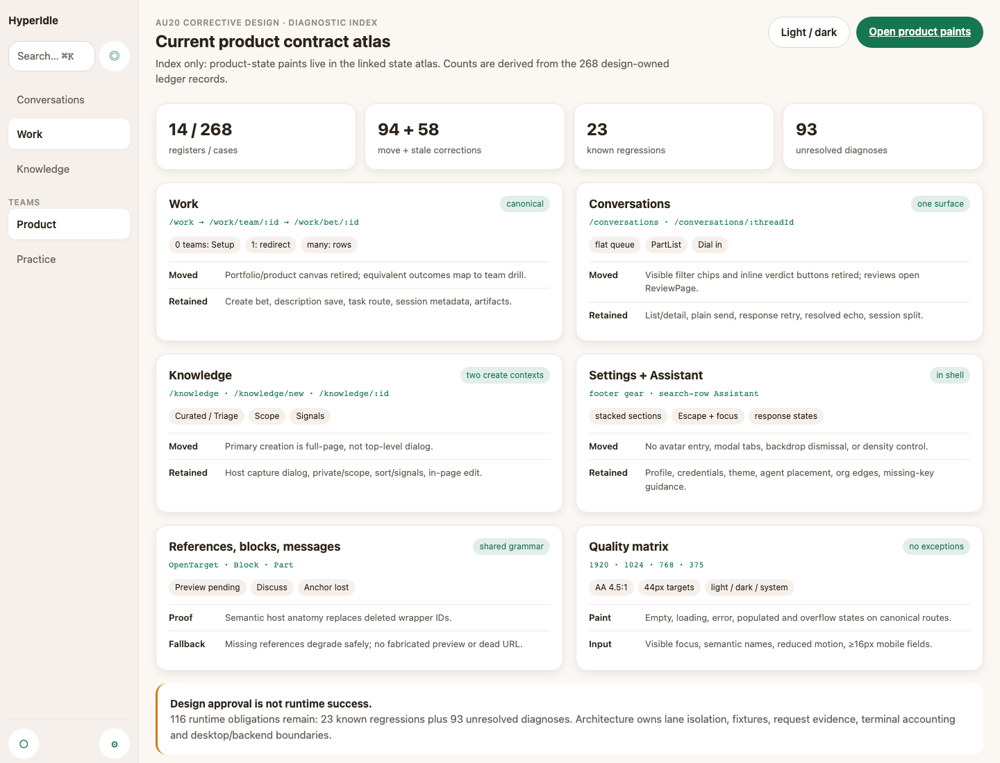
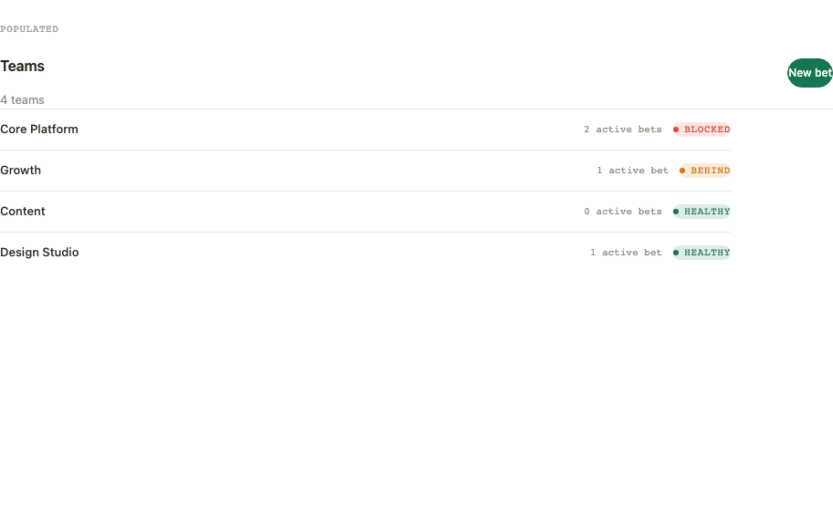
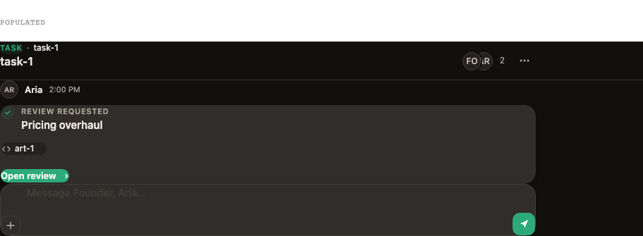
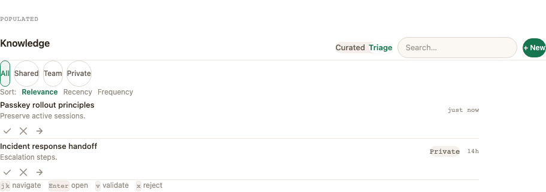
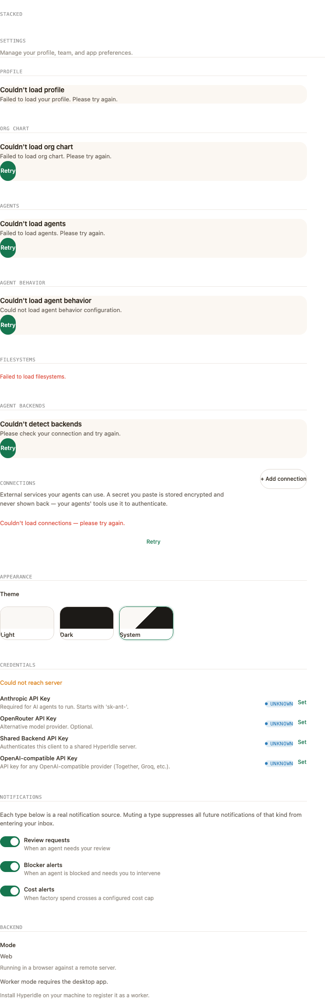
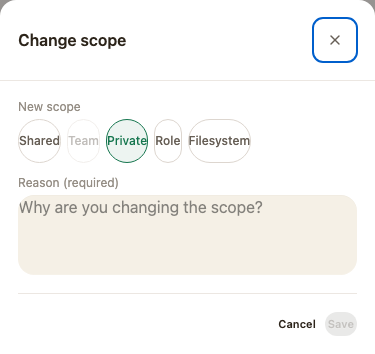
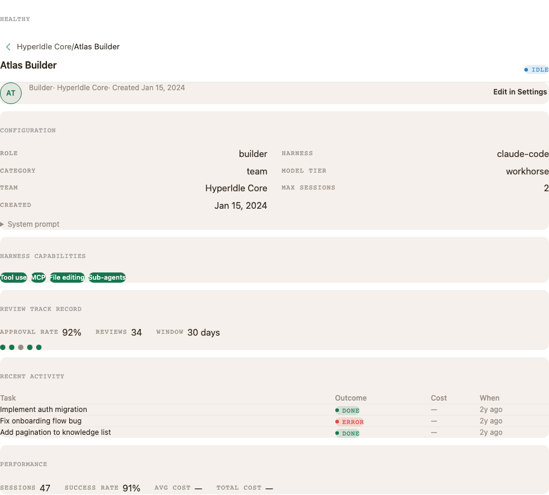

# Comparison

Routine recovery has one conforming variant. Rejected directions were considered but not regenerated.

| Dimension | Current-contract recovery atlas |
|---|---|
| Signature | finite register→contract→painted-state map |
| Component count | 0 new; current DS/application components only |
| Density | existing per-zone density; no density mode |
| Primary action surface | current canonical page/overlay owner |
| State strategy | representative state matrix per retained surface |
| Motion budget | existing fast/default tokens; reduced-motion honored |
| Best at | recovering trustworthy tests without redesign |
| Worst at | visual novelty (deliberately out of scope) |
| Phase-2 critique score | 8.8/10 after corrective state-atlas revision |

### In-session critique

Hierarchy 9 · spacing/density 9 · typography 9 · color 9 · coherence 9 · states 9 · accessibility 9 · anti-slop 9 · premium finish 8. The diagnostic screenshot remains navigation only. Twenty-six canonical TSX renders cover mutually exclusive states, light/dark, 1920/1440/1024/768/375, ReviewPage, dialogs, desktop, agents and shared primitives. Exact provenance, observed drift, and remaining runtime-only proof live in `current-contract/state-atlas.md`.

