# As-Implemented Domain Architecture

Code-derived domain, component, and interface map. Each diagram shows domain ownership and the interfaces between domains; the component inventory below the diagrams is verified against `packages/` file-by-file.

## L0 - Domain Map

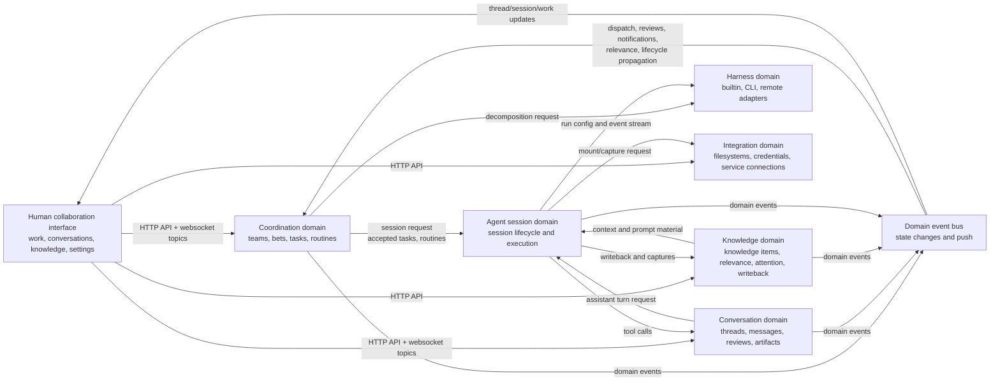

## L1 - Bounded Contexts And Public Interfaces

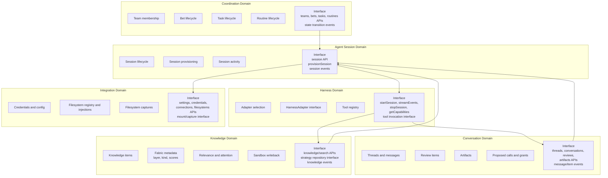

## L1 - Core Interface Contracts

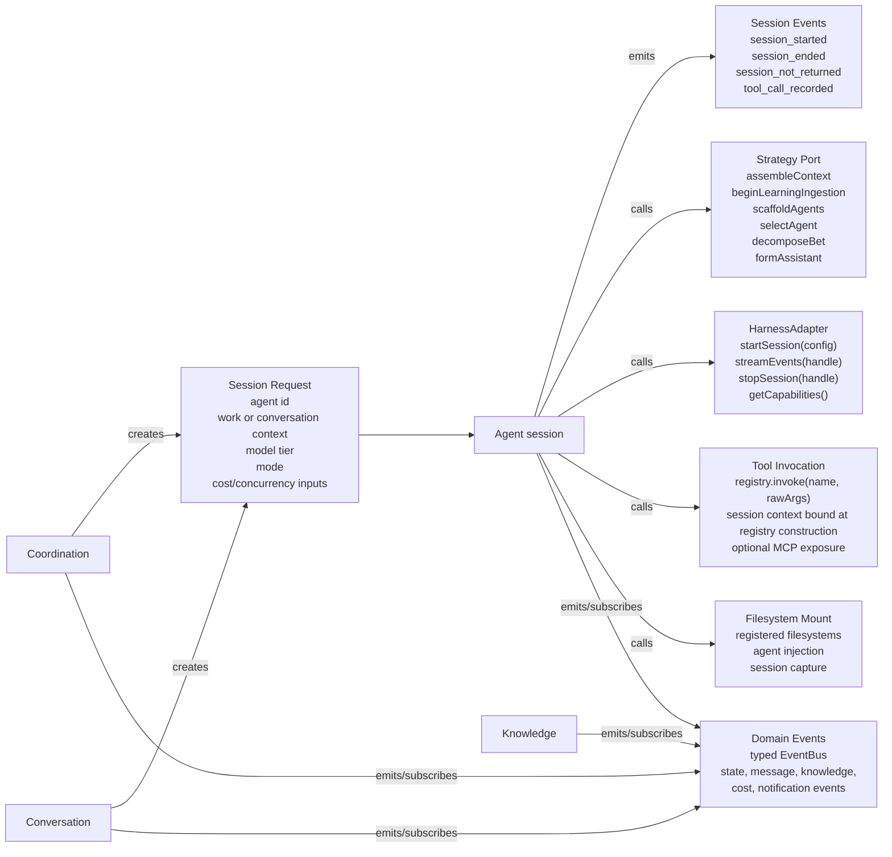

Contract anchors:

- `HarnessAdapter` = startSession/streamEvents/stopSession/getCapabilities — `packages/shared/src/harness/harness-adapter.ts:270`. `startSession(config: SessionConfig)`; SessionConfig carries sessionId, sandboxPath, assembledPrompt, modelTier, resolvedModel, MCP bridge info, thread messages, return hook, session workflow.
- Strategy port = assembleContext/beginLearningIngestion/scaffoldAgents/selectAgent/decomposeBet/formAssistant — `packages/shared/src/strategy-port.ts:378`. Two implementations ship: `packages/fabric` (FabricStrategy) and `packages/strategy-minimal`. Boundary rationale: [Kernel/Strategy split](./kernel-strategy-split.md).
- Tool invocation = `registry.invoke(name, rawArgs)` — `packages/server/src/tools/tool-registry.ts:584`; per-session context is bound when `buildToolRegistry` constructs the registry, not passed per call.
- Session events verified in `packages/shared/src/events.ts` (session_started :34, session_ended :51, session_not_returned :72, tool_call_recorded :207).

## L2 - Coordination Domain

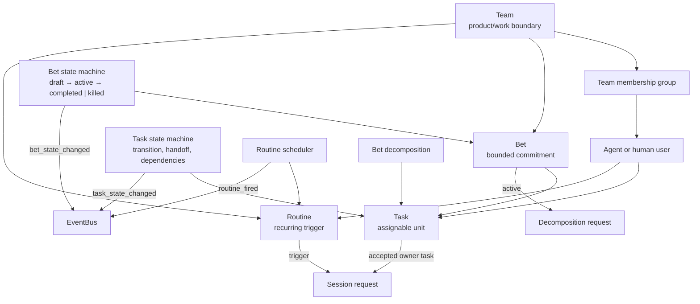

Bet lifecycle endpoints: `POST /api/bets/:id/commit` (`routes/bets.ts:739`), `/:id/ship` (:802), `/:id/kill` (:823), `/:id/outcome` (:860). Task handoff: `POST /api/tasks/:id/handoff` (`routes/tasks.ts:224`) via the handoff protocol. Lifecycle semantics live in [process-layer](../process-layer/bets-shape-commit-change-ship.md).

## L2 - Conversation Domain

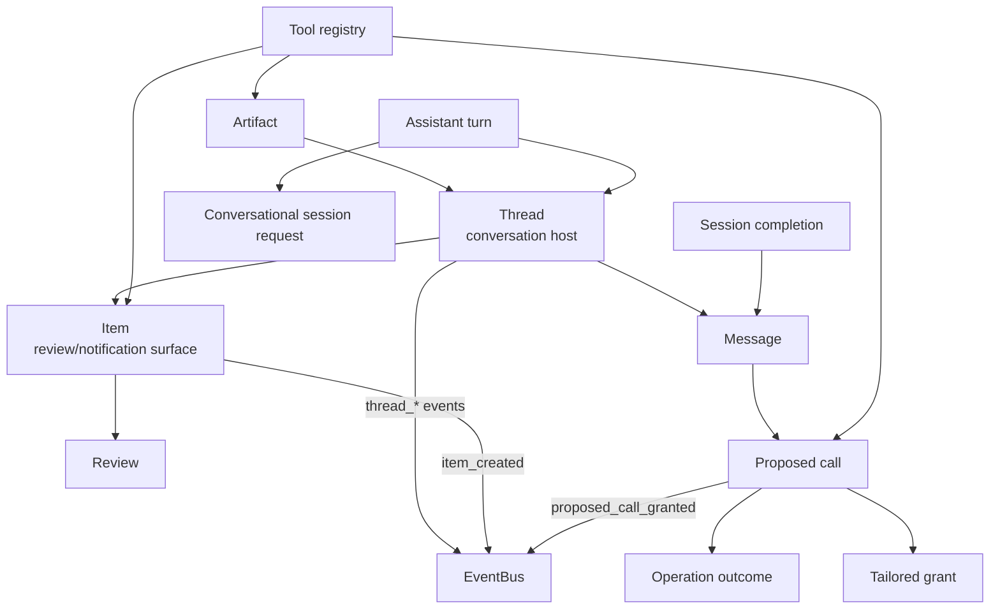

Thread/Message primitive (HOST_KINDS, MESSAGE_TYPES, verdict grammar, idempotency) is owned by the [Thread primitive](../human-interface-layer/thread-primitive.md). Proposed calls / staged operations: [staged operation](../process-layer/staged-operation.md). Artifact contract and embed shapes: [Artifact primitive](../process-layer/artifact-primitive.md).

## L2 - Knowledge Domain

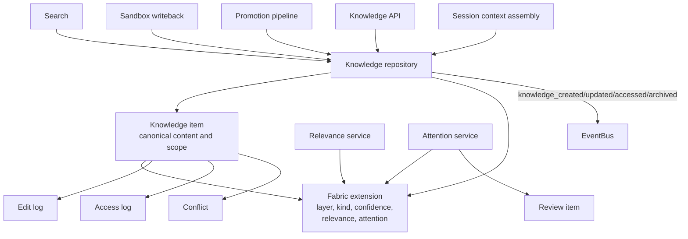

Fabric internals (layer taxonomy, assembly, sync, scoring) are owned by [knowledge-architecture](../knowledge-architecture/index.md). Component-level summary: the fabric projects the canonical store into a human-facing API and per-session agent sandboxes — `assembleContext` writes the sandbox zones `context/` (read-only 0o444), `knowledge/`, `work/` with a version manifest (`packages/fabric/src/context-assembly.ts`); a file watcher plus writeback with optimistic concurrency (`version` column, `knowledge_conflicts` table) carries agent edits back (`packages/fabric/src/file-watcher.ts`, `writeback.ts`); relevance and attention scoring filter what each session loads (`relevance-service.ts`, `attention-service.ts`).

## L2 - Agent Session Domain

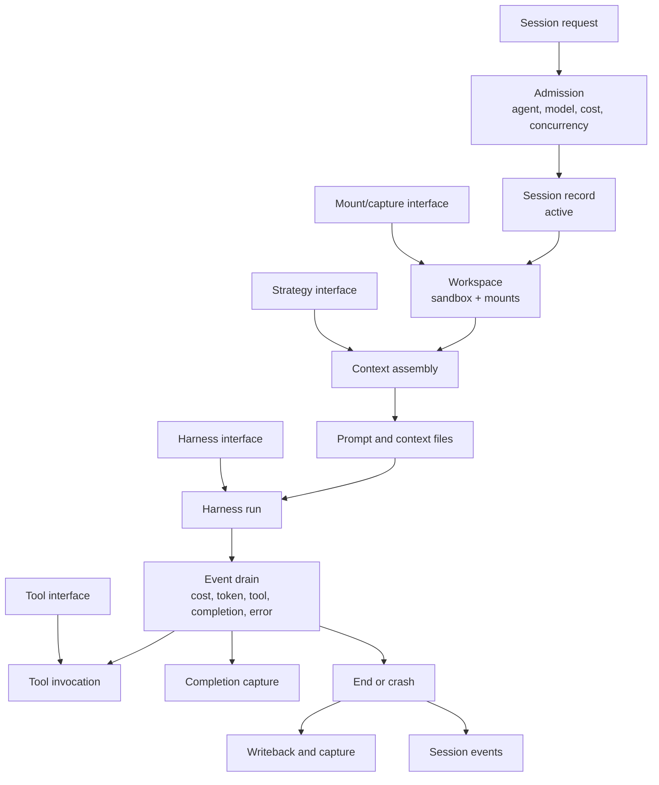

`provisionSession` (`packages/server/src/services/session-provisioning.ts`) runs admission (adapter selection, concurrency, cost cap at :622-694), spawns the sandbox, applies filesystem mounts (Phase 4.5, :237) before context assembly, then drains harness events. The run unit itself — per-session host working directory, no isolation boundary — is owned by the [run-unit model](./run-unit-model.md).

## L2 - Harness Domain

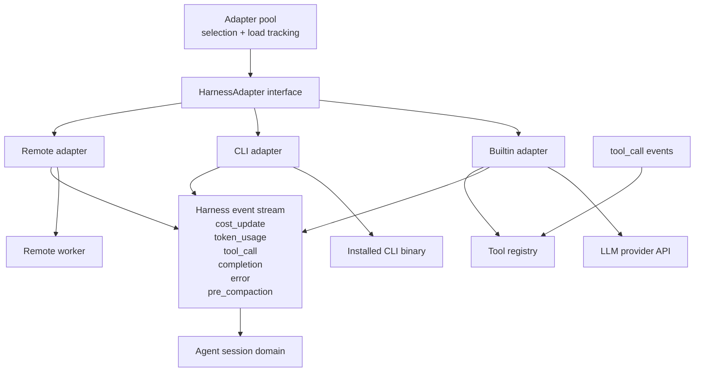

Harness event types match `packages/shared/src/harness/harness-events.ts:6-57` exactly (token_usage, tool_call, completion, error, cost_update, pre_compaction). The pool does least-loaded selection with load tracking (`packages/server/src/harness/adapter-pool.ts:187-235`). Event-normalization mechanism, capability descriptor shape, discovery/session probes, and the MCP bridge are owned by the [harness capability descriptor](../agent-layer/harness-capability-descriptor.md).

## L2 - Strategy/Fabric Domain

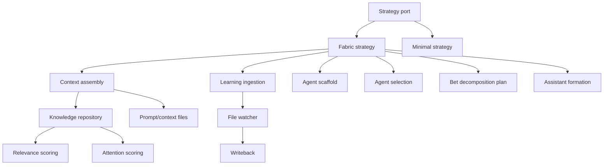

## L2 - Integration Domain

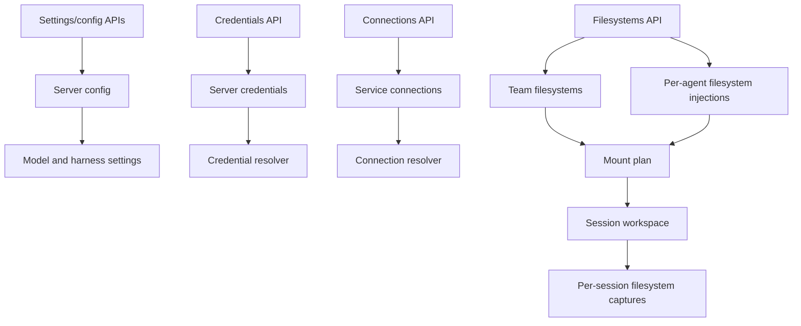

Tables in `packages/db/src/schema.ts`: filesystems (:871), filesystem_injections (:919), filesystem_captures (:951), server_credentials (:988), server_config (:1009), service_connections (:1313). Held/inherited Connection semantics: [connection model](./connection-model.md). Encryption: [credential model](./credential-model.md).

## L2 - Event Interface

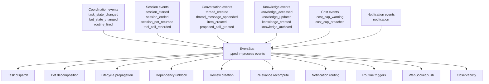

**Guarantees** (one line — the contract lives in the `packages/shared/src/event-bus.ts` docblock): in-process typed pub/sub, synchronous delivery, per-stream ordering, at-least-once when `emit()` is called after database write durability; one throwing handler does not abort delivery to the rest.

## L3 - Current Agent Invocation Paths

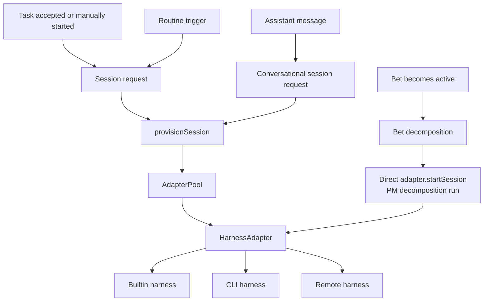

Two agent-run entry paths exist: `provisionSession` (tasks, routines, assistant turns — `session-provisioning.ts`, `assistant-turn.ts:55`) and `runBetDecomposition` branch 3, which calls `adapter.startSession` directly for the PM decomposition run (`bet-decomposition.ts:634`).

## Component Inventory

Verified against code 2026-07-07. Component-level facts only; primitive semantics live in their owning docs.

### Primitive store

Embedded Postgres: PGlite (laptop/test) or postgres-js (VPS/cloud), one unified Drizzle type (`packages/db/src/connection.ts`). Tables (all shapes owned by `packages/db/src/schema.ts`): teams, team_members, users (humans and agents, `kind` human|ai), bets, tasks, sessions, routines, routine_runs, threads, messages, items, user_skills, org_edges (:548), factory_settings, knowledge_items (:580) + knowledge_strategy_fabric extension (:690, the [kernel/strategy split](./kernel-strategy-split.md)) + knowledge_edit_log (:609) + knowledge_access_log (:641) + knowledge_conflicts (:659), propagation_log (:808), notification_queue, artifacts, filesystems (+injections/captures), credential/config/login/invite/proposed-call tables.

- The `responses` table is dropped — verdicts are `verdict`-typed messages ([Thread primitive](../human-interface-layer/thread-primitive.md)).
- Message idempotency: UNIQUE(threadId, senderId, clientKey).
- Sessions carry no cost columns — spend accrues on users/teamMembers ([the five primitives](../process-layer/the-five-primitives.md)).
- `org_edges` records org relationships per (fromUserId, mechanism, target); `propagation_log` records lifecycle-propagation applications by source level/id and status; `knowledge_access_log` records per-item knowledge reads.

### Item router

Pure function `routeItem` at `packages/fabric/src/services/item-router.ts` returning a target view; `routeToFounder` at `founder-router.ts` picks the recipient by agent role. Item shape and routing rules are owned by [items and routing](../human-interface-layer/items-and-routing.md). Notification policy is not the router's output — it lives in the notification services (`silence-policy.ts`, `notifications/dispatcher.ts`).

### Schedulers

In-process `setInterval` services, no external workflow engine. Routine scheduler (`packages/fabric/src/services/routine-scheduler.ts`) fires cron/event/heartbeat triggers, honors silent routines; task dispatcher (`fabric/src/services/task-dispatcher.ts`) starts sessions; dependency watcher (`packages/server/src/services/dependency-watcher.ts`) emits `dependency_met`. The scheduler never calls models — it reads the store and emits events.

Model tier selection: explicit param → agent `modelTierPreference` → `"workhorse"` (`session-provisioning.ts:663-673`); tier→model resolution via the model gateway. Vocabulary and catalog: [model routing and cost](../agent-layer/model-routing-and-cost.md).

### Cost sentinel

Application code, not a routine row — extracted in AD8c and registered by the server app-runtime bootstrap precisely so it cannot be disabled from data (`packages/server/src/app-runtime/services/cost-sentinel.ts`). 15-minute tick, level-based dedupe via factory_settings key `cost_sentinel_last_level`; emits `cost_cap_warning` / `cost_cap_breached`. Cap grammar and hierarchy: [WIP and cost limits](../process-layer/wip-and-cost-limits.md).

### Knowledge fabric

See the L2 Knowledge Domain paragraph above; full design in [knowledge-architecture](../knowledge-architecture/index.md). Fabric exports: `assembleContext`, `writeback`, `promote`, `scoreAttention`, `resolveConflict` (`packages/fabric/src/index.ts`). Search is escaped case-insensitive LIKE SQL (`routes/search.ts`) — no FTS5, no pgvector.

### API layer

Hono on Node, all routes under `/api` (`packages/server/src/app.ts`), single process hosting API + app-owned schedulers (`bootstrapAppRuntime` wired in `server-factory.ts`). Route groups: auth, users, agents, teams, team-members, bets (incl. `/:id/commit|ship|kill|outcome`), tasks (incl. `/:id/handoff`), sessions, reviews, artifacts, filesystems, knowledge (URL shape `/:id`, not `/:layer`), conversations, threads, org, recipients, status (incl. `/digest`), workers, harnesses, git-export, credentials, connections, hint-progress, dispatch-queue, search, settings, ws.

Auth: single `HYPERIDLE_API_KEY` via `X-API-Key` header (constant-time compare) + Bearer login-session tokens + invite codes (`middleware/auth.ts`, `services/login-session.ts`). Boundary enforcement: [authorization model](./authorization-model.md).

### Harness adapters

Interface in `packages/shared/src/harness/harness-adapter.ts`; implementations in `packages/server/src/harness/`: builtin (gateway/direct-key runtime — anthropic/openrouter/openai-compatible, `builtin-harness-adapter.ts`), CLI (codex, claude-code, opencode — `cli-harness-adapter.ts`), remote worker (`remote-harness-adapter.ts`). Autodiscovery covers codex, claude-code, cursor-agent, opencode (`harness-discovery.ts`). Descriptor, probes, MCP bridge, pre-compaction contract: [harness capability descriptor](../agent-layer/harness-capability-descriptor.md).

### Sandbox (run unit)

Per-session working directory under `HYPERIDLE_WORKSPACES_DIR` (`server-factory.ts:266-268`); the harness runs as a host child process with the user's environment inherited — no isolation boundary (AQ1). `SandboxAdapter` = `spawn(baseDir)` / `exec` / `destroy` (`harness/sandbox-adapter.ts:19-23`). `LocalSandboxAdapter` is the default; `DisabledSandboxAdapter` refuses agent provisioning on non-laptop server profiles. Opt-in isolation is planned (AQ2). Full model: [run-unit model](./run-unit-model.md).

### Notifications

`packages/fabric/src/services/notifications/`: ntfy, SMTP, and console adapters behind `adapter-factory.ts`; the dispatcher owns policy, mute, drain, redaction, and runs the daily digest on its own timer (`dispatcher.ts` → `runDailyDigest`) — not via a routine. Primitive semantics and cadence discipline: [notification primitive](../human-interface-layer/notification-primitive.md).

### Observability

Channels `"console"` | `"noop"` (`packages/server/src/services/observability/types.ts:4`); OpenTelemetry explicitly future (`config.ts:25,110-113`); event shapes in `packages/shared/src/observability/events.ts`.

## MCP Tool Surface

Agents interact with the process layer through MCP tools served in-process (`packages/server/src/mcp/mcp-bridge.ts` + `tools/tool-registry.ts`), calling services directly — not HTTP wrappers. Tools include: read_inbox, send_message, log_task, query_practice, write_memory, handoff_to, create_item, write_session_notes, plus create-bet/task/team/routine, promote-knowledge, score-attention, route-item, submit-review, commit-file, return-status (`packages/server/src/tools/`).

The same nouns have real HTTP surfaces for clients: `/api/users/:id/inbox` (GET/POST, principal-self scoped), `POST /api/tasks/:id/handoff`, `/api/knowledge` (`/search`, `/`, `/triage-count`, `/:id`).

## Session Flow

Triggers: routine fired, dependency cleared, or an inbox/assistant message. Then:

1. Model tier resolved (explicit param → agent preference → workhorse), model via gateway.
2. Context assembly (fabric, TOON pack) writes prompt + context files.
3. `LocalSandboxAdapter` provisions the per-session working directory; filesystem mounts applied.
4. Harness spawned; agent works via MCP tools.
5. Session notes written before context compaction (`tools/write-session-notes.ts`; fallback notes file `work/task-notes.md`).
6. Stop → `SessionResult` persisted, writeback + capture, `session_ended` emitted (`services/session-lifecycle.ts`).

## Item Routing Pipeline

Verified end-to-end: `create_item` tool → `items` row → `item_created` event → item-router/founder-router pick target view + recipient → notification dispatcher fires if push-worthy (ntfy) → WebSocket push → UI renders in the target view.

## WebSocket Push Contract

One client endpoint, topic-based:

- `GET /api/ws?token=<one-shot token>`; the token is minted by authenticated `POST /api/auth/ws-token` (`routes/ws.ts:77-99`, `routes/auth.ts`). Connection acks `{type:"connected"}`.
- Client sends `{type:"subscribe"|"unsubscribe", topic}`; server acks `{type:"subscribed"|"unsubscribed"|"forbidden", topic}`.
- Topics: `conversations`, `work`, `thread:<threadId>`, `session:<sessionId>` (session topics are read-only observe mode, open to any authenticated client).
- Payloads are serialized EventBus event objects per topic (`services/ws-broadcaster.ts`) — not REST-shaped responses.
- Subscribe authorization for per-thread topics goes through `canSubscribe` — see the [authorization model](./authorization-model.md).

A separate worker channel `GET /ws/worker?token=<HYPERIDLE_WORKER_TOKEN>` (`routes/worker-ws.ts`) carries Zod-validated register/event/session_result/error/pause/resume messages for remote harness workers.

Web client: singleton `packages/web/src/services/ws-client.ts` — lazy connect on first subscriber, auto-reconnect with 1s→15s backoff.
