# As-Implemented Domain Architecture

Code-derived domain, component, and interface map. Each diagram shows domain ownership and the interfaces between domains; the component inventory below the diagrams is verified against the source tree file-by-file.

## L0 - Domain Map

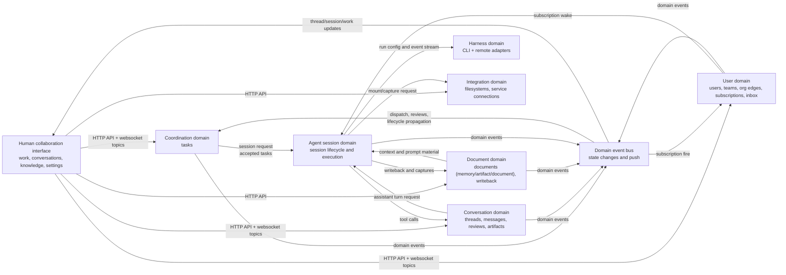

## L1 - Bounded Contexts And Public Interfaces

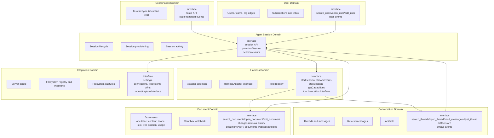

## L1 - Core Interface Contracts

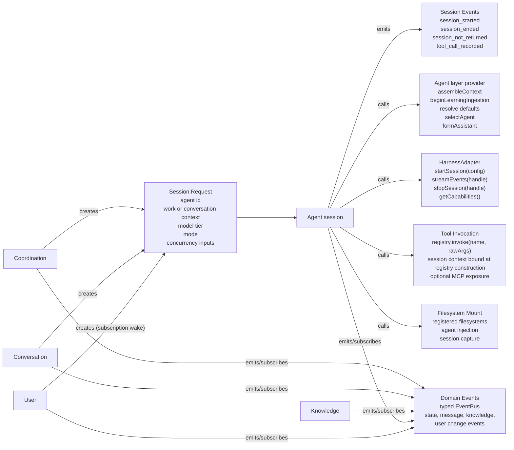

Contract anchors:

- `HarnessAdapter` = startSession/streamEvents/stopSession/getCapabilities — `framework/harness-protocol/src/harness/harness-adapter.ts:270`. `startSession(config: SessionConfig)`; SessionConfig carries sessionId, sandboxPath, assembledPrompt, modelTier, resolvedModel, MCP bridge info, thread messages, return hook, session workflow.
- Agent layer provider = assembleContext/beginLearningIngestion/resolve defaults/selectAgent/formAssistant. Production ownership lives in `layers/agent-orchestration/`'s Services.
- Tool invocation = `registry.invoke(name, rawArgs)` — `layers/agent-execution/harness-registry/src/tool-registry.ts`; per-session context is bound when `buildToolRegistry` constructs the registry, not passed per call.
- Session events verified in `framework/domain-model/src/events.ts` (session_started :34, session_ended :51, session_not_returned :72, tool_call_recorded :207).

## L2 - Coordination Domain

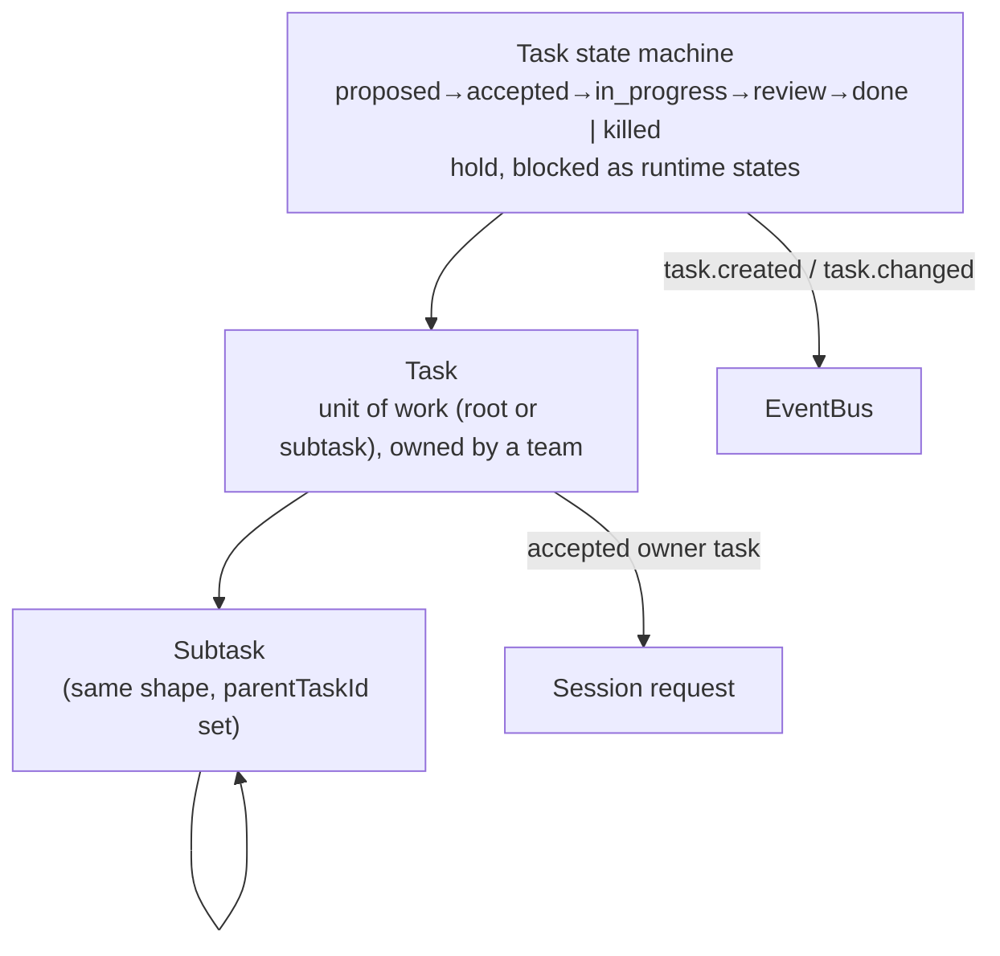

Task actions, `POST /api/actions/<name>`: `search_tasks`, `open_task` (returns the task, its ancestors, and its full subtree), `edit_task` (create when `id` is omitted, otherwise edit — same door for humans and agents, no gate; `state: "killed"` cascades to the whole subtree; setting `ownerAgentId` to another user is a handoff). Lifecycle semantics: [tasks-and-sessions](../process-layer/tasks-and-sessions.md).

## L2 - User Domain

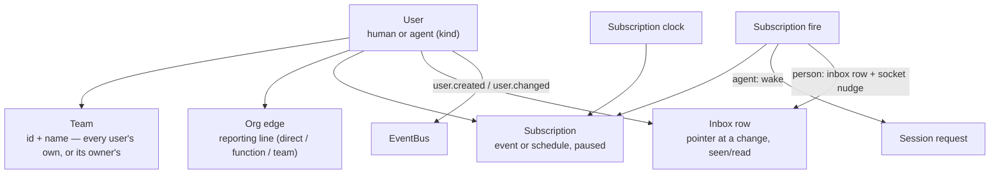

User actions, `POST /api/actions/<name>`: `search_users`, `open_user` (returns identity, team, run config, folders, connections, subscriptions, and — for the caller's own row — the inbox), `edit_user` (create when `id` is omitted; the one door for a person's profile and an agent's identity, harness, folders, connections, subscriptions, and inbox marks alike — same door for humans and agents, no gate). Firing, reach, and the retro loop: [subscriptions-and-retros](../process-layer/subscriptions-and-retros.md).

## L2 - Conversation Domain

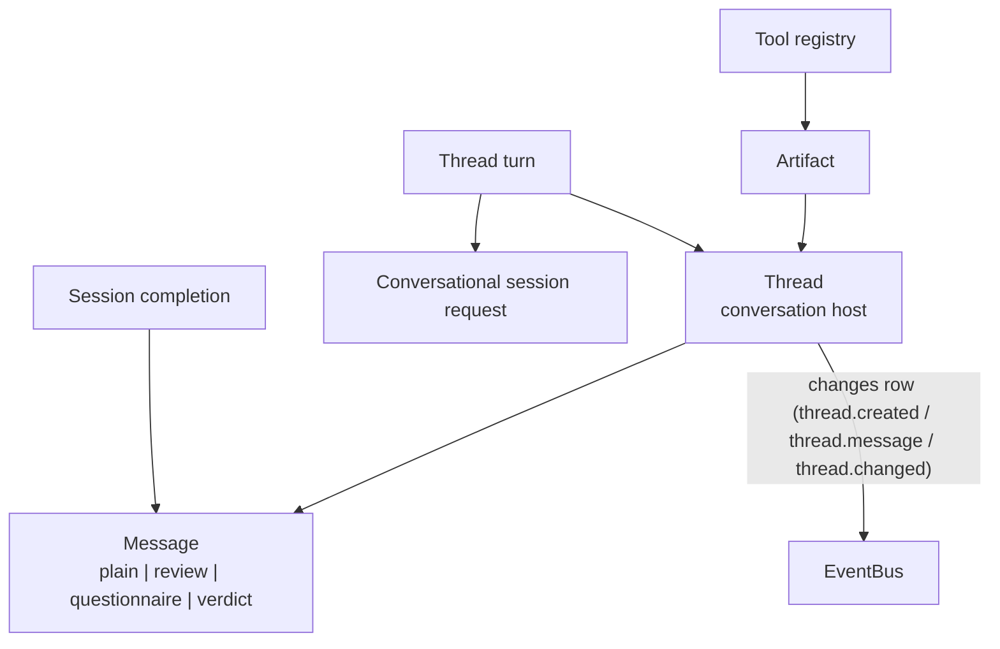

Thread/Message primitive (HOST_KINDS, MESSAGE_TYPES, verdict grammar, idempotency) is owned by the [Thread primitive](../human-interface-layer/thread-primitive.md). Artifact contract and embed shapes: [Artifact primitive](../process-layer/artifact-primitive.md).

## L2 - Document Domain

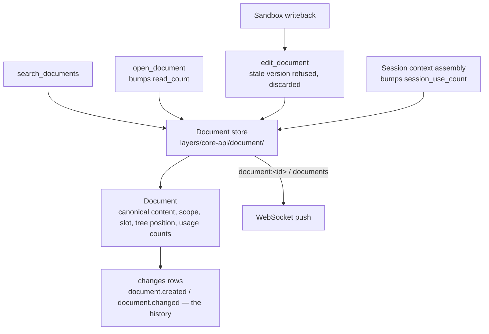

Document runtime internals (assembly, sync, tree invariants) are owned by [knowledge-architecture](../knowledge-architecture/index.md). Component-level summary: `agent-orchestration`'s writeback (`layers/agent-orchestration/run-orchestration/src/writeback-processor.ts`) calls `edit_document` as the session's own agent, using optimistic concurrency (`version` column) — a stale write is refused and discarded, there is no conflict table. There is no repository, relevance service, attention service, or promotion pipeline; `layers/core-api/document/` is the one module, and every create/edit is one `changes` row.

## L2 - Agent Session Domain

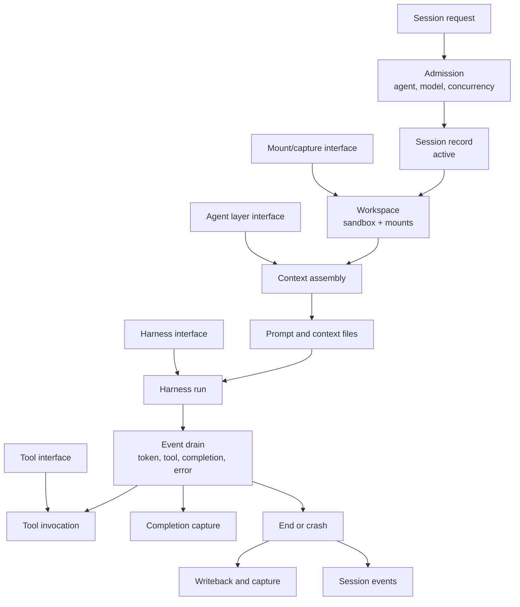

The provisioner (`layers/agent-orchestration/run-orchestration/src/provisioner.ts`) runs admission (adapter selection, concurrency), spawns the sandbox, applies filesystem mounts before context assembly, then drains harness events. The run unit itself — per-session host working directory, no isolation boundary — is owned by the [run-unit model](./run-unit-model.md).

## L2 - Harness Domain

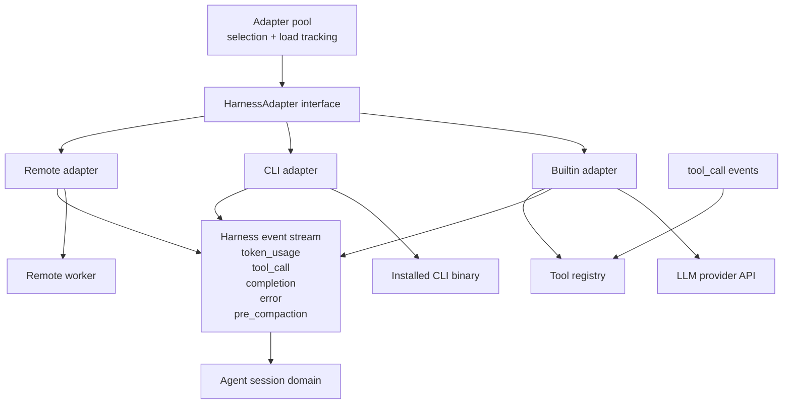

Harness event types match `framework/harness-protocol/src/harness/harness-events.ts` exactly (token_usage, tool_call, completion, error, pre_compaction). `cost_update` was removed — harness telemetry was narrowed to token usage only (founder ruling: "very few harness can actually report cost"; see `layers/agent-execution/harness-registry/src/__testing__/llm-cassette.ts`). The pool does least-loaded selection with load tracking (`layers/agent-execution/harness-registry/src/adapter-pool.ts`). Event-normalization mechanism, capability descriptor shape, discovery/session probes, and the MCP bridge are owned by the [harness capability descriptor](../agent-layer/harness-capability-descriptor.md).

## L2 - Document And Agent Services

Context assembly and learning ingestion belong to `agent-orchestration`; the document module belongs to `core-api` (`layers/core-api/document/`). See [runtime-simplification](./runtime-simplification.md).

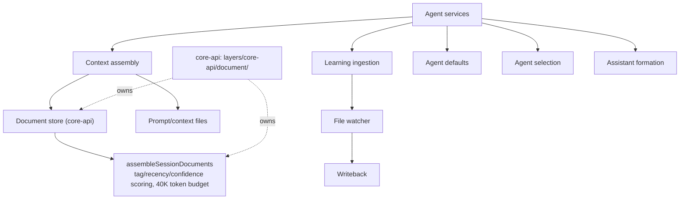

## L2 - Integration Domain

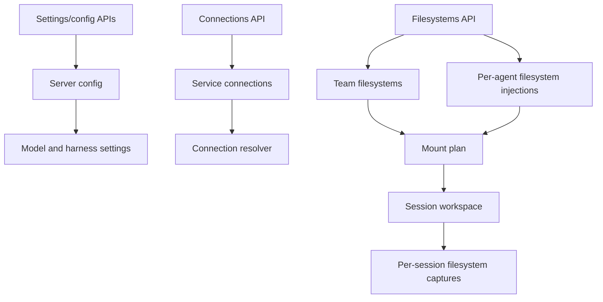

Tables in `framework/db/src/schema.ts`: filesystems, filesystem_injections, filesystem_captures, server_config, service_connections (:1387). Held/inherited Connection semantics and its encryption: [connection model](./connection-model.md).

## L2 - Event Interface

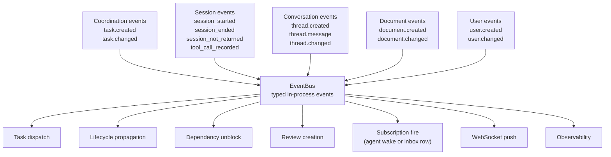

All nine members of `EventByType` — `task.created`/`task.changed`/`thread.created`/`thread.message`/
`thread.changed`/`document.created`/`document.changed`/`user.created`/`user.changed` — are one shape,
`ObjectChangeEvent`, built from the `changes` row the emitting module just appended. The document
websocket push (`document:<id>`/`documents`) is a separate direct push from the same row, not routed
through the bus.

**Guarantees** (one line — the contract lives in the `framework/event-bus/src/event-bus.ts` docblock): in-process typed pub/sub, synchronous delivery, per-stream ordering, at-least-once when `emit()` is called after database write durability; one throwing handler does not abort delivery to the rest.

## L3 - Current Agent Invocation Paths

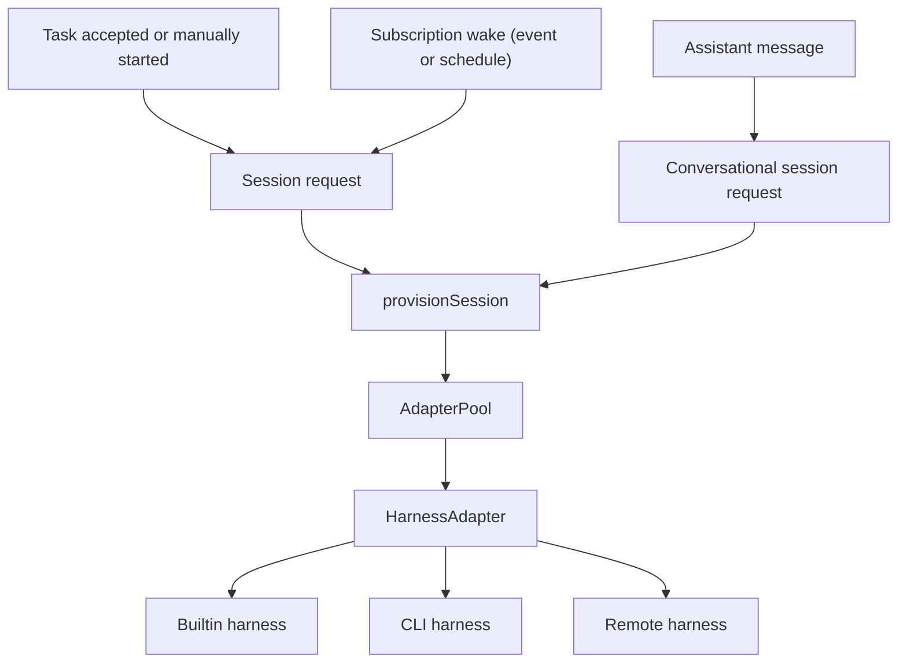

All agent-run entry families persist a durable work intent. `core-api` bakes everything the run needs onto the emitted request; `agent-orchestration` claims it, formats it and dispatches. Thread-turn preparation (a mention or a direct-thread reply waking an agent) lives in `layers/core-api/thread/src/thread-turn-resolver.ts`.

## Component Inventory

Verified against code 2026-08-06. Component-level facts only; primitive semantics live in their owning docs.

### Primitive store

Embedded Postgres: PGlite (laptop/test) or postgres-js (VPS/cloud), one unified Drizzle type (`framework/db/src/connection.ts`). All shapes owned by `framework/db/src/schema.ts`: teams (id + name only), users (humans and agents, `kind` human|ai; team membership is `users.teamId`, or an owned agent's owner's), subscriptions, inbox, tasks (recursive — `parent_task_id` nullable self-FK; replaces the former `bets` + `tasks` two-table design), sessions, threads, messages, org_edges, `documents` (one table: content, scope, slot, tree position, `confidence`/`meta`, and four usage columns — `read_count`/`last_read_at`/`session_use_count`/`last_used_at`), artifacts, filesystems (+injections/captures), agent-run tables (agent_session_requests, agent_work_intents, explicit_session_starts, agent_run_config, …), config/login/invite/proposed-call tables.

- The `responses` table is dropped — verdicts are `verdict`-typed messages ([Thread primitive](../human-interface-layer/thread-primitive.md)).
- There is no `items` table. A review, a question, an escalation are messages on a thread.
- Message idempotency: UNIQUE(threadId, senderId, clientKey).
- Sessions carry no cost columns. The cost feature was deleted with no replacement; the spend ceiling lives at the upstream LLM provider account ([WIP limits](../process-layer/wip-and-cost-limits.md)).
- `org_edges` records org relationships per (fromUserId, mechanism, target). There is no separate access-log table for documents — a read is counted directly on the row (`read_count`/`last_read_at`), and every create/edit is one `changes` row (`object='document'`).

### Item routing

There is no `items` table and no item router. Review recipients are resolved through `org_edges` (`(fromUserId, mechanism, target)`), read via `open_user`/`search_users`.

### Schedulers

In-process `setInterval` services, no external workflow engine. The subscription clock (`layers/core-api/user/src/subscription-clock.ts`) fires due schedule subscriptions and advances their `nextRunAt`; subscription fire (`layers/core-api/user/src/subscription-fire.ts`) wakes event subscriptions off the same nine change events every object module emits; dispatch lives in `layers/agent-orchestration/dispatch/`; `checkAndUnblockDependents` (`layers/core-api/work/src/dependency-watcher.ts`) moves dependent tasks off hold. Neither scheduler calls models — both read the store and emit events or wakes.

A session runs the model its agent was configured with — `agent_run_config.model_id` reaches the harness as `SessionConfig.selectedModel`. There is no gateway and no tier→model resolution; the tier is a cost-reporting label only. Vocabulary: [model routing and cost](../agent-layer/model-routing-and-cost.md).

### Document Services

See the L2 Document Domain paragraph above; full design in [knowledge-architecture](../knowledge-architecture/index.md). Context assembly and writeback belong to `layers/agent-orchestration/run-orchestration/`; the document store and the three document actions belong to `layers/core-api/document/`. Search is case-insensitive `ILIKE` over title and body (`document-store.ts`) — no FTS5, no pgvector.

### API layer

Hono on Node. `core-api` mounts its routes under `/api` (`layers/core-api/src/app.ts`); each Layer hosts its own app, and an Application composes them (`applications/remote-server/src/create-server.ts`, `applications/desktop/src/main.ts`). Schedulers start from `layers/core-api/src/service-bootstrap.ts`. `core-api`'s own route groups are down to four: `auth`, `health`, `search`, and `actions` — one router over the composed action list (`search_tasks`/`open_task`/`edit_task`/`search_threads`/`open_thread`/`send_message`/`adjust_thread`/`search_documents`/`open_document`/`edit_document`/`search_users`/`open_user`/`edit_user`/`search_plugins`/`edit_plugin`). There is no separate `users`/`agents`/`teams`/`team-members`/`org`/`recipients`/`harnesses`/`settings-agent-behavior`/`notifications` route family any more — every one of those nouns is now `search_users`/`open_user`/`edit_user` under `POST /api/actions/<name>`, mounted generically. Agent-orchestration mounts its own `/actions` the same way, with `search_sessions`/`watch_session`/`stop_session`, plus `/filesystems` (plumbing: `POST /inspect-path` only) — both Layer apps mount at `/` on the one `/api` router, so `POST /api/actions/<name>` resolves to whichever Layer owns that action. The two Layers' action lists are joined once, at each Application's `createServer`, into the one list an agent reaches over MCP. `/api/connections` and the core-hosted `/api/agents/:id/injections` route are both deleted — connections and folders are user attributes now, behind `open_user`/`edit_user`.

Auth: single `HYPERIDLE_API_KEY` via `X-API-Key` header (constant-time compare) + Bearer login-session tokens + invite codes (`layers/core-api/src/middleware/auth.ts`, `layers/core-api/users/src/login-session.ts`). Boundary enforcement: [authorization model](./authorization-model.md).

### Harness adapters

Interface in `framework/harness-protocol/src/harness/harness-adapter.ts`; implementations in `layers/agent-execution/harness-registry/src/`: CLI (codex, claude-code, opencode, cursor-agent — `cli-harness-adapter.ts`) and remote worker (`remote-harness-adapter.ts`). Autodiscovery covers the same four CLIs (`harness-discovery.ts`). A built-in in-process adapter used to sit alongside these, calling a provider API directly; it is gone, and with it the model gateway that fed it. Descriptor, probes, MCP bridge, pre-compaction contract: [harness capability descriptor](../agent-layer/harness-capability-descriptor.md).

### Sandbox (run unit)

Per-session working directory under `HYPERIDLE_WORKSPACES_DIR`; the harness runs as a host child process with the user's environment inherited — no isolation boundary (AQ1). `SandboxAdapter` = `spawn(baseDir)` / `exec` / `destroy` (`layers/agent-execution/harness-registry/src/sandbox-adapter.ts`). `LocalSandboxAdapter` is the default; `DisabledSandboxAdapter` refuses agent provisioning on non-laptop server profiles. Opt-in isolation is planned (AQ2). Full model: [run-unit model](./run-unit-model.md).

### Notifications

There is no notifications package and no egress adapter — `layers/core-api/notifications/` is deleted. A person's inbox is `inbox` rows, owned by `layers/core-api/user/`, filled by subscription fire (above) and pushed live over the `user:<id>` websocket topic. Primitive semantics: [notification primitive](../human-interface-layer/notification-primitive.md).

### Observability

Channels `"console"` | `"noop"` (`framework/diagnostics/src/observability/types.ts:4`); OpenTelemetry explicitly future. Event shapes in `framework/diagnostics/src/observability/events.ts`; the runtime wiring in `layers/core-api/src/observability-runtime.ts`.

## MCP Tool Surface

Agents interact with the process layer through MCP tools served in-process (`layers/agent-execution/harness-registry/src/mcp/mcp-bridge.ts` + `tool-registry.ts`). There are no hand-declared tools any more — `create_team`/`add_agent`/`create_routine`/`update_routine` and the `CoreApiPort` seam behind them are all deleted. Every tool is projected straight from the composed action list (`layers/core-api/src/actions/actions-as-tools.ts`) — `search_tasks`, `open_task`, `edit_task` (ungated — same door for humans and agents; setting `ownerAgentId` is a handoff), `search_threads`, `open_thread`, `send_message`, `adjust_thread`, `search_documents`, `open_document`, `edit_document`, and `search_users`, `open_user`, `edit_user`. There is no `write_memory`, `create_artifact`, or knowledge-sweep/scoring/conflict/merge/split tool any more — a memory or an artifact is `edit_document` called with `as: "memory"` / `as: "artifact"`.

The same nouns have one real HTTP surface for clients: `POST /api/actions/<name>` for tasks, threads, documents, and users alike — there is no separate `/api/knowledge` route and no per-noun REST family. A person's own inbox is `open_user({}).inbox`; marking it read or seen is `edit_user({ id: me, inbox })`.

## Session Flow

Triggers: a subscription wake (event or schedule), dependency cleared, or an inbox/assistant message. Then:

1. The agent's own model (`model_id`) becomes `SessionConfig.selectedModel`; the tier is a cost-reporting label, resolved as explicit param → `workhorse`.
2. Context assembly writes TOON prompt + context files.
3. `LocalSandboxAdapter` provisions the per-session working directory; filesystem mounts applied.
4. Harness spawned; agent works via MCP tools.
5. Session notes written before context compaction (the `write_session_notes` tool; fallback notes file `work/task-notes.md`).
6. Stop → `SessionResult` persisted, writeback + capture, `session_ended` emitted.

## WebSocket Push Contract

One client endpoint, topic-based:

- `GET /api/ws?token=<one-shot token>`; the token is minted by authenticated `POST /api/auth/ws-token` (`layers/core-api/src/routes/ws.ts`, `routes/auth.ts:87`). Connection acks `{type:"connected"}`.
- Client sends `{type:"subscribe"|"unsubscribe", topic}`; server acks `{type:"subscribed"|"unsubscribed"|"forbidden", topic}`.
- Topics: `conversations`, `work`, `thread:<threadId>`, `session:<sessionId>` (session topics are read-only observe mode, open to any authenticated client), `document:<documentId>`, `documents` (pushed once per `changes` row on a document create/edit), `user:<userId>` (a content-free nudge telling that user's own client to refetch its inbox — admits only that user).
- Payloads are serialized EventBus event objects per topic (`layers/core-api/src/ws-connection-hub.ts`) — not REST-shaped responses. Two topics push a plain envelope instead, straight from the write that changed something rather than through the bus: `document:<id>`/`documents` from the row that changed, and `session:<id>` from agent-orchestration's own activity gateway — a content-free `{type:"update", topic, kind:"session.activity", data:{sessionId}}` nudge telling the client to re-fetch, not the activity itself. There is no separate session websocket any more.
- Subscribe authorization for per-thread topics goes through `canSubscribe` — see the [authorization model](./authorization-model.md).

A separate worker channel `GET /ws/worker?token=<HYPERIDLE_WORKER_TOKEN>` (`layers/agent-orchestration/run-orchestration/src/worker-ingress.ts`) carries Zod-validated register/event/session_result/error/pause/resume messages for remote harness workers.

Web client: singleton `layers/core-ui/src/services/ws-client.ts` — lazy connect on first subscriber, auto-reconnect with 1s→15s backoff.
