# As-Implemented Domain Architecture

Code-derived domain view. Each diagram shows domain ownership and the interfaces between domains.

## L0 - Domain Map

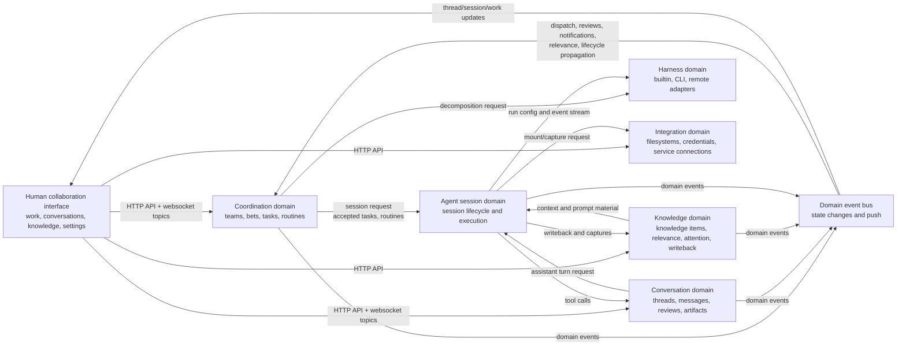

## L1 - Bounded Contexts And Public Interfaces

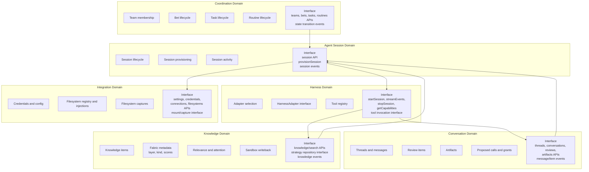

## L1 - Core Interface Contracts

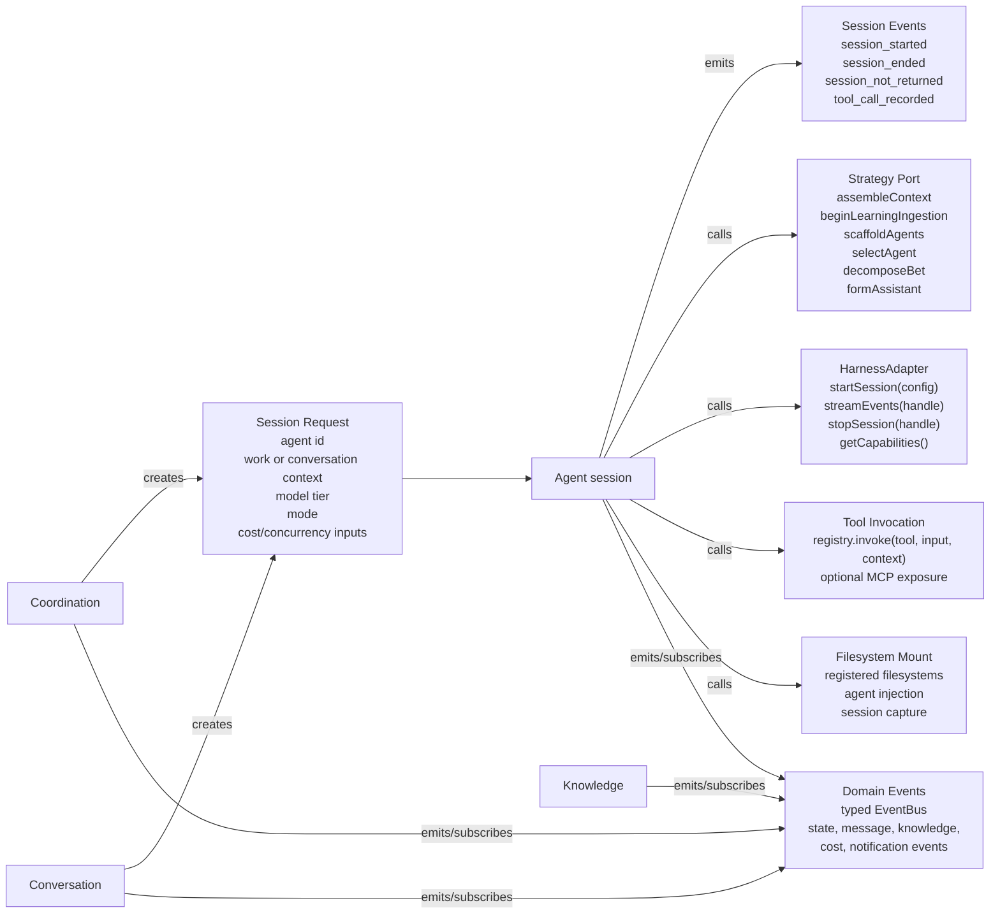

## L2 - Coordination Domain

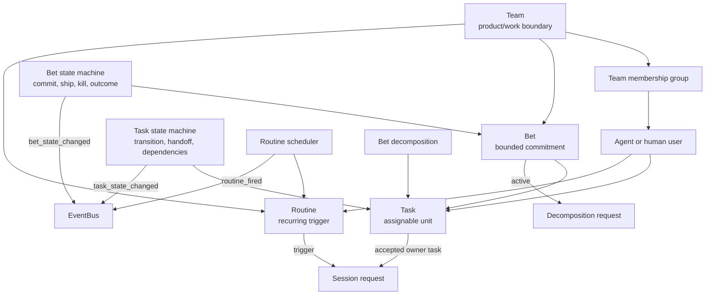

## L2 - Conversation Domain

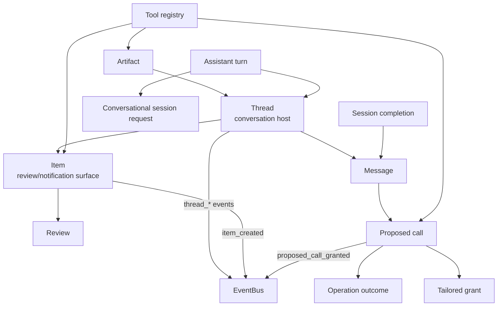

## L2 - Knowledge Domain

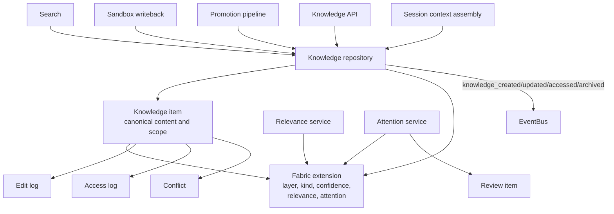

## L2 - Agent Session Domain

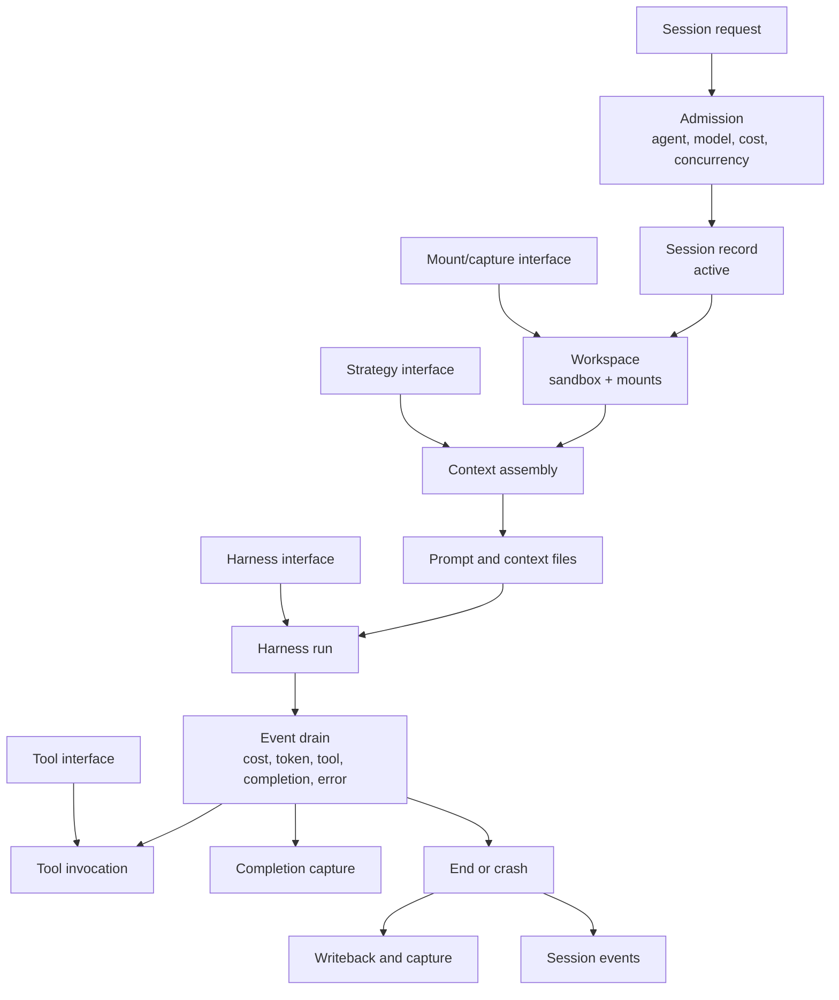

## L2 - Harness Domain

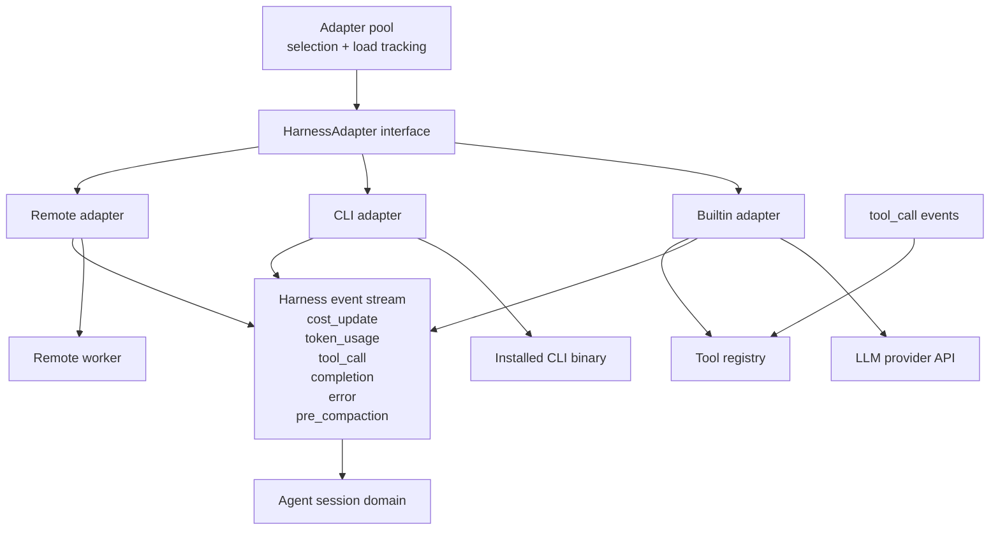

## L2 - Strategy/Fabric Domain

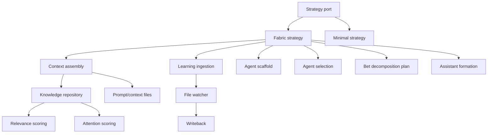

## L2 - Integration Domain

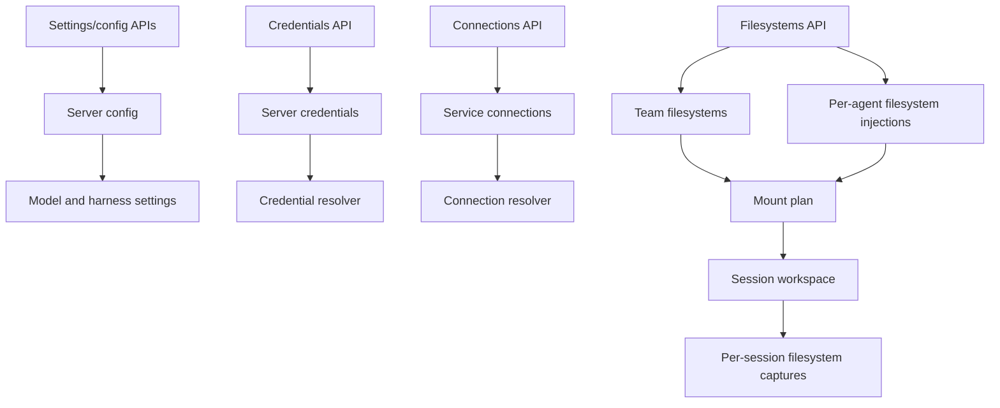

## L2 - Event Interface

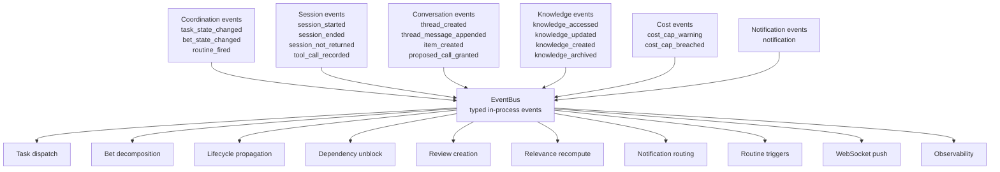

## L3 - Current Agent Invocation Paths

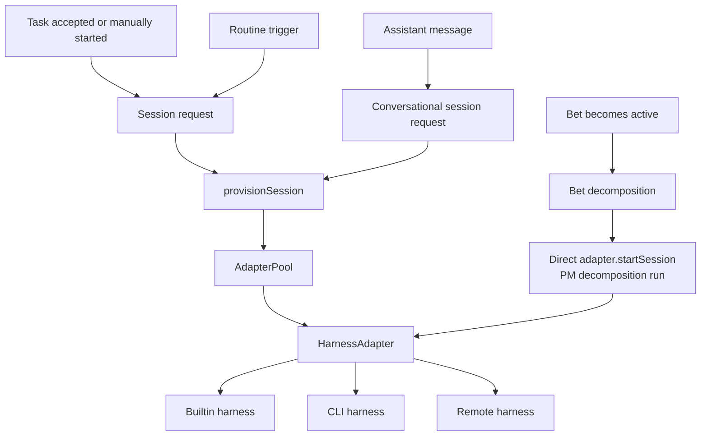
