# As-Implemented Domain Architecture

Code-derived domain, component, and interface map. Each diagram shows domain ownership and the interfaces between domains; the component inventory below the diagrams is verified against the source tree file-by-file.

## L0 - Domain Map

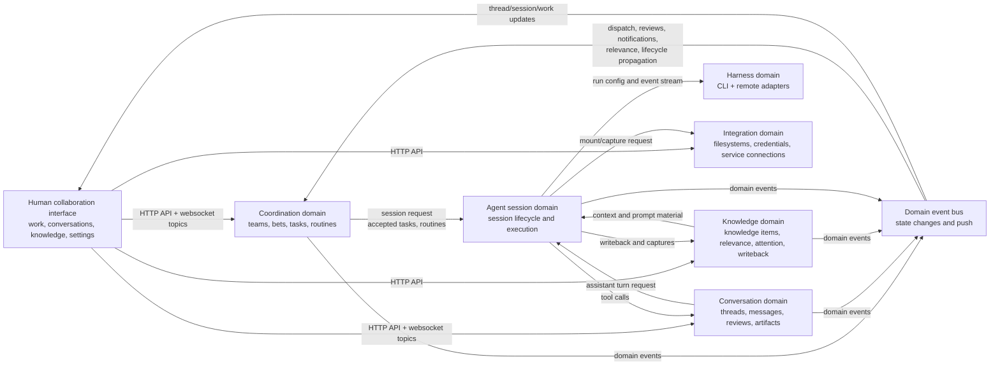

## L1 - Bounded Contexts And Public Interfaces

## L1 - Core Interface Contracts

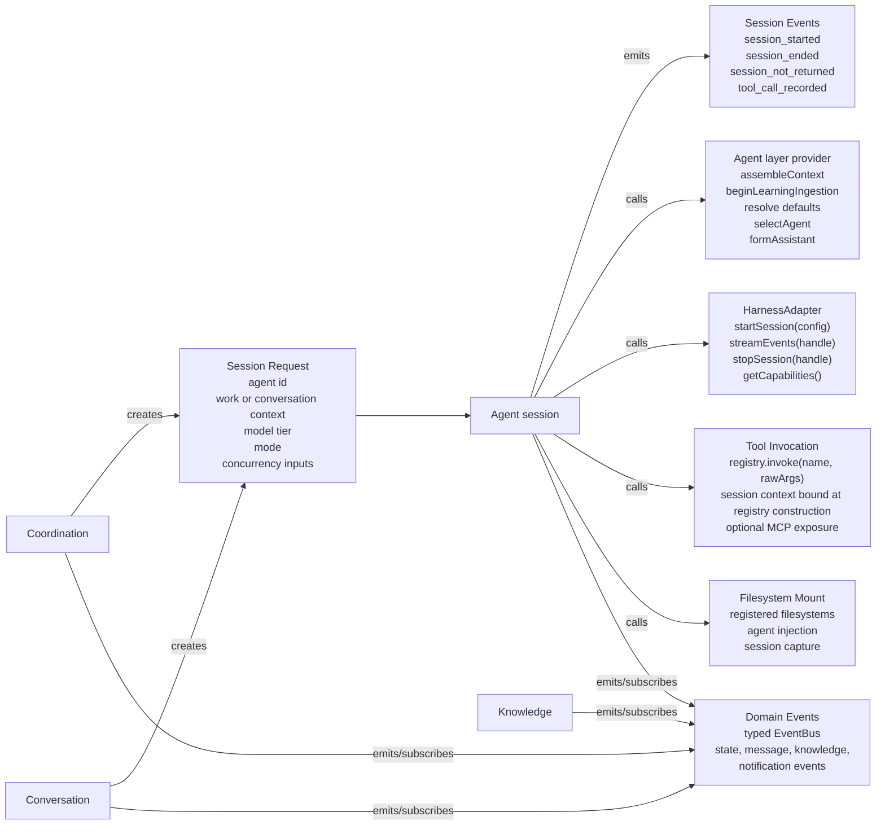

Contract anchors:

- `HarnessAdapter` = startSession/streamEvents/stopSession/getCapabilities — `framework/harness-protocol/src/harness/harness-adapter.ts:270`. `startSession(config: SessionConfig)`; SessionConfig carries sessionId, sandboxPath, assembledPrompt, modelTier, resolvedModel, MCP bridge info, thread messages, return hook, session workflow.
- Agent layer provider = assembleContext/beginLearningIngestion/resolve defaults/selectAgent/formAssistant. Production ownership lives in `layers/agent-orchestration/`'s Services.
- Tool invocation = `registry.invoke(name, rawArgs)` — `layers/agent-execution/harness-registry/src/tool-registry.ts`; per-session context is bound when `buildToolRegistry` constructs the registry, not passed per call.
- Session events verified in `framework/domain-model/src/events.ts` (session_started :34, session_ended :51, session_not_returned :72, tool_call_recorded :207).

## L2 - Coordination Domain

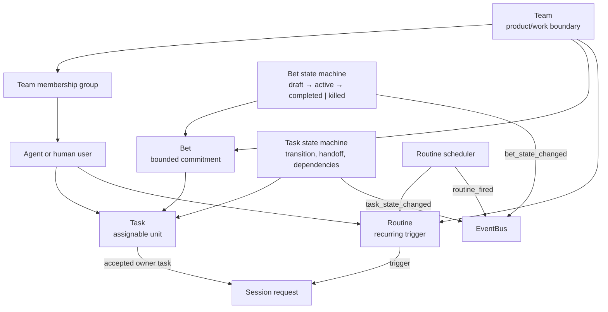

Bet lifecycle endpoints: `POST /api/bets/:id/commit`, `/:id/ship`, `/:id/kill`, `/:id/outcome` (`layers/core-api/src/routes/bets.ts`). Task handoff: `POST /api/tasks/:id/handoff` (`layers/core-api/src/routes/tasks.ts`) via the handoff protocol. Lifecycle semantics live in [process-layer](../process-layer/bets-shape-commit-change-ship.md).

## L2 - Conversation Domain

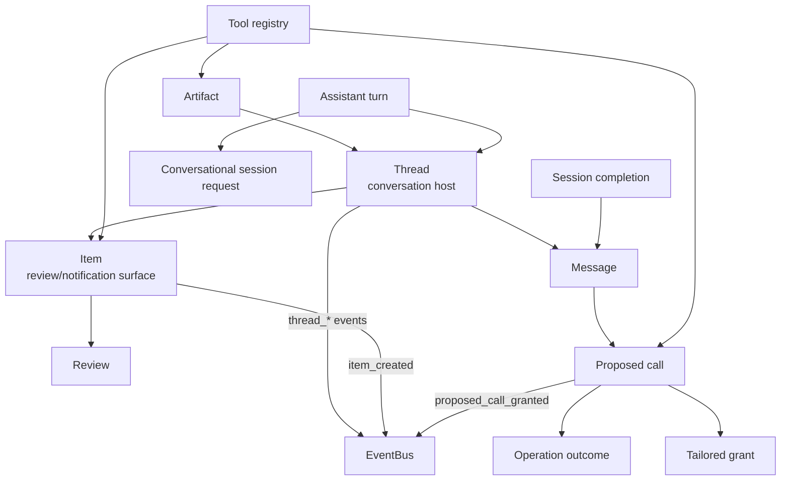

Thread/Message primitive (HOST_KINDS, MESSAGE_TYPES, verdict grammar, idempotency) is owned by the [Thread primitive](../human-interface-layer/thread-primitive.md). Proposed calls / staged operations: [staged operation](../process-layer/staged-operation.md). Artifact contract and embed shapes: [Artifact primitive](../process-layer/artifact-primitive.md).

## L2 - Knowledge Domain

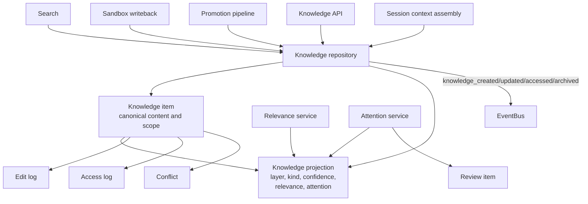

Knowledge runtime internals (layer taxonomy, assembly, sync, scoring) are owned by [knowledge-architecture](../knowledge-architecture/index.md). Component-level summary: `agent-orchestration` assembles the context a run needs and writes it into the per-session workspace; its writeback (`layers/agent-orchestration/run-orchestration/src/writeback-processor.ts`) uses optimistic concurrency (`version` column, `knowledge_conflicts` table); `core-api`'s relevance and attention scoring filter what each session loads (`layers/core-api/knowledge/src/relevance-service.ts`, `attention-service.ts`).

## L2 - Agent Session Domain

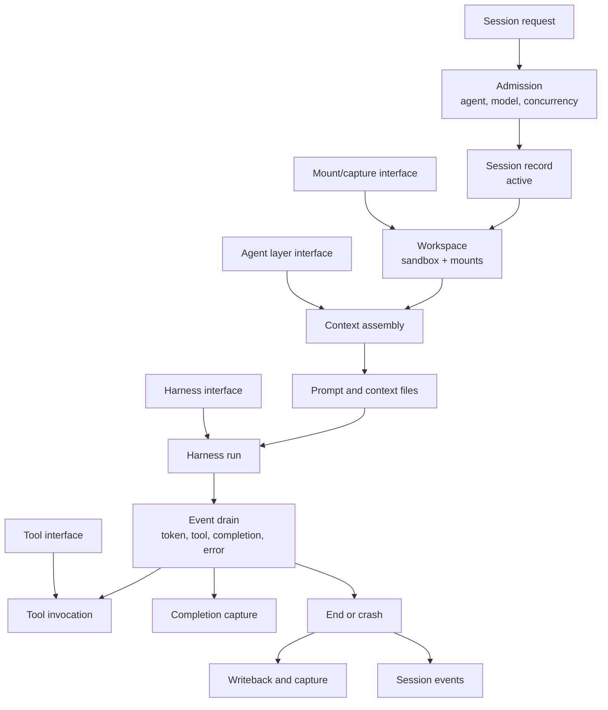

The provisioner (`layers/agent-orchestration/run-orchestration/src/provisioner.ts`) runs admission (adapter selection, concurrency), spawns the sandbox, applies filesystem mounts before context assembly, then drains harness events. The run unit itself — per-session host working directory, no isolation boundary — is owned by the [run-unit model](./run-unit-model.md).

## L2 - Harness Domain

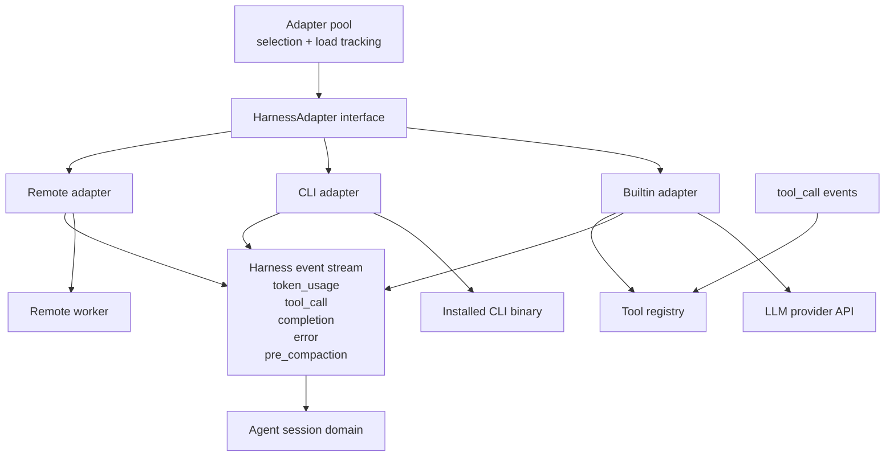

Harness event types match `framework/harness-protocol/src/harness/harness-events.ts` exactly (token_usage, tool_call, completion, error, pre_compaction). `cost_update` was removed — harness telemetry was narrowed to token usage only (founder ruling: "very few harness can actually report cost"; see `layers/agent-execution/harness-registry/src/__testing__/llm-cassette.ts`). The pool does least-loaded selection with load tracking (`layers/agent-execution/harness-registry/src/adapter-pool.ts`). Event-normalization mechanism, capability descriptor shape, discovery/session probes, and the MCP bridge are owned by the [harness capability descriptor](../agent-layer/harness-capability-descriptor.md).

## L2 - Knowledge And Agent Services

Context assembly and learning ingestion belong to `agent-orchestration`; the knowledge repository, relevance, and attention scoring belong to `core-api` (`layers/core-api/knowledge/`). See [runtime-simplification](./runtime-simplification.md).

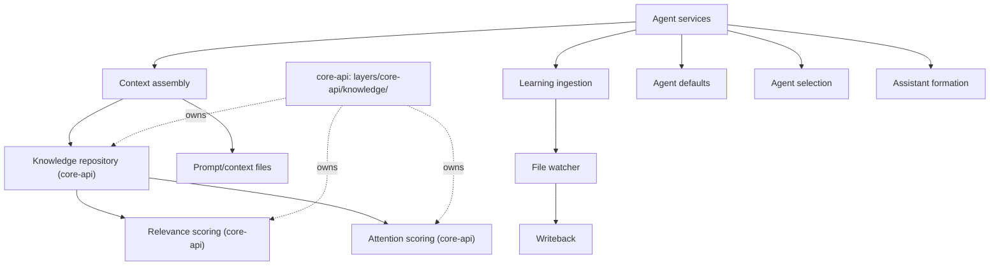

## L2 - Integration Domain

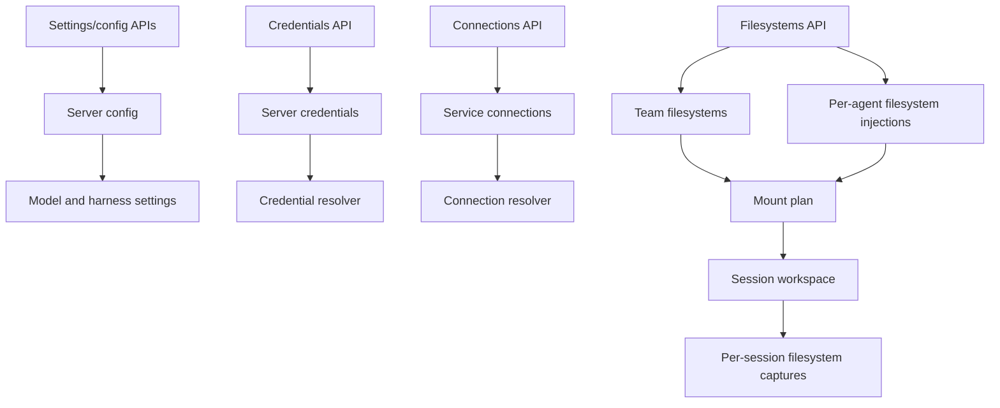

Tables in `framework/db/src/schema.ts`: filesystems, filesystem_injections, filesystem_captures, server_credentials (:1319), server_config, service_connections (:1735). Held/inherited Connection semantics: [connection model](./connection-model.md). Encryption: [credential model](./credential-model.md).

## L2 - Event Interface

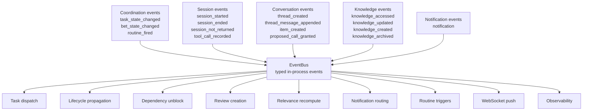

**Guarantees** (one line — the contract lives in the `framework/event-bus/src/event-bus.ts` docblock): in-process typed pub/sub, synchronous delivery, per-stream ordering, at-least-once when `emit()` is called after database write durability; one throwing handler does not abort delivery to the rest.

## L3 - Current Agent Invocation Paths

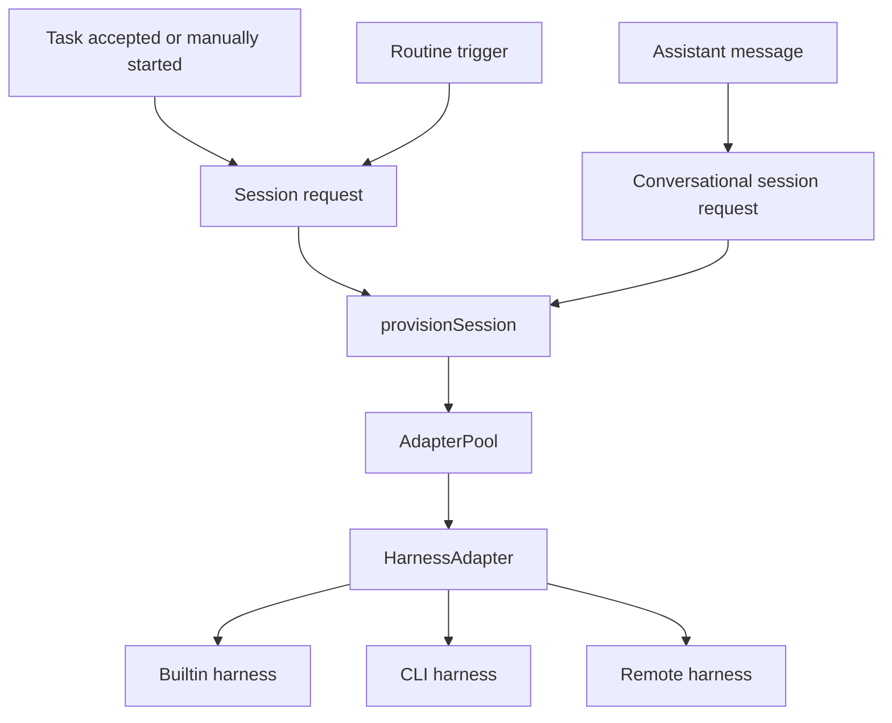

All agent-run entry families persist a durable work intent. `core-api` bakes everything the run needs onto the emitted request; `agent-orchestration` claims it, formats it and dispatches. Assistant preparation lives in `layers/core-api/conversation/src/assistant-turn-resolver.ts`.

## Component Inventory

Verified against code 2026-08-06. Component-level facts only; primitive semantics live in their owning docs.

### Primitive store

Embedded Postgres: PGlite (laptop/test) or postgres-js (VPS/cloud), one unified Drizzle type (`framework/db/src/connection.ts`). 44 tables, all shapes owned by `framework/db/src/schema.ts`: teams, team_members, users (humans and agents, `kind` human|ai), bets, tasks, sessions, routines, routine_runs, threads, messages, items, org_edges, knowledge_items (:883) + knowledge_app_projection (:1004) + knowledge_edit_log (:912) + knowledge_access_log + knowledge_conflicts, propagation_log, notification_queue, artifacts, filesystems (+injections/captures), agent-run tables (agent_session_requests, agent_work_intents, explicit_session_starts, agent_run_config, …), credential/config/login/invite/proposed-call tables.

- The `responses` table is dropped — verdicts are `verdict`-typed messages ([Thread primitive](../human-interface-layer/thread-primitive.md)).
- Message idempotency: UNIQUE(threadId, senderId, clientKey).
- Sessions carry no cost columns. The cost feature was deleted with no replacement; the spend ceiling lives at the upstream LLM provider account ([WIP limits](../process-layer/wip-and-cost-limits.md)).
- `org_edges` records org relationships per (fromUserId, mechanism, target); `propagation_log` records lifecycle-propagation applications by source level/id and status; `knowledge_access_log` records per-item knowledge reads.

### Item routing

`routeItem` and `routeToFounder` are deleted. An item carries no computed target view; review recipients are resolved by `resolveReviewRecipients` (`layers/core-api/org/src/org-routing.ts`), and notification policy lives in the notification Service (`layers/core-api/notifications/src/silence-policy.ts`, `install.ts`). Item shape is owned by [items and routing](../human-interface-layer/items-and-routing.md).

### Schedulers

In-process `setInterval` services, no external workflow engine. Routine scheduler (`layers/core-api/routine/src/routine-scheduler.ts`) fires cron/event/heartbeat triggers and honors silent routines; dispatch lives in `layers/agent-orchestration/dispatch/`; `checkAndUnblockDependents` (`layers/core-api/work/src/dependency-watcher.ts`) moves dependent tasks off hold. The scheduler never calls models — it reads the store and emits events.

A session runs the model its agent was configured with — `agent_run_config.model_id` reaches the harness as `SessionConfig.selectedModel`. There is no gateway and no tier→model resolution; the tier is a cost-reporting label only. Vocabulary: [model routing and cost](../agent-layer/model-routing-and-cost.md).

### Knowledge Services

See the L2 Knowledge Domain paragraph above; full design in [knowledge-architecture](../knowledge-architecture/index.md). Context assembly and writeback belong to `layers/agent-orchestration/run-orchestration/`; promotion, attention scoring, and conflict resolution to `layers/core-api/knowledge/`. Search is escaped case-insensitive LIKE SQL (`layers/core-api/src/routes/search.ts`) — no FTS5, no pgvector.

### API layer

Hono on Node. `core-api` mounts its routes under `/api` (`layers/core-api/src/app.ts`); each Layer hosts its own app, and an Application composes them (`applications/remote-server/src/create-server.ts`, `applications/desktop/src/main.ts`). Schedulers start from `layers/core-api/src/service-bootstrap.ts`. Route groups: auth, users, agents, teams, team-members, bets (incl. `/:id/commit|ship|kill|outcome`), tasks (incl. `/:id/handoff`), sessions, reviews, artifacts, filesystems, knowledge (URL shape `/:id`, not `/:layer`), conversations, threads, org, recipients, status (incl. `/digest`), workers, harnesses, credentials, hint-progress, dispatch-queue, search, settings, ws. `/connections` is served by `agent-orchestration`'s own app (`layers/agent-orchestration/src/app.ts`, `layers/agent-orchestration/src/routes/connections.ts`) — its table set (`service_connections`) is owned by that Layer (AU26 E4).

Auth: single `HYPERIDLE_API_KEY` via `X-API-Key` header (constant-time compare) + Bearer login-session tokens + invite codes (`layers/core-api/src/middleware/auth.ts`, `layers/core-api/users/src/login-session.ts`). Boundary enforcement: [authorization model](./authorization-model.md).

### Harness adapters

Interface in `framework/harness-protocol/src/harness/harness-adapter.ts`; implementations in `layers/agent-execution/harness-registry/src/`: CLI (codex, claude-code, opencode, cursor-agent — `cli-harness-adapter.ts`) and remote worker (`remote-harness-adapter.ts`). Autodiscovery covers the same four CLIs (`harness-discovery.ts`). A built-in in-process adapter used to sit alongside these, calling a provider API directly; it is gone, and with it the model gateway that fed it. Descriptor, probes, MCP bridge, pre-compaction contract: [harness capability descriptor](../agent-layer/harness-capability-descriptor.md).

### Sandbox (run unit)

Per-session working directory under `HYPERIDLE_WORKSPACES_DIR`; the harness runs as a host child process with the user's environment inherited — no isolation boundary (AQ1). `SandboxAdapter` = `spawn(baseDir)` / `exec` / `destroy` (`layers/agent-execution/harness-registry/src/sandbox-adapter.ts`). `LocalSandboxAdapter` is the default; `DisabledSandboxAdapter` refuses agent provisioning on non-laptop server profiles. Opt-in isolation is planned (AQ2). Full model: [run-unit model](./run-unit-model.md).

### Notifications

`layers/core-api/notifications/`: ntfy, SMTP, and console adapters; the dispatcher owns policy, mute, drain, redaction, and runs the daily digest on its own timer (`install.ts` → `runDailyDigestInternal`, `daily-digest.ts`) — not via a routine. Primitive semantics and cadence discipline: [notification primitive](../human-interface-layer/notification-primitive.md).

### Observability

Channels `"console"` | `"noop"` (`framework/diagnostics/src/observability/types.ts:4`); OpenTelemetry explicitly future. Event shapes in `framework/diagnostics/src/observability/events.ts`; the runtime wiring in `layers/core-api/src/observability-runtime.ts`.

## MCP Tool Surface

Agents interact with the process layer through MCP tools served in-process (`layers/agent-execution/harness-registry/src/mcp/mcp-bridge.ts` + `tool-registry.ts`). The tool set is declared in `layers/agent-orchestration/tool-handlers/src/tool-definitions.ts`: read_inbox, send_message, reply, log_task, query_practice, write_memory, handoff_to, create_item, create_artifact, write_session_notes, create_bet, edit_bet, create_task, create_team, add_agent, create_routine, update_routine, promote_knowledge, score_attention, create_conflict_review, submit_review, commit_file.

The same nouns have real HTTP surfaces for clients: `/api/users/:id/inbox` (GET/POST, principal-self scoped), `POST /api/tasks/:id/handoff`, `/api/knowledge` (`/search`, `/`, `/triage-count`, `/:id`).

## Session Flow

Triggers: routine fired, dependency cleared, or an inbox/assistant message. Then:

1. Model tier resolved (explicit param → agent preference → workhorse), model via gateway.
2. Context assembly writes TOON prompt + context files.
3. `LocalSandboxAdapter` provisions the per-session working directory; filesystem mounts applied.
4. Harness spawned; agent works via MCP tools.
5. Session notes written before context compaction (the `write_session_notes` tool; fallback notes file `work/task-notes.md`).
6. Stop → `SessionResult` persisted, writeback + capture, `session_ended` emitted.

## Item Pipeline

`create_item` tool → `items` row → `item_created` event → notification dispatcher fires if push-worthy (ntfy) → WebSocket push → UI renders it.

## WebSocket Push Contract

One client endpoint, topic-based:

- `GET /api/ws?token=<one-shot token>`; the token is minted by authenticated `POST /api/auth/ws-token` (`layers/core-api/src/routes/ws.ts`, `routes/auth.ts:87`). Connection acks `{type:"connected"}`.
- Client sends `{type:"subscribe"|"unsubscribe", topic}`; server acks `{type:"subscribed"|"unsubscribed"|"forbidden", topic}`.
- Topics: `conversations`, `work`, `thread:<threadId>`, `session:<sessionId>` (session topics are read-only observe mode, open to any authenticated client).
- Payloads are serialized EventBus event objects per topic (`layers/core-api/src/ws-connection-hub.ts`) — not REST-shaped responses.
- Subscribe authorization for per-thread topics goes through `canSubscribe` — see the [authorization model](./authorization-model.md).

A separate worker channel `GET /ws/worker?token=<HYPERIDLE_WORKER_TOKEN>` (`layers/agent-orchestration/run-orchestration/src/worker-ingress.ts`) carries Zod-validated register/event/session_result/error/pause/resume messages for remote harness workers.

Web client: singleton `layers/core-ui/src/services/ws-client.ts` — lazy connect on first subscriber, auto-reconnect with 1s→15s backoff.
