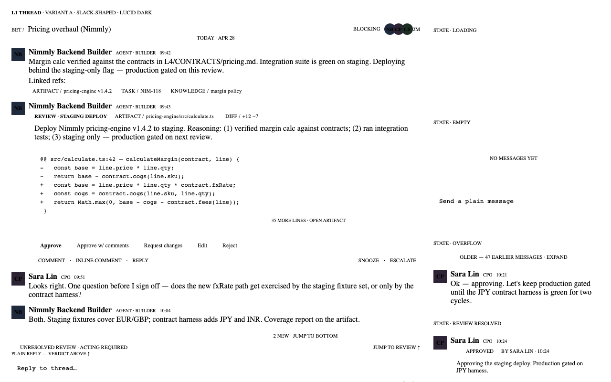
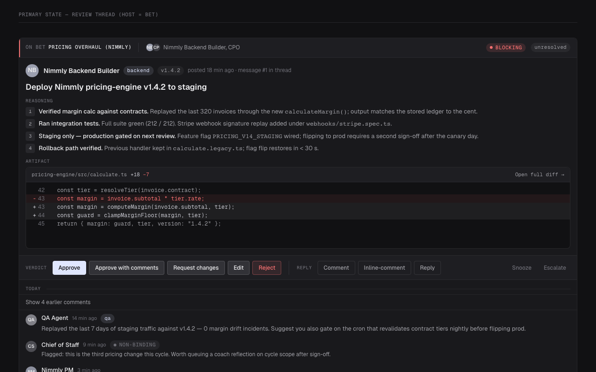
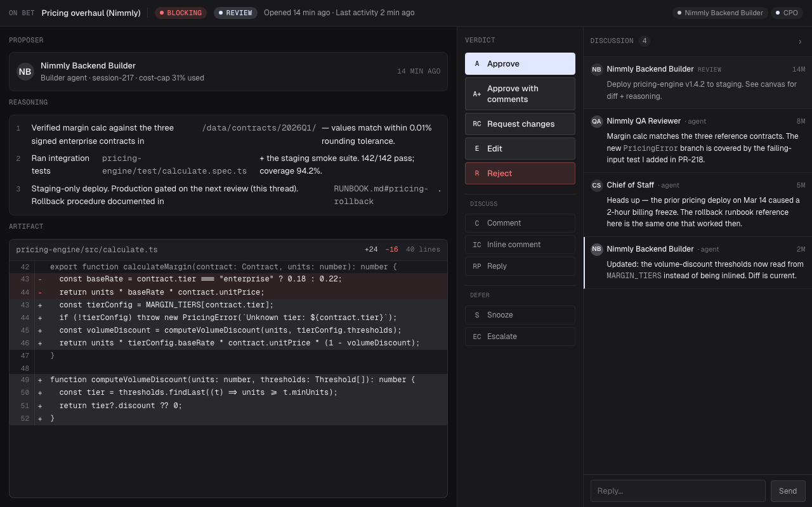

# L1 Thread primitive — Variant comparison

Phase 2 of `/design`. Three variants critiqued against the 9-dimension rubric from `.claude/skills/design-critique/SKILL.md`. Anti-convergence verified: each pair differs on ≥3 of {hierarchy, density, action surface, composition, copy register}.

## Variant summary

| Variant | Signature | Total /90 | Recommendation |
|---|---|---|---|
| A — slack-shaped | Verdict lives **inline** at the bottom of the rich message; the thread is a single chronological column. Density wins; separation loses. | 60 | Advance with notes — solid for chat-shape; structurally wrong for the load-bearing review case (the verdict scrolls out of reach). |
| B — linear-shaped | Issue-shape: HEAD region (proposer + reasoning + artifact) at top, **sticky verdict bar**, condensed `CommentRow` stream below, composer at the floor. | 78 | **Advance cleanly. Recommended base for the synthesis.** The hierarchy is sharpest for the load-bearing case (blocking review). |
| C — slate-shaped | Canvas (artifact + reasoning) ‖ dock (compact stream + composer); verdict lives on the **canvas-edge seam**. | 64 | Advance with notes — best for heavy-artifact deep-review; degrades-by-suppression for the ~40% chat-shape case, which is a structural cost the synthesis should not pay by default. |

## Per-variant scores (0-10 each)

Dimensions: H = Hierarchy · S = Spacing/Density · T = Typography · C = Color · Co = Component coherence · St = States · A = Accessibility · AS = Anti-slop · PP = Premium polish.

| Variant | H | S | T | C | Co | St | A | AS | PP | Total |
|---|---:|---:|---:|---:|---:|---:|---:|---:|---:|---:|
| A — slack-shaped | 5 | 7 | 7 | 7 | 7 | 7 | 6 | 7 | 7 | **60 / 90** |
| B — linear-shaped | 9 | 8 | 9 | 9 | 9 | 9 | 8 | 9 | 8 | **78 / 90** |
| C — slate-shaped | 7 | 7 | 7 | 7 | 6 | 8 | 7 | 8 | 7 | **64 / 90** |

No variant scores below 5 on any dimension — none requires regeneration. Variant A's hierarchy at 5 is the closest to the floor (verdict location is structurally weak for review threads); not a regen, but not advancing without the patch the synthesis prescribes.

---

### Variant A — slack-shaped

**Strengths**
1. Honest single-column composition matches the chat-shape mental model perfectly. The composer dominates because it is the only persistently-visible action surface; for a thread that is genuinely a chat (~40% of threads per Variant C's spec), this is the right hierarchy.
2. Tightest density of the three. Sender-grouping ("avatar appears once per run") is a Linear/Slack-grade premium detail that punches above its weight for power users.

**Weaknesses**
1. **Verdict location regresses on long review threads.** The screenshot itself proves the failure mode: the verdict row sits in the middle of the column, with `35 more lines · open artifact`, replies, `OVERFLOW`, and additional `RESOLVED` content piled on top of it. A founder revisiting the thread to act has to scroll up to find the action. The "UNRESOLVED REVIEW · acting required ↑" rule above the composer is a mitigation, not a fix.
2. The screenshot tries to render seven states (`LOADING`, `EMPTY`, `OVERFLOW`, `REVIEW RESOLVED`, populated, etc.) on one canvas. As a state-coverage demonstration that's earned; as a *primary-state* mockup it crowds the typography and makes the hierarchy unreadable at a glance — fails the 3-second-scan requirement for the populated case.

**Unfixable in this variant.** The thesis is "verdict lives inline in the stream." Pinning it would erase the variant's identity. Any synthesis that wants the verdict above the fold must abandon A's central claim.

---

### Variant B — linear-shaped

**Strengths**
1. **Hierarchy is exactly right for the load-bearing case.** Eye lands on `BLOCKING` chip → host (`PRICING OVERHAUL (NIMMLY)`) → proposer + version tag → `Deploy Nimmly pricing-engine v1.4.2 to staging` headline → numbered Reasoning bullets → artifact diff (`+18 / -7`, `pricing-engine/src/calculate.ts`) → labelled `VERDICT` row → `REPLY` row → sidecar (`Snooze`, `Escalate`). Six landing points in clean numbered order. This is what a precision instrument looks like.
2. Component discipline. Reuses `StatusChip`, `Tag`, `KeyValue` 1:1; introduces only the new region (`ThreadHead`), the verdict bar, and `CommentRow`. The label register (`REASONING`, `ARTIFACT`, `VERDICT`, `REPLY`) is uppercase mono caps with letter-spacing — semantic, not decorative. Verdict is the only flat-filled `Approve` button; `Reject` is `--danger` text-only; everything else ghost. One accent, used flatly.

**Weaknesses**
1. **Plain-only ("chat-shape") threads pay a hierarchy tax.** The spec promotes the first plain message to HEAD even when there's no rich content. For a 4-line back-and-forth between Builder and Founder, the HEAD treatment + sticky bar slot + `Reasoning` label scaffolding is overweight. The variant admits this in trade-offs.
2. Resolved threads bury the verdict in a one-line summary. Multi-vote audit trails (re-open cycles) get condensed into the comment stream — fine for one verdict, awkward for three. Auditors lose the "who voted what when" at-a-glance read.

**Unfixable in this variant.** The thesis is "thread is *about a thing*; the rest is discussion." This is structurally hostile to the chat-shape case — a thread that is genuinely a conversation, not about a substance message. The synthesis must either fork the head (cost: forking the renderer) or collapse the head when no substance message exists (the synthesis recommendation below).

---

### Variant C — slate-shaped

**Strengths**
1. **Best surface for heavy-artifact review.** A 40-line diff in a dedicated canvas with internal scroll, reasoning above, dock to the right, and the verdict on the seam between them — this is exactly where the eye drifts when transitioning from "study artifact" to "read discussion". For the deep-review case, this is the right shape.
2. Honest about its degradation. The chat-shape collapse is named and justified ("the variant earns the canvas only when there is something worth canvassing"), so the variant doesn't pretend it's universal — it knows when it shouldn't render.

**Weaknesses**
1. **Component-budget cost is heavy.** 4 net-new components scoped to slate (`ThreadCanvas`, `CanvasEdgeToolbar`, `ThreadDock`, `DockMessageRow`) — the spec acknowledges only `ThreadShell` and `Composer` are reusable. That's a significant tax against the 19-component budget, and most of it serves only the heavy-artifact case.
2. **Pays the full layout cost on every thread, then suppresses on ~40%.** Even with the chat-shape collapse rule, the variant has to decide-and-suppress on every render. The dock is also uncomfortable below ~1100px viewport — the variant requires a desktop or a large laptop, against `auto-density` design that targets ≤1024px as comfortable.

**Unfixable in this variant.** The thesis is "canvas + dock as the default render." The thesis cannot be the default and also gracefully serve the 40% chat-shape case — the collapse-to-single-column is the variant admitting this. The synthesis should pull the canvas-mode in as a *promoted* state (when artifact is heavy), not as the default render.

---

## Anti-convergence axes (cross-reference table from the brief)

| Axis | A — slack | B — linear | C — slate |
|---|---|---|---|
| Hierarchy | latest message at bottom; composer dominates | head message at top; verdict sticky beneath | artifact canvas dominates left; dock secondary |
| Density | high (single column, tight rows) | medium (HEAD expanded; comments compact) | low primary (canvas) + medium secondary (dock) |
| Action surface | verdict inline in the stream; composer at bottom | sticky verdict bar attached to HEAD | canvas-edge toolbar (the seam) |
| Composition | 1 stream + 1 composer | 1 head + 1 stream + 1 composer | 1 canvas + 1 dock + 1 composer |
| Copy register | terse, chat-shape | structured, issue-shape (`REASONING` / `ARTIFACT` / `VERDICT`) | label-driven, document-shape |
| **9-dim total** | **60 / 90** | **78 / 90** | **64 / 90** |

A vs B differs on hierarchy, density, action surface, copy register, composition (5/5).
A vs C differs on hierarchy, density, action surface, composition, copy register (5/5).
B vs C differs on hierarchy, density, action surface, composition (4/5).

All three pairs clear the 3-axis anti-convergence floor. The variants are genuinely different theses, not three flavors of the same idea.

---

## One-paragraph capture per variant

**A — slack-shaped.** Best at: short, terse, conversational threads with many participants where every message is more or less the same shape. Worst at: blocking review threads where the verdict needs to be above the fold — A's screenshot literally demonstrates the failure mode by piling 40 lines of overflow + reply + resolved content above where the verdict actually sits.

**B — linear-shaped.** Best at: blocking reviews on a single substance message — the load-bearing case for the entire Conversations view. The HEAD + sticky `VerdictBar` + condensed `CommentRow` stream maps the user's task ("read substance, render verdict, scan discussion") to the page geometry exactly. Worst at: pure chat-shape threads where promoting the first plain message to a HEAD region wastes vertical real estate and over-formalises a 4-line exchange.

**C — slate-shaped.** Best at: deep review of a complex artifact (multi-file diff, full landing-page mock, design comparison) where the artifact deserves a canvas of its own and the discussion is supporting context. Worst at: anything else. The variant pays a heavy component-budget cost and a layout-decision cost on every render, even threads that ultimately collapse to single-column.
