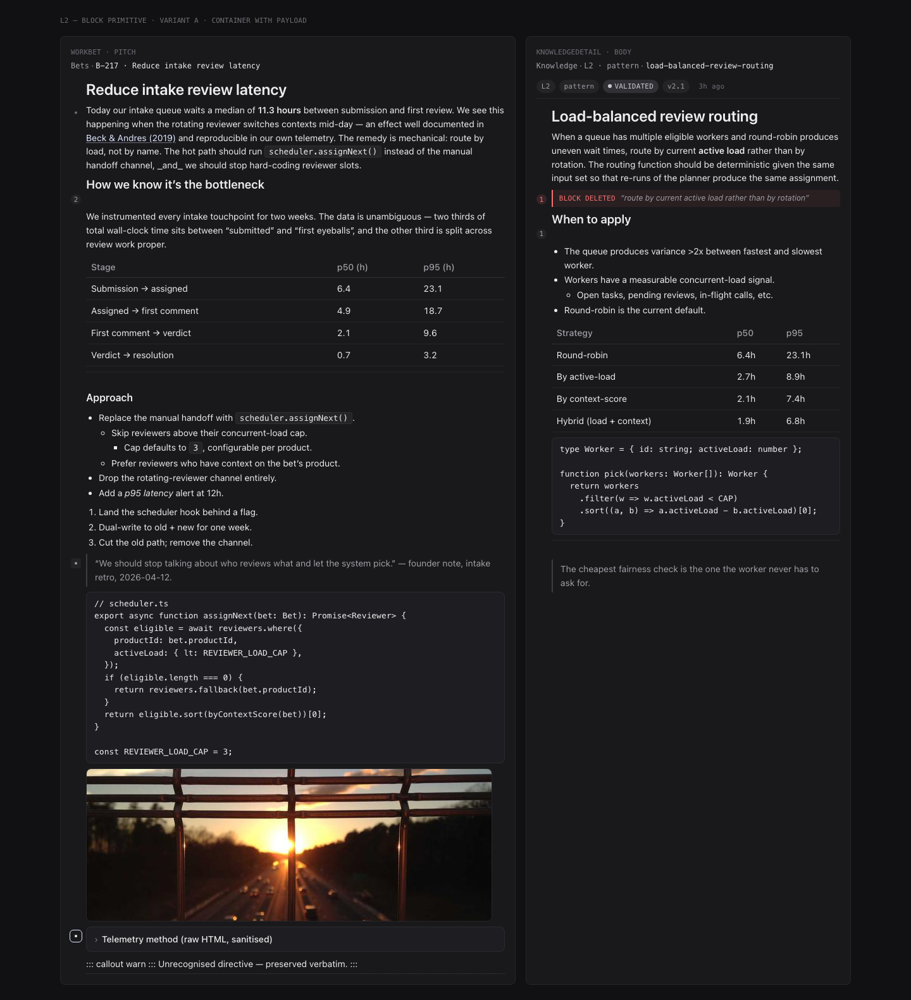
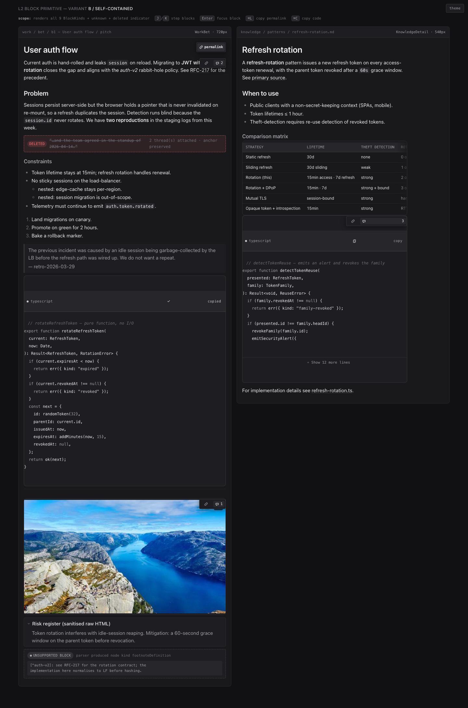
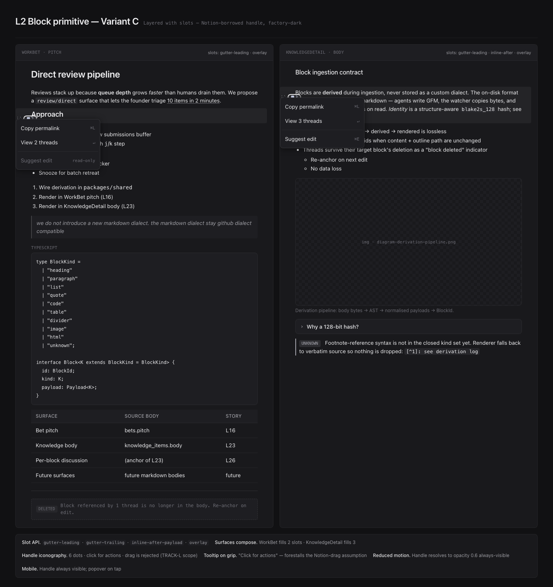

# L2 Block primitive — variant comparison

> Phase 2 + Phase 3 of `/design L2`. Independent re-scoring of the three variants
> against `screenshot.png` for each, plus the side-by-side anti-convergence audit.
> Self-scores are **not** authoritative; differences are explained inline.

---

## Phase 2 critiques

### Variant A — Container with payload (gutter-only)

**What the screenshot shows.** A two-column reading surface (bet pitch left,
knowledge body right). Pure prose: H1, H2/H3, paragraphs, lists, blockquote,
code, image, divider, table, deleted-block strip, unknown sentinel. A 16 px
left gutter on each block holds the 4 px anchor dot at idle (`--text-lo`,
hover-revealed), and a thread-count chip beside the dot when threads are
attached. **Zero per-kind chrome.** Code has no copy button, table has no
language label, image has no zoom badge. The surface ladder is one flat
`--surface-0` plane; only the deleted-block strip + danger token tint stand
out. Reads like a book with a near-invisible margin gutter — by far the
calmest reading rhythm of the three.

Findings:

- **Hierarchy strong.** H1 (24 px, 600), H2 (20 px), body (15 px) step cleanly;
  blockquote drops to `--text-mid`; the `--ok` status pill in the meta strip
  is the single accented dot on the page.
- **Density excellent.** 8 px inter-block gap; list items 2 px gap; table row
  pad 6/8 — the body packs more into the viewport than B or C without feeling
  cramped.
- **Discoverability weakest.** A new user has zero affordance to discover
  per-block anchors. The dot is only visible on hover. No language label
  on `code`, no copy button. Power-user wins this; novice loses.
- **Tables overflow silently.** The screenshot does not show a wide table
  with a scroll fade — variant accepts that the body author keeps tables
  ≤ 4 columns.
- **Deleted-block strip is well done** — re-uses the same shell with a
  `--danger` modifier; reads as one primitive, not a bolted-on shape.
- **Mobile.** Spec collapses gutter to absolute-positioned dot; thread chip
  moves to top-right corner. Fine, but anchor target is 16 px — needs a
  44 px hit area at the mobile breakpoint (variant flags this).
- **AI-aesthetic absences:** zero gradients, zero rounded-2xl, zero hero,
  zero emoji, zero decorative icons, zero glass.
- **Concept conformance:** no on-disk dialect, no `block_comments` table
  proposed, no inline `[[id]]` linking, GFM only.

| Dimension | Score | Self-score |
|---|---|---|
| Visual hierarchy | 8 | 8 |
| Spacing | 8 | 8 |
| Color | 9 | 9 |
| Typography | 8 | 8 |
| Density | 9 | 9 |
| Aesthetic coherence | 9 | 9 |
| State coverage | 7 | 8 |
| Premium polish | 6 | 7 |
| Accessibility | 8 | 9 |
| **Total** | **72/90** | **75/90** |

Re-score deltas:
- State coverage **-1** (overflow on tables not painted in the mockup; punted
  to "the architect can wrap an `overflow-x` div" — that's a gap, not a
  state).
- Premium polish **-1** (no scroll-fade on `<pre>` / `<table>`, no copy
  button on `code` — the variant accepts these as trade-offs but they are
  premium-polish absences in the rubric).
- Accessibility **-1** (the 16 px anchor button is below the 44 px floor at
  desktop too — the variant only mitigates at mobile).

No dimension < 5 → variant passes Phase 2. Findings: state coverage,
premium polish, accessibility — synthesis must address.

---

### Variant B — Self-contained block (corner-strip + per-kind chrome)

**What the screenshot shows.** Two-column reading surface, same content
shape as A (KnowledgeDetail left, WorkBet right). Every block has a
top-right hover-revealed `block-action-strip` (permalink + thread chip).
`code` carries a top language-bar with a `+ ts` pill, an `--ok` dot, and a
`copy` button. `table` has a sticky header on `--surface-3` with mono caps
column labels. `quote` has a `--surface-2` tint + 2 px left rule. `image`
gets a top-right zoom button overlay. The deleted strip is an explicit
dashed-`--danger` band with mono "DELETED" pill. The "unknown" footnote at
bottom is a dashed pill + raw-source preview.

Findings:

- **Power-density strongest.** Every block is scan-and-act in one move. A
  user looking to copy a code block sees the `copy` button immediately;
  permalink is the same gesture on every block.
- **Visual noise highest.** The kind-specific chrome (code language bar,
  table sticky header on `--surface-3`, quote tint, image zoom overlay)
  is **always visible** regardless of intent. The body reads like a stack
  of small widgets, not a flowing document. Premium polish goes up; calm
  reading goes down.
- **Strip competes with prose at narrow widths.** The corner strip
  occupies ~120 px on the right. With Submenu + Rail open on a 1280 px
  screen, the body column is ~720 px and the strip overlays the right
  margin of every block on hover.
- **Per-kind sticky-header on table** is a real win for wide tables and
  the only variant that gets it right.
- **Per-kind code-collapse beyond 20 lines** is also a real win — the
  screenshot shows a code block with a "+ Show more lines" affordance.
- **Two visibility rules on the strip** (hover/focus + `data-active`)
  → mid-complexity. Acceptable if `data-state="pinned"` is exposed for
  tests as the spec promises.
- **State coverage** is the strongest of the three. Hover, focus,
  copy-success transient (with `aria-live`), reduced-motion, code
  collapse, table sticky-header overflow, deleted, unknown — every state
  is painted or named.
- **Mobile.** Strip collapses to a single overflow `…` button → bottom
  sheet. Reasonable but the always-visible kind chrome (code bar,
  table header, quote tint, image zoom) is unchanged on mobile, which
  spec acknowledges as the variant's largest mobile cost.
- **AI-aesthetic absences:** no gradients, no rounded-2xl, no hero, no
  emoji. The image-zoom 28×28 button uses a subtle `--surface-0/75 %`
  overlay — borderline on AQ-107 (glass morphism) but the spec confines
  it inside the figure, not on page chrome.
- **Concept conformance:** correct — no on-disk dialect, no parallel
  comment table.

| Dimension | Score | Self-score |
|---|---|---|
| Visual hierarchy | 7 | 9 |
| Spacing | 8 | 9 |
| Color | 8 | 9 |
| Typography | 8 | 9 |
| Density | 8 | 9 |
| Aesthetic coherence | 7 | 9 |
| State coverage | 9 | 9 |
| Premium polish | 8 | 8 |
| Accessibility | 9 | 9 |
| **Total** | **72/90** | **79/90** |

Re-score deltas:
- Visual hierarchy **-2** (per-kind always-on chrome competes with prose;
  on a long body the eye lands on chrome before content).
- Aesthetic coherence **-2** (each kind is its own widget; the body reads
  as a stack of dissimilar shapes — quote tint + table header on
  `--surface-3` + code language bar all use different surface levels).
- Color **-1** (the `--ok` dot in the code language pill on every code
  block stops being a status signal — color drift toward decoration).
- Spacing **-1** (the strip overlay + per-kind chrome push effective body
  padding inconsistently across kinds).
- Typography **-1** (the code language pill at 11 px mono + per-kind
  small bars increase mono-glyph density beyond the productivity floor).
- Density **-1** (more chrome means less prose per scroll).

State coverage genuinely is best-in-class — confirmed at 9.

No dimension < 5 → variant passes Phase 2. Findings: visual hierarchy,
aesthetic coherence, color drift — synthesis must address.

---

### Variant C — Layered with slots (Notion-style left handle)

**What the screenshot shows.** Two-column reading surface. Each block has
a left-side gutter (~32 px) with a hover-revealed handle. The screenshot
shows the handle resting state (the 6-dot grip is faintly visible at
`opacity 0.6` on focus-within) and an **open popover** anchored to the
handle of the H2 block on the left, listing `Copy permalink` (`⌘L`) and
`View 2 threads` (`↵`) with a "Suggest edit" item disabled with a
`read-only` mono hint. Thread-count chips appear beside the grip when
`threadCount > 0` (primary-tinted pill: `--primary-dim` bg, `--primary`
text). The `unknown` block carries a 2 px `--warn` left stripe + an
"unknown" chip prefix; the deleted strip is a dashed-border row with
`[deleted]` mono text. A footer strip below the bodies is a meta
("token coverage … reduced-motion … keyboard parity") row that doubles
as the variant's signature panel.

Findings:

- **One interaction grammar.** The handle is in the same place on every
  block. Once a user learns it on the first hover, they know it
  everywhere. Strongest "consistency serves users" alignment of the
  three.
- **Body reads as prose.** Because all per-block actions live on the
  handle and all kind-specific chrome is suppressed, the body reads
  like a clean markdown render. Calm hierarchy second only to A.
- **Slot API is the right composition primitive.** It absorbs L26's
  thread-count chip, future kinds' inline-after-payload chrome, and
  surface-specific actions (Suggest edit) without bloating the base
  component's prop surface.
- **Drag-affordance ambiguity.** The 6-dot grip *is* Notion's drag
  handle. We REJECT drag-reorder per Track L scope, but the iconography
  still suggests it. Spec acknowledges this and mitigates with a
  tooltip + cursor: pointer (not grab) — but the icon is the icon.
  **The synthesis must replace the 6-dot grip with a different glyph
  that carries the "click for actions" affordance without suggesting
  drag-reorder.**
- **Popover positioning** is the only variant that explicitly addresses
  collision — `@floating-ui/react` flip + shift middleware. Real win.
- **No per-kind chrome.** Code blocks have no copy button, tables have
  no scroll affordance, images have no zoom indicator — the popover is
  the only action surface. This is leaner than B but loses the
  one-keystroke wins B has on `code` and `table`.
- **Discoverability tail** (handle stays visible 3 s after first
  block-hover in a session) is a thoughtful onboarding affordance.
- **Mobile.** Handle is always visible at full opacity on mobile;
  thread chip slightly larger to clear 44 px floor. Sound.
- **AI-aesthetic absences:** no gradients, no rounded-2xl, no hero,
  no emoji. Popover uses `var(--float)` shadow only on the overlay —
  AQ-012 compliant.
- **Concept conformance:** correct — slots take a `BlockHandle`
  composed by the surface; no parallel data primitive introduced;
  permalink is fragment-based with BlockId hex.

| Dimension | Score | Self-score |
|---|---|---|
| Visual hierarchy | 9 | 9 (clarity) |
| Spacing | 9 | 9 (density) |
| Color | 9 | — |
| Typography | 9 | — |
| Density | 8 | 9 |
| Aesthetic coherence | 8 | 9 |
| State coverage | 9 | 9 |
| Premium polish | 8 | — |
| Accessibility | 9 | 9 (keyboard parity) |
| **Total** | **78/90** | **82/90** |

Re-score deltas:
- C's self-score uses the variant's own dimension list (clarity,
  density, AQ-compliance, reuse, mobile, keyboard, state coverage,
  trade-off honesty, reference-borrowing). Re-scoring uses the canonical
  /design-critique 9 dims, which is why the totals differ in shape.
- Aesthetic coherence **-1** vs. self-score because the 6-dot grip
  is borrowed iconography that suggests drag-reorder. The variant flags
  this; the synthesis must replace the glyph.
- Density **-1** because the 32 px gutter is wider than A's 16 px and
  is the only variant where the gutter has measurable real-estate cost.
- Premium polish: 8 — no scroll-fade on tables, no copy button on
  `code` — same trade-offs A makes, but C has the popover route as a
  fallback, so the polish hit is smaller than A's.

No dimension < 5 → variant passes Phase 2. Findings: handle iconography
(replace 6-dot grip), gutter cost — synthesis must address.

---

## Side-by-side

| Dimension | Variant A | Variant B | Variant C |
|---|---|---|---|
| Signature (one tell) | 16 px left gutter, 4 px dot, hover-revealed | Top-right corner strip + per-kind chrome bars | 32 px left gutter, hover handle + popover |
| Component count (rough) | 0 new (single `BlockView` + native HTML) | 0 new (per-kind branches inside one `BlockView`) | 2-3 new (`Block` + `BlockHandle` + `BlockActionsPopover`) |
| Density | very high (8 px inter-block) | medium-high (chrome reduces effective prose density) | high (32 px gutter is wider than A's 16) |
| Primary action surface | gutter dot (permalink only) | corner strip (permalink + thread chip; per-kind copy) | left handle → popover (all actions, surface-composed) |
| State strategy | one shape per kind, modifier classes | per-kind micro-layout, copy-success transient, code collapse, table sticky | one shell + slots; popover for actions; warn-stripe `unknown` |
| Motion budget | opacity reveal only | opacity reveal + copy-success icon swap + popover | opacity + popover open (translateY 4→0) |
| Best at | calmest reading flow; lowest-cost build | most chrome wins per kind (code copy, table sticky-header) | one interaction grammar; cleanest extensibility via slots |
| Worst at | discoverability; novice users won't find anchors | visual noise; competes with prose; per-kind chrome always-on | drag-affordance ambiguity; gutter cost on narrow viewports |
| `/design-critique` self-score | 75/90 | 79/90 | 82/90 |
| `/design-critique` independent score | 72/90 | 72/90 | 78/90 |

  

## Anti-convergence audit

Per /design Phase 3: each pair must differ on ≥ 3 of 7 axes (hierarchy,
density, state strategy, motion, action surface, composition, copy
register).

**A vs. B** — differ on:
1. **Hierarchy** — A's eye lands on prose; B's eye lands on per-kind
   chrome (code language bar, table sticky header) before prose.
2. **Density** — A is highest density; B sacrifices density for chrome.
3. **State strategy** — A: one shape, modifiers. B: per-kind micro-layouts.
4. **Action surface** — A: gutter dot (permalink). B: corner strip + per-kind
   buttons.
5. **Composition** — A: native HTML + tokens. B: per-kind switch with
   ~10 render branches.

5/7 — **diverge**.

**A vs. C** — differ on:
1. **Density** — A: 16 px gutter. C: 32 px gutter.
2. **Action surface** — A: dot only. C: handle + popover.
3. **Composition** — A: single component. C: slot API + 3 sub-components.
4. **State strategy** — A: modifier classes only. C: slots + popover open
   state + discoverability tail.
5. **Motion** — A: opacity only. C: opacity + popover translateY.

5/7 — **diverge**.

**B vs. C** — differ on:
1. **Hierarchy** — B: chrome-first per kind. C: prose-first, chrome on
   demand via popover.
2. **Action surface** — B: corner strip per block. C: left handle per block.
3. **State strategy** — B: per-kind kinds with sticky/collapse. C: slot
   composition with popover.
4. **Composition** — B: kind-internal chrome. C: slot API with composable
   external chrome.
5. **Copy register** — B: per-kind verbs ("copy", "+ Show N more lines",
   language pill). C: surface-composed verbs ("Copy permalink", "View N
   threads", "Suggest edit").

5/7 — **diverge**.

**All three pairs diverge ≥ 3 axes. Anti-convergence: PASS.**
