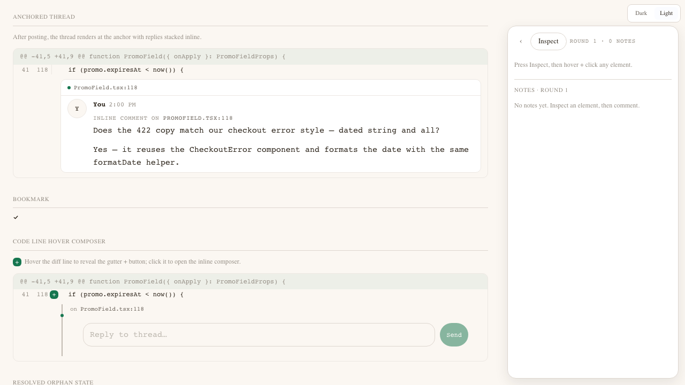

# AL4 — Approved design: Inline anchored review comments

DESIGN-CLASS: routine-low-conf
Status: APPROVED as the visual + interaction contract for `/architecture`.
Direction: Variant A (stay close to the existing block-anchor pattern).

---

## Lock summary

Anchored comments in a review are created by hovering the exact spot in an artifact canvas and clicking an affordance; an inline composer appears at that spot; after posting, the threaded comment renders directly adjacent to its anchor. The comment is still a normal `plain` message in the review’s single global Thread.

- No coordinate/offset anchoring. Anchor = `artifactId + blockId + optional spotLabel`.
- No new on-disk payload dialect. Reuses `PlainPayloadWithBlockId` + a `refs[]` artifact label.
- No per-artifact or per-spot thread. One global Thread per Subject.
- No change to the Subject-level verdict flow.

---

## Interaction grammar

| Step | Code diff | Prose / block content | Region / cell / step |
|---|---|---|---|
| **Hover** | Diff line gets a warm-tint background plus a gutter `+`. | Block gets the existing hover handle / left edge affordance. | Sub-element gets a subtle `--accent-primary-dim` overlay. |
| **Trigger** | Click the gutter `+`. | Click “Comment on this block” (in existing popover/menu). | Click the highlighted region/cell. |
| **Compose** | Inline composer opens directly under the line, connected by a vertical hairline. | Inline composer opens directly under the block. | Inline composer opens near the selected region. |
| **Prefill** | Placeholder: `Comment on {spotLabel}…` (e.g., `promo-webhook.ts:118`). | Placeholder: `Comment on paragraph…` or `Comment on block…`. | Placeholder: `Comment on {spotLabel}…`. |
| **Submit** | `Cmd/Ctrl+Enter` or pill `Send` posts a Thread message carrying `blockId` + refs. | Same. | Same. |
| **Cancel** | `Esc` or click outside collapses composer with no post. | Same. | Same. |

---

## Visual specification

### Target hover state

- Code line: `hover:bg-[color-mix(in_oklab,var(--accent-primary)_6%,transparent)]` over `--motion-fast`, applied to the row.
- Gutter `+` button: 16px × 16px, rounded `--r-subtle`, bg `--accent-primary`, `text-[var(--text-on-accent)]`; appears only on row hover. Focus-visible receives `outline outline-1 outline-[var(--accent-primary)]`.
- Composer textarea: focus-visible uses existing `outline-[var(--accent-primary)]` + `shadow-[0_0_0_3px_var(--accent-primary-dim)]` treatment.
- Prose block: reuse the existing block-hover handle; no new chrome.

### Inline composer

- Container: `--surface-elevated`, `--r-subtle`, 1.5px `--border-subtle`, `--shadow-subtle`.
- Connected to anchor by a `w-[var(--bw-default)]` vertical `--border-strong` hairline, 18px high, flush with composer left edge.
- Internal layout: same pill-send pattern as `Composer` but `rows={1}`, no error alert by default, 12px padding.
- Spot-label chip above composer: 11px mono, `--text-tertiary`, format `on {spotLabel}`.

### Anchored thread card

- First comment header: `CommentRow` with `showSenderHeader={true}` and `inlineAnchor={spotLabel}`.
- Replies: `CommentRow` with `showSenderHeader={false}`, stacked vertically, left indented by 12px.
- Thread container same card chrome as composer (elevated + border + shadow) and a 6px forest dot on the left edge.
- The `inlineAnchor` label renders as an 11px mono `--text-tertiary` uppercase line (`tracking-[var(--tracking-caps-sm)]`).

### Orphan state

- If `blockId` no longer resolves during render, the inline card is `opacity-60` and prefixed with a small `source changed` pill in `--text-tertiary`.
- In the global thread, the anchor chip is muted and non-clickable.

### Global-thread chip

- Anchored comments in the global conversation keep the existing reference-chip button (`on {spotLabel}`), but it now scrolls to the anchor and applies a 500ms `--accent-primary-dim` line/block highlight.

---

## Motion

- Composer expand: `height` + `opacity` over `--motion-default`.
- Thread card appear: `translateY(-6px) → 0` + `opacity` over `--motion-default`.
- Hover highlight: background transition over `--motion-fast`.
- Anchor jump highlight: 500ms accent dim pulse, then fade over `--motion-slow`.
- Respect `prefers-reduced-motion` by collapsing to instant swaps (system already handles this via token override).

---

## States

- **Create:** target hovered, trigger visible.
- **Composing:** inline composer open with focused textarea.
- **Sending:** composer disabled, button label `Sending…`.
- **Posted:** composer gone, thread card at anchor.
- **Collapsed thread:** first comment visible; replies hidden behind a `N replies` disclosure. Open on click.
- **Orphaned:** card muted, `source changed` badge.
- **Resolved review:** add affordance hidden; existing threads read-only.

---

## Accessibility

- The gutter `+` has `aria-label="Add inline comment"`.
- The composer is a focus trap: `Tab` moves between textarea and send/cancel; `Esc` closes.
- Anchor chip in the global thread is a `<button>` with `aria-label="Go to anchor {spotLabel}"`.
- Orphan state: `aria-label="Anchor no longer resolves"`.

---

## Mobile

- Right pane examine becomes a full-screen sheet; the anchored thread card sits between content rows as in desktop.
- Inline composer becomes a sticky bottom input inside the sheet so the anchor remains visible while typing.
- Gutter `+` becomes a tap on the line row; line tap also opens selection highlight.

---

## Rejection list (locked)

- Floating side-rail (Variant B): not the default.
- Coordinate/offset anchoring: rejected per concept hard rule.
- Per-spot/per-artifact threads: rejected per AL1.
- Suggestion/inline edit mode: out of scope.
- New visual language for anchored comments: rejected; use Hearth + existing primitives.

---

## Looked-at artifact

`packages/design-system/src/ReviewAnchoredComment.stories.tsx` renders the two key Variant A states:
1. Code-line hover with the gutter `+` and an open inline composer.
2. An anchored thread card below a code line, rendered through `CommentRow`.

A **Sending** state story will be added once the design-system `Composer` exposes a stable disabled/`busy` visual state; until then the existing `Composer` internal `Sending…` state covers the runtime behavior.

## Screenshot

Captured below with the design-system viewer at `http://localhost:8098/#Review%20Anchored%20Comment`.

If the image is missing, the viewer or Playwright was unavailable during this design pass; the story file itself remains the looked-at artifact.
