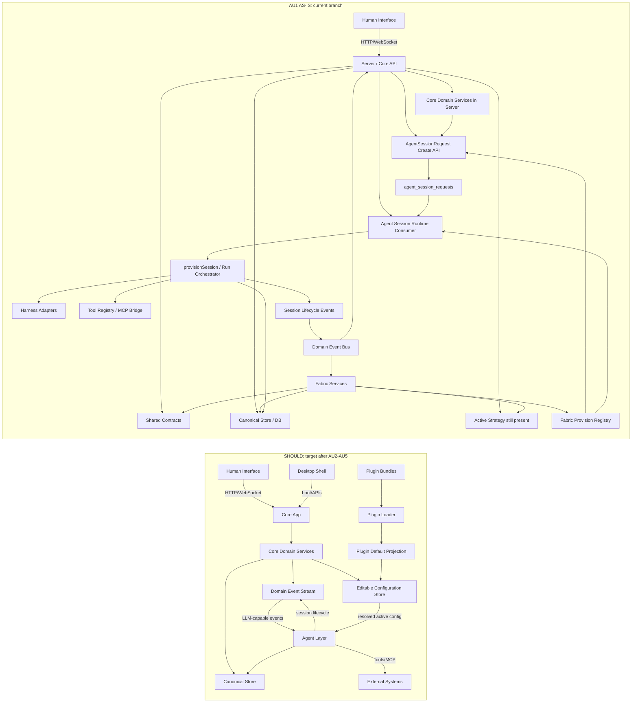

# AU1 Dependency Graph Comparison

Purpose: compare AU1's as-built dependency graph against the registered should-dependency graph at `/Users/tg/hyperidle/.worktrees/kernel-plugin-dependency-audit/plans/strategy-kernel-plugin-split/as-should-dependency-graph.md`.

This is the Track AU progress ledger. Future AU work packages should update this file or add a sibling snapshot with the same sections so dependency-tree progress is visible over time.

## Side-By-Side Layer Graph



## Side-By-Side Component Comparison

| Should graph component | Should responsibility | AU1 as-is location/state | Delta after AU1 |
| --- | --- | --- | --- |
| Core App | Owns app APIs and core records; does not provision sessions | `packages/server` still owns APIs and runtime-adjacent services | Core still too broad |
| Core Domain Services | Work, Conversation, Knowledge, Users, Settings, Routines emit events and persist records | Mostly in `packages/server`; some routine/task behavior remains in `packages/fabric` | Partial ownership split remains |
| Editable Configuration Store | Active config from built-ins/plugins/user overrides | Not built in AU1 | Missing |
| Domain Event Stream | Sends LLM-capable events to Agent Layer | Existing event bus remains; events still feed server and Fabric subscribers | Event stream exists but target routing not done |
| Plugin Bundles / Loader / Defaults | Plugins seed editable config only | Not built in AU1 | Missing |
| Agent Layer | Owns every LLM-capable run end-to-end | Runtime consumer and `provisionSession` still live in `packages/server`; Fabric still triggers some runs | Partial |
| Session Request Queue | Durable request boundary before runtime execution | Built as `agent_session_requests` + create/claim/consume services | Done for local runtime |
| Agent Run Orchestrator | Admission, provisioning, harness run, tools, MCP, capture, lifecycle | Existing `provisionSession` remains orchestrator; now entered through request consumer | Improved entry point, not extracted |
| Context Assembly Providers | Build run context from core records/config | Still Strategy/Fabric-shaped | Not simplified |
| Trigger Resolver | Maps domain events to configured agent runs | Not built; existing callers decide when to enqueue | Missing |
| Harness Registry / Adapters | Agent Layer resolves harnesses | Harness adapters remain in server runtime | Not extracted |
| Tool Surface / MCP | Agent Layer resolves and executes tool/MCP access | Existing server tool registry/MCP bridge remains | Not extracted |
| Capture / Writeback | Agent Layer writes results back to app records | Existing provisioning/tool paths remain; decomposition writeback preserved via `create_task` | Partial |
| Session Lifecycle Publisher | Emits lifecycle with enough correlation | Lifecycle now includes `requestId`, `sourceKind`, `sourceId`, `sourceCorrelation` | Done |

## Package-Level Edges After AU1

From touched source imports:

```text
server -> db
server -> fabric
server -> shared
server -> strategy-minimal
fabric -> db
fabric -> shared
```

Target package direction is:

```text
human-interface -> core-app
desktop -> core-app
core-app -> db/shared/config/events
agent-layer -> db/shared/config/events/external-systems
plugins -> config
```

Open gap: `server -> fabric` and active Strategy/Fabric runtime ownership remain. AU1 reduces runtime entry-point complexity, but does not yet reduce the package dependency tree.

## AU1 Progress Against The Should Graph

| Target rule from should graph | AU1 result | Status |
| --- | --- | --- |
| Core app owns records and emits domain events; it does not provision sessions | Core callers now create `AgentSessionRequest`; public/session assistant/routine/decomposition paths no longer need bespoke direct starts | Partial |
| Agent layer owns every LLM-capable run | Runtime consumer owns request consumption, then calls existing `provisionSession` | Partial |
| Session Request Queue exists | `agent_session_requests` table, idempotent create, claim, terminal status | Done |
| Session lifecycle carries source correlation | `requestId/sourceKind/sourceId/sourceCorrelation` added to lifecycle and sessions | Done |
| Task-free runs do not require task rows | `sessions.task_id` nullable; assistant/routine/decomposition can be task-free | Done |
| Trigger resolver exists | No central trigger resolver yet | Not started |
| Config resolver/plugin defaults exist | No editable config/plugin-default graph yet | Not started |
| Strategy removed | Active Strategy still exists | Not started |
| Fabric service layer removed | Fabric still owns task dispatcher, routine scheduler, bootstrap/service bundle | Not started |
| Plugins only flow into configuration | Not addressed in AU1 | Not started |

## Before And After Runtime Entry Shape

Before AU1:

```text
Task Dispatcher -> provision registry -> provisionSession
Assistant Turn -> provisionSession with conv-stub task
Routine Scheduler -> direct session/provision path or stub task assumptions
Knowledge action -> domain-local event path
Bet Decomposition -> direct PM adapter/runtime path
```

After AU1:

```text
Task Dispatcher -> AgentSessionRequest -> Runtime Consumer -> provisionSession
Assistant Turn -> AgentSessionRequest -> Runtime Consumer -> provisionSession
Routine Fire -> AgentSessionRequest -> Runtime Consumer -> provisionSession
Knowledge Review -> AgentSessionRequest
Bet Decomposition -> AgentSessionRequest -> Runtime Consumer -> create_task writeback
```

That is the concrete AU1 progress: the runtime entry boundary is now request-shaped. The dependency tree still needs later AU work to extract Agent Layer ownership and remove Strategy/Fabric from the core path.

## Update Rule For Future AU Snapshots

For each AU package:

1. Keep the left side as the registered should graph unless the target changes.
2. Update the right side with actual package/component ownership.
3. Update package-level edges from changed files.
4. Mark movement in the progress table, especially removal of `server -> fabric`, Strategy singleton use, Fabric-owned runtime behavior, and plugin/config ownership.
