# AU19 As-Is Dependency Graph — Post-Shipment (2026-07-16)

Baseline: `framework/AU19-applications-layers-services`, shipped as PR #450, CI green, all `npm run
verify` checks passing at HEAD. Verified directly against the shipped source (every
`packages/{core-api,agent-orchestration,agent-execution}/*/src/ports.ts`, `package.json`
dependency lists, `scripts/table-ownership-guard.ts`'s `TABLE_OWNER` map, `packages/shared/src/events.ts`'s
`KernelEvent` union, and the composition root at `packages/core-api/src/{server-factory,app}.ts` +
`services/*-bindings.ts`) — **not** `plans/AU19/architecture.md` §10.1/§10.2, whose census tables are
explicitly labeled "post-Increment-3i" and predate the tool split (Increment 4) and several
Increment-5 corrections. This document is the current source of truth for "what actually shipped";
§10.1/§10.2 remain useful as the historical planning record.

## Key structural facts

- **No Service's `package.json` lists another Service as a dependency.** Every one of the ~31 Service
  packages depends only on `@hyperidle/db` and/or `@hyperidle/shared`. Every cross-Service edge is a
  structurally-typed DI port (`ports.ts`), wired at a composition root — never a direct package import
  between nested Services. This is Mechanism C, holding with zero exceptions found.
- **Layering (foundational → consumer):** `core-api` is the foundation — both `core-ui` (the web app,
  via a type-only Hono RPC client import) and `agent-orchestration` depend on it. `agent-orchestration`
  additionally reaches `agent-execution`, but only through **one seam** (`HarnessPort`), injected by
  the Application at boot — never a package dependency. A `core-api` Service is structurally forbidden
  from depending on `agent-orchestration`; the three places that need to reach "up" invert through the
  `EventBus` instead (§ Against-grain edges, below).
- **The real composition root is `packages/core-api/src/`** (the dissolved former `packages/server`) —
  not the `@hyperidle/agent-orchestration` or `@hyperidle/agent-execution` Layer barrels, which are
  both empty (`export {}`) by design, pending a future consumer.

## The graph

```mermaid
flowchart TD
  subgraph UI["core-ui"]
    WEB["web (React)"]
  end

  subgraph APPS["Applications — bootstrap only, inject the concrete HarnessPort"]
    direction LR
    DESKTOP["desktop<br/>(core-api + orchestration + execution,<br/>one Electron process)"]
    REMOTESERVER["remote-server<br/>(core-api + orchestration only,<br/>never composes execution)"]
    REMOTEWORKER["remote-worker<br/>(execution only —<br/>today only run inside desktop)"]
  end

  subgraph CA["core-api layer (17 Services, foundational — every table lives here)"]
    direction LR
    ca_work["work<br/>bets/tasks/items/artifacts"]
    ca_org["org<br/>teamMembers/orgEdges/teams"]
    ca_users["users<br/>users/loginSessions/hintProgress"]
    ca_conversation["conversation<br/>threads/messages"]
    ca_knowledge["knowledge<br/>knowledgeItems + fabric"]
    ca_review["review<br/>proposedCalls/tailoredGrants"]
    ca_settings["settings<br/>serverConfig/plugins"]
    ca_notifications["notifications<br/>notificationQueue"]
    ca_connections["connections<br/>serverCredentials"]
    ca_routine["routine<br/>routines/routineRuns"]
    ca_filesystems["filesystems<br/>filesystems/captures"]
    ca_policy["policy<br/>handoff/approval/propagation"]
    ca_gitexport["git-export"]
    ca_modelgateway["model-gateway"]
    ca_observability["observability<br/>(wildcard event sink)"]
    ca_realtime["realtime<br/>(broad fan-in, WS push)"]
    ca_retention["retention<br/>(TTL reaper)"]
  end

  subgraph AO["agent-orchestration layer (11 Services)"]
    direction LR
    ao_sessionrequests["session-requests<br/>agentWorkIntents/agentSessionRequests"]
    ao_sessionlifecycle["session-lifecycle<br/>(composes HarnessPort)"]
    ao_runorchestration["run-orchestration"]
    ao_dispatch["dispatch"]
    ao_toolhandlers["tool-handlers<br/>(11 agent-invocable tools)"]
    ao_triggerresolution["trigger-resolution<br/>triggerResolutionHistory"]
    ao_agentselection["agent-selection"]
    ao_cost["cost"]
    ao_contextassembly["context-assembly"]
    ao_lifecycleprojection["lifecycle-projection<br/>agentLifecycleInbox"]
    ao_capturewriteback["capture-writeback"]
  end

  subgraph AE["agent-execution layer (3 Services — zero DB, zero Service deps)"]
    direction LR
    ae_harnessregistry["harness-registry<br/>AdapterPool/CLI adapters"]
    ae_mcpprovider["mcp-provider"]
    ae_toolprovider["tool-provider<br/>(descriptor/dispatch)"]
  end

  %% Applications compose Layers (bootstrap wiring)
  DESKTOP -.compose.-> CA
  DESKTOP -.compose.-> AO
  DESKTOP -.compose.-> AE
  REMOTESERVER -.compose.-> CA
  REMOTESERVER -.compose.-> AO
  REMOTEWORKER -.compose.-> AE
  WEB -->|"type-only RPC client"| CA

  %% core-api intra-layer DI (ordinary, wired in server-factory.ts/app.ts)
  ca_connections --> ca_users
  ca_gitexport --> ca_settings
  ca_gitexport --> ca_knowledge
  ca_modelgateway --> ca_connections
  ca_notifications --> ca_settings
  ca_notifications --> ca_users
  ca_notifications --> ca_org
  ca_notifications --> ca_work
  ca_notifications --> ca_connections
  ca_observability --> ca_settings
  ca_policy --> ca_work
  ca_policy --> ca_conversation
  ca_policy --> ca_users
  ca_policy --> ca_org
  ca_policy --> ca_notifications
  ca_realtime --> ca_conversation
  ca_realtime --> ca_users
  ca_realtime --> ca_org
  ca_realtime --> ca_work
  ca_retention --> ca_users
  ca_retention --> ca_knowledge
  ca_retention --> ca_notifications
  ca_review --> ca_work
  ca_review --> ca_conversation
  ca_review --> ca_users
  ca_review --> ca_org
  ca_settings --> ca_routine
  ca_settings --> ca_users
  ca_settings --> ca_connections
  ca_filesystems --> ca_work
  ca_filesystems --> ca_connections

  %% agent-orchestration -> core-api (legal downward DI)
  ao_agentselection --> ca_users
  ao_agentselection --> ca_org
  ao_cost --> ca_org
  ao_cost --> ca_settings
  ao_cost --> ca_work
  ao_contextassembly --> ca_knowledge
  ao_contextassembly --> ca_work
  ao_contextassembly --> ca_users
  ao_contextassembly --> ca_routine
  ao_contextassembly --> ca_filesystems
  ao_contextassembly --> ca_org
  ao_dispatch --> ca_conversation
  ao_dispatch --> ca_knowledge
  ao_dispatch --> ca_modelgateway
  ao_dispatch --> ca_review
  ao_dispatch --> ca_routine
  ao_dispatch --> ca_settings
  ao_dispatch --> ca_users
  ao_dispatch --> ca_work
  ao_lifecycleprojection --> ca_routine
  ao_lifecycleprojection --> ca_work
  ao_sessionlifecycle --> ca_connections
  ao_sessionlifecycle --> ca_filesystems
  ao_sessionlifecycle --> ca_routine
  ao_sessionlifecycle --> ca_settings
  ao_sessionlifecycle --> ca_users
  ao_sessionlifecycle --> ca_work
  ao_sessionlifecycle --> ca_observability
  ao_sessionrequests --> ca_conversation
  ao_sessionrequests --> ca_knowledge
  ao_sessionrequests --> ca_org
  ao_sessionrequests --> ca_review
  ao_sessionrequests --> ca_routine
  ao_sessionrequests --> ca_settings
  ao_sessionrequests --> ca_users
  ao_sessionrequests --> ca_work
  ao_toolhandlers --> ca_conversation
  ao_toolhandlers --> ca_knowledge
  ao_toolhandlers --> ca_org
  ao_toolhandlers --> ca_routine
  ao_toolhandlers --> ca_users
  ao_toolhandlers --> ca_work
  ao_toolhandlers --> ca_review
  ao_triggerresolution --> ca_users
  ao_triggerresolution --> ca_org

  %% agent-orchestration peer edges (same layer)
  ao_dispatch <--> ao_toolhandlers
  ao_runorchestration <--> ao_dispatch
  ao_runorchestration --> ao_sessionrequests
  ao_runorchestration --> ao_sessionlifecycle
  ao_sessionrequests --> ao_lifecycleprojection
  ao_lifecycleprojection --> ao_sessionrequests
  ao_dispatch --> ao_sessionrequests
  ao_sessionlifecycle --> ao_sessionrequests
  ao_sessionlifecycle --> ao_cost
  ao_sessionlifecycle --> ao_contextassembly
  ao_toolhandlers --> ao_dispatch
  ao_toolhandlers --> ao_agentselection

  %% agent-orchestration -> agent-execution (legal downward DI — the tool split)
  ao_sessionlifecycle --> ae_harnessregistry
  ao_sessionlifecycle --> ae_mcpprovider
  ao_sessionlifecycle --> ae_toolprovider
  ao_dispatch --> ae_harnessregistry
  ao_runorchestration --> ae_harnessregistry

  %% the ONE execution seam (application-injected, not a package dep)
  ao_runorchestration ==>|"HarnessPort seam<br/>(admitSession/runSession,<br/>Application-injected)"| ae_harnessregistry

  %% AGAINST-GRAIN edges — all EventBus inversions, zero direct DI exceptions
  ca_filesystems -.->|"EventBus:<br/>sandbox_writeback_changes_detected"| ao_capturewriteback
  ca_policy -.->|"EventBus:<br/>session_handoff_completed"| ao_cost
  ca_policy -.->|"EventBus:<br/>session_handoff_completed"| ao_sessionlifecycle
```

**Legend:** solid arrow `-->` = ordinary DI port (downward or same-layer, wired at a composition
root). `<-->` = mutual peer DI (both sides bound-function only, no package cycle). Thick `==>` = the
one `HarnessPort` execution seam, Application-injected. Dashed `-.->` = EventBus inversion — always
against-grain (a `core-api` Service reaching "up" into `agent-orchestration`), the only lever that
direction is legal. `-.compose.->` = an Application composing a Layer at boot (bootstrap wiring, not
a runtime call edge).

**Simplifications for readability:** `observability` (wildcard `"*"` subscriber — every domain event)
and `realtime` (broad WS-push fan-in from ~15 event-emitting sites) are drawn only with their DI ports
above; their EventBus fan-in is a many-to-one sink, not meaningful individual edges — see § EventBus
inversions below for the full list. `knowledge → git-export` (a second, EventBus-based edge alongside
`git-export`'s DI read of `knowledge`) is omitted from the diagram to avoid a visual cycle between two
boxes that are otherwise a clean one-directional DI edge — noted in prose instead.

## EventBus edges (full list, including same-layer ones omitted from the diagram above)

| Emitter | Event | Subscriber | Grain |
|---|---|---|---|
| `filesystems` | `sandbox_writeback_changes_detected` | `capture-writeback` | **against-grain** |
| `policy` | `session_handoff_completed` | `cost` | **against-grain** |
| `policy` | `session_handoff_completed` | `session-lifecycle` | **against-grain** |
| `work`, `session-lifecycle` | `task_state_changed` | `filesystems` (dep-watcher), `dispatch`, `realtime` | same-layer / legal |
| `filesystems` | `notification` (`auto_unblock`) | `notifications` | same-layer |
| `policy` | `notification` (`attention`) | `notifications` | same-layer |
| `knowledge` | `knowledge_updated` | `git-export`, `realtime` | same-layer (the second `knowledge↔git-export` edge, omitted from the diagram above) |
| `work` | `bet_state_changed` | `dispatch`, `realtime`, `work` (self, `bet-decomposition-subscriber.ts`) | legal |
| `session-lifecycle` | `session_ended` | `cost`, `review`, `capture-writeback`, `dispatch`, `realtime` | legal (peer + downward) |
| `tool-handlers` (5 tools) | `task_state_changed`/`artifact_created`/`item_created`/`agent_added`/`team_created` | `realtime` | legal |
| `cost` | `cost_cap_warning`/`cost_cap_breached` | `realtime`, `notifications` | legal |
| `dispatch` | `routine_fired` | `notifications` | legal |
| `agent-selection` | `work_selection_requested` | (audit-only, no mutating subscriber) | n/a |
| — (wildcard) | every `DomainEvent` | `observability` | audit sink, not a directional edge |
| — (~15 producers) | thread/*, propagation_*, session_started, tool_call_recorded, etc. | `realtime` | broad UI-push fan-in, not enumerated individually |

**Against-grain edges are genuinely rare and fully resolved: exactly three.** Zero illegal direct DI
edges were found crossing `core-api → agent-orchestration` anywhere in the shipped tree — every case
that needed to reach "up" inverts through the `EventBus`, matching the architecture's own rule with no
exceptions.

## Full Service roster

### `core-api` (17 Services — every SQL table in the system lives here)

| Service | Owned tables | Purpose |
|---|---|---|
| `work` | `bets`, `tasks`, `items`, `artifacts`, `taskPlanningSignals` | Bet/task/item state machines, decomposition |
| `org` | `teamMembers`, `orgEdges`, `teams` | Team/org membership, routing, agent scaffolding |
| `users` | `users`, `loginSessions`, `inviteCodes`, `hintProgress` | User directory/auth |
| `conversation` | `threads`, `messages` | Threads/messages store |
| `knowledge` | `knowledgeItems`, `knowledgeEditLog`, `knowledgeAccessLog`, `knowledgeConflicts`, `knowledgeAppProjection` | Knowledge fabric: items, attention scoring, promotion |
| `review` | `proposedCalls`, `operationOutcomes`, `tailoredGrants` | AL7 trust-first review workflow |
| `settings` | `serverConfig`, `plugins`, `pluginConfigurationDefaults`, `configurationOverrides` | Server config, plugin configuration |
| `notifications` | `notificationQueue` | Notification dispatch/digest/mute |
| `connections` | `serverCredentials`, `serviceConnections` | Credential storage/encryption |
| `routine` | `routines`, `routineRuns` | Routine config/run state |
| `filesystems` | `filesystems`, `filesystemInjections`, `filesystemCaptures` | Filesystem registry, mounting, capture |
| `policy` | zero | Handoff protocol, approval-rate, lifecycle propagation |
| `git-export` | zero | Knowledge→git export |
| `model-gateway` | zero | Model tier → concrete model + credential |
| `observability` | zero | Structured event dispatcher (wildcard sink) |
| `realtime` | zero | WS broadcaster to UI clients |
| `retention` | zero | TTL reaper across other Services' tables |

### `agent-orchestration` (11 Services)

| Service | Owned tables | Purpose |
|---|---|---|
| `session-requests` | `agentWorkIntents`, `agentSessionRequests`, `explicitSessionStarts` | Work-intent/session request queue |
| `session-lifecycle` | zero | Session admit/provision/run/end; composes the `HarnessPort` |
| `run-orchestration` | zero | Top-level run admit/execute; worker WS route |
| `dispatch` | zero | Task/assistant-turn dispatch, routine scheduler |
| `tool-handlers` | zero | Every agent-invocable tool (create_task, handoff_to, …) |
| `trigger-resolution` | `triggerResolutionHistory` | Resolves triggers into session requests |
| `agent-selection` | zero | Selects owning/candidate agent |
| `cost` | zero | Cost-cap tracking, dedup, sentinel |
| `context-assembly` | zero | Assembles session context |
| `lifecycle-projection` | `agentLifecycleInbox` | Projects lifecycle facts into terminal states |
| `capture-writeback` | zero | Writes sandbox changes back into knowledge |

### `agent-execution` (3 Services — zero DB, zero Service deps of any kind)

| Service | Purpose |
|---|---|
| `harness-registry` | Harness adapters, `AdapterPool`, return-gate enforcement |
| `mcp-provider` | MCP bridge for CLI-spawned harnesses |
| `tool-provider` | Harness-facing tool descriptor/dispatch surface |

### `core-ui` and Applications

| Package | Composes | Notes |
|---|---|---|
| `web` (`core-ui`) | `core-api` (type-only) | `connections`/`harness-registry` deps are dev-script-only, dead in the shipped bundle |
| `desktop` | `core-api` + `agent-orchestration` + `agent-execution` | One Electron process; injects `LocalSandboxAdapter` + in-process `AdapterPool` |
| `remote-server` | `core-api` + `agent-orchestration` only | **Never** composes `agent-execution`; injects `DisabledSandboxAdapter` + an empty `AdapterPool`, populated only by remote workers registering over WS |
| `remote-worker` | `agent-execution` only | Real, separately-typed package — but today only ever instantiated inside `desktop` (toggle mode), no standalone deployable exists yet |

## Notable structural findings

1. **`dispatch` and `tool-handlers` are mutually coupled peers**, as are `dispatch` and
   `run-orchestration` — both same-layer "circular-import-by-construction," safe only because neither
   package imports the other; the coupling exists solely in the composition root's bound-function
   wiring, never a package-level cycle.
2. **`remote-worker` has no standalone deployable today** — real code, real package, but only ever
   run inside `desktop`'s toggle mode. Extracting it was Increment 5's scope; building actual
   deployment/ops tooling around it was explicitly ruled out of AU19 (see architecture.md's
   Increment-5 scoping ruling).
3. **`observability` and `realtime` are broad fan-in hubs** (wildcard sink / ~15 producers) — drawn as
   single nodes with their outbound DI ports only, not one line per emitter, to keep the diagram
   legible.
4. **Three against-grain edges, all EventBus-inverted, zero exceptions** — `filesystems→capture-writeback`,
   `policy→cost`, `policy→session-lifecycle`. This was the single riskiest part of the plan (§10.3) and
   it closed clean.
5. **`packages/core-api/src/` (the dissolved former `packages/server`) is the true composition root** —
   the `agent-orchestration` and `agent-execution` Layer barrels are both empty (`export {}`) by
   design, pending a future consumer that needs a real Layer-level import surface.
