# AU19/AU20 As-Is Dependency Graph — Generated

Generated mechanically by `scripts/generate-dependency-graph.ts` from the current source tree. Surface counts come from the authoritative implementation-site `scripts/surface-census.ts`. Do not hand-edit this file; regenerate it.

## Current graph

```mermaid
flowchart TD
  subgraph core_api["core-api"]
    connections["connections<br/>12m / 1t"]
    conversation["conversation<br/>16m / 8t"]
    filesystems["filesystems<br/>12m / 9t"]
    git_export["git-export<br/>21m / 16t"]
    knowledge["knowledge<br/>19m / 14t"]
    model_gateway["model-gateway<br/>2m / 2t"]
    notifications["notifications<br/>17m / 11t"]
    observability["observability<br/>7m / 13t"]
    org["org<br/>14m / 7t"]
    policy["policy<br/>3m / 6t"]
    realtime["realtime<br/>2m / 3t"]
    review["review<br/>10m / 9t"]
    routine["routine<br/>20m / 14t"]
    settings["settings<br/>8m / 8t"]
    users["users<br/>19m / 5t"]
    work["work<br/>26m / 28t"]
  end
  subgraph agent_orchestration["agent-orchestration"]
    cost["cost<br/>1m / 6t"]
    dispatch["dispatch<br/>1m / 4t"]
    run_orchestration["run-orchestration<br/>13m / 17t"]
    session_requests["session-requests<br/>15m / 8t"]
    tool_handlers["tool-handlers<br/>2m / 1t"]
  end
  subgraph agent_execution["agent-execution"]
    harness_registry["harness-registry<br/>22m / 13t"]
  end
  filesystems -->|"FilesystemsGitRunner"| git_export
  filesystems -->|"FilesystemsServiceConnectionResolver"| connections
  git_export -->|"GitExportServerConfigPort"| settings
  git_export -->|"GitExportKnowledgeReader"| knowledge
  model_gateway -->|"ModelGatewayCredentialResolver"| connections
  notifications -->|"NotificationsServerConfigPort"| settings
  notifications -->|"NotificationsUserReader"| users
  notifications -->|"NotificationsTeamReader"| org
  notifications -->|"NotificationsWorkReader"| work
  notifications -->|"NotificationsCredentialCipher"| connections
  notifications -->|"NotificationsCredentialStore"| connections
  org -->|"OrgUserDirectory"| users
  policy -->|"PolicyDeps.work"| work
  policy -->|"PolicyDeps.conversation"| conversation
  policy -->|"PolicyDeps.users"| users
  policy -->|"PolicyDeps.org"| org
  policy -->|"PolicyDeps.notifications"| notifications
  policy -->|"PolicyDeps.sessionRequests"| session_requests
  realtime -->|"RealtimeThreadReader"| conversation
  realtime -->|"RealtimeUserDirectory"| users
  realtime -->|"RealtimeOrgTeamReader"| org
  realtime -->|"RealtimeTaskReader"| work
  review -->|"ReviewPorts"| users
  routine -->|"RoutineSchedulerPorts"| users
  settings -->|"RoutineReader"| routine
  settings -->|"SettingsUserDirectory"| users
  settings -->|"SettingsCredentialCipher"| connections
  work -->|"UserStoreReader"| users
  work -->|"TeamCapacityReader"| org
  cost -->|"CostDeps.users"| users
  cost -->|"CostDeps.org"| org
  cost -->|"CostDeps.work"| work
  cost -->|"CostDeps.settings"| settings
  dispatch -->|"DispatchPorts.work"| work
  dispatch -->|"DispatchPorts.routine"| routine
  dispatch -->|"DispatchPorts.conversation"| conversation
  dispatch -->|"DispatchPorts.users"| users
  dispatch -->|"DispatchPorts.settings"| settings
  dispatch -->|"DispatchPorts.modelGateway"| model_gateway
  dispatch -->|"DispatchPorts.runOrchestration"| run_orchestration
  dispatch -->|"DispatchPorts.toolHandlers"| tool_handlers
  tool_handlers -->|"ToolHandlersWorkAccessor"| work
  tool_handlers -->|"ToolHandlersDispatchAccessor"| dispatch
  policy -. "session_handoff_completed" .-> cost
  policy -. "session_handoff_completed" .-> run_orchestration
  policy -. "task_state_changed" .-> dispatch
  policy -. "task_state_changed" .-> _core_api_composition_root_
  work -. "task_state_changed" .-> policy
  work -. "task_state_changed" .-> dispatch
  work -. "task_state_changed" .-> _core_api_composition_root_
  run_orchestration -. "task_state_changed" .-> policy
  run_orchestration -. "task_state_changed" .-> dispatch
  run_orchestration -. "task_state_changed" .-> _core_api_composition_root_
  policy -. "bet_state_changed" .-> routine
  policy -. "bet_state_changed" .-> work
  work -. "bet_state_changed" .-> policy
  work -. "bet_state_changed" .-> routine
  routine -. "routine_fired" .-> notifications
  work -. "item_created" .-> notifications
  work -. "item_created" .-> policy
  work -. "notification" .-> notifications
  cost -. "cost_cap_breached" .-> notifications
  cost -. "cost_cap_warning" .-> notifications
  run_orchestration -. "session_started" .-> _core_api_composition_root_
  run_orchestration -. "tool_call_recorded" .-> _core_api_composition_root_
  run_orchestration -. "session_ended" .-> policy
  run_orchestration -. "session_ended" .-> review
  run_orchestration -. "session_ended" .-> cost
  run_orchestration -. "session_ended" .-> dispatch
  run_orchestration -. "session_ended" .-> session_requests
  run_orchestration -. "session_ended" .-> _core_api_composition_root_
  run_orchestration -. "agent_run_admission_failed" .-> _core_api_composition_root_
  session_requests -. "agent_run_admission_failed" .-> _core_api_composition_root_
  run_orchestration -. "agent_run_lifecycle_changed" .-> _core_api_composition_root_
```

## Surface by Service

| Service | Layer | Methods | Types | Total | Owned tables |
|---|---|---:|---:|---:|---|
| work | core-api | 26 | 28 | 54 | bets, tasks, items, artifacts, taskPlanningSignals |
| git-export | core-api | 21 | 16 | 37 | — |
| harness-registry | agent-execution | 22 | 13 | 35 | — |
| routine | core-api | 20 | 14 | 34 | routines, routineRuns |
| knowledge | core-api | 19 | 14 | 33 | knowledgeItems, knowledgeEditLog, knowledgeAccessLog, knowledgeConflicts, knowledgeAppProjection |
| run-orchestration | agent-orchestration | 13 | 17 | 30 | — |
| notifications | core-api | 17 | 11 | 28 | notificationQueue |
| conversation | core-api | 16 | 8 | 24 | threads, messages |
| users | core-api | 19 | 5 | 24 | users, loginSessions, inviteCodes, hintProgress |
| session-requests | agent-orchestration | 15 | 8 | 23 | triggerResolutionHistory, agentWorkIntents, agentSessionRequests, explicitSessionStarts, agentLifecycleInbox |
| filesystems | core-api | 12 | 9 | 21 | filesystems, filesystemInjections, filesystemCaptures |
| org | core-api | 14 | 7 | 21 | teamMembers, orgEdges, teams |
| observability | core-api | 7 | 13 | 20 | — |
| review | core-api | 10 | 9 | 19 | proposedCalls, operationOutcomes, tailoredGrants |
| settings | core-api | 8 | 8 | 16 | serverConfig, plugins, pluginConfigurationDefaults, configurationOverrides |
| connections | core-api | 12 | 1 | 13 | serverCredentials, serviceConnections |
| policy | core-api | 3 | 6 | 9 | — |
| cost | agent-orchestration | 1 | 6 | 7 | — |
| dispatch | agent-orchestration | 1 | 4 | 5 | — |
| realtime | core-api | 2 | 3 | 5 | — |
| model-gateway | core-api | 2 | 2 | 4 | — |
| tool-handlers | agent-orchestration | 2 | 1 | 3 | — |
| **TOTAL (22)** |  | **262** | **203** | **465** |  |

## Extraction summary

- Port-derived edges: 43 (43 high confidence, 0 medium, 0 unresolved)
- EventBus edges: 31
- Hidden composition-bundle edges: 33 (29 agent-orchestration -> core-api)
- Services: 22
