# AU19/AU20 As-Is Dependency Graph — Generated

Generated mechanically by `scripts/generate-dependency-graph.ts` from the current source tree. Surface counts come from the authoritative implementation-site `scripts/surface-census.ts`. Do not hand-edit this file; regenerate it.

## Current graph

```mermaid
flowchart TD
  subgraph core_api["core-api"]
    connections["connections<br/>14m / 3t"]
    conversation["conversation<br/>14m / 6t"]
    filesystems["filesystems<br/>13m / 11t"]
    git_export["git-export<br/>21m / 16t"]
    knowledge["knowledge<br/>17m / 12t"]
    model_gateway["model-gateway<br/>2m / 2t"]
    notifications["notifications<br/>17m / 11t"]
    observability["observability<br/>7m / 13t"]
    org["org<br/>14m / 7t"]
    policy["policy<br/>3m / 6t"]
    realtime["realtime<br/>2m / 3t"]
    review["review<br/>7m / 7t"]
    routine["routine<br/>11m / 4t"]
    settings["settings<br/>8m / 8t"]
    users["users<br/>17m / 5t"]
    work["work<br/>15m / 20t"]
  end
  subgraph agent_orchestration["agent-orchestration"]
    agent_selection["agent-selection<br/>1m / 7t"]
    cost["cost<br/>1m / 6t"]
    dispatch["dispatch<br/>1m / 5t"]
    run_orchestration["run-orchestration<br/>9m / 8t"]
    session_requests["session-requests<br/>13m / 7t"]
    tool_handlers["tool-handlers<br/>2m / 1t"]
  end
  subgraph agent_execution["agent-execution"]
    harness_registry["harness-registry<br/>22m / 13t"]
  end
  connections -->|"ConnectionsUserReader"| users
  filesystems -->|"FilesystemsGitRunner"| git_export
  filesystems -->|"FilesystemsServiceConnectionResolver"| connections
  git_export -->|"GitExportServerConfigPort"| settings
  git_export -->|"GitExportKnowledgeReader"| knowledge
  model_gateway -->|"ModelGatewayCredentialResolver"| connections
  notifications -->|"NotificationsServerConfigPort"| settings
  notifications -->|"NotificationsUserReader"| users
  notifications -->|"NotificationsTeamReader"| org
  notifications -->|"NotificationsWorkReader"| work
  notifications -->|"NotificationsCredentialCipher"| connections
  notifications -->|"NotificationsCredentialStore"| connections
  org -->|"OrgUserDirectory"| users
  realtime -->|"RealtimeThreadReader"| conversation
  realtime -->|"RealtimeUserDirectory"| users
  realtime -->|"RealtimeOrgTeamReader"| org
  realtime -->|"RealtimeTaskReader"| work
  review -->|"ReviewAgentWorkIntentRecorder"| session_requests
  settings -->|"RoutineReader"| routine
  settings -->|"SettingsUserDirectory"| users
  settings -->|"SettingsCredentialCipher"| connections
  work -->|"AgentWorkIntentRecorder"| session_requests
  work -->|"AgentSelectionDefaults"| agent_selection
  work -->|"CostCapChecker"| cost
  work -->|"UserStoreReader"| users
  work -->|"TeamCapacityReader"| org
  dispatch -->|"DispatchPorts"| work
  dispatch -->|"DispatchPorts"| routine
  dispatch -->|"DispatchPorts"| conversation
  dispatch -->|"DispatchPorts"| users
  dispatch -->|"DispatchPorts"| settings
  dispatch -->|"DispatchPorts"| model_gateway
  dispatch -->|"DispatchPorts"| agent_selection
  dispatch -->|"DispatchPorts"| run_orchestration
  dispatch -->|"DispatchPorts"| session_requests
  dispatch -->|"DispatchPorts"| cost
  dispatch -->|"DispatchPorts"| review
  dispatch -->|"DispatchPorts"| knowledge
  dispatch -->|"DispatchPorts"| tool_handlers
  tool_handlers -->|"ToolHandlersWorkAccessor"| work
  tool_handlers -->|"ToolHandlersUsersAccessor"| users
  tool_handlers -->|"ToolHandlersConversationAccessor"| conversation
  tool_handlers -->|"ToolHandlersOrgAccessor"| org
  tool_handlers -->|"ToolHandlersAgentSelectionAccessor"| agent_selection
  tool_handlers -->|"ToolHandlersRoutineAccessor"| routine
  tool_handlers -->|"ToolHandlersDispatchAccessor"| dispatch
  tool_handlers -->|"ToolHandlersKnowledgeAccessor"| knowledge
  tool_handlers -->|"ToolHandlersPolicyAccessor"| policy
  filesystems -. "sandbox_writeback_changes_detected" .-> run_orchestration
  policy -. "session_handoff_completed" .-> cost
  policy -. "session_handoff_completed" .-> run_orchestration
  policy -. "task_state_changed" .-> dispatch
  work -. "task_state_changed" .-> policy
  work -. "task_state_changed" .-> dispatch
  run_orchestration -. "task_state_changed" .-> policy
  run_orchestration -. "task_state_changed" .-> dispatch
  policy -. "bet_state_changed" .-> work
  policy -. "bet_state_changed" .-> dispatch
  work -. "bet_state_changed" .-> policy
  work -. "bet_state_changed" .-> dispatch
  work -. "item_created" .-> notifications
  work -. "item_created" .-> policy
  work -. "notification" .-> notifications
  cost -. "cost_cap_breached" .-> notifications
  cost -. "cost_cap_warning" .-> notifications
  dispatch -. "routine_fired" .-> notifications
  run_orchestration -. "session_ended" .-> policy
  run_orchestration -. "session_ended" .-> review
  run_orchestration -. "session_ended" .-> cost
  run_orchestration -. "session_ended" .-> dispatch
```

## Surface by Service

| Service | Layer | Methods | Types | Total | Owned tables |
|---|---|---:|---:|---:|---|
| git-export | core-api | 21 | 16 | 37 | — |
| harness-registry | agent-execution | 22 | 13 | 35 | — |
| work | core-api | 15 | 20 | 35 | bets, tasks, items, artifacts, taskPlanningSignals |
| knowledge | core-api | 17 | 12 | 29 | knowledgeItems, knowledgeEditLog, knowledgeAccessLog, knowledgeConflicts, knowledgeAppProjection |
| notifications | core-api | 17 | 11 | 28 | notificationQueue |
| filesystems | core-api | 13 | 11 | 24 | filesystems, filesystemInjections, filesystemCaptures |
| users | core-api | 17 | 5 | 22 | users, loginSessions, inviteCodes, hintProgress |
| org | core-api | 14 | 7 | 21 | teamMembers, orgEdges, teams |
| conversation | core-api | 14 | 6 | 20 | threads, messages |
| observability | core-api | 7 | 13 | 20 | — |
| session-requests | agent-orchestration | 13 | 7 | 20 | triggerResolutionHistory, agentWorkIntents, agentSessionRequests, explicitSessionStarts, agentLifecycleInbox |
| connections | core-api | 14 | 3 | 17 | serverCredentials, serviceConnections |
| run-orchestration | agent-orchestration | 9 | 8 | 17 | — |
| settings | core-api | 8 | 8 | 16 | serverConfig, plugins, pluginConfigurationDefaults, configurationOverrides |
| routine | core-api | 11 | 4 | 15 | routines, routineRuns |
| review | core-api | 7 | 7 | 14 | proposedCalls, operationOutcomes, tailoredGrants |
| policy | core-api | 3 | 6 | 9 | — |
| agent-selection | agent-orchestration | 1 | 7 | 8 | — |
| cost | agent-orchestration | 1 | 6 | 7 | — |
| dispatch | agent-orchestration | 1 | 5 | 6 | — |
| realtime | core-api | 2 | 3 | 5 | — |
| model-gateway | core-api | 2 | 2 | 4 | — |
| tool-handlers | agent-orchestration | 2 | 1 | 3 | — |
| **TOTAL (23)** |  | **231** | **181** | **412** |  |

## Extraction summary

- Port-derived edges: 48 (48 high confidence, 0 medium, 0 unresolved)
- EventBus edges: 22
- Services: 23
