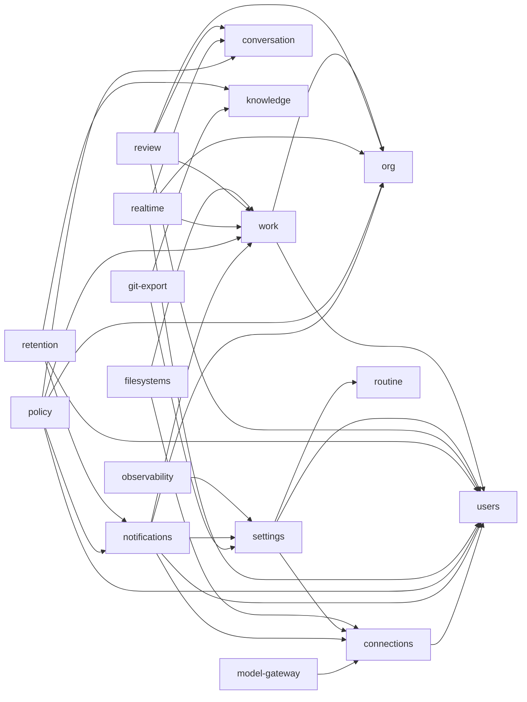
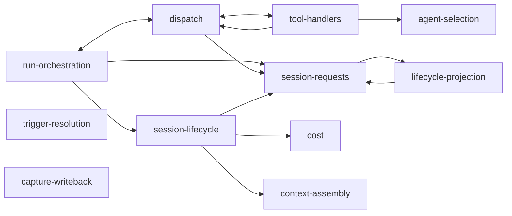
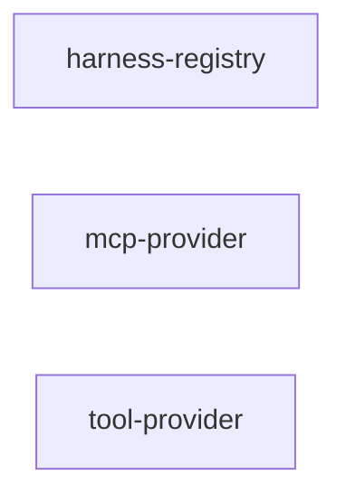

# AU19 As-Is Dependency Graph — Post-Shipment (2026-07-16)

Baseline: `framework/AU19-applications-layers-services`, shipped as PR #450, CI green, all `npm run
verify` checks passing at HEAD. Verified directly against the shipped source (every
`packages/{core-api,agent-orchestration,agent-execution}/*/src/ports.ts`, `package.json`
dependency lists, `scripts/table-ownership-guard.ts`'s `TABLE_OWNER` map, `packages/shared/src/events.ts`'s
`KernelEvent` union, and the composition root at `packages/core-api/src/{server-factory,app}.ts` +
`services/*-bindings.ts`) — **not** `plans/AU19/architecture.md` §10.1/§10.2, whose census tables are
explicitly labeled "post-Increment-3i" and predate the tool split (Increment 4) and several
Increment-5 corrections. This document is the current source of truth for "what actually shipped";
§10.1/§10.2 remain useful as the historical planning record.

## Key structural facts

- **No Service's `package.json` lists another Service as a dependency.** Every one of the ~31 Service
  packages depends only on `@hyperidle/db` and/or `@hyperidle/shared`. Every cross-Service edge is a
  structurally-typed DI port (`ports.ts`), wired at a composition root — never a direct package import
  between nested Services. This is Mechanism C, holding with zero exceptions found.
- **Layering (foundational → consumer):** `core-api` is the foundation — both `core-ui` (the web app,
  via a type-only Hono RPC client import) and `agent-orchestration` depend on it. `agent-orchestration`
  additionally reaches `agent-execution`, but only through **one seam** (`HarnessPort`), injected by
  the Application at boot — never a package dependency. A `core-api` Service is structurally forbidden
  from depending on `agent-orchestration`; the three places that need to reach "up" invert through the
  `EventBus` instead (§ Against-grain edges, below).
- **The real composition root is `packages/core-api/src/`** (the dissolved former `packages/server`) —
  not the `@hyperidle/agent-orchestration` or `@hyperidle/agent-execution` Layer barrels, which are
  both empty (`export {}`) by design, pending a future consumer.

## The graph

```mermaid
flowchart TD
  subgraph UI["core-ui"]
    WEB["web (React)"]
  end

  subgraph APPS["Applications — bootstrap only, inject the concrete HarnessPort"]
    direction LR
    DESKTOP["desktop<br/>(core-api + orchestration + execution,<br/>one Electron process)"]
    REMOTESERVER["remote-server<br/>(core-api + orchestration only,<br/>never composes execution)"]
    REMOTEWORKER["remote-worker<br/>(execution only —<br/>today only run inside desktop)"]
  end

  subgraph CA["core-api layer (17 Services, foundational — every table lives here)"]
    direction LR
    ca_work["work<br/>bets/tasks/items/artifacts"]
    ca_org["org<br/>teamMembers/orgEdges/teams"]
    ca_users["users<br/>users/loginSessions/hintProgress"]
    ca_conversation["conversation<br/>threads/messages"]
    ca_knowledge["knowledge<br/>knowledgeItems + fabric"]
    ca_review["review<br/>proposedCalls/tailoredGrants"]
    ca_settings["settings<br/>serverConfig/plugins"]
    ca_notifications["notifications<br/>notificationQueue"]
    ca_connections["connections<br/>serverCredentials"]
    ca_routine["routine<br/>routines/routineRuns"]
    ca_filesystems["filesystems<br/>filesystems/captures"]
    ca_policy["policy<br/>handoff/approval/propagation"]
    ca_gitexport["git-export"]
    ca_modelgateway["model-gateway"]
    ca_observability["observability<br/>(wildcard event sink)"]
    ca_realtime["realtime<br/>(broad fan-in, WS push)"]
    ca_retention["retention<br/>(TTL reaper)"]
  end

  subgraph AO["agent-orchestration layer (11 Services)"]
    direction LR
    ao_sessionrequests["session-requests<br/>agentWorkIntents/agentSessionRequests"]
    ao_sessionlifecycle["session-lifecycle<br/>(composes HarnessPort)"]
    ao_runorchestration["run-orchestration"]
    ao_dispatch["dispatch"]
    ao_toolhandlers["tool-handlers<br/>(11 agent-invocable tools)"]
    ao_triggerresolution["trigger-resolution<br/>triggerResolutionHistory"]
    ao_agentselection["agent-selection"]
    ao_cost["cost"]
    ao_contextassembly["context-assembly"]
    ao_lifecycleprojection["lifecycle-projection<br/>agentLifecycleInbox"]
    ao_capturewriteback["capture-writeback"]
  end

  subgraph AE["agent-execution layer (3 Services — zero DB, zero Service deps)"]
    direction LR
    ae_harnessregistry["harness-registry<br/>AdapterPool/CLI adapters"]
    ae_mcpprovider["mcp-provider"]
    ae_toolprovider["tool-provider<br/>(descriptor/dispatch)"]
  end

  %% Applications compose Layers (bootstrap wiring)
  DESKTOP -.compose.-> CA
  DESKTOP -.compose.-> AO
  DESKTOP -.compose.-> AE
  REMOTESERVER -.compose.-> CA
  REMOTESERVER -.compose.-> AO
  REMOTEWORKER -.compose.-> AE
  WEB -->|"type-only RPC client"| CA

  %% core-api intra-layer DI (ordinary, wired in server-factory.ts/app.ts)
  ca_connections --> ca_users
  ca_gitexport --> ca_settings
  ca_gitexport --> ca_knowledge
  ca_modelgateway --> ca_connections
  ca_notifications --> ca_settings
  ca_notifications --> ca_users
  ca_notifications --> ca_org
  ca_notifications --> ca_work
  ca_notifications --> ca_connections
  ca_observability --> ca_settings
  ca_policy --> ca_work
  ca_policy --> ca_conversation
  ca_policy --> ca_users
  ca_policy --> ca_org
  ca_policy --> ca_notifications
  ca_realtime --> ca_conversation
  ca_realtime --> ca_users
  ca_realtime --> ca_org
  ca_realtime --> ca_work
  ca_retention --> ca_users
  ca_retention --> ca_knowledge
  ca_retention --> ca_notifications
  ca_review --> ca_work
  ca_review --> ca_conversation
  ca_review --> ca_users
  ca_review --> ca_org
  ca_settings --> ca_routine
  ca_settings --> ca_users
  ca_settings --> ca_connections
  ca_filesystems --> ca_work
  ca_filesystems --> ca_connections
  ca_work --> ca_org
  ca_work --> ca_users

  %% agent-orchestration -> core-api (legal downward DI)
  ao_agentselection --> ca_users
  ao_agentselection --> ca_org
  ao_cost --> ca_org
  ao_cost --> ca_settings
  ao_cost --> ca_work
  ao_contextassembly --> ca_knowledge
  ao_contextassembly --> ca_work
  ao_contextassembly --> ca_users
  ao_contextassembly --> ca_routine
  ao_contextassembly --> ca_filesystems
  ao_contextassembly --> ca_org
  ao_dispatch --> ca_conversation
  ao_dispatch --> ca_knowledge
  ao_dispatch --> ca_modelgateway
  ao_dispatch --> ca_review
  ao_dispatch --> ca_routine
  ao_dispatch --> ca_settings
  ao_dispatch --> ca_users
  ao_dispatch --> ca_work
  ao_lifecycleprojection --> ca_routine
  ao_lifecycleprojection --> ca_work
  ao_sessionlifecycle --> ca_connections
  ao_sessionlifecycle --> ca_filesystems
  ao_sessionlifecycle --> ca_routine
  ao_sessionlifecycle --> ca_settings
  ao_sessionlifecycle --> ca_users
  ao_sessionlifecycle --> ca_work
  ao_sessionlifecycle --> ca_observability
  ao_sessionrequests --> ca_conversation
  ao_sessionrequests --> ca_knowledge
  ao_sessionrequests --> ca_org
  ao_sessionrequests --> ca_review
  ao_sessionrequests --> ca_routine
  ao_sessionrequests --> ca_settings
  ao_sessionrequests --> ca_users
  ao_sessionrequests --> ca_work
  ao_toolhandlers --> ca_conversation
  ao_toolhandlers --> ca_knowledge
  ao_toolhandlers --> ca_org
  ao_toolhandlers --> ca_routine
  ao_toolhandlers --> ca_users
  ao_toolhandlers --> ca_work
  ao_toolhandlers --> ca_review
  ao_triggerresolution --> ca_users
  ao_triggerresolution --> ca_org

  %% agent-orchestration peer edges (same layer)
  ao_dispatch <--> ao_toolhandlers
  ao_runorchestration <--> ao_dispatch
  ao_runorchestration --> ao_sessionrequests
  ao_runorchestration --> ao_sessionlifecycle
  ao_sessionrequests --> ao_lifecycleprojection
  ao_lifecycleprojection --> ao_sessionrequests
  ao_dispatch --> ao_sessionrequests
  ao_sessionlifecycle --> ao_sessionrequests
  ao_sessionlifecycle --> ao_cost
  ao_sessionlifecycle --> ao_contextassembly
  ao_toolhandlers --> ao_dispatch
  ao_toolhandlers --> ao_agentselection

  %% agent-orchestration -> agent-execution (legal downward DI — the tool split)
  ao_sessionlifecycle --> ae_harnessregistry
  ao_sessionlifecycle --> ae_mcpprovider
  ao_sessionlifecycle --> ae_toolprovider
  ao_dispatch --> ae_harnessregistry
  ao_runorchestration --> ae_harnessregistry

  %% the ONE execution seam (application-injected, not a package dep)
  ao_runorchestration ==>|"HarnessPort seam<br/>(admitSession/runSession,<br/>Application-injected)"| ae_harnessregistry

  %% AGAINST-GRAIN edges — EventBus inversions (3)
  ca_filesystems -.->|"EventBus:<br/>sandbox_writeback_changes_detected"| ao_capturewriteback
  ca_policy -.->|"EventBus:<br/>session_handoff_completed"| ao_cost
  ca_policy -.->|"EventBus:<br/>session_handoff_completed"| ao_sessionlifecycle

  %% AGAINST-GRAIN edges — PERMANENT synchronous DI ports (5, NOT EventBus — corrected 2026-07-16,
  %% see the correction note below the legend)
  ca_work ==>|"PERMANENT DI:<br/>same-tx write"| ao_sessionrequests
  ca_work ==>|"PERMANENT DI:<br/>sync read-then-branch"| ao_agentselection
  ca_work ==>|"PERMANENT DI:<br/>sync read-then-branch"| ao_cost
  ca_policy ==>|"PERMANENT DI:<br/>same-tx write"| ao_sessionrequests
  ca_review ==>|"PERMANENT DI:<br/>same-tx write"| ao_sessionrequests
```

**Legend:** solid arrow `-->` = ordinary DI port (downward or same-layer, wired at a composition
root). `<-->` = mutual peer DI (both sides bound-function only, no package cycle). Dashed `-.->` =
EventBus inversion — against-grain (`core-api` reaching "up" into `agent-orchestration`), resolved
via a domain event. Thick `==>` = against-grain edges that are NOT EventBus-inverted — either the one
`HarnessPort` execution seam (Application-injected), or (new label, see below) a **permanent
synchronous DI port** crossing the against-grain direction directly. `-.compose.->` = an Application
composing a Layer at boot (bootstrap wiring, not a runtime call edge).

**Correction, 2026-07-16 (this section previously said "against-grain edges are always EventBus-
inverted, zero exceptions" — that was wrong and has been fixed).** The first version of this document
omitted `work`'s entire outbound port set (5 ports: 2 ordinary + 3 against-grain) and did not list
`policy`'s and `review`'s already-real `session-requests` ports in the cross-layer table, understating
the against-grain edge count as 3 when it is actually **8**: `work→session-requests`,
`work→agent-selection`, `work→cost`, `policy→session-requests`, and `review→session-requests` are
**permanent synchronous DI ports**, not EventBus inversions — each was individually ruled this way
because the caller needs either a same-transaction write or an immediate synchronous answer, which an
async, fire-and-forget EventBus structurally cannot serve. Only `policy→cost`, `policy→session-lifecycle`,
and `filesystems→capture-writeback` are genuine EventBus inversions. See the "Why 5 of 8 against-grain
edges are permanent, not inverted" section below for the reasoning behind each one.

**Simplifications for readability:** `observability` (wildcard `"*"` subscriber — every domain event)
and `realtime` (broad WS-push fan-in from ~15 event-emitting sites) are drawn only with their DI ports
above; their EventBus fan-in is a many-to-one sink, not meaningful individual edges — see § EventBus
inversions below for the full list. `knowledge → git-export` (a second, EventBus-based edge alongside
`git-export`'s DI read of `knowledge`) is omitted from the diagram to avoid a visual cycle between two
boxes that are otherwise a clean one-directional DI edge — noted in prose instead.

## Per-layer graphs (intra-layer connections only)

Addendum, 2026-07-16, corrected same day: an earlier version of this section undercounted — it
omitted `work`'s entire outbound port set. **Corrected count: 33 edges inside `core-api`, 12 inside
`agent-orchestration`, 0 inside `agent-execution` — versus 59 edges crossing Layer boundaries** (45
`agent-orchestration → core-api`, 8 `core-api → agent-orchestration` — 5 permanent DI ports + 3
EventBus inversions, NOT all EventBus as first stated — 5 `agent-orchestration → agent-execution`,
1 `core-ui → core-api`). Cross-Layer traffic is not a minority case — it is the majority of the
system's real coupling. See "Why 5 of 8 against-grain edges are permanent" after the cross-layer list.

### `core-api` — 17 Services, 33 intra-layer edges

`org`, `users`, `conversation`, `knowledge`, `routine` receive edges but never originate one here —
they're the leaf domain-data Services everything else in this Layer reads. `notifications`, `policy`,
`review`, `realtime`, `retention`, `settings`, and `work` (2 ordinary edges shown here — its 3
against-grain ports go to `agent-orchestration`, listed separately below, not in this intra-layer
graph) are the ones actually reaching across to their siblings.

### `agent-orchestration` — 11 Services, 12 intra-layer edges

`trigger-resolution` and `capture-writeback` have **zero** intra-layer edges — both are pure
consumers of `core-api` (trigger-resolution) or a pure EventBus subscriber with no outbound DI at all
(capture-writeback). `session-requests` is the most-referenced node (4 inbound peer edges) — it's the
central request queue every other orchestration Service eventually needs to write into.

### `agent-execution` — 3 Services, 0 intra-layer edges

No edges — confirmed directly (each package's `package.json` depends only on `@hyperidle/shared`,
and none has a `ports.ts` at all, meaning none declares an outbound dependency on anything). This is
the one Layer where the "layers are isolated" intuition holds completely: these three Services don't
know about each other, don't know about `core-api`, and don't know about `agent-orchestration` — they
are only ever reached *from* orchestration, never the reverse, and never sideways.

### `core-ui`

A single package (`packages/web`), not decomposed into Services — nothing to graph internally.

## Every connection crossing a Layer boundary (the full list)

**59 edges total, corrected 2026-07-16** (an earlier version of this list said 53 — it omitted
`work`'s entire outbound port set and didn't list `policy`'s/`review`'s already-real
`session-requests` ports; see the correction note above the per-layer graphs). Format: `source
Service (Layer)` → `target Service (Layer)` — mechanism.

**`agent-orchestration` → `core-api`, 45 edges (ordinary downward DI, legal — the expected direction):**

| Source | Targets |
|---|---|
| `agent-selection` | `users`, `org` |
| `cost` | `org`, `settings`, `work` |
| `context-assembly` | `knowledge`, `work`, `users`, `routine`, `filesystems`, `org` |
| `dispatch` | `conversation`, `knowledge`, `model-gateway`, `review`, `routine`, `settings`, `users`, `work` |
| `lifecycle-projection` | `routine`, `work` |
| `session-lifecycle` | `connections`, `filesystems`, `routine`, `settings`, `users`, `work`, `observability` |
| `session-requests` | `conversation`, `knowledge`, `org`, `review`, `routine`, `settings`, `users`, `work` |
| `tool-handlers` | `conversation`, `knowledge`, `org`, `routine`, `users`, `work`, `review` |
| `trigger-resolution` | `users`, `org` |

**`core-api` → `agent-orchestration`, 8 edges (against-grain — `core-api` reaching "up," the
direction that isn't supposed to be legal DI). Two different resolutions, not one:**

| Source | Target | Mechanism | Why |
|---|---|---|---|
| `work` | `session-requests` | **Permanent DI** (`AgentWorkIntentRecorder`) | Same-transaction write — `record(tx, ...)` runs inside `work`'s own `db.transaction` alongside the bet claim. A crash between an emit and an async record would leave a claimed bet with no intent, silently stuck. |
| `work` | `agent-selection` | **Permanent DI** (`AgentSelectionDefaults`) | Synchronous read-then-branch — `selectOwner`/`enumerateTeamCandidates`/`resolveDecompositionPlan` return values are consumed immediately to continue decomposition. An event has no reply channel. |
| `work` | `cost` | **Permanent DI** (`CostCapChecker`) | Same shape — `checkCostCap`'s `allowed` boolean gates the very next line of code. |
| `policy` | `session-requests` | **Permanent DI** (`PolicyAgentWorkIntentRecorder`) | Same-transaction write, same reasoning as `work`'s. |
| `review` | `session-requests` | **Permanent DI** (`ReviewAgentWorkIntentRecorder`) | Same-transaction write — recording the intent alongside the `tailoredGrants` insert + `proposedCalls` transition. |
| `filesystems` | `capture-writeback` | EventBus (`sandbox_writeback_changes_detected`) | Genuine fire-and-forget — a file-watcher noticing a change, no caller waiting on a reply, no shared transaction. |
| `policy` | `cost` | EventBus (`session_handoff_completed`) | Post-commit, in-memory-only cleanup (dedup-lock release) — nothing to keep atomic, no answer needed. |
| `policy` | `session-lifecycle` | EventBus (`session_handoff_completed`) | Same shape — fires outside any transaction, return value never used. |

**5 of these 8 are permanent synchronous DI ports, not EventBus.** See "Why 5 of 8 are permanent"
below for the full reasoning — the short version: an EventBus can't serve a caller that needs an
atomic same-transaction write or an immediate answer to branch on, and 5 of the 8 real against-grain
edges turned out to be exactly that shape.

**`agent-orchestration` → `agent-execution`, 5 edges (ordinary downward DI, legal):**

| Source | Target |
|---|---|
| `session-lifecycle` | `harness-registry`, `mcp-provider`, `tool-provider` |
| `dispatch` | `harness-registry` |
| `run-orchestration` | `harness-registry` |

**`core-ui` → `core-api`, 1 edge:** `web` → `core-api` (type-only Hono RPC client import — no runtime
call, just shared response types).

**One additional wiring-only case, not a Layer edge in the architectural sense:** the composition
root (`packages/core-api/src/services/tool-provider-bindings.ts`) wires `review`'s functions
(`captureProposedCall`/`consumeTailoredGrant`/`recordOutcome`) into one specific `agent-execution`
tool implementation at boot. This is not `tool-provider` (the package) depending on `review` — it's
the same composition root that wires everything else reaching across two Layers in one place to
build a single tool's concrete behavior. Flagged here because it's easy to misread as a `core-api ↔
agent-execution` edge if you only grep imports; it isn't one.

### Why 5 of 8 against-grain edges are permanent, not EventBus-inverted

The architecture's original rule was: against-grain edges (`core-api` reaching "up" into
`agent-orchestration`) invert through the EventBus — that's the only legal way for the direction to
flip. In practice, over the course of the migration, 5 of the 8 real edges turned out not to fit that
rule at all, and each was individually ruled a **permanent exception** rather than forced into an
EventBus shape that would have introduced a real bug. The test that emerged: **does the caller need
the write and the target's action to succeed or fail together as one atomic transaction, or does it
need an answer back immediately to decide what to do next?** If either is true, an event can't do the
job — it's fire-and-forget, no return trip, no shared transaction. All 5 permanent ports fit one of
those two shapes; all 3 genuine EventBus edges are pure notifications with nothing waiting on a
reply. See the table above for the specific reasoning per edge — the pattern was verified against
actual code for each one (`db.transaction` boundaries, return-value usage, whether a write exists at
all), not assumed from the port's name.

### Why so many cross-layer edges, and is that a problem

The 53 cross-layer edges are not evenly spread — `dispatch`, `session-requests`, and `tool-handlers`
alone account for 23 of the 45 `agent-orchestration → core-api` edges (roughly half). That concentration
matters: three Services are doing most of the reaching-out; the rest of the Layer is much more modest.

This is the direct, honest answer to "how is that possible": the architecture's actual rule was never
"Layers communicate through a small number of specified points." It was "a Service may reach
downward into another Service only through a typed port, never a raw import or raw table access."
That rule bounds *how* a crossing happens (auditable, swappable, no bypass) but does not bound *how
many* Services get to cross, or how many targets each one reaches. Nothing in Mechanism C forbids
`dispatch` from independently wiring to 8 different `core-api` Services — it only forbids it from
doing so via a raw `@hyperidle/work` import or a direct `bets` table read.

Whether that's actually a problem depends on what you want from "layers." If the goal was
enforcement — no raw access, no accidental coupling, everything visible in one composition root — AU19
delivered that with zero exceptions. If the goal is closer to the classical layered-architecture
promise (a small, stable set of seams between subsystems), this graph does not deliver that: it's a
densely-connected bipartite graph between two Layers, just a *typed* one. Reducing the touchpoint
count (e.g. consolidating `dispatch`'s eight downward edges behind a narrower interface, or asking
whether `dispatch`/`session-requests`/`tool-handlers` are doing too much) is a legitimate follow-up
architecture question — but it's a *different* goal than AU19's (topology reduction vs. boundary
enforcement), and AU19 never claimed to pursue it.

## EventBus edges (full list, including same-layer ones omitted from the diagram above)

| Emitter | Event | Subscriber | Grain |
|---|---|---|---|
| `filesystems` | `sandbox_writeback_changes_detected` | `capture-writeback` | **against-grain** |
| `policy` | `session_handoff_completed` | `cost` | **against-grain** |
| `policy` | `session_handoff_completed` | `session-lifecycle` | **against-grain** |
| `work`, `session-lifecycle` | `task_state_changed` | `filesystems` (dep-watcher), `dispatch`, `realtime` | same-layer / legal |
| `filesystems` | `notification` (`auto_unblock`) | `notifications` | same-layer |
| `policy` | `notification` (`attention`) | `notifications` | same-layer |
| `knowledge` | `knowledge_updated` | `git-export`, `realtime` | same-layer (the second `knowledge↔git-export` edge, omitted from the diagram above) |
| `work` | `bet_state_changed` | `dispatch`, `realtime`, `work` (self, `bet-decomposition-subscriber.ts`) | legal |
| `session-lifecycle` | `session_ended` | `cost`, `review`, `capture-writeback`, `dispatch`, `realtime` | legal (peer + downward) |
| `tool-handlers` (5 tools) | `task_state_changed`/`artifact_created`/`item_created`/`agent_added`/`team_created` | `realtime` | legal |
| `cost` | `cost_cap_warning`/`cost_cap_breached` | `realtime`, `notifications` | legal |
| `dispatch` | `routine_fired` | `notifications` | legal |
| `agent-selection` | `work_selection_requested` | (audit-only, no mutating subscriber) | n/a |
| — (wildcard) | every `DomainEvent` | `observability` | audit sink, not a directional edge |
| — (~15 producers) | thread/*, propagation_*, session_started, tool_call_recorded, etc. | `realtime` | broad UI-push fan-in, not enumerated individually |

**Against-grain edges: 8 total (corrected 2026-07-16 — an earlier version of this document said
"three," missing `work`'s and `policy`'s/`review`'s permanent ports).** All 8 are typed DI ports
wired at the composition root, never a raw import or table access — but only 3 are EventBus
inversions. The other 5 are permanent synchronous DI ports crossing the against-grain direction
directly, each individually justified (same-transaction write, or a synchronous answer the caller
needs to branch on). See "Why 5 of 8 against-grain edges are permanent" above for the reasoning.

## Full Service roster

### `core-api` (17 Services — every SQL table in the system lives here)

| Service | Owned tables | Purpose |
|---|---|---|
| `work` | `bets`, `tasks`, `items`, `artifacts`, `taskPlanningSignals` | Bet/task/item state machines, decomposition |
| `org` | `teamMembers`, `orgEdges`, `teams` | Team/org membership, routing, agent scaffolding |
| `users` | `users`, `loginSessions`, `inviteCodes`, `hintProgress` | User directory/auth |
| `conversation` | `threads`, `messages` | Threads/messages store |
| `knowledge` | `knowledgeItems`, `knowledgeEditLog`, `knowledgeAccessLog`, `knowledgeConflicts`, `knowledgeAppProjection` | Knowledge fabric: items, attention scoring, promotion |
| `review` | `proposedCalls`, `operationOutcomes`, `tailoredGrants` | AL7 trust-first review workflow |
| `settings` | `serverConfig`, `plugins`, `pluginConfigurationDefaults`, `configurationOverrides` | Server config, plugin configuration |
| `notifications` | `notificationQueue` | Notification dispatch/digest/mute |
| `connections` | `serverCredentials`, `serviceConnections` | Credential storage/encryption |
| `routine` | `routines`, `routineRuns` | Routine config/run state |
| `filesystems` | `filesystems`, `filesystemInjections`, `filesystemCaptures` | Filesystem registry, mounting, capture |
| `policy` | zero | Handoff protocol, approval-rate, lifecycle propagation |
| `git-export` | zero | Knowledge→git export |
| `model-gateway` | zero | Model tier → concrete model + credential |
| `observability` | zero | Structured event dispatcher (wildcard sink) |
| `realtime` | zero | WS broadcaster to UI clients |
| `retention` | zero | TTL reaper across other Services' tables |

### `agent-orchestration` (11 Services)

| Service | Owned tables | Purpose |
|---|---|---|
| `session-requests` | `agentWorkIntents`, `agentSessionRequests`, `explicitSessionStarts` | Work-intent/session request queue |
| `session-lifecycle` | zero | Session admit/provision/run/end; composes the `HarnessPort` |
| `run-orchestration` | zero | Top-level run admit/execute; worker WS route |
| `dispatch` | zero | Task/assistant-turn dispatch, routine scheduler |
| `tool-handlers` | zero | Every agent-invocable tool (create_task, handoff_to, …) |
| `trigger-resolution` | `triggerResolutionHistory` | Resolves triggers into session requests |
| `agent-selection` | zero | Selects owning/candidate agent |
| `cost` | zero | Cost-cap tracking, dedup, sentinel |
| `context-assembly` | zero | Assembles session context |
| `lifecycle-projection` | `agentLifecycleInbox` | Projects lifecycle facts into terminal states |
| `capture-writeback` | zero | Writes sandbox changes back into knowledge |

### `agent-execution` (3 Services — zero DB, zero Service deps of any kind)

| Service | Purpose |
|---|---|
| `harness-registry` | Harness adapters, `AdapterPool`, return-gate enforcement |
| `mcp-provider` | MCP bridge for CLI-spawned harnesses |
| `tool-provider` | Harness-facing tool descriptor/dispatch surface |

### `core-ui` and Applications

| Package | Composes | Notes |
|---|---|---|
| `web` (`core-ui`) | `core-api` (type-only) | `connections`/`harness-registry` deps are dev-script-only, dead in the shipped bundle |
| `desktop` | `core-api` + `agent-orchestration` + `agent-execution` | One Electron process; injects `LocalSandboxAdapter` + in-process `AdapterPool` |
| `remote-server` | `core-api` + `agent-orchestration` only | **Never** composes `agent-execution`; injects `DisabledSandboxAdapter` + an empty `AdapterPool`, populated only by remote workers registering over WS |
| `remote-worker` | `agent-execution` only | Real, separately-typed package — but today only ever instantiated inside `desktop` (toggle mode), no standalone deployable exists yet |

## Notable structural findings

1. **`dispatch` and `tool-handlers` are mutually coupled peers**, as are `dispatch` and
   `run-orchestration` — both same-layer "circular-import-by-construction," safe only because neither
   package imports the other; the coupling exists solely in the composition root's bound-function
   wiring, never a package-level cycle.
2. **`remote-worker` has no standalone deployable today** — real code, real package, but only ever
   run inside `desktop`'s toggle mode. Extracting it was Increment 5's scope; building actual
   deployment/ops tooling around it was explicitly ruled out of AU19 (see architecture.md's
   Increment-5 scoping ruling).
3. **`observability` and `realtime` are broad fan-in hubs** (wildcard sink / ~15 producers) — drawn as
   single nodes with their outbound DI ports only, not one line per emitter, to keep the diagram
   legible.
4. **8 against-grain edges, 5 permanent DI + 3 EventBus-inverted (corrected 2026-07-16)** — this was
   the single riskiest part of the plan (§10.3). It didn't close as originally specified (EventBus for
   all of them); it closed *correctly*, with each edge individually tested against whether it could
   actually tolerate an async, no-reply-channel handoff. 5 couldn't.
5. **`packages/core-api/src/` (the dissolved former `packages/server`) is the true composition root** —
   the `agent-orchestration` and `agent-execution` Layer barrels are both empty (`export {}`) by
   design, pending a future consumer that needs a real Layer-level import surface.
