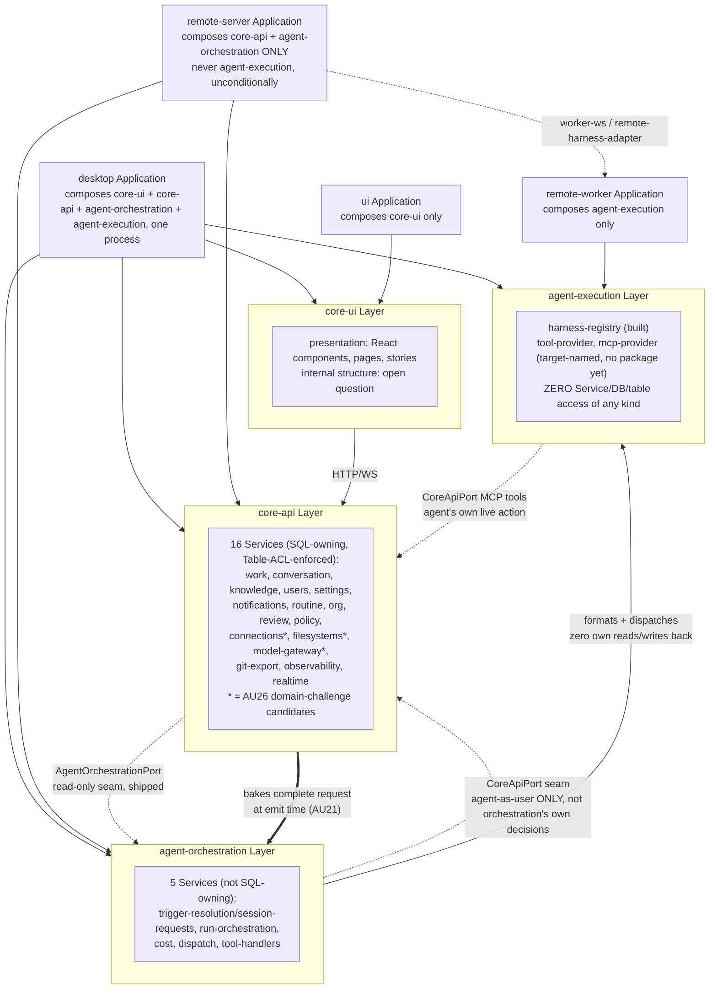
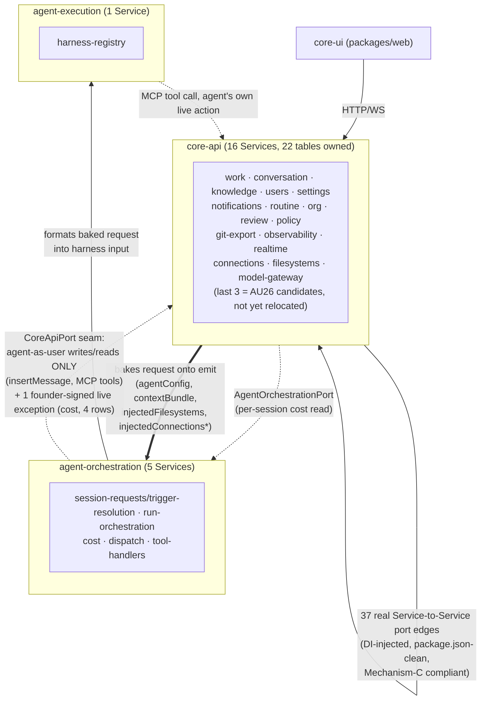

# Runtime Simplification Dependency Graph (AU19 Generation): As-Is vs As-Should

Baseline: `plan/AU21-layer-boundary-seam` at commit `0878592a` (`chore(AU21): re-mint verify
attestation for generalized AU26 rewrite`), PR #457 against `origin/main` — `npm run verify` and
`release-guard` both CI-green, PR open, awaiting human merge. This document is the AU19-generation
successor to `plans/strategy-kernel-plugin-split/as-is-vs-should-dependency-graph.md` (now marked
SUPERSEDED at its own top) — that document tracked the AU7→AU11 arc inside a single
`packages/server` monolith conceptually split into "Core app"/"Agent layer" folders. Starting with
**AU19** ("Applications, Layers, and Services," 2026-07-13), the codebase moved to a structurally
different model — four real npm-workspace Layers, each decomposed into its own Service packages —
and this document tracks that generation instead: AU19 itself, AU20 (not started), and AU21 (shipped,
CI-green, not yet merged), plus AU21's own four spun-out follow-ups (AU22, AU24, AU25 unchanged in
readiness; AU26 and AU27 newly registered this cycle).

This file is intentionally dependency-focused: it tracks Layer/Service ownership and call
direction, not every API route or DB table. Numbers below are pulled directly from
`plans/AU19/dependency-graph-data.json` (mechanically regenerated by
`scripts/generate-dependency-graph.ts` against the current tree, generated 2026-07-22 — do not
hand-edit that file or its companion `as-is-dependency-graph.md`; re-run the script) — never
estimated.

## Update: AU19 ("Applications, Layers, and Services") — structurally shipped, no dedicated ship commit tracked in this table

AU19 is not a row in `.pipeline/AU.md`'s current registry (it predates that file's registration
shape and is referenced only as a legacy dependency: `"AU19 (legacy: .pipeline/work-packages/
TRACK-AU.md)"`), but its *structural* deliverable is verifiably real in the tree today, independent
of its own paperwork status:

- **The package-per-Layer, package-per-Service split exists.** `package.json`'s `workspaces` glob
  already includes `"packages/*/*"` alongside `"packages/*"` — confirmed by direct read. 22 real
  Service packages exist today, nested under 3 of the 4 Layer directories: 16 under
  `packages/core-api/*` (`connections`, `conversation`, `filesystems`, `git-export`, `knowledge`,
  `model-gateway`, `notifications`, `observability`, `org`, `policy`, `realtime`, `review`,
  `routine`, `settings`, `users`, `work`), 5 under `packages/agent-orchestration/*` (`cost`,
  `dispatch`, `run-orchestration`, `session-requests`, `tool-handlers`), 1 under
  `packages/agent-execution/*` (`harness-registry` — the target's own list names three Services
  here, `harness-registry`/`tool-provider`/`mcp-provider`; only `harness-registry` exists as its own
  package today, confirmed by `ls packages/agent-execution/`; the other two either never got split
  out or their capability lives inside `harness-registry` today — a real, small, unclosed gap, not
  previously named anywhere).
- **All three enforcement mechanisms the target section calls "AU19's job, not yet built" are, in
  fact, built and wired into `npm run lint` today**, confirmed by reading each script directly:
  - **Mechanism 1 (Table ACL)** — `scripts/table-ownership-guard.ts`.
  - **Mechanism 2 (Layer/execution boundary)** — `scripts/execution-boundary-guard.ts`.
  - **Mechanism 3 (Composition boundary — Services never import Services)** —
    `scripts/composition-boundary-guard.ts`, whose own top-of-file doc confirms the exact target
    rule verbatim: "A Service package NEVER depends on another Service or on a Layer package.
    Cross-Service data flows in as a port parameter wired by the owning Layer." Verified directly:
    `packages/core-api/policy/package.json`'s `dependencies` list only
    `@hyperidle/db`/`@hyperidle/shared`/`drizzle-orm` — none of the Service-to-Service edges the
    mechanical graph shows (`PolicyDeps.work`, `PolicyDeps.conversation`, etc.) are real package
    imports; they are DI-injected port parameters, wired by `policy-bindings.ts` at the `core-api`
    Layer's own composition root — exactly the pattern the target frame specifies. This means
    `docs/architecture/runtime-simplification.md`'s own "(AU19's job, not yet built)" label on this
    section is itself stale prose, not a real gap — a small doc-accuracy item, not a structural one.
- **`core-ui`'s internal structure remains the one item the target frame itself flagged as an "open
  question, not yet decided"** (`packages/web` is still a flat page/component-type structure, not
  reorganized into per-Service/Domain folders) — this was never claimed as settled, so it is not a
  regression, just still-open.

**Net: AU19's structural/mechanical deliverable is fully realized in the current tree.** Nothing in
this document's Gap Register below concerns package structure or the three enforcement mechanisms —
every remaining gap is either a Service-level domain-ownership question (AU20, AU26) or a
behavioral/output-shape question (AU27), never "is the guard even wired."

## Update: AU20 ("Challenge every Service's exposed method surface") — planned, not started

Registered in `.pipeline/AU.md`, complexity L, depends on AU19. Status remains `planned` — no
architecture, no build. Its own axis (reduce each of the 22 Services' exposed method/type surface —
currently 259 methods / 204 types / 463 total, per the mechanical graph — "reduce, don't just
document") is a sibling to AU26's domain-ownership axis below but shares no dependency; the two can
proceed independently once both start. Not touched by AU21.

## Update: AU21 ("Seam the core-api ↔ agent-orchestration boundary") — SHIPPED, CI-green, PR #457 open, not yet merged

This is the largest single-WP arc this document tracks, and — matching this document's predecessor's
own honesty about AU7's/AU9's real false starts — it includes a genuine overclaim-then-correction,
not a straight line to green.

**The core mechanism (Decisions A–G, B″/B‴, D2).** A `CoreApiPort` seam lets the agent act as its own
user — the same real HTTP route stack a human client uses — for any live write/read it needs during
a run ("agent-as-user," Decision A/C). Core-api resolves and BAKES a complete request onto an event
at emit time; `agent-orchestration` never reads core's domain state to decide anything — it drains
the baked request, builds a session, and dispatches. Failures report back via two explicit event
channels; core-api owns retry/recovery. Routine-runs-as-sessions collapsed (Decision B″) — a routine
firing is an orchestration session, not a core-api field mutation. Push-based supersede /
deliver-on-next-turn for continued updates (Decision B‴) — the mechanism AU22 (below) will extend.
The generic realtime broadcaster retired into its three real owners (Decision E): notifications,
discrete-change invalidation, and session/harness streaming gatewayed through a new, symmetric
`AgentOrchestrationPort` (a read-only seam, `core-ui → agent-orchestration`, shipped Increment 6/7,
serving per-session cost display without a raw DI reach-in).

**The mechanical guard (Increment 9).** `scripts/composition-edge-anti-regrowth-guard.ts` — folds
`generate-dependency-graph.ts`'s raw-port resolution plus a hidden composition-bundle detector — was
wired into `npm run lint` as a hard failure. This was the first time a specific class of hidden edge
(a "Deps"-shaped interface *declared* in an `agent-orchestration` package but *composed* in a
`core-api` composition-root file — invisible to any prior tooling) became mechanically detectable at
all. A forensic-triage wave found the true edge count (37 real pairs, not the 15 prior tooling saw)
and disposed of every one: detector false positives fixed at the source (`SEAM_INTERFACES` for
whole-interface seam-satisfied cases like `tool-handlers`'s 40-method MCP accessor;
`isStatelessProvider`/`STATELESS_METHODS` for zero-owned-table or provably-pure providers), genuine
dead composition deleted, or the remainder left honestly open in `DEFERRED_FOLLOWUP`.

**Decision H (re-derived from first principles, founder-corrected twice) + Decision I.** Closed the
10 boundary edges Increment 9 had left open. **H1** — `task_run`'s post-session writeback moved
core-side onto an `agent_run_lifecycle_changed` event subscriber; the `bet_decomposition` half was
**deleted entirely** (**Decision I** — not a Kernel feature; a strategy/plugin concern, spun out to
`strategy-minimal` as its own default-trigger re-provision, AU24). **H2** — the assistant turn's
transcript INPUT is baked by core at emit time; orchestration builds harness input FROM the bake as
its OWN job — explicitly NOT an agent MCP pull. Founder, verbatim, rejecting the alternative
directly: *"the agent does not pull its own transcript. that is THE CORE TASK of the
orchestration."* **H3** — core bakes the FULL session context (task/bet/team/routine + ranked/
budgeted knowledge) via one shared assembler; `context.ts` became pure format/write, zero DB reads;
session-lifecycle writes moved onto `session_started`/`session_ended` event subscribers.

**The "blind executor" principle (final, load-bearing, arrived at through 3 successive founder
corrections).** The emit→deactivate→drain race (a session emitted for an agent that gets deactivated
before drain) needs **no mechanism at all** — neither a live re-check nor a push notification —
because `agent-orchestration` is purely request-driven and never independently acts on core state it
wasn't told about; if an agent is deactivated, core simply stops sending it new work.
`SessionLifecycleAgentRunnabilityReader` and its live check were deleted with zero replacement (not
even a defense-in-depth push) — confirmed: only a `@lore` comment referencing the now-deleted symbol
remains in `provisioner.ts`; only the baked-snapshot check in `admitSession`'s Phase 1 survives, as
pure documentation of expected state, never a live authority gate.

**Increment 13 — final guard closure.** `dispatch::conversation`'s last open pair (`insertMessage`, a
real, live, sanctioned seam write — the assistant-turn's own "agent-as-user" reply) was closed via a
NEW per-group `SEAM_GROUPS` mechanism (the group-level analogue of `SEAM_INTERFACES`, needed because
`DispatchPorts` has other, non-seam-satisfied sibling groups so the whole-interface exclusion didn't
apply) — a detector-precision fix, not a founder-signed exception. Confirmed: `SEAM_GROUPS` exists
(`generate-dependency-graph.ts:131`, `Set(["dispatch:DispatchPorts:conversation"])`);
`DEFERRED_FOLLOWUP` reached genuinely empty (confirmed:
`composition-edge-anti-regrowth-guard.ts:421`, `Set([])`). `runtime-simplification.md`'s
`agent-orchestration` Layer description was rebaselined to state the final bake-at-emit /
agent-self-recovery / format-only-orchestration model as settled fact, replacing a prior "not yet
resolved, do not treat as settled" flag.

**The overclaim, and its correction.** At this point AC #2 ("orchestration reads zero core-api
domain state") and AC #9 ("a documented + enforced anti-regrowth practice") were declared fully met.
This was premature, caught by review after the fact, not hidden:

- **Decision J** — `service_connections` was found to be agent-session-provisioning domain, not
  core domain. Decision J traced every real dependent and concluded a full relocation (table, CRUD,
  crypto decrypt primitive, HTTP delegation) belongs in `agent-orchestration` — spun out as its own
  follow-up WP (**AU26**) rather than folded into AU21, per explicit founder direction ("no full
  move here in AU21").
- **Decision K1** — a NARROWER, genuinely-AU21-scoped gap survived Decision J's own scoping-out:
  `run-orchestration`'s `connection-provisioning.ts` still made a LIVE
  `CoreApiPort.connections.listHeldConnectionsForProvisioning()` seam call at session-provisioning
  time — structurally identical to an already-fixed filesystems gap (an Increment 12 follow-up,
  which baked `injectedFilesystems` at emit and deleted the analogous live seam call). **K1 closed
  this** — connections now bake at emit too, mirroring filesystems; `CoreApiPort.connections`/
  `CoreApiConnectionsPort`/the `/connections/provisioning` route are deleted (confirmed: only a
  historical `@lore` comment in `core-api-port.ts` still names `CoreApiConnectionsPort`, the type
  itself is gone). This went through a full architecture→critique→build→independent-code-review
  cycle, not a quick patch — the critique caught a real **guard blind spot**: the mechanical guard
  classifies edges by KIND (raw-DI vs. seam-routed) not by PURPOSE, so a seam-routed *decision-read*
  was invisible to it even though it violates AC #2 the same way a raw read would. Closed with a
  targeted regression test (spies on the one real choke point every in-process `CoreApiPort` call
  routes through, `app.fetch`, and proves zero calls during real provisioning). Also fixed along the
  way: 2 stale tests still referencing the deleted seam method, a magic-string fallback confirmed as
  a faithful behavior carry-over (not new), and a wiring-completeness gap — **8** real
  composition-root call sites, not 6 as first assumed (reengagement/proposed_call and assistant_turn
  each have an initial-emit site *and* a retry/re-bake site).
- **Decision K2** — the assistant turn is STILL special on the OUTPUT side, even after H2 fixed the
  input side: `dispatch`'s `runTurnInternal` still runs a bespoke `conversational` execution mode,
  gets back a special `conversationalReply` result shape, and **dispatch itself** (not the agent, not
  a tool call) posts the reply via `insertMessage` — while every other agent kind (task_run/
  routine_run/knowledge_action) produces output entirely via ordinary tool calls during the session.
  Verified against real source, not assumed: `tasks.threadId → threads.id` (task comments genuinely
  ARE the same conversation primitive) but **no generic "reply into my calling thread" tool exists
  for ANY agent kind** — `send_message` is agent-to-agent direct only, `ToolContext` has no
  `threadId` field. This is net-new capability, not just deleting a special case. Unmeets no AU21
  AC (a purity/consistency question, not a boundary hole) — spun out as its own follow-up, **AU27**.

**AU26, rewritten twice more after this (founder-directed) into its current, final shape** — no
longer "just move connections," but one precise test applied across `core-api`: does core-api ever
operationally consume some data/capability for its OWN purpose, or does it only (a) let a human
administer/configure it and/or (b) hold an implementation exercised exclusively on an agent's
behalf? Four concrete candidates verified by direct source read, none built yet:
**`connections`** (Decision J, locked, full move); **`filesystems`' mounting engine**
(`RegistryFilesystemMounter`, `packages/core-api/filesystems/src/mounter-registry.ts` — real
`fs.symlinkSync`/`fs.cpSync`/git-worktree mounting logic, composed once at boot in
`server-factory.ts` and injected into `run-orchestration`; core-api never calls `.mount()` itself —
a domain question AU21's own build had waved through too quickly as "mostly stays core" without
applying this sharper test, now reopened, with the record/reachability-UI getting their own separate
verdict, not an automatic "moves with the engine"); **`model-gateway`** (Decision J flagged its own
placement as open, never resolved); **`users`' agent-execution columns** (`kind`, `harnessType`,
`modelId`, `modelProvider`, `maxConcurrentSessions` — agent config on the same table row as human
identity, never challenged before). Everything else in core-api is explicitly out of scope — a real
check found no agent-environment capability in it core doesn't itself use.

**Bottom line for AU21 itself: SHIPPED.** All Decisions A through K1 are closed, independently
code-reviewed, CI-green on PR #457. Decision K2 and Decision J's domain-move are correctly *not*
part of AU21's own scope — they are AU27 and AU26 respectively, both registered, neither built.

## Update: AU22, AU24, AU25 — unchanged in readiness this cycle

- **AU22** ("deliver a live update into an already-running agent session") — planned, depends on
  AU21 (now shipped, unblocking it). Extends Decision B‴'s supersede/deliver-on-next-turn plumbing
  to true mid-run injection, which AU21 explicitly did *not* build (harness CLI adapters close
  stdin by design — confirmed infeasible today, not merely deferred).
- **AU24** ("strategy-minimal re-provides auto-decompose as a default trigger") — planned, settled by
  the founder, release-coupled with AU21 (must ship in the same release window or the default
  "commit auto-decomposes" UX regresses since AU21/Decision I already deleted the built-in
  mechanism). Its own risk note (confirm the generic trigger substrate actually affects agent
  selection, don't assume it) is unresolved.
- **AU25** ("meta-orchestration of resumable harness sessions") — proposed, not yet scoped in
  detail. Genuinely new machinery, verified absent today (every assistant turn is a fresh harness
  spawn fed the full transcript; `sessionRunRegistry` is abort-only, no resume concept). Not required
  for AU21's own AC; this is the founder's stated "almost the hardest task" and the eventual
  efficiency answer to re-baking the full transcript every turn.

## Update: AU21 Increment 14 (a-e) — the exception itself, and the exemption apparatus, are now GONE

The framing below this heading (the original "Executive Summary" through the Gap Register's item 9)
was written when AU21's own guard still held one live, founder-acknowledged exception — `cost`'s
4-row `ALLOWLIST` entry — and treated that as the accepted end state ("the one place AU21's 'bake
everything' principle correctly does not apply"). The founder overturned that framing outright,
2026-08-03: *"as long as there is any exception I don't think AU21 is done."* Five sub-increments
(Decision L) closed it for real, not by relabeling:

- **14a** — `@hyperidle/cost` HARD-DELETED (package, cap gate, events, DB columns, every UI surface).
  No replacement mechanism; the founder confirmed the real spend ceiling lives at the upstream LLM
  provider, not in HyperIdle.
- **14b** — `model-gateway` dissolved into `@hyperidle/shared`; the package is gone.
- **14c** — `routeItem`/`route_item`/`item-router.ts` deleted outright (vestigial, zero consumers).
- **14d** — the generic realtime forwarder retired; changed data pushed per-domain.
- **14e** (this pass) — `ALLOWLIST`, `STATELESS_METHODS`, and `isStatelessProvider` **deleted from
  `composition-edge-anti-regrowth-guard.ts` itself**, not merely emptied. There is no exemption
  mechanism left in the file to re-populate — `inspect()` treats every `agent-orchestration ->
  core-api` edge as a violation, filtered only by `DEFERRED_FOLLOWUP` (an honestly-open gap set,
  currently empty, never a permanent carve-out). A fixture (`buildStatelessProviderFixture`) proves a
  zero-owned-table, `model-gateway`-shaped edge now FIRES — the exact class the deleted mechanism
  used to exempt.

Re-running `scripts/generate-dependency-graph.ts` against the post-14a-14e tree confirms it directly:
20 Services (not 22 — `cost` and `model-gateway` are gone), 0 hidden `agent-orchestration ->
core-api` composition edges (was 6), 0 `cost::*`/`model-gateway`-shaped raw-port edges. The boundary
is now genuinely zero-exception — every claim below this point that still describes a `cost`
exception or an `ALLOWLIST` row as the accepted end state is superseded by this update; the
historical narrative is kept for the record, not as current truth.

## Executive Summary

AU19's structural target — four real Layer packages, ~20-25 Service packages nested under three of
them, three mechanically-enforced boundary rules (Table ACL, Layer/execution boundary, Composition
boundary) — **is fully realized in the current tree**, verified by direct inspection of
`package.json`, the three guard scripts, and the mechanical dependency graph, independent of AU19's
own paperwork status (it has no row in the current `.pipeline/AU.md` registry). AU21 then built and
shipped the concrete behavioral mechanism the target frame's `agent-orchestration` Layer description
only gestured at: `agent-orchestration` reads **zero** `core-api` domain state, for its own
decisions, by any mechanism — not raw DI, not a governed seam, nothing — because core-api bakes
everything a run needs onto the request at emit time and orchestration only formats + dispatches;
the *only* sanctioned crossing is the agent's own live `CoreApiPort`/MCP action during its run
("agent-as-user," the exact same shape as filesystems'/connections' own baked provisioning, and the
assistant-turn's own reply write). **Superseded by Increment 14 (see the Update section above): the
one live exception this paragraph originally described (`cost`, 4 `ALLOWLIST` rows) is HARD-DELETED,
and the `ALLOWLIST`/`isStatelessProvider` exemption mechanism itself is deleted from
`composition-edge-anti-regrowth-guard.ts`'s source, not merely emptied.** This is mechanically
enforced, not merely documented: `composition-edge-anti-regrowth-guard.ts` is wired into `npm run
lint` as a hard failure, `DEFERRED_FOLLOWUP` is genuinely empty, and there is no `ALLOWLIST` left in
the file to hold rows at all — verified against real source for this document, not taken from prior
claims.

What's genuinely still open, honestly stated (this document's predecessor was explicit that AU7 got
"sent back through the pipeline after review found the cleanup requirement gap"; AU21's own arc
includes an equivalent real correction — the first "AC #2/#9 met" claim was premature, caught by
review, fixed via Decision K1 — not polished away here either):

- **AU20** (reduce each Service's exposed method/type surface, currently 259 methods / 204 types /
  463 total across 22 Services) — planned, zero architecture, zero build.
- **AU26** (relocate `connections` fully — locked design, not built; plus three more candidates —
  `filesystems`' mounting engine, `model-gateway`, `users`' agent-execution columns — each of which
  needs its own real architecture pass before it can be sized or built at all) — registered, zero
  build on any of the four.
- **AU27** (de-specialize the assistant turn's output/execution path onto a net-new generic
  reply-into-thread tool every agent kind would use) — scoped, zero build.
- **AU22/AU24/AU25** — registered follow-ups at varying readiness, none built.
- **`agent-execution`'s own Service decomposition is one Service short of the target's own list** —
  only `harness-registry` exists as a package; `tool-provider`/`mcp-provider` (named in the target
  frame's own Service list) have no dedicated package today. A small, real, previously-unnamed gap.
- **`core-ui`'s internal structure** remains the one item the target frame itself calls "open,
  not yet decided" — not a regression, genuinely still undecided.

No should-graph claim in this document is asserted true where it isn't — every "shipped"/"closed"
claim above was independently checked against real source (guard scripts read directly,
`package.json` dependency lists read directly, `DEFERRED_FOLLOWUP`/`ALLOWLIST`/`SEAM_GROUPS`
contents read directly from `composition-edge-anti-regrowth-guard.ts`/`generate-dependency-graph.ts`
at the moment this document was written) rather than carried forward from a prior claim without
re-verification.

## Side-by-Side Shape

| Area | As-is (current, real) | As-should (target) |
| --- | --- | --- |
| Package structure | 4 Layer packages (`core-ui`≈`packages/web`, `core-api`, `agent-orchestration`, `agent-execution`) + 22 nested Service packages, `workspaces` glob includes `packages/*/*`. Matches target exactly except `agent-execution` has 1 of its target's 3 named Services as its own package. | Same — Applications compose Layers; Layers compose their own Services + cross-boundary Services from Layers below; Services compose nothing, take cross-Service data as an injected port parameter. |
| Table ACL | `scripts/table-ownership-guard.ts`, wired into `npm run lint`, real-tree green. | A SQL-owning Service's barrel never exports its raw table object; one small, general, declarative check. |
| Layer/execution boundary | `scripts/execution-boundary-guard.ts`, wired into `npm run lint`, real-tree green. Only `agent-execution`'s Services (today: `harness-registry`) may import an LLM-CLI/harness/MCP/tool-execution symbol. | Same. |
| Composition boundary | `scripts/composition-boundary-guard.ts`, wired into `npm run lint`, real-tree green — verified directly (`policy`'s own `package.json` lists only `@hyperidle/db`/`@hyperidle/shared`; every Service-to-Service "edge" the mechanical graph shows is an injected port parameter, wired at the owning Layer's composition root, never a raw import). | Services never import Services or Layer packages; only `@hyperidle/db`/`@hyperidle/shared` (+ a narrow ports/contracts package if ever needed). |
| `agent-orchestration ↔ core-api` boundary | **Fully closed (AU21, shipped, CI-green, PR #457 open).** Zero live reads of any kind (raw or seam-routed) for orchestration's own decisions; core bakes everything at emit; the agent's own live `CoreApiPort` action is the only sanctioned crossing; one founder-signed live exception (`cost`, 4 rows). Mechanically enforced: `composition-edge-anti-regrowth-guard.ts`, `DEFERRED_FOLLOWUP` empty. | `agent-orchestration` reads zero `core-api` domain state to decide anything; the only crossings are agent-as-user seam actions and explicitly founder-signed exceptions. |
| `core-ui ↔ agent-orchestration` boundary | `AgentOrchestrationPort` (read-only seam), shipped AU21 Increment 6/7, serving per-session cost. Narrow — one read family so far. | `core-ui` reads agent-orchestration state (cost, session activity, etc.) through a read-only seam, never raw DI. |
| Domain ownership inside `core-api` | 16 of 22 Services correctly core-owned by the track's own charter (Work, Conversation, Knowledge, Org, Notifications, Git-export, Review/Policy, Settings, Routine, Users' identity half). 4 candidates (`connections`, `filesystems`'s mounting engine, `model-gateway`, `users`'s agent-execution columns) verified as agent-orchestration domain currently misplaced in core-api — none relocated yet (AU26, registered, not built). | Every Service that is genuinely agent-session/agent-execution domain lives in `agent-orchestration`, not `core-api`, regardless of history. |
| Assistant-turn specialness | Input side closed (AU21/H2 — core bakes the transcript, orchestration formats it, no agent MCP pull). Output side still special — `dispatch` runs a bespoke `conversational` mode and posts the reply itself, unlike every other agent kind (AU27, registered, not built). | The assistant is an ordinary agent session; its conversation is an ordinary conversation; no backend distinction beyond UI placement. |
| Service method-surface | 259 methods / 204 types / 463 total across 22 Services, unchallenged for over-broad exposure. | Each Service's exposed surface reflects real callers, not accumulated history (AU20, planned, not started). |

## As-Should Graph (current generation)

## As-Is Graph (current generation, simplified — full mechanical detail in `plans/AU19/as-is-dependency-graph.md`)

*`injectedConnections*` is AU21 Decision K1's own interim mechanism — throwaway the moment AU26
relocates the `connections` table and its record moves in-layer.

## Current Evidence

| Current state | Evidence |
| --- | --- |
| 22 Service packages exist, 3 Layers populated | `plans/AU19/dependency-graph-data.json` (`"totalServices": 22`); `ls packages/core-api packages/agent-orchestration packages/agent-execution` |
| `workspaces` glob includes nested Service packages | `package.json`: `"workspaces": ["packages/*", "packages/*/*"]` |
| Table ACL guard exists, green | `scripts/table-ownership-guard.ts`, `package.json` `lint` script |
| Layer/execution boundary guard exists, green | `scripts/execution-boundary-guard.ts`, `package.json` `lint` script |
| Composition boundary guard exists, green, verified against a real Service's own `package.json` | `scripts/composition-boundary-guard.ts`; `packages/core-api/policy/package.json`'s `dependencies` list only `@hyperidle/db`/`@hyperidle/shared`/`drizzle-orm` |
| Anti-regrowth guard exists, wired hard-fail | `scripts/composition-edge-anti-regrowth-guard.ts`, `package.json` `lint` script (both `--fixtures` and bare live-tree invocations) |
| `DEFERRED_FOLLOWUP` is genuinely empty | `scripts/composition-edge-anti-regrowth-guard.ts` — `export const DEFERRED_FOLLOWUP: ReadonlySet<string> = new Set([]);` |
| `ALLOWLIST`/`isStatelessProvider` are DELETED from the guard's source (AU21 Increment 14e) — no exemption mechanism exists to hold rows at all | `scripts/composition-edge-anti-regrowth-guard.ts` (no `ALLOWLIST`/`isStatelessProvider`/`isDomainStateEdge` declarations remain); `npx tsx scripts/composition-edge-anti-regrowth-guard.ts` returns zero findings on the live tree |
| `SEAM_GROUPS` exists (Increment 13's per-group seam exclusion) | `scripts/generate-dependency-graph.ts:131` — `Set(["dispatch:DispatchPorts:conversation"])` |
| `CoreApiPort.connections`/`CoreApiConnectionsPort` are deleted | `packages/api-contract/src/core-api-port.ts` — only a historical `@lore` comment names the type; no live declaration |
| `SessionLifecycleAgentRunnabilityReader` is deleted, zero replacement | `packages/agent-orchestration/run-orchestration/src/provisioner.ts` — only a `@lore` comment references the deleted symbol |
| `AgentOrchestrationPort` exists, read-only | `packages/api-contract/src/*` (AU21 Increment 6/7) |
| `agent-execution` has 1 of its target's 3 named Service packages | `ls packages/agent-execution/` → `harness-registry` only |
| `core-ui` is still `packages/web`'s flat structure | `ls packages/web/src` — page/component-type folders, not per-Service |
| `service_connections` still core-api-owned (AU26 not built) | `packages/core-api/connections/src/` still holds the table + CRUD; no `packages/agent-orchestration/connections/` package exists |
| `RegistryFilesystemMounter` still core-api-owned (AU26 not built) | `packages/core-api/filesystems/src/mounter-registry.ts`, composed in `packages/core-api/src/server-factory.ts:1027` |
| `users`' agent-execution columns unchallenged (AU26 not built) | `packages/db/src/schema.ts` — `kind`, `harnessType`, `modelId`, `modelProvider`, `maxConcurrentSessions` all on the `users` table |
| Assistant-turn `conversational` mode still exists (AU27 not built) | `packages/agent-orchestration/dispatch/src/service.ts` — `runTurnInternal`'s `conversational` params bag + `conversationalReply` result shape |
| Surface totals (superseded, see the Increment 14a-14e update above) | `plans/AU19/dependency-graph-data.json`, regenerated post-14a-14e — 20 Services (was 22, `cost`/`model-gateway` deleted), 246 methods / 195 types / 441 total, 30 port edges (28 high/2 medium/0 unresolved confidence), 21 EventBus edges, 4 hidden composition-bundle edges, **0 `agent-orchestration → core-api`** (was 6, all now closed: `cost` HARD-DELETED, `dispatch::model-gateway` gone with the package, `tool-handlers::work:routeItem` deleted with `routeItem`) — zero findings from `composition-edge-anti-regrowth-guard.ts`'s bare check |

## Gap Register

1. **`agent-execution`'s Service decomposition is one short of the target's own named list.** The
   target frame names `harness-registry`/`tool-provider`/`mcp-provider` as three Services; only
   `harness-registry` exists as its own package. Not previously named in any AU document. Small — a
   real gap to close whenever `agent-execution`'s own surface is next touched, not urgent, not
   assigned to a WP today.
2. **`core-ui`'s internal structure remains genuinely undecided**, exactly as the target frame itself
   states — `packages/web` is still page/component-type organized, not per-Service/Domain. Not a
   regression; still an open question for a future `/refine` to settle if ever taken up.
3. **AU20 (Service method-surface reduction) has not started.** 259 methods / 204 types / 463 total
   across 22 Services, unchallenged. Planned, no architecture yet.
4. **AU26's four domain-relocation candidates are none of them built.** `connections` has a fully
   locked four-increment design (from Decision J) and is the largest, most-ready piece; the other
   three (`filesystems`'s mounting engine, `model-gateway`, `users`'s agent-execution columns) each
   need their own real architecture pass — sized only as "smaller individually," not yet actually
   sized — before any of them can be built. Human review gate is explicitly load-bearing here: which
   of the three beyond connections actually relocate is a real domain call the founder must confirm.
5. **AU27 (assistant-turn output de-specialization) is scoped but not built.** Needs a net-new
   generic reply-into-thread tool + `ToolContext.threadId` + deletion of the `conversational`
   execution mode — none of this exists yet.
6. **AU22 (mid-run delivery into an already-running session) is planned, unblocked by AU21 shipping,
   but not started.** True mid-run injection was confirmed infeasible today (harness CLI adapters
   close stdin by design) — AU22's own scope is explicitly narrower than that (extends the already-
   built supersede/deliver-on-next-turn plumbing, not true injection).
7. **AU24's risk note is still open**: the generic trigger substrate (`settings` `kind:"trigger"`)
   was flagged as "no code path reads it to affect real agent selection" during AU21's own build —
   AU24 must confirm/wire this, not assume it works, when it starts.
8. **AU25 is not yet scoped in detail** beyond its own one-paragraph problem statement (resumable
   harness sessions + delta computation) — genuinely new machinery, verified absent today, no
   architecture pass has begun.
9. ~~One legitimate residual live-read exception remains inside `agent-orchestration → core-api`, by
   founder design, not oversight: the `cost` cap-gate consumer.~~ **CLOSED (AU21 Increment 14, Decision
   L, founder 2026-08-03).** The founder overturned this framing outright ("as long as there is any
   exception I don't think AU21 is done"): `cost` is HARD-DELETED (14a, no replacement mechanism —
   the real spend ceiling lives at the upstream LLM provider), and the `ALLOWLIST`/`isStatelessProvider`
   exemption apparatus that held this row is deleted from `composition-edge-anti-regrowth-guard.ts`'s
   source outright (14e), not merely emptied. No residual exception of any kind remains.

## AU19 Completion Check

| AU19 requirement (from `docs/architecture/runtime-simplification.md`) | Status | Notes |
| --- | --- | --- |
| Package-per-Layer, package-per-Service structure exists | Complete | 22 Service packages across 3 of 4 Layers, `workspaces` glob updated. |
| Table ACL mechanically enforced | Complete | `scripts/table-ownership-guard.ts`, real-tree green. |
| Layer/execution boundary mechanically enforced | Complete | `scripts/execution-boundary-guard.ts`, real-tree green. |
| Composition boundary (Services never import Services) mechanically enforced | Complete | `scripts/composition-boundary-guard.ts`, real-tree green; independently verified against `policy`'s own `package.json`. |
| `agent-execution` fully decomposed into its 3 named Services | Incomplete | Only `harness-registry` exists as a package; `tool-provider`/`mcp-provider` do not. |
| `core-ui` internal structure decided | Open by design | The target frame itself calls this an open question, not a requirement. |

## AU21 Completion Check

| AU21 requirement | Status | Notes |
| --- | --- | --- |
| `agent-orchestration` reads zero `core-api` domain state for its own decisions, by any mechanism | Complete, independently code-reviewed | Guard green, `DEFERRED_FOLLOWUP` empty; K1's guard-blind-spot fix specifically closed the one class (seam-routed decision-reads) the mechanical guard alone could not catch. |
| A documented + mechanically enforced anti-regrowth practice exists | Complete | `composition-edge-anti-regrowth-guard.ts` wired into `npm run lint` as a hard failure; `--fixtures` self-test proves the detection mechanism itself, including the new Scenario 6 (per-group seam exclusion doesn't blind the guard to a sibling group). |
| The built-in `bet_decomposition` mechanism is removed, re-provided as strategy config | Complete (removal); pending (re-provision) | Decision I shipped in AU21; AU24 (strategy-minimal's own default trigger) is the re-provision, not yet built. |
| The assistant turn's input is de-specialized (no agent MCP pull for its own transcript) | Complete | Decision H2, shipped. |
| The assistant turn's output is de-specialized | Not in AU21's scope, correctly | Decision K2, spun out as AU27. |
| `service_connections`'s domain placement is corrected | Not in AU21's scope, correctly (record/table); Complete (the live-read violation specifically) | Decision J's full domain move is AU26's scope; Decision K1 closed only the narrower live-seam-read AU21 itself introduced/inherited. |
| Full as-should dependency tree mechanically enforced end-to-end | Complete for the one boundary AU21 owns (`agent-orchestration ↔ core-api`) | AU20 (Service surface) and AU26 (remaining domain misplacements) are separate, unstarted axes — not part of AU21's own AC. |

## Bottom Line

**AU21 is shipped and CI-green (PR #457, open, not yet merged).** Its own boundary — the last of
the four Layer boundaries this track disciplines — is closed, independently verified against real
source for this document rather than taken on faith from prior claims, including the one real
overclaim in its history (the first "AC #2/#9 met" declaration, corrected via Decision K1 after
review). AU19's structural target (package-per-Layer, package-per-Service, three mechanical
boundary guards) is fully realized in the tree today, though AU19 itself carries no explicit "shipped"
row in the current registry. What remains, honestly: AU20 (Service surface reduction) hasn't started;
AU26's four domain-relocation candidates are architected-for-one (`connections`) and
architected-for-none (the other three); AU27 (assistant-turn output) is scoped but not built;
AU22/24/25 are registered follow-ups at their own, varying readiness. No work has silently
regressed and no should-graph claim here is asserted true where direct verification found it
otherwise.
