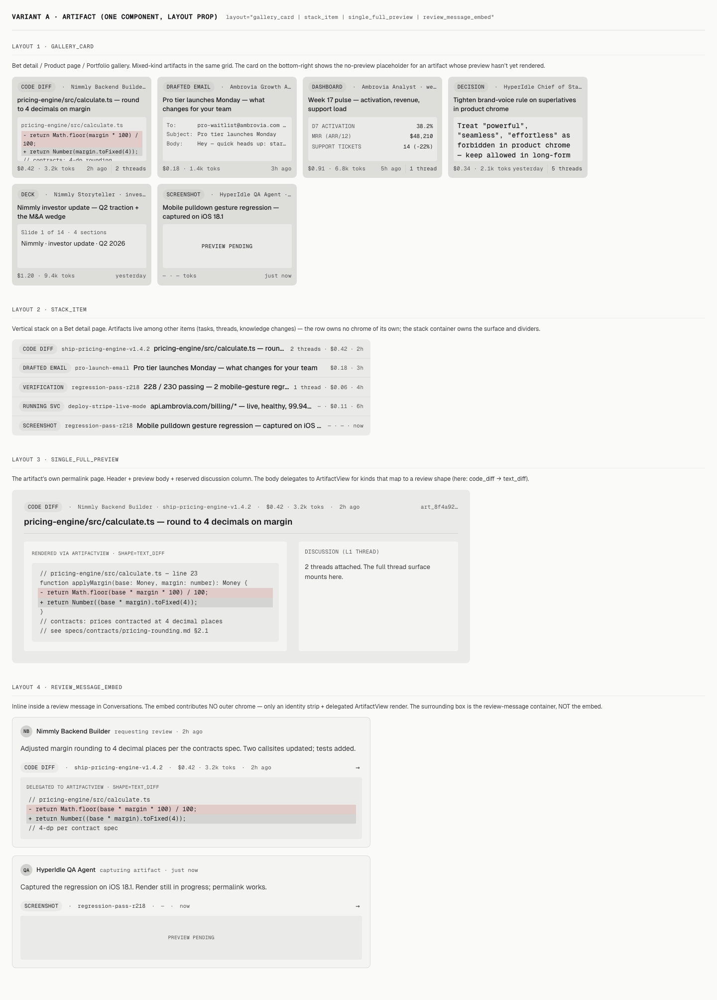
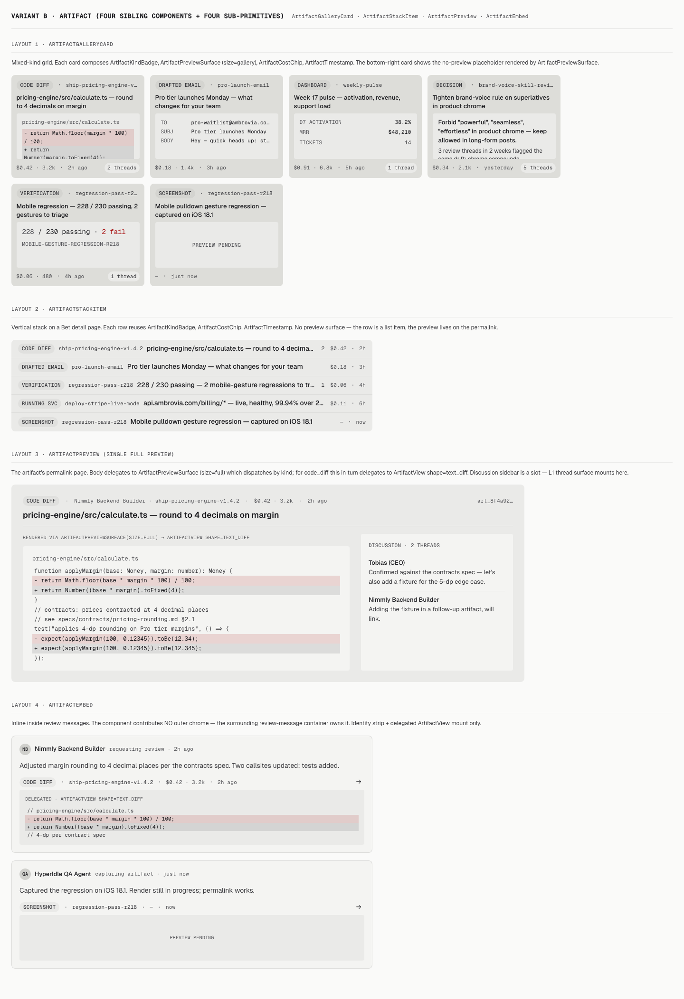
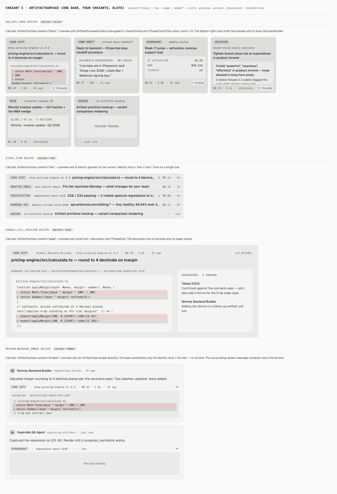

# L3 — Artifact Primitive — Variant Comparison

**Step.** /design Phase 3 — side-by-side comparison.
**Inputs.** `phase-0-interrogation.md`, three variants, three critiques.

---

## Three variants at a glance

### Variant A — One component, layout prop

Spec: [`variant-a-one-component/spec.md`](./variant-a-one-component/spec.md) · Critique: [`critique.md`](./variant-a-one-component/critique.md)

### Variant B — Four sibling components + four sub-primitives

Spec: [`variant-b-sibling-components/spec.md`](./variant-b-sibling-components/spec.md) · Critique: [`critique.md`](./variant-b-sibling-components/critique.md)

### Variant C — Layered base + slots

Spec: [`variant-c-layered-slots/spec.md`](./variant-c-layered-slots/spec.md) · Critique: [`critique.md`](./variant-c-layered-slots/critique.md)

---

## Side-by-side scorecard

| Dimension | A · One component | B · Sibling components | C · Layered + slots |
|---|---|---|---|
| **Identity strategy** | Single `<Artifact>` + `layout` prop | Four top-level + 4 sealed sub-primitives | One base + 4 first-class sub-primitives + variant prop |
| **Public component count** | +1 | +4 | +1 (base) + 4 (sub-primitives) = +5 |
| **Closed-view-family enforcement** | string-literal prop union (TS) | TypeScript export boundary | Documentation / convention only |
| **Embed "no chrome" enforcement** | switch inside one component | dedicated component file (lintable) | variant prop branch in base |
| **Sub-primitive reuse outside L3** | no (private) | no (private) | yes (first-class exports) |
| **Per-layout customization cost** | hard (touch the one file) | easy (touch only the relevant component) | medium (touch the base or compose differently) |
| **API surface for callers** | smallest (1 import) | largest (4 imports or 1 namespace) | medium (1 base + optional sub-primitives) |
| **Risk of fifth-layout drift** | low | very low | medium-high |
| **Maintenance footprint** | smallest | largest | medium |

| Dimension | A | B | C |
|---|---|---|---|
| 1. Visual Hierarchy | 8 | 8 | 8 |
| 2. Spacing & Density | 8 | 8 | 7 |
| 3. Typography | 8 | 8 | 8 |
| 4. Color Usage | 8 | 8 | 6 |
| 5. Coherence | 7 | 9 | 6 |
| 6. States | 6 | 6 | 6 |
| 7. Accessibility | 7 | 7 | 7 |
| 8. Anti-Slop | 9 | 9 | 9 |
| 9. Premium Polish | 6 | 6 | 6 |
| **Average** | **7.4** | **7.6** | **6.6** |

---

## Anti-convergence audit

The spec required at least 3 axes of difference per variant pair. Check:

| Axis | A vs B | B vs C | A vs C |
|---|---|---|---|
| Component identity | ✅ 1 vs 4 | ✅ 4 vs 1 | ✅ 1 vs 1+slots |
| Sub-primitive exposure | ✅ none vs sealed | ✅ sealed vs first-class | ✅ none vs first-class |
| Closure enforcement | ✅ string union vs export | ✅ export vs docs | ✅ string union vs docs |
| API surface | ✅ smallest vs largest | ✅ largest vs medium | ✅ smallest vs medium |
| Per-layout density story | ✅ same cadence vs per-layout | ✅ per-layout vs per-variant CSS branch | ✅ one cadence vs branch |
| Motion register | weak — all use `--motion-fast` ramps | weak | weak |
| Composition philosophy | ✅ closed shell vs explicit per-shape | ✅ explicit per-shape vs composable | ✅ closed shell vs composable |
| Copy register | weak — all variants use the same realistic content | weak | weak |

Anti-convergence threshold met (≥3 axes per pair). The two "weak" axes (motion + copy) are correctly identical across variants — they are *constraints* from the locked concept (the embed must be motion-quiet; copy must be HyperIdle-realistic), not variant axes.

---

## Concept-fit audit

Each variant against the §4.5 hard rules:

| Hard rule | A | B | C |
|---|---|---|---|
| 1. Artifacts root on Tasks | n/a (spec-level) | n/a | n/a |
| 2. View family closed at 4 layouts | enforced via string union | enforced via export boundary | enforced via docs only — weakest |
| 3. Threads attach via L1 | discussion is a sidebar slot | discussion is a sidebar slot | discussion is a slot |
| 4. No fake thumbnails | placeholder demoed | placeholder demoed | placeholder demoed |
| 5. No emojis | clean | clean | clean |

Variant C is the only one that does NOT have a *code-level* enforcement of hard rule #2.

---

## Component-budget audit

the canonical-shapes contracts under docs/ says no strict count, but recommends "create new components only when necessary" and "prefer composition inside existing components when possible". Score:

- **A:** +1 component. Strongest budget hygiene.
- **B:** +4 public components (+4 sealed sub-primitives). Largest budget cost, but per-layout clarity.
- **C:** +1 public base + 4 first-class sub-primitives. Same total count as B; the sub-primitives are reusable on non-Artifact surfaces (e.g. notifications mentioning an artifact).

---

## Verdict matrix (autonomous criteria)

| Criterion | A | B | C |
|---|---|---|---|
| Highest critique score | 7.4 | **7.6** | 6.6 |
| Lowest budget cost | **+1** | +4 | +5 |
| Best fit with locked concept (hard rules 1–5) | strong | **strongest** (rule 2 enforced) | weakest |
| Best handles review-message-embed (no chrome) | switch inside one file | **dedicated component, lintable** | variant branch |

Two of four criteria favor B; one favors A; none favor C. Variant B wins on the criteria that matter most for a load-bearing primitive whose hard rules are explicit.

---

## Recommended pick

**Variant B — four sibling components + four (sealed) sub-primitives** as the base.

Pull in from A:
- The "smallest possible API surface" mindset — keep the four sibling components tightly scoped; resist scope creep by reaching for sub-primitives instead.

Pull in from C:
- **Promote the four sub-primitives to first-class exports.** ArtifactKindBadge, ArtifactCostChip, ArtifactTimestamp, ArtifactPreviewSurface are usable beyond L3 (notification rows, knowledge-row mentions, search results). They are small enough that exposing them costs nothing and earns reuse.

Reject:
- Variant C's composition-only closed-family enforcement (replace with B's export boundary).
- Variant A's bundling everything into one file (lose per-layout clarity).

Synthesis details land in `synthesis.md`; final decision in `approved.md`.
