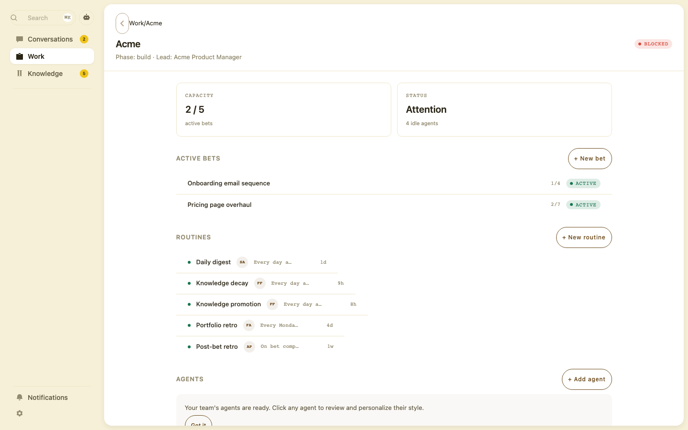
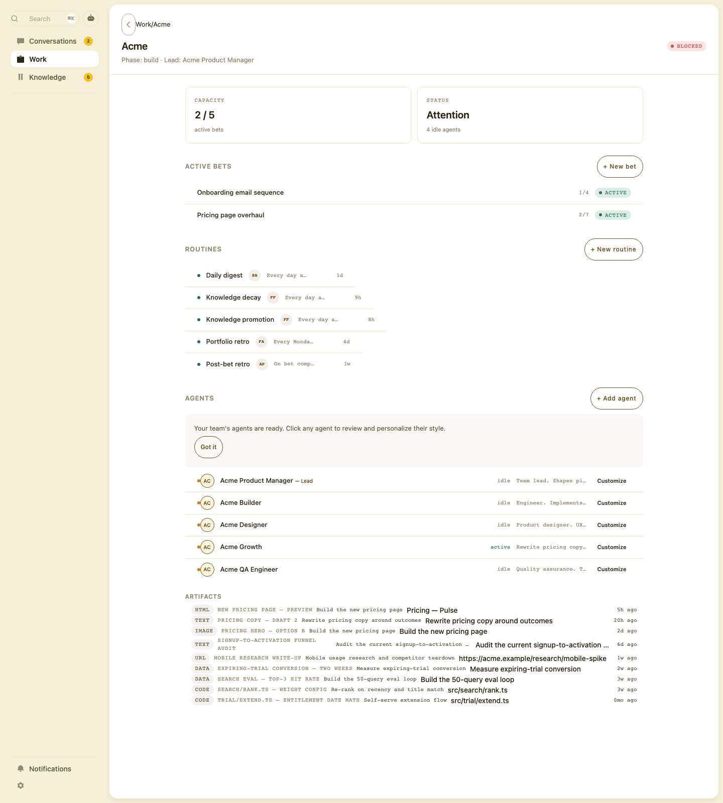
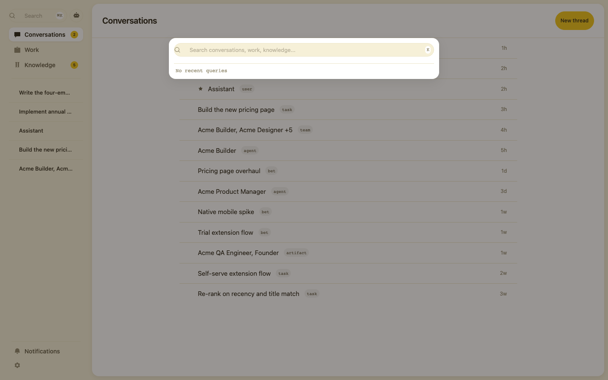
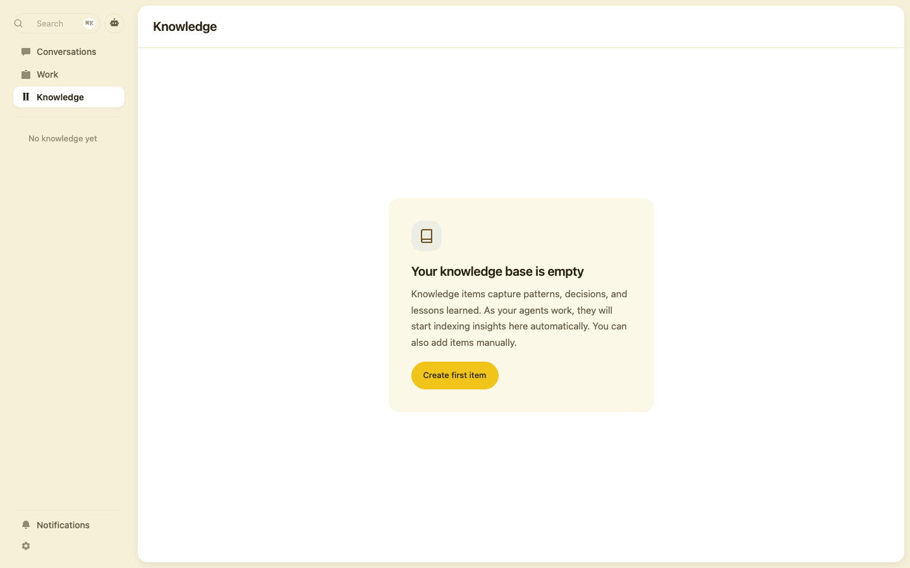
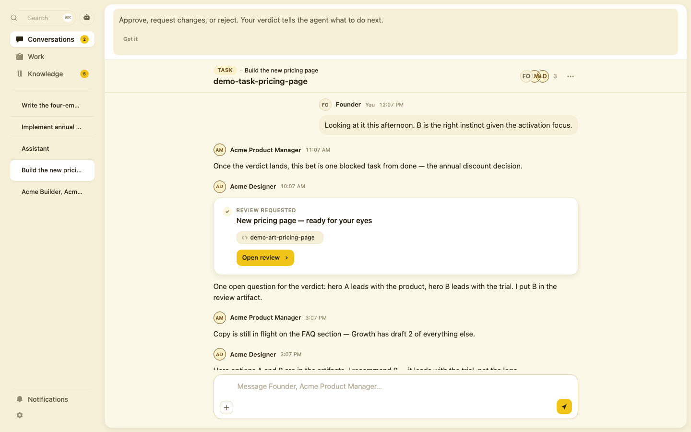
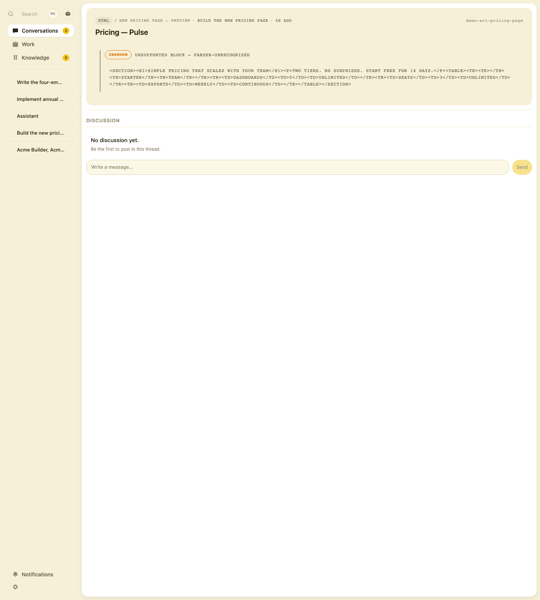
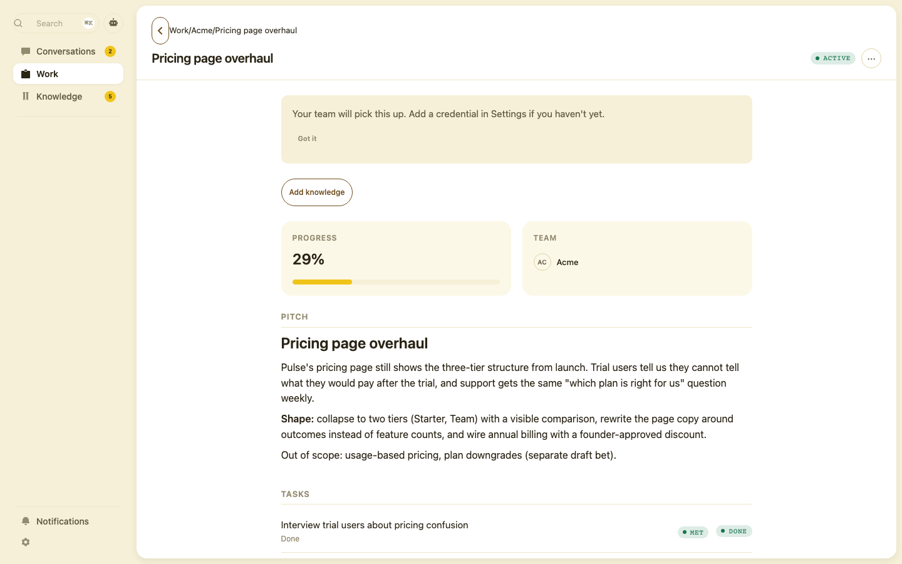
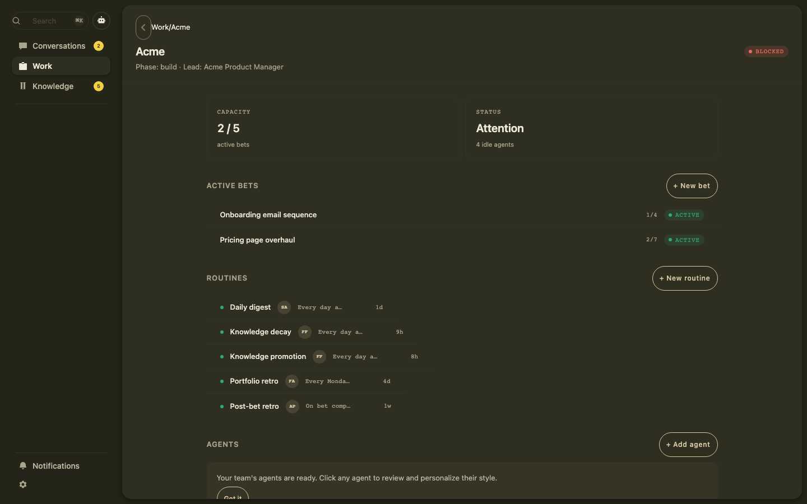
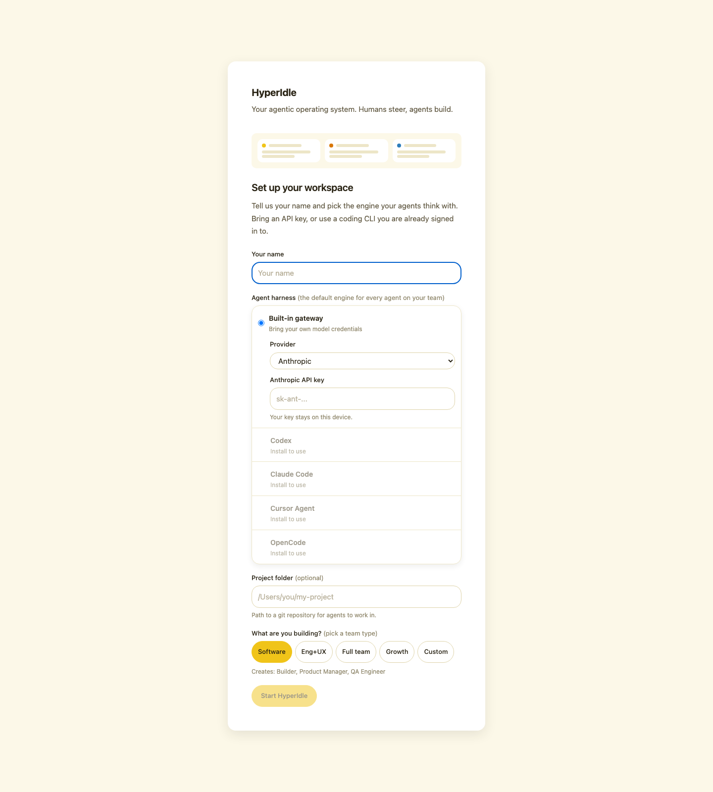
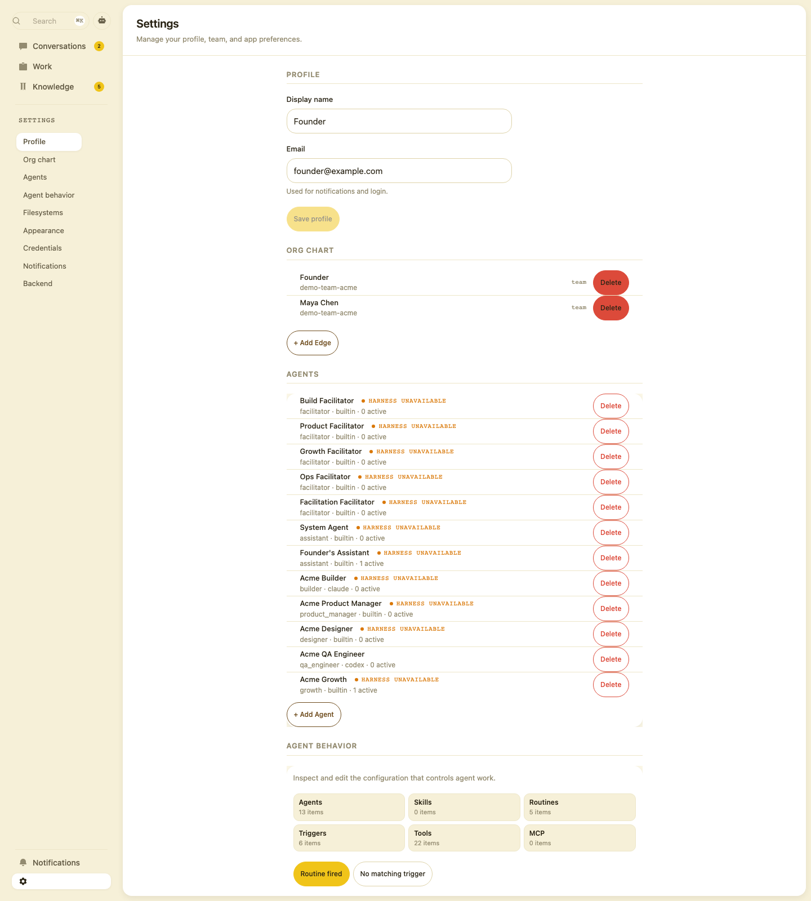

# HyperIdle UI Audit — consolidated

**Date:** 2026-08-11 · **Status:** findings only, nothing fixed.

Two independent passes, merged and reconciled:

| Pass | Lens | Method | Source |
|---|---|---|---|
| **A — live** | Drove the running app | Demo world seeded, every route in light + dark at 1440/1280/1024/768/375, plus loading / empty / error / 500 states. DOM + computed CSS measured where the eye wasn't proof. | this document |
| **B — code** | Read the source | Every shipped screen judged against `docs/ui-design/*`, `PRINCIPLES.md`, `AESTHETICS.md`, each finding traced to a file:line. | [source-ui-consistency-review-codelens.md](source-ui-consistency-review-codelens.md) |

The two passes disagreed in seven places. **Every disagreement was settled by driving the running app**, not by preferring one document. Three of pass A's claims and two of pass B's were wrong; the corrections are recorded below in full, because a couple of them produced better findings than either pass had alone.

Screenshots: all 99 in `ui-audit-shots/`. Pass A's are numbered (`01-work-team.png`, `r375-thread.png`); pass B's are theme-prefixed (`light-03-work-team.png`, `dark-03-work-team.png`).

Tags: **[A]** found live · **[B]** found in code · **[A+B]** both · **[corrected]** a claim that changed after verification.

---

## Verification ledger — the seven conflicts

| # | Claim | Verdict | Evidence |
|---|---|---|---|
| 1 | **B:** ⌘K search opens dead (panel inerts itself) | **B correct — A missed it** | Live: `#root` has `inert`, `elementFromPoint` at the input returns `<body>`, typing "pricing" leaves `value: ""`, Escape doesn't close. A had screenshotted the panel open but never typed into it. |
| 2 | **B:** mobile drawer is inert, nav untappable | **B correct — A missed it** | Live at 375×812: `rootInert: true`, hit-test at "Work" returns `BODY`, Playwright click times out after 4 s, URL unchanged. |
| 3 | **B:** `AppShell.tsx` contains raw control bytes | **B correct** | `file` reports `data`, not text; control byte at line 92. This is *why* several of pass A's greps into that file returned nothing. |
| 4 | **A:** `/work` + `/work/team/:id` cannot scroll | **A correct — B missed it** | Live, re-run twice: `scrollers: 0`, `clippedPx: 538` at 1440×900 and 706 at 1024×768. A code read wouldn't catch it; the classes look right in isolation. |
| 5 | **B:** "dark theme is consistent; no dark-only defects" · **A:** "dark is muddy, the card shell disappears" | **Both wrong — real defect is narrower** | Surface ladder is *identical* in both themes (container→elevated: 5.3 L* light vs 5.2 L* dark). The actual defect: **`--border-subtle` sits 8.9 L* from the card in light but only 2.0 L* in dark** — dividers and card edges dissolve. That is what "muddy" was; it is a border-token bug, not a surface-ladder or dark-theme bug. |
| 6 | **B:** "PageHeader on every page; heading contract intact" | **B wrong** | Live DOM: artifact permalink, `/setup` and `/settings` render **zero** `PageHeader` and **zero `<h1>`**. The bet page renders **two `<h1>`** — a direct violation of `rules.md` §7 (one h1 per page). Knowledge's h1 reads `"Knowledge BaseKnowledge"` (two text nodes concatenated). |
| 7 | **B:** "`0mo` shows for items updated today" | **B's symptom right, cause wrong** | An item updated today returns `just now`/`Nm`/`Nh` — it can never reach the month branch. `0mo` is only reachable at **28–30 days**: [time.ts:82-83](../../framework/presentation-format/src/format/time.ts#L82) switches to months at `FOUR_WEEKS_MS` (28 d) but divides by `MONTH_MS` (30 d). Confirmed live on "Trial entitlement date math is UTC end-to-end". |

Pass B's §6 "non-modal overlays behave correctly" **checked out**: notifications and assistant do not inert the root and do close on Escape. Pass A's complaints about those two overlays are about layout and content, not behaviour — no conflict.

---

## P0 — broken, a user meets these in the first two minutes

### 1. `/work` and `/work/team/:id` cannot scroll **[A]**

538 px clipped at 1440×900, 706 px at 1024×768, with **zero scroll containers on the page**. No scrollbar, wheel does nothing, `scrollTop` stays 0. The AGENTS heading is visible; its roster and the entire ARTIFACTS section below are unreachable.

What is down there, revealed by forcing `overflow: visible`:

**Cause** — [WorkTeam.tsx:709](../../layers/core-ui/src/pages/WorkTeam.tsx#L709) wraps the body in `
`. That wrapper is a *block*, not a flex container, so `flex-1` on the scroll child ([WorkTeam.tsx:294](../../layers/core-ui/src/pages/WorkTeam.tsx#L294)) does nothing and the child grows to its content height (1281 px) inside a 743 px clipping parent. Introduced with the AV4 SplitView work. `/work` short-circuits to the team page for a 1-team org, so both routes are dead.

**Systemic:** **every** page scroller in the repo is `flex-1 overflow-y-auto` *without* `min-h-0` (30+ sites). Only `Sidebar.tsx`, `NotificationPopover.tsx`, `SettingsHarnesses.tsx` and `RichMessageCard.tsx` do it correctly. The others survive by luck — no intermediate wrapper clips them *yet*.

**Fix:** make the scaffold a primitive (`<PageBody>` owning `flex-1 min-h-0 overflow-y-auto`) and lint against a bare `flex-1 overflow-y-auto` in `pages/**`. `docs/ui-design/rules.md` §6 already states the contract; nothing enforces it.

### 2. ⌘K global search opens dead **[B, confirmed live]**

The panel renders inline inside `#root` ([GlobalSearchPanel.tsx:141-313](../../layers/core-ui/src/components/GlobalSearchPanel.tsx#L141)) while using `useDialogBehavior({ modal: true })`, and that hook sets `inert` on `#root` ([useDialogBehavior.ts:117-126](../../framework/design-system/src/useDialogBehavior.ts#L117)). The panel inerts itself: no typing, no clickable results, no Escape, no scrim-click. Only a second ⌘K closes it, via a document-level listener.

**Fix:** portal panel + scrim into `#overlay-root` the way [Dialog.tsx:288](../../framework/design-system/src/Dialog.tsx#L288) does, or exclude the active overlay from the inert target.

### 3. Mobile drawer is the same dead overlay **[B, confirmed live]**

Same inline-in-`#root` + `modal: true` shape at [AppShell.tsx:778-795](../../layers/core-ui/src/layouts/AppShell.tsx#L778). On a phone the drawer opens and **nothing inside it can be tapped**. A document-level Escape listener ([AppShell.tsx:140-153](../../layers/core-ui/src/layouts/AppShell.tsx#L140)) papers over the symptom. Same fix as #2 — one fix closes both.

### 4. A server error renders as "you have no data" **[A]**

With every `/api/**` returning 500, Knowledge shows a confident empty state — *"Your knowledge base is empty · Create first item"* — and the whole header toolbar vanishes.

The sidebar tells the same lie while **loading** ("No teams yet", "No knowledge yet") and after a 429 ("No threads yet"). Three wrong stories told with total confidence.

**Fix:** `empty ≠ loading ≠ failed` as three branches everywhere, with an inline retry on failure. This is a trust bug: telling a founder their knowledge base is empty when the server is down can end a trial.

### 5. Thread headline is a raw database ID **[A+B]**

The largest text on a conversation is `demo-task-pricing-page`; on a team thread the eyebrow *and* the `<h1>` both read `demo-team-acme`. [Conversations.tsx:442](../../layers/core-ui/src/pages/Conversations.tsx#L442) falls back to `hostId` when the identity lookup misses — and it always misses for teams.

Same leak in: the in-thread artifact chip, the artifact page's top-right corner, ORG CHART row subtitles, task session subtitles (`demo-agent-pm`, named "Session 1/2/3"), knowledge Editor (`seed-age…`), and agent role enums (`product_manager`, `builtin` — the setup flow already has display labels for these).

**Fix:** one rule — *an ID never renders as user-facing text.* Resolve to a name; if it can't resolve, show type + muted fallback, never the key.

### 6. "Open review" — the thread's primary CTA — silently does nothing **[A]**

Confirmed live: click → no navigation, no panel, no toast, URL unchanged, button not disabled. [open-handler.ts:78](../../layers/core-ui/src/services/open-handler.ts#L78) documents it: *"No bet → no valid review route. Documented no-op (no dead URL)."*

Avoiding a dead URL is right; rendering a full-contrast primary that does nothing is not. Don't render the action, or disable it with a reason. A silent no-op on the core loop — *plan → interact → review* — is the worst available failure mode.

### 7. Artifact viewer uppercases and mono-cases its own content **[A+B]**

HTML artifacts render `UNSUPPORTED BLOCK — PARSER-UNRECOGNISED` plus their source **shouted in uppercase**:

Two problems. **The product bug [B]:** the flagship artifact kind doesn't render; it should be a sandboxed preview or a designed `ErrorState` with "Open raw" — never a source dump. **The cosmetic bug [A], confirmed in the DOM:** the source is lowercase in the DOM but painted uppercase, because [ArtifactPreviewSurface.tsx:27](../../framework/design-system/src/ArtifactPreviewSurface.tsx#L27) applies `font-mono text-[11px] tracking-caps-sm uppercase text-tertiary justify-center` to the **whole preview container**. Those styles were written for a placeholder label ("IMAGE PREVIEW") and now cascade onto real content — anything inside a preview surface is uppercased, centred and greyed.

### 8. `AppShell.tsx` is a binary file to every tool you own **[B]**

`file` reports `data`; a literal control byte sits at line 92 inside a regex that rejects control characters, written with raw bytes instead of `\x00` escapes. grep, ripgrep, code search and diff reviewers silently skip the file — which is exactly how pass A's searches into it came back empty. Replace the literals with escape sequences.

---

## Pass C — founder walkthrough, 2026-08-11

A third pass: the founder drove the app and annotated screenshots. Every claim below was re-verified live before being written down. Two are more severe than anything in P2, and four are gaps in how passes A and B sliced the work rather than findings they missed.

### C1. The conversation renders newest-first **[P0]**

Verified against the seed fixture. True chronological order in the pricing-review thread is `pr-01` (3d) → `pr-03` (2d) → `pr-02` (1d) → `pr-06` (5h) → `pr-05` (4h) → `pr-07` (3h). The rendered order top-to-bottom is `pr-07` (3h, **newest**) → `pr-05` (4h) → `pr-06` (5h) → older. The stream is reverse-chronological in a surface whose composer sits at the bottom, so a user writes at the bottom and their message appears at the top, and reading a conversation means reading up. Pass A logged this only as "timestamps look out of order" — it is an ordering defect, not a formatting one.

### C2. A blocking decision cannot be answered **[P0]**

On the blocked annual-billing task an agent asks the founder a question with three options (10% / 15% / 20%). Verified live: the options are plain `<li>` elements — no `button`, no `role`, `cursor: auto` — and clicking one changes nothing. The product's central claim is that humans steer and agents build; the control where a human steers a blocked task is inert. This belongs beside "Open review" in AZ5, and is arguably the more damaging of the two.

### C3. The conversation kebab injects unrelated fixture content **[P1]**

The "Conversation actions" control in the thread header adds attachment chips to the composer area: `auth/passkey.ts — TS · 3 lines` and `auth-flow.png — 82 KB`. Neither has anything to do with a pricing thread — this is demo/fixture content reachable from an ordinary control in a normal session. Separately, the affordance is unexplained: a header menu whose effect lands in the composer.

### C4. Control sprawl, quantified **[P1]**

Measured across twelve routes by computed style:

| Surface | Distinct recipes | Notes |
|---|---|---|
| Buttons | **47** | keyed on background, border, radius, height, padding, font-size, weight |
| Inputs | **6** | four different fills, six heights (30/32/36/40/45/74), three radii |
| `--surface-container` blocks | **13** | same fill doing jobs from a 138×32 chip to a 1189×260 card |

The `--surface-container` count is the "yellow boxes everywhere" observation: one fill is standing in for chip, input, card, panel, banner and empty-state backgrounds, with radius varying 10px / 16px / 9999px and border present or absent per instance. It reads as arbitrary because it is.

### C5. Radius scale is not being honoured **[P1]**

The documented scale is `0 / 10 / 16 / 9999`. In use: `3.35544e+07px` (**99 occurrences**), `10px` (80), `9999px` (78), `16px` (61), `16px 16px 0px 0px` (3), `4px` (1). The most-used radius in the app is an off-scale computed value, and "pill" is spelled two different ways.

### C6. Dividers — the token is clean, the placement is not **[correction]**

Pass A claimed inconsistent separator treatments. That was wrong, and an artifact of counting button borders as dividers. Measured properly — elements whose only border is a bottom border, excluding controls — there is exactly **one** divider recipe (`1px rgb(237, 230, 200)`) used 89 times. The real problem is where dividers are drawn, not how: they stop mid-row (the `Row` width bug, AZ9), they stack into phantom empty rows on task detail, and they bracket sections that have no content. Fixing placement, not styling.

### C7. Prose blocks have two different editing models **[P1]**

The bet page renders a live Tiptap `contenteditable` inline — the pitch is always editable in place. Knowledge detail renders a read-only view behind an explicit **Edit** button, i.e. a mode switch. Same content primitive, two mental models, no rule for which applies.

### C8. Split pane vs. full page vs. overlay has no rule **[P1]**

Opening a routine or an agent replaces half the screen with a split pane; opening a bet, task, knowledge item, thread or artifact takes the whole page; notifications, the assistant and search are overlays. Nothing about the objects explains the grouping, so a user cannot predict what a click will do to their context.

### C9. Onboarding banners — founder ruling: delete **[scope change]**

Passes A and B recorded the coach-mark banners as misplaced and proposed relocating them below the page header. Founder ruling, 2026-08-11: they are useless and should be **removed entirely**, not relocated. This narrows AZ11.

### C10. Spacing and elevation were never audited systematically **[gap]**

Neither pass ran a proportional-spacing or elevation pass — the finding "spacing is inconsistent or absent in places" is correct and is not represented anywhere in P0/P1/P2. The token grid (`3/6/9/12/18/24/36/48`) and the shadow tokens exist; whether the app honours them per surface is unmeasured. This is the one item here that needs its own investigation before it can be scoped.

---

## P1 — the app reads as several products

### 9. The design system already has the components the pages hand-rolled **[B]**

Confirmed present and unused where they're needed: `ThreadRow`, `Composer`, `KpiStat`, `EmptyState` (with a `compact` variant), `status-mapping.ts`. This reframes most of the inconsistency below — it isn't "we haven't built the primitive yet", it's "we built it and forked around it", which `.claude/rules/design-system.md` calls a CRITICAL finding.

- **Three message composers.** Conversations: textarea + "+" + icon-send. WorkTask / KnowledgeDetail / ArtifactPermalink: bare input + text "Send" pill. DS `Composer` ("Reply to thread…"): used only in review/host threads. Pick the DS one.
- **The conversations queue is hand-rolled** (`li > button`) while global search renders *the same threads* through DS `ThreadRow` with avatar + snippet + status. The queue is visually poorer than the search results for identical data.

### 10. Five vocabularies for "status" **[A+B]**

On one scroll of the team page:

| Spelling | Example | Where |
|---|---|---|
| Uppercase chip, tinted pill | `● ACTIVE` | bet rows |
| Lowercase mono, coloured text, no pill | `idle` / `active` | agent rows — **same page, 10 rows apart** |
| Bare coloured dot | ● | routine rows |
| Uppercase mono, no pill, amber | `HARNESS UNAVAILABLE` | Settings, ×13 |
| Lowercase mono pill | `task` `bet` `agent` `team` | conversations queue |

Plus `Private` (Title Case cocoa pill) in Knowledge, `Agent` (cream pill) in the assistant, `REVIEW`/`BLOCKER` (bare mono) in notifications, and `Done` as plain text in task sessions while `DONE` as a chip sits 200 px above it. The **words** collide too: the team header chip says `BLOCKED` while the STATUS card on the same page says "Attention"; AgentProfile says `IDLE` as a bare dot+mono label rather than a `StatusChip`.

Where a chip appears on 100% of rows (every curated knowledge row says `ACTIVE`) it carries zero information — delete it rather than restyle it.

### 11. `Row`'s `<button>` branch has no `w-full` — rows shrink-wrap **[A root cause / B symptom]**

Pass B saw hairlines "stop mid-row"; the cause is a layout bug. Measured: routine rows render at 339 / 352 / 375 px inside a 912 px container, each with a different divider length.

**Cause:** [Row.tsx:226-238](../../framework/design-system/src/Row.tsx#L226) — the `button` branch sets `flex items-center` but no `w-full`, and a `<button>` is shrink-to-fit even as a flex container. The `li` branch got a `w-full` inner div in the AD9 hover fix; the `button` branch never did. Every `Row` with `onClick` and no `actions` is affected. This may be *why* pages forked away from `Row`.

### 12. The app has no links, no pointer, and no hover on its busiest list **[A]**

- **Zero `<a href>` elements** anywhere — not one on the conversations page. Every navigation is a `button` + programmatic `navigate()`. No middle-click, no ⌘-click, no open-in-new-tab, no URL preview, no copy-link.
- **11 of 18 interactive elements report `cursor: default`**, including the entire sidebar nav.
- **The conversations queue has no hover state at all** — background unchanged before and after hover, cursor `auto`. Knowledge, bet and routine rows do have hover + pointer, because they use `Row`.

Cheapest large win available: real `<Link>` for anything that changes the URL, `cursor: pointer` + hover on every interactive surface.

### 13. Content geometry differs on every page **[A+B]**

Measured widths: `max-w-[800px]` (conversations, knowledge, bet), `max-w-[960px]` (team), `520px` (setup), `680px` (settings), full-bleed (agent profile). And on **every** page the header's left edge (x=242) misses the body's left edge (x=448) by ~200 px, because the header is full-bleed and the body is a centred column.

**Fix:** one rule — body content `max-w-[960px]` centred, lists may widen — and the header shares the body's column.

### 14. Three breadcrumb treatments, and the back button sits on the text **[A+B]**

Circular back button + `Work/Acme` (detail pages), plain `Work / New bet` (create pages), ALL-CAPS MONO chain (artifact permalink). Spacing around the separator is inconsistent between the first two.

The chevron overlaps the first character of the breadcrumb on every Work and Knowledge page. On task detail the *middle* crumb truncates while the longest last crumb doesn't, with a stray space before the final separator: `Work/Acme/Pricing page over… /Interview trial users about pricing confusion`. And the last crumb always duplicates the `<h1>` beneath it — on the bet page a **third** time under PITCH, which the DOM confirms is a genuine second `<h1>`.

### 15. Coach-mark banners are the first thing on three pages **[A]**

"Your team will pick this up…", "Your team's agents are ready…", "Approve, request changes, or reject…" — each an 80–110 px block *above* the real content with a text-only "Got it". On mobile the thread banner eats 130 px of an 812 px screen; on dark it's nearly invisible. These are onboarding, not content — move them out of the document flow and never above the page header.

### 16. Two navigation systems fight in the sidebar **[A+B]**

Under the three nav items sits a second unlabeled list of the same threads, truncated to ~14 characters (`Write the four-em…`, `Decision: client-si…`) with no `title` tooltip, ordered differently from the main list — and differently again on `/knowledge/new`. Meanwhile **the primary nav disappears entirely while Settings is open**, leaving only the gear as the way back. The sidebar also has no brand wordmark, which `AESTHETICS.md` AQ-014 and `docs/ui-design` still describe — two sources of truth disagreeing.

---

## P2 — craft

### Typography & content
- **Text clipped mid-word with no ellipsis** across the knowledge list ("users respond to vi", "6 or 8 days depen") while one row in the same list *does* get a "…". **[A]**
- **Raw markdown in previews:** `# Pulse Customer-feedback…`, `- **Starter** — 5 dashboards`. Related: the knowledge body and bet pitch still render through a `<pre>` fallback rather than the Block primitive (see `improvements-knowledge.md` §2, `improvements-work.md` §1). **[A+B]**
- **Group headers are slugs:** `PRODUCT-IDENTITY`, `ARCHITECTURE` → should be "Product identity". **[A]**
- **`1 items`** — hardcoded plural, [KnowledgeTopicGroup.tsx:73](../../layers/core-ui/src/components/KnowledgeTopicGroup.tsx#L73), 5× on one screen. **[A]**
- **`0mo`** — the 28-day/30-day boundary bug, [time.ts:82](../../framework/presentation-format/src/format/time.ts#L82). **[A+B, cause corrected]**
- **Raw ISO timestamp** `2026-08-11T13:07:38.072Z` + "by unknown" in the knowledge subtitle ([KnowledgeDetail.tsx:313](../../layers/core-ui/src/pages/KnowledgeDetail.tsx#L313)) — and the *same value* renders 300 px away as `Aug 11, 2026, 3:07 PM`. **[A+B]**
- **`Access count 1`** — internal telemetry as user-facing metadata. **[A]**
- **Developer jargon:** `+ Add Edge` (graph theory), `product_manager`, `parser-unrecognised`. **[A+B]**
- **Button casing unsystematic:** `+ New bet`, `+ Add agent`, `+ Add Edge`, `New thread`, `Create first item`, `Customize`, `Edit in Settings`. **[A]**
- **Label casing split personality:** caps micro-labels (NAME / PROMPT / AUTONOMY) vs sentence case ("Your name", "Task / Outcome / When"). **[B]**
- **Message timestamps out of order** in the pricing thread (12:07 PM → 11:07 AM → 10:07 AM → 3:07 PM); six consecutive team-feed messages all read `3:07 PM`, with no grouping and no day separators. **[A+B]**

### Layout & rhythm
- **The last message is clipped behind the composer** — no bottom padding, no fade. On mobile the composer sits *on top of* the review card, cutting "Open review" in half. **[A]**
- **OWNER stat cell renders blank** when unassigned — no `—`, no "Unassigned". **[A+B]**
- **Sessions score column (`0.75`)** is unexplained mono. **[A+B]**
- **Empty sections render as bare dividers:** WorkTask ARTIFACTS is a label, a rule, and nothing; DISCUSSION below stacks two rules with a phantom gap. Four sections use four different empty treatments while DS `EmptyState compact` exists. **[A+B]**
- **NotFound is top-anchored** with 560 px of void; the agent-profile error card is left-anchored in a 440 px box. Two error layouts, neither centred. **[A+B]**
- **Settings rows clip their own container** — white corner notches where the rounded card behind the agent list peeks past the rows. **[A]**
- **Knowledge triage icons (✓ ✕ →)** wrap below the excerpt, unlabeled, no tooltips, making row heights vary 69–78 px; the keyboard hint bar that explains them floats at the end of the list instead of being pinned, and is undiscoverable by mouse. **[A+B]**
- **CAPACITY / STATUS stat cards are ~60% empty air** — DS `KpiStat` exists. **[B]**
- **"Add knowledge" pill floats alone** above the bet's stat cards; belongs in a `SectionLabel trailing=` slot. **[B]**
- **Both create pages are a lone textarea on a vast canvas** with one tiny right-rail card; constrain the width so the emptiness reads as margin. **[A+B]**
- **Editable titles look disabled** — "Untitled bet" / "Untitled" in muted grey with no caret affordance. **[A+B]**
- **Routine detail duplicates itself:** the form and the read-only echo below it (AGENT / SCHEDULE / TRIGGER TYPE) state the same facts twice in two styles, with `SCHEDULE` appearing twice meaning two different things, and a raw cron field far from its human preview. `/work/routine/:id` additionally renders two headers — `PageHeader` plus a full-width strip repeating name + chip + Save ([WorkRoutine.tsx:111](../../layers/core-ui/src/pages/WorkRoutine.tsx#L111)). **[A+B]**
- **Agent profile:** key-value rows stretch full width (label x=260, value x=690, 400 px of nothing), the two columns don't align to each other, RECENT ACTIVITY headers are sentence case among all-caps labels, and two identical rows appear ("Audit the current signup-to-activation path" ×2). The "Health warning" banner has no icon and no CTA. **[A+B]**
- **Hairlines stop mid-row** in WorkTeam routines and the WorkTask stat card — the `Row` `w-full` bug (#11). **[A+B]**

### Colour, theme & state
- **Border tokens collapse in dark.** `--border-subtle` sits **8.9 L\*** from the card surface in light but only **2.0 L\*** in dark, so dividers and card edges dissolve. The surface ladder itself is fine and near-identical in both themes (5.3 vs 5.2 L\*). This single token pair is the whole "dark feels flat" complaint. **[A+B, corrected]**

  

- **Native blue on the first screen a user ever sees.** Setup shows the browser's default blue focus ring and a blue OS radio ([SetupFlow.tsx:633,762,837](../../layers/core-ui/src/pages/SetupFlow.tsx#L633)) in a cream/lemon UI — the only cold colour in the app. Native `<select>` chrome in Setup and the routine panel too. The selected harness row also gets no selected treatment beyond the radio dot. **[A+B]**

  

- **Disabled = `opacity: 0.5`** on primaries (Create bet, Create knowledge, Send, Save profile, Start HyperIdle) — a half-transparent lemon fill still shouts while its label drops to ~3:1. DS `Button` has a proper disabled treatment. **[A+B]**
- **A disabled control that looks enabled:** the `Team` scope pill on `/knowledge/new` is `disabled` yet renders identically to its siblings and keeps `cursor: pointer`. **[A]**
- **Destructive actions are the loudest thing in Settings** — 13 red Delete buttons, styled two different ways on one page (filled red in ORG CHART, outlined red in AGENTS). **[A+B]**

  

- **Unread uses `--status-error` red** in the notification popover. Unread is not an error. **[A]**
- **All five team agents share "AC" avatar initials** — derived from the team name, not the agent — and each avatar's status dot is clipped by its own edge. Overlapping avatar stacks clip their initials in every thread header. **[A]**

### Overlays
- **Notification popover** covers its own trigger, truncates titles to ~18 characters inside a panel with room to be wider, and shows row actions on only one of two rows. **[A+B]**
- **Assistant overlay has no composer** — you cannot reply. Text clips mid-sentence at the bottom, measure is ~230 px (4–6 words/line), it hangs over the shell's rounded card edge, carries two stacked headers both titled "Assistant" with two identical "F" avatars, and opens bottom-right from a top-left trigger. **[A+B]**
- **The search palette's scrim covers only the content pane**, leaving the sidebar and its own Search field lit; a stray `K` chip renders where `⌘K` belongs. **[A]**
- **Bet kebab menu** ("Unblock / Kill") has no icons and uneven padding; DS `Menu` exists. **[B]**

### Loading, empty, responsive, a11y
- **The skeleton doesn't resemble the page** — 16 identical bars stand in for 2 cards + 3 structured sections, inset 20 px differently than the real content, under a placeholder title ("Team") that swaps to the real name. Guaranteed layout jump. **[A]**
- **Mobile duplicates the page title** — top bar and page header both say "Conversations", 60 px apart, costing 130 px of an 812 px screen; inside a thread the top bar still says "Conversations", so the thread loses its identity. **[A]**
- **768 and below is healthier than desktop** — the team page scrolls correctly there; the scroll bug is desktop-shell-only. **[A]**
- **The app 429s during ordinary fast navigation** and surfaces it as `Agent profile fetch failed: 429` with no retry. **[A]**
- **Tab order enters at sidebar chrome** (Search → assistant → nav) with no skip-link — four tabs to reach content — and the focus ring on a nav item overlaps the item below it. **[A]**
- **`--text-tertiary` (~3:1 in light) is documented as decorative-only** but carries real data: every timestamp in the conversations queue and knowledge list, and the routine schedule text. **[A]**
- **`prefers-reduced-motion` is honoured** (transitions collapse to 0.001 s). **[A]**

---

## What holds up — don't touch it

- Hearth light/dark tokens, warm shadows, pill buttons, the type scale. The palette is genuinely good; the problems are enforcement, not taste. **[A+B]**
- The surface ladder is correct and consistent across both themes — only the border token needs work. **[A]**
- `PageHeader` / `SectionLabel` on the five main pages; `StatusChip` semantics in Settings match the documented colour=meaning table. **[B]**
- Non-modal overlays (notifications, assistant) do not inert the root and do close on Escape — verified live. **[A+B]**
- NotFound copy and actions; only its placement nags. **[B]**
- `prefers-reduced-motion` support. **[A]**

---

## Order of work

1. **The eight P0s as one bug batch.** Note #2 and #3 share a single fix (portal into `#overlay-root`), and #1 is one wrapper class. This is a small diff for the largest possible perceived-quality jump.
2. **Adopt what already exists.** `ThreadRow` in the queue, DS `Composer` everywhere, `KpiStat` in the stat cards, `EmptyState compact` in all four empty sections, `status-mapping.ts` for every status. Most of P1 closes without new components — this is a deletion exercise, not a build.
3. **Make it feel clickable.** Real `<Link>`, `cursor: pointer`, hover on every interactive surface, focus rings with offset.
4. **Fix the geometry.** One content width, one shared left edge for header and body, one scaffold primitive owning the scroll contract.
5. **Then the border token in dark**, and the remaining P2 craft.

**One thing worth challenging outright:** the sidebar's secondary list, the coach-mark banners and the per-row `ACTIVE` chips all add pixels without adding information. `rules.md` §4 says "density over whitespace — whitespace is earned." The inverse holds too: *noise is earned.* Today the busiest parts of the UI carry the least meaning, while the pages carrying real work — task detail, bet detail — end in 400 px of dead space.

**And one process note:** pass B's code lens found three interaction bugs that a live pass walked straight past, and pass A's live lens found a page that cannot scroll and a component that mangles its own content — both of which read as correct in source. Neither lens is sufficient. The seven-conflict ledger at the top is the most reusable artifact here.
