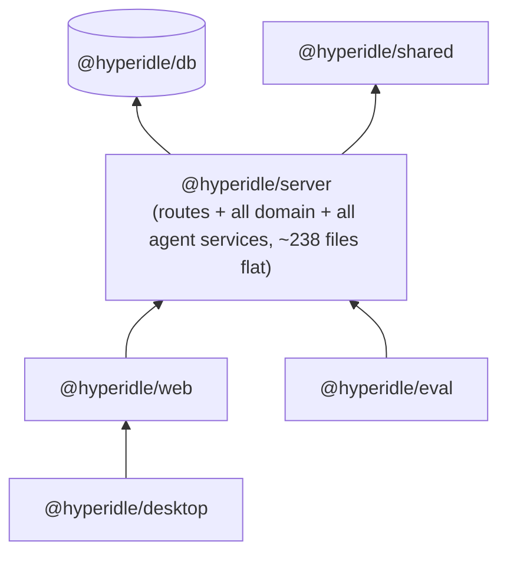
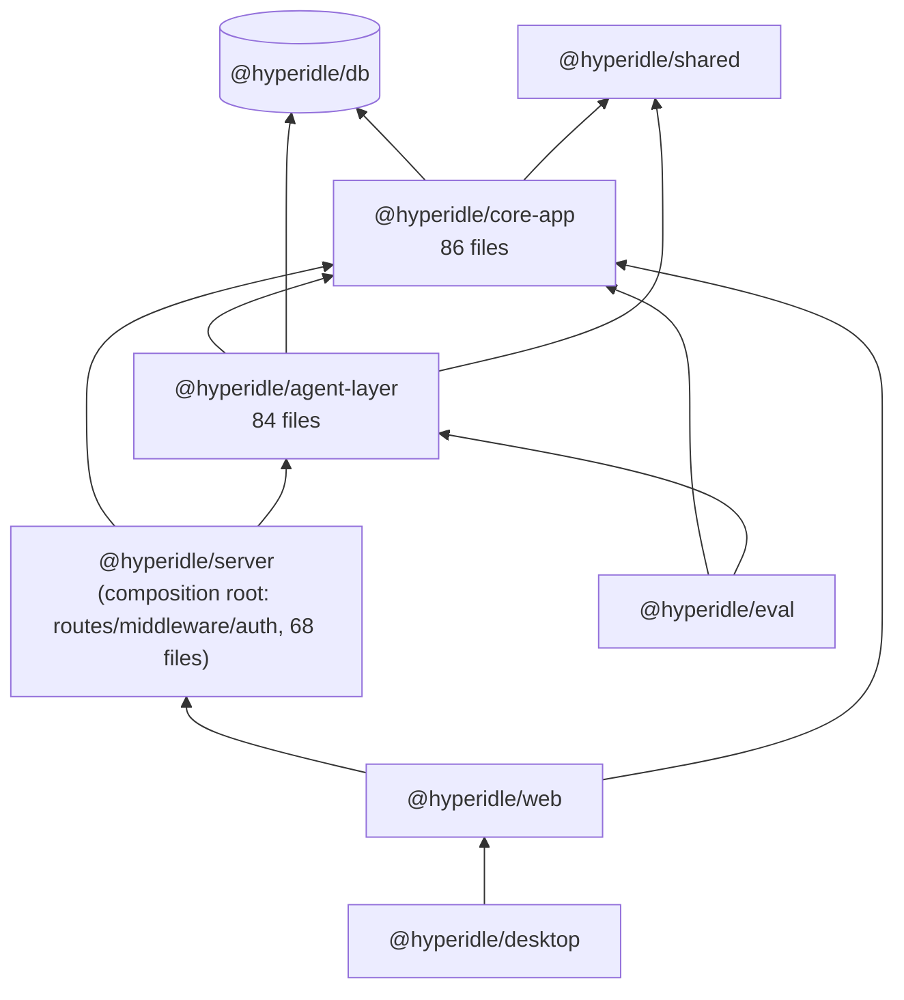
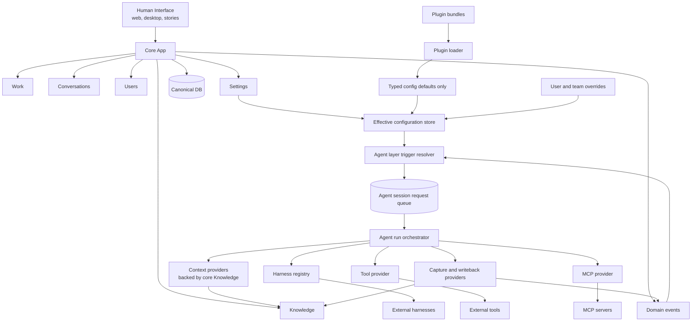
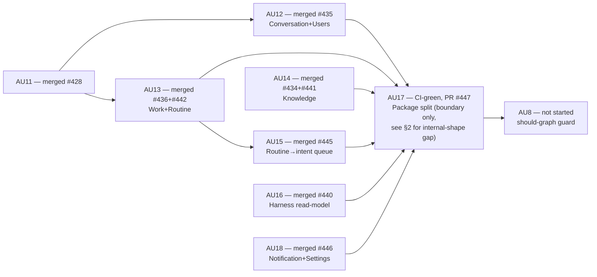

# Runtime Simplification: Dependency Graph (As-Is vs As-Should)

Tracks Core App / Agent Layer / Plugin ownership boundaries for Track AU. Graphs and tables only —
see git history for the AU7–AU18 build narrative this document used to carry inline. Companion
target doc: `plans/strategy-kernel-plugin-split/as-should-dependency-graph.md`.

**Live state as of 2026-07-13:** every domain-ownership WP (AU12–AU16, AU18) is merged to
`origin/main`. AU17 (the package split below) is CI-green on **PR #447**, not merged — origin/main
still runs the single-package `packages/server` monolith. AU8 (should-graph guard) has not started.

---

## 1. Package Dependency Graph

### 1a. As-is — merged `origin/main` (single-package monolith)



No structural boundary between domain (Work/Conversation/Knowledge/Users/Notifications) code and
agent-execution (harness/mcp/tools/dispatch) code — both live in one flat `packages/server/src/`.
Ownership is enforced only by 9 separate hand-typed guard scripts, not by the package graph itself.

### 1b. As-is — PR #447 branch (unmerged), three-tier split



Acyclic (verified): `core-app → agent-layer` and `core-app|agent-layer → server` are both zero
edges. `eval` and `web/scripts/*` now import `@hyperidle/core-app`/`@hyperidle/agent-layer`
directly — they no longer route through `packages/server`'s exports (which shrank from ~15 deep
file exports to 4: `.`, `./server-factory`, `./schemas`, `./test-utils`).

### 1c. As-should (target, unchanged by AU17)



---

## 2. Folder Trees — Core App / Agent Layer

### 2a. As-is (PR #447 branch) — package boundary real, internal organization NOT domain-split

```
packages/core-app/src/
├── config/                    3 files  (git-export-config, builtin-routines, builtin-tool-catalog)
├── knowledge/                 15 files (pre-existing subfolder, carried over unchanged)
├── notifications/             15 files (pre-existing subfolder, carried over unchanged)
├── schemas/                   3 files  (pure zod: artifact-preview, bet, common)
└── services/            ⚠️    43 files — FLAT, no domain grouping. Work (work-service.ts,
                                routine-service.ts), Conversation (conversation-store.ts), Users
                                (user-store.ts), and Settings (server-config.ts) each sit as a
                                single file beside ~35 unrelated ones (invite-code.ts,
                                item-router.ts, like-escape.ts, org-edges.ts, schedule-label.ts,
                                ws-broadcaster.ts, …).

packages/agent-layer/src/
├── harness/                   20 files (pre-existing subfolder, carried over unchanged)
├── mcp/                       2 files  (pre-existing subfolder, carried over unchanged)
├── tools/                     28 files (pre-existing subfolder, carried over unchanged)
└── services/             ⚠️    31 files — FLAT. Session/dispatch (agent-session-runtime.ts,
                                task-dispatcher.ts), execution (agent-run-boundary.ts,
                                trigger-resolution.ts), context (context-assembly.ts), cost
                                (cost-cap.ts, cost-sentinel.ts) all sit in one directory with no
                                sub-grouping. `agent-context/` and `agent-defaults/` are the only
                                two sub-folders that exist, each holding a single file.

packages/server/src/                  (composition root — routes + wiring only, 68 files)
├── routes/                    38 files (HTTP surface)
├── middleware/                8 files
├── auth/                      3 files
├── filesystem/                8 files
├── services/                  2 prod files (mcp-route.ts, worker-ws.ts — inbound transport)
└── app.ts, index.ts, server-factory.ts, session.ts
```

**Root cause:** AU17's plan (§3, §Out-of-scope) explicitly relocated the pre-existing monolith's
flat `services/` bucket as-is into two smaller flat buckets, and declared further internal
reorganization out of scope ("one boundary at a time"). The package *boundary* is real and
enforced; the internal *shape* does not yet match the as-should graph's domain separation
(Work / Conversations / Knowledge / Users / Settings each visibly distinct).

### 2b. As-should (target — not yet built, no WP registered)

```
packages/core-app/src/
├── work/            work-service.ts, bet-state-machine.ts, bet-kill-cascade.ts, task-*, item-router.ts
├── conversation/     conversation-store.ts
├── users/            user-store.ts, login-session.ts, invite-code.ts
├── knowledge/        (unchanged — already correctly organized)
├── notifications/    (unchanged — already correctly organized)
├── settings/          server-config.ts, plugin-configuration.ts, agent-behavior-config.ts, config/
├── routine/           routine-service.ts
└── shared/            files with no single clear domain (ws-broadcaster.ts, org-edges.ts,
                        credential-encryption.ts, model-gateway.ts, …) — needs its own audit,
                        not a default dumping ground

packages/agent-layer/src/
├── harness/           (unchanged)
├── mcp/               (unchanged)
├── tools/              (unchanged)
├── execution/          agent-run-boundary.ts, agent-session-runtime.ts, agent-session-requests.ts,
                        trigger-resolution.ts, agent-selection.ts, select-agent.ts
├── dispatch/            task-dispatcher.ts, assistant-dispatcher.ts, routine-scheduler.ts,
                        builtin-routine-handlers.ts, bet-decomposition*.ts
├── context/             context-assembly.ts, context-assembly-prompt.ts, session-context.ts,
                        agent-context/
├── lifecycle/           session-lifecycle.ts, session-provisioning.ts, routine-session-reaper.ts,
                        sandbox-reaper.ts
└── cost/                cost-cap.ts, cost-sentinel.ts
```

This split is a proposal for illustration, derived by grouping the as-is flat file list under the
as-should graph's named domains — it has not been critiqued or built. Registering it as a WP (same
shape as AU12–AU18's per-domain pattern) is the concrete next step if the org wants folders to match
the conceptual graph in §1c, not just a compiler-enforced package boundary.

---

## 3. Domain Ownership Table

| As-should domain | Owning file(s) today | As-is folder | Has own subfolder? |
|---|---|---|---|
| Work | `work-service.ts` | `core-app/src/services/` | No — flat |
| Conversations | `conversation-store.ts` | `core-app/src/services/` | No — flat |
| Knowledge | `knowledge/` (15 files) | `core-app/src/knowledge/` | **Yes** |
| Users | `user-store.ts` | `core-app/src/services/` | No — flat |
| Settings | `server-config.ts`, `plugin-configuration.ts` | `core-app/src/services/` | No — flat |
| Notifications | `notifications/` (15 files) | `core-app/src/notifications/` | **Yes** |
| Routine | `routine-service.ts` | `core-app/src/services/` | No — flat |
| Domain events | `EventBus` (`packages/shared`) | n/a | n/a |
| Trigger resolution | `trigger-resolution.ts` | `agent-layer/src/services/` | No — flat |
| Agent run orchestration | `agent-run-boundary.ts`, `agent-session-runtime.ts` | `agent-layer/src/services/` | No — flat |
| Harness registry | `harness/` (20 files) | `agent-layer/src/harness/` | **Yes** |
| Tool provider | `tools/` (28 files) | `agent-layer/src/tools/` | **Yes** |
| MCP provider | `mcp/` (2 files) | `agent-layer/src/mcp/` | **Yes** |
| Context providers | `context-assembly.ts` | `agent-layer/src/services/` | No — flat |
| Capture/writeback | `writeback.ts`, `file-watcher.ts` | `agent-layer/src/services/` | No — flat |

---

## 4. Work Package Status



| WP | Status | PR |
|---|---|---|
| AU12 Conversation+Users | Merged | #435 |
| AU13 Work+Routine | Merged | #436, #442 |
| AU14 Knowledge | Merged | #434, #441 |
| AU15 Routine→intent queue | Merged | #445 |
| AU16 Harness read-model | Merged | #440 |
| AU18 Notification+Settings | Merged | #446 |
| AU17 Package split | CI-green, **not merged** — holding pending internal-shape decision (§2) | #447 |
| AU8 Should-graph guard | Not started, blocked on AU17 | — |
| (unregistered) Domain-folder reorg (§2b) | Not registered | — |

---

## 5. Guards (all in `npm run lint`)

| Guard | Scans | Enforces |
|---|---|---|
| `au3-runtime-vocab-guard.ts` | all packages | no Strategy/Fabric/app-runtime vocabulary reappears |
| `au6-agent-boundary-guard.ts` | core+agent+server roots | request-consumption ownership |
| `au7-runtime-retirement-guard.ts` | `packages/server` (pre-#447) | Strategy/Fabric runtime retirement |
| `au10-plugin-config-ownership-guard.ts` | plugin/config surface | no runtime-execution import |
| `au12-conversation-users-ownership-guard.ts` | domain roots | sole owner of `threads`/`messages`/`users` |
| `au13-work-routine-ownership-guard.ts` | domain roots | sole owner of `bets`/`tasks`/`items`/`routines` |
| `au14-knowledge-ownership-guard.ts` | `routes/knowledge.ts` | sole route path to `knowledgeItems` |
| `au18-notification-ownership-guard.ts` | domain roots | sole owner of `notificationQueue` |
| `honest-harness-guard.ts` | `**/harness/__tests__` | no stubbed harness integration tests |
| `au17-package-boundary-guard.ts` (PR #447, unmerged) | 3 package roots | core-app cannot import agent-layer; AC-2 typecheck-boundary proof |
| `au9-direct-handoff-guard.ts`, `au11-runtime-ownership-guard.ts` | — | **retired by PR #447** — superseded by the real package boundary |

---

## 6. Gap Register

| # | Gap | Status |
|---|---|---|
| 1 | Core-app-imports-plugin-internals check | No guard. AU8's job. |
| 2 | Agent-layer-owns-core-CRUD check | No guard (proven only by regression tests, not statically). AU8's job. |
| 3 | Prompt Catalog (8th configuration catalog in as-should graph) | Not built. No `prompt` kind in `CONFIGURATION_KINDS`. Product decision, no WP assigned. |
| 4 | `routine-scheduler.ts` fire-time call into `agent-selection.ts` | Deliberate, named exception — Core calling Agent directly at fire-time, bypasses the intent-queue pattern every other family uses. Needs an explicit AU8 allowlist entry, not a silent pass or a flagged regression. |
| 5 | `@hyperidle/agent-layer/routines` curated 3-function export (for `packages/eval` only) | Deliberate, guard-pinned exception to "no barrel." Not a violation. |
| 6 | **Domain-folder reorg** (§2b) — flat `services/` in both new packages doesn't match the as-should graph's per-domain shape | Real gap, not yet a registered WP. See §2 for scope. |
| 7 | AU17 package split itself | CI-green, **held from merge** pending a decision on gap 6 (see §4). |
