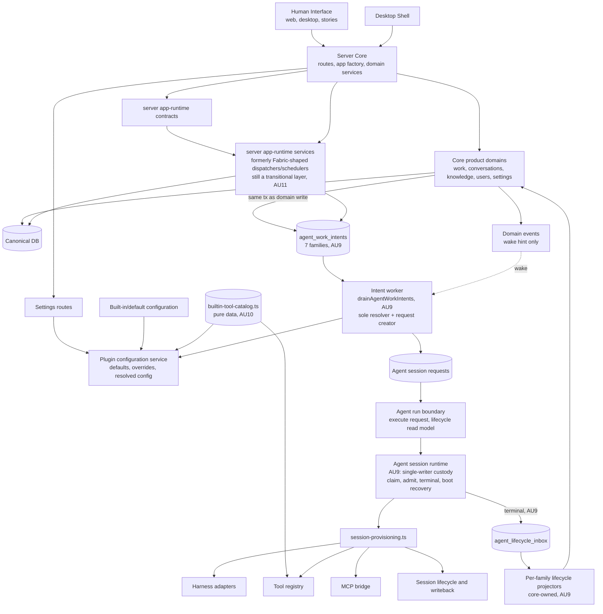
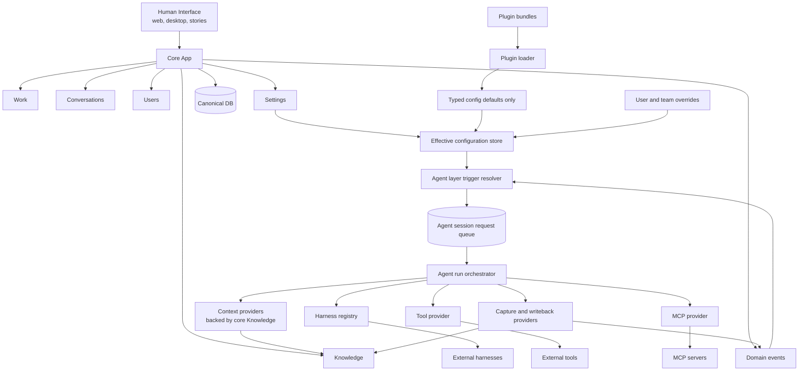

# Runtime Simplification Dependency Graph: As-Is vs As-Should

Baseline: `origin/main` at `c82812b5` (`feat(AU9): hard agent handoff boundary — remediation-2 rebuild (#425)`).

Update: AU6 rework checked against `feat/AU6-agent-execution-boundary` at `4a11aa45`
(`chore: attest AU6 boundary closure`, PR #419). AU6-owned agent execution boundary gaps
are marked separately below from the remaining Strategy/Fabric retirement gaps.

Update: AU7 was sent back through the pipeline after review found the cleanup requirement gap.
The corrected AU7 scope now deletes the live Strategy/Fabric source packages and seam files:
`packages/fabric`, `packages/strategy-minimal`, `packages/shared/src/strategy-port.ts`, and
`packages/server/src/services/strategy-registry.ts`. Server/eval runtime code uses server
app-runtime contracts, and lint now blocks runtime imports/registration of Fabric, minimal
Strategy, Strategy port, active Strategy APIs, and the deleted live paths returning. Durable
historical `strategy`/`fabric` names remain only where old records need to be readable.

**Update: AU9 ("Hard agent handoff boundary") merged.** PR #425
(`feat(AU9): hard agent handoff boundary — remediation-2 rebuild`) merged to `origin/main` at
`c82812b5`, now this document's baseline — `npm run verify` and `release-guard` were both green on
the merge commit. AU9 replaced the ad-hoc, direct request-creation paths still present at the AU7
baseline with a single durable handoff: every core route/domain command persists one
`agent_work_intents` row (kind, source, idempotency key — no execution detail) in the same
transaction as its own domain write; the agent layer alone drains, resolves, admits, executes, and
projects lifecycle back. This took five build/review cycles inside AU9 itself — two remediation
passes on the *implementation* found 8, then 13, CRITICAL findings of the same shape (a correct,
CAS-safe symbol added beside a weaker one that stayed wired into production; tests asserted the
unused-correct symbol instead of the real entrypoint) before a founder-directed architecture-level
re-diagnosis closed the pattern for good (see `plans/AU9/architecture.md` §Remediation-2, rules
R1/R2/R3). All "(AU9, pending merge)" markers from the prior revision of this document are now
just "(AU9)" — the state below is what is actually on `main`, not a PR preview.

**Update: AU10 ("Plugin surface ownership correction") is implementation-complete but not yet
merged.** Checked against branch `framework/AU10-plugin-surface-ownership` at commits `14a7418c`
(`feat(AU10): plugin surface ownership — builtin tool catalog seam`) and `8eff2b52`
(`chore(AU10): add verify attestation for 14a7418c`), PR #426 — `npm run verify` (2m26s) and
`release-guard` (11s) both green in CI, PR open and mergeable, awaiting human merge. AU10's audit
of the plugin/default configuration surface (`plugin-configuration.ts`, `agent-behavior-config.ts`
— the entire production config-seeder surface) found exactly one forbidden upward edge:
`plugin-configuration.ts:26` imported `ALL_TOOL_DEFINITIONS` from the runtime
`tools/tool-registry.ts` to seed built-in tool config defaults, pulling in ~20 tool handlers plus
`ToolContext` and `app-runtime/contracts` transitively for what was only ever a
name/description/roles/reversibility read. The fix extracted a pure-data
`packages/server/src/config/builtin-tool-catalog.ts` (zero runtime imports — only `import type`
from `@hyperidle/shared`); `tool-registry.ts` now depends on that same catalog too, so both sides
depend downward onto one data source instead of config reaching up into execution. A new static
guard, `scripts/au10-plugin-config-ownership-guard.ts` (AST module-import reachability, not a
runtime test, wired into `npm run lint`), makes the boundary durable — real-tree run finds 0
forbidden imports post-fix, and its `--fixtures` mode proves it catches both a direct and a
transitive leak. `agent-defaults/resolvers.ts` (which imports `app-runtime/roster` +
`app-runtime/services/agent-selection`) was confirmed out of AU10's scope — that is the AU11
transitional-shell edge, unchanged by this package. The as-is graph below reflects PR #426's state
wherever it differs from `main`, clearly marked "(AU10, pending merge)".

Companion target document: `plans/strategy-kernel-plugin-split/as-should-dependency-graph.md`.

This file compares the current runtime dependency graph against the target dependency graph. It is intentionally dependency-focused: it tracks ownership and call direction, not every API route or DB table.

## Executive Summary

The AU7 runtime-retirement, AU9 hard-handoff, and AU10 plugin-ownership targets are all now
reached at the work-package level (AU9 merged; AU10 implementation-complete, PR #426 pending
merge). Strategy/Fabric are gone from production runtime and live source; core app routes/services
no longer construct, consume, or execute agent requests directly — they record durable intent, the
agent layer does everything downstream of that; and the plugin/default configuration surface no
longer imports a runtime execution registry to seed its defaults. The full target graph is still
not mechanically proven end-to-end: AU8 has not yet enforced the complete should-graph guard, and
AU11 has not yet cut the remaining app-runtime transitional shell. AU9 was a *precondition* for
both AU10 and AU11 (both formally depend on it in the manifest; AU8 depends on AU11) — with AU9
merged and AU10 done, only AU11 then AU8 remain in the dependency chain.

Important target pieces are already present:

- `AgentSessionRequest` is now a real runtime primitive.
- Trigger-backed request creation exists in `packages/server/src/services/trigger-resolution.ts`.
- `packages/server/src/services/agent-run-boundary.ts` is the named execution boundary:
  request execution flows through `executeAgentRunRequest`, while lifecycle reads use
  `getAgentRunLifecycle` / `listAgentRunLifecycleBySource`.
- Server/app-runtime, routine, decomposition, and session route callers no
  longer resolve a production request consumer from the legacy registry.
- Plugin/default configuration resolution exists in `packages/server/src/services/plugin-configuration.ts`.
- `scripts/au6-agent-boundary-guard.ts` is wired into `npm run lint` and fails when
  production server/app-runtime code imports `agent-session-runtime`, resolves request consumers
  from the registry, uses the legacy `provisionSession` registry hook, or reintroduces local
  `consumeAgentSessionRequest` naming outside the boundary.
- Settings has a current story entry at `packages/web/src/pages/SettingsPage.stories.tsx`.
- `packages/server/src/app-runtime/contracts.ts` owns the runtime contracts production server
  code uses instead of the legacy Strategy port.
- `@hyperidle/server/app-runtime` is exported for runtime/eval callers.
- Eval scenarios that used to import Fabric runtime types now import server app-runtime.
- `scripts/au7-runtime-retirement-guard.ts` is wired into `npm run lint` and blocks production
  runtime use of `@hyperidle/fabric`, `@hyperidle/strategy-minimal`, Strategy registry, Strategy
  port, Fabric bootstrap, minimal Strategy fallback, and the retired source paths returning.
- **(AU9)** Every one of the seven work families (assistant, explicit session, knowledge, routine,
  decomposition, task, re-engagement) persists a durable `agent_work_intents` row in the same
  transaction as its own domain write; no family callback creates or resolves a request itself.
- **(AU9)** `scripts/au9-direct-handoff-guard.ts` is wired into `npm run lint` and statically
  forbids core-side files from importing `trigger-resolution`, `agent-session-requests`,
  `agent-session-runtime`, or `agent-run-boundary`, or from referencing request-construction/
  consumption symbols (`createTriggeredAgentSessionRequest`, `claimNextAgentSessionRequest`,
  `consumeAgentSessionRequest`, `executeAgentRunRequest`, `provisionSession`, etc.) outside the
  agent-owned file set.
- **(AU9)** Request custody (claim, admission, terminal transition, boot recovery) is each a
  single CAS-guarded writer function, and terminal state is projected through a durable
  `agent_lifecycle_inbox` and per-family projector registry rather than a direct execution
  callback — closing Gap Register items 1 and 2 from the AU7-era version of this document.
- **(AU10, pending merge)** `packages/server/src/config/builtin-tool-catalog.ts` is a pure-data
  catalog (zero runtime imports) that both `plugin-configuration.ts` and `tools/tool-registry.ts`
  depend on downward, replacing the prior edge where `plugin-configuration.ts` imported
  `ALL_TOOL_DEFINITIONS` from the runtime tool registry directly.
- **(AU10, pending merge)** `scripts/au10-plugin-config-ownership-guard.ts` is wired into
  `npm run lint` and statically forbids the plugin/default configuration surface
  (`plugin-configuration.ts`, `agent-behavior-config.ts`) from importing runtime tool registries,
  harness adapters, MCP bridge registries, provisioning services, or agent execution internals
  (module-import reachability, not symbol-call reachability); real-tree run is 0 findings
  post-fix, `--fixtures` mode proves it catches a direct and a transitive leak.

The remaining structural gap is no longer deletion of Strategy/Fabric source, nor direct
core-to-execution handoff, nor plugin config importing a runtime registry. The remaining AU work
is: (a) merge AU10 (implementation-complete), (b) cut the remaining app-runtime transitional shell
so Core app and Agent layer are the only two runtime owners (AU11), and (c) mechanically enforce
the complete should-graph guard once (a)-(b) land (AU8).

## Side-by-Side Shape

| Area | As-is graph | As-should graph |
| --- | --- | --- |
| Runtime center | Server owns routes plus provisioning, request runtime, trigger resolution, plugin config, app-runtime contracts, and app-runtime services. Legacy Fabric package dependency is gone. **(AU9)** Every route/domain command's only cross-boundary act is a durable intent write; app-runtime dispatchers/schedulers still exist as an intermediate layer between core routes and the agent layer (AU11 scope). | Core app owns product records/events/settings. Agent layer owns every LLM-capable run. Plugins only seed defaults. |
| Strategy | Strategy port/registry files and Fabric/minimal implementations are deleted from the live source graph. Production runtime no longer imports/registers/selects active Strategy. | No Strategy port, no active Strategy singleton, no Strategy implementations. |
| Fabric | `packages/fabric` is deleted from the live source graph. Former Fabric behavior lives in server app-runtime/core/agent services, with durable historical names preserved only for old records. | No Fabric runtime package. Former Fabric responsibilities redistributed to Core app, Agent layer, or plugin defaults. |
| Agent runs | **(AU9)** All seven work families enter through one durable-intent → drain → single-request → custody → lifecycle-inbox pipeline. `agent-work-intent-worker.ts` is the sole intent resolver/request-creator; `agent-session-runtime.ts` is the sole request custody writer (claim, admission, terminal transition, boot recovery each a single CAS-guarded function). Provisioning (`session-provisioning.ts`) remains the internal orchestrator the agent layer calls once custody is held. | All LLM runs enter via trigger resolver -> session request queue -> agent run orchestrator. |
| Configuration | Plugin configuration resolver exists with defaults, overrides, and resolved views. **(AU10, pending merge)** Built-in tool defaults now project from a pure-data `builtin-tool-catalog.ts`; the config surface no longer imports the runtime tool registry, and a lint guard enforces it. | Plugins seed typed config defaults. User/team overrides win. Config resolver produces the effective runtime view. |
| Knowledge | Knowledge routes and projections exist in server; former Fabric knowledge/context behavior has been rehomed into server app-runtime/core/agent services. Knowledge actions now also persist a durable intent row alongside their domain write (AU9). | Knowledge CRUD, scoring, search, and projections are core app Knowledge. Agent context/writeback are Agent layer providers backed by core Knowledge. |
| Boundary enforcement | AU6 guard enforces request-consumption ownership. AU7 guard enforces Strategy/Fabric runtime retirement. **(AU9)** `au9-direct-handoff-guard.ts` forbids core-side construction/consumption of requests; two of the target's eight boundary checks ("every LLM-capable event has a trigger surface or default-attach path", "every agent run has a recorded trigger resolution including fallback runs") are already structurally guaranteed by AU9's `agent_work_intents_kind_source_compat_ck` DB constraint + exhaustive `eventTypeFor` switch + mandatory `triggerResolutionHistory` insert on every request — not merely pending AU8. **(AU10, pending merge)** `au10-plugin-config-ownership-guard.ts` forbids the plugin/default config surface from importing runtime tool registries/harness adapters/MCP bridges/provisioning services. Three of the remaining boundary checks (Core-app-imports-harness-directly, Core-app-imports-plugin-internals, Agent-layer-owns-core-CRUD) have no guard yet and genuinely await AU8. | Mechanical lint/type/package boundaries prevent forbidden imports and ownership leaks. |

## As-Is Graph

## As-Should Graph

## Current Evidence

| Current edge | Evidence |
| --- | --- |
| Legacy Strategy port deleted | `packages/shared/src/strategy-port.ts` removed from live source graph |
| Legacy Strategy registry deleted | `packages/server/src/services/strategy-registry.ts` removed from live source graph |
| Legacy Fabric package deleted | `packages/fabric` removed from live source graph |
| Legacy minimal Strategy package deleted | `packages/strategy-minimal` removed from live source graph |
| Server app-runtime contracts exist | `packages/server/src/app-runtime/contracts.ts` |
| Server app-runtime export exists | `packages/server/package.json` exports `./app-runtime` |
| Agent run boundary exists | `packages/server/src/services/agent-run-boundary.ts` |
| AU6 request-consumption guard exists | `scripts/au6-agent-boundary-guard.ts`, `package.json` `lint` script |
| AU7 runtime-retirement guard exists | `scripts/au7-runtime-retirement-guard.ts`, `package.json` `lint` script |
| **(AU9)** Direct-handoff guard exists | `scripts/au9-direct-handoff-guard.ts`, `package.json` `lint` script — forbids core imports of `trigger-resolution`/`agent-session-requests`/`agent-session-runtime`/`agent-run-boundary` and forbidden request-construction/consumption symbols outside the agent-owned file set |
| **(AU9)** Durable intent boundary exists | `packages/db/src/schema.ts` (`agent_work_intents`, seven kinds/sources, unique idempotency key), `packages/server/src/services/agent-work-intent-worker.ts` |
| **(AU9)** Single-writer request custody exists | `packages/server/src/services/agent-session-runtime.ts` (`terminalizeAgentSessionRequest` — sole terminal writer, both running+session_id and claimed+claim_token preconditions; `recoverRunningAgentSessionRequests` — real boot recovery) |
| **(AU9)** Durable lifecycle projection exists | `packages/db/src/schema.ts` (`agent_lifecycle_inbox`), `packages/server/src/app-runtime/services/agent-lifecycle-projectors.ts` (per-family projector registry, core-owned, no agent-runtime import) |
| **(AU9)** Task dispatch has a durable, replay-safe source | `packages/db/src/schema.ts` (`task_dispatch_attempts`), `packages/server/src/services/task-state-machine.ts` |
| **(AU9)** `createTriggeredAgentSessionRequest` has exactly one production caller | the intent drain (`agent-work-intent-worker.ts`); assistant/handoff direct-create paths collapsed into it |
| **(AU10, pending merge)** Built-in tool catalog is pure data | `packages/server/src/config/builtin-tool-catalog.ts` — no import of `tools/`, `harness/`, `mcp/`, `app-runtime/`, or provisioning; only `import type` from `@hyperidle/shared` |
| **(AU10, pending merge)** Plugin config no longer imports the runtime tool registry | `packages/server/src/services/plugin-configuration.ts:26` imports `BUILTIN_TOOL_CATALOG` from `../config/builtin-tool-catalog.js` (was `ALL_TOOL_DEFINITIONS` from `../tools/tool-registry.js`) |
| **(AU10, pending merge)** Catalog↔registry drift guard exists | `packages/server/src/tools/__tests__/builtin-tool-catalog-consistency.test.ts` — name-set equality, `return_status_tool` exclusion, per-tool metadata deep-equal, real-path validation via `loadBuiltInConfigurationDefaults` |
| **(AU10, pending merge)** Plugin-config-ownership guard exists | `scripts/au10-plugin-config-ownership-guard.ts`, `package.json` `lint` script — module-import-reachability check over the plugin/default config surface; 0 findings on the real tree post-fix, `--fixtures` mode proves it catches a direct and a transitive leak |
| Server bootstrap no longer registers production request/provision consumer hooks | `packages/server/src/server-factory.ts` |
| Trigger-backed request creation exists | `packages/server/src/services/trigger-resolution.ts` |
| Agent request queue/runtime exists | `packages/server/src/services/agent-session-requests.ts`, `packages/server/src/services/agent-session-runtime.ts` |
| Provisioning remains central | `packages/server/src/services/session-provisioning.ts` |
| Plugin configuration resolution exists | `packages/server/src/services/plugin-configuration.ts` |
| App-runtime dispatch uses boundary handoff | `packages/server/src/app-runtime/services/task-dispatcher.ts` |
| App-runtime routine scheduling uses boundary handoff | `packages/server/src/app-runtime/services/routine-scheduler.ts` |
| Core/server knowledge exists | `packages/server/src/routes/knowledge.ts`, `packages/server/src/services/knowledge/projections.ts` |
| Eval runtime imports use app-runtime contracts | `packages/eval/src/scenarios/builtin-routines.ts`, `packages/eval/src/scenarios/delegation.ts`, `packages/eval/src/scenarios/routine-sessions.ts`, `packages/eval/src/scenarios/skill-autonomy.ts` |
| Settings story exists | `packages/web/src/pages/SettingsPage.stories.tsx` |

## Detailed Comparison

### Core App

| Responsibility | As-is | As-should |
| --- | --- | --- |
| Work records | Core server routes/services own much of this. App-runtime dispatchers still exist, but AU6 moved request execution through the agent-run boundary, AU7 removed Strategy/Fabric ownership, and **(AU9)** task acceptance/retry/owner-handoff now persist a `task_dispatch_attempts` row + intent in the same transaction as the domain write — no post-commit enqueue. | Core owns records and emits events only. |
| Conversations | Server routes/services own records. **(AU9)** the assistant message-insert transaction persists the intent directly; the route no longer fires a turn itself (the dead `assistantTurnDeps` route parameter was removed at ship). | Conversation domain records user intent and emits events; Agent layer owns the LLM run. |
| Knowledge | Core routes/projections exist. Former Fabric knowledge/context behavior is reachable through server app-runtime/core/agent services. **(AU9)** knowledge actions persist their intent in the same transaction as the action/flag mutation. | Core Knowledge owns CRUD, search, scoring, projections, and visibility. |
| Settings | Settings routes plus plugin configuration service exist. **(AU10, pending merge)** the config surface no longer imports a runtime execution registry to seed built-in tool defaults. | Settings edits user/team overrides; resolver merges overrides with plugin defaults. |
| Domain events | Present, and **(AU9) substantially closed**: direct route/service creation of agent requests is gone — replaced by a durable intent row per family, persisted in the same transaction as the domain write, with the EventBus emission demoted to a wake-hint only (not the recovery contract). One nuance versus the as-should diagram: the as-should graph draws `DomainEvents -> TriggerResolver` as the sole handoff primitive, while AU9 built a dedicated `agent_work_intents` table as the durable contract and kept EventBus purely as a latency optimization. This is arguably the stronger design (a table survives replay; an in-memory-published event does not) but it is a deliberate divergence from the literal diagram worth flagging, not a defect. | Sole handoff from core domains into Agent layer triggers. |

### Agent Layer

| Responsibility | As-is | As-should |
| --- | --- | --- |
| Trigger resolution | Exists in server service and reads resolved configuration. | Lives inside Agent layer and is the only event-to-run decision point. |
| Request queue | `AgentSessionRequest` create/claim/consume exists. AU6 puts production consumption behind `executeAgentRunRequest`. **(AU9)** `createTriggeredAgentSessionRequest` now has exactly one production caller (the intent drain), closing the "who creates a request" question the AU7-era version of this doc left open. | Queue is the stable boundary between core events and execution. |
| Run orchestration | `executeAgentRunRequest` is the domain-facing boundary; `consumeAgentSessionRequest` and `provisionSession` remain internal implementation details. **(AU9)** custody (claim/reclaim, admission, terminal transition, boot recovery) is each a single CAS-guarded writer — the recurring "correct symbol exists but a weaker one is wired into production" defect class was closed by deleting every weak/dead sibling (`markRequestTerminal`, a weaker `claim()`, a stub `recoverRunningAgentSessionRequests`, a commented-out recovery corpse). | Agent run orchestrator owns lifecycle, harness, context, tools, MCP, capture, and writeback. |
| Context | Split across server `agent-context` and app-runtime/core services. | Context providers are Agent layer adapters backed by Core Knowledge. |
| Tools/MCP | Server provisioning builds tool registry and MCP wiring. | Agent layer exposes tool/MCP providers; core does not import execution adapters. |
| Capture/writeback | Split across session lifecycle, provisioning, Fabric/context services, and domain-specific code. | Agent layer writes captured artifacts back through core-owned stores/events. |
| Lifecycle projection | **(AU9)** terminal request state is written by the single custody writer, which inserts one `agent_lifecycle_inbox` row in the same transaction; a core-owned, per-family projector registry (`agent-lifecycle-projectors.ts`) drains that inbox and mutates each family's own read model (routine run outcome, task dispatch attempt state, explicit-session-start status, etc.) — domains never receive a raw `ProvisionSessionResult`. | Domains observe completion/failure/cancellation only through durable lifecycle projection, never an execution callback. |

### Plugin And Configuration

| Responsibility | As-is | As-should |
| --- | --- | --- |
| Defaults | Default/configuration records exist; typed-default projection (AU2/AU5) predates AU10. **(AU10, pending merge)** built-in tool defaults now project from the pure-data `builtin-tool-catalog.ts` instead of the runtime tool registry. | Plugins seed typed defaults only. |
| Overrides | Plugin configuration service supports user/team overrides and resolved config. AU10 preserved this byte-for-byte (`defaultVersionHash` unchanged; VS2 override-survives-reseed regression stayed green). | Same concept, but enforced as the only editable runtime configuration path. |
| Runtime behavior | Production runtime no longer registers Strategy or imports Fabric/minimal Strategy; legacy packages/files are deleted from the live source graph. | Effective config feeds Agent layer trigger/orchestration decisions directly. |
| Plugin isolation | **(AU10, pending merge)** Partially enforced: `au10-plugin-config-ownership-guard.ts` statically forbids the plugin/default config surface from importing runtime tool registries, harness adapters, MCP bridge registries, or provisioning services (0 findings on the real tree). Scoped to that one surface, not the full should-graph — AU8 still owns forbidding Agent-layer-owns-core-CRUD and the complete cross-cutting boundary. | Plugins cannot subscribe to the event bus, invoke harnesses, or mutate core records directly. |
| Prompt catalog | **Should-graph audit finding (2026-07-11, pre-existing, not created by AU9/AU10):** the target's 8th configuration catalog (Prompt Catalog) has no real equivalent. `packages/server/src/services/configuration.ts` `CONFIGURATION_KINDS` defines exactly 7 kinds (agent, skill, routine, trigger, tool, mcp_server, harness_descriptor) — no `prompt` kind. Prompt templates/overrides are not editable configuration; they live folded into trigger/agent prompt-mode bindings (`PROMPT_MODE_BY_SOURCE`, `trigger-resolution.ts:23`). This is the AU2/AU5-era shape, unchanged by AU9/AU10, but was never named in this document before this audit. | Prompt Catalog is a first-class configuration catalog alongside the other 7 (Agent, Skill, Routine, Trigger, Tool, MCP, Harness). |

## Gap Register

These gaps should be registered as follow-up work if not already represented by later AU work packages. Status reflects PR #425 (AU9) as merged and PR #426 (AU10) as if merged.

1. ~~Finish defining and enforcing the Agent layer boundary beyond AU6 request consumption.~~ **Substantially closed by AU9.**
   - AU6 closed the production request-consumption gap: non-boundary imports of
     `agent-session-runtime`, registry consumer resolution, legacy `provisionSession` registry
     hooks, and local `consumeAgentSessionRequest` variables are guarded by lint.
   - **AU9** closed request *construction*: `au9-direct-handoff-guard.ts` forbids core files from
     importing the agent-owned modules at all, and `createTriggeredAgentSessionRequest` has
     exactly one production caller.
   - Remaining AU8/AU11 work: place trigger resolution, provisioning/orchestration, harness
     registry, tools, MCP, context, and capture/writeback fully under one owned package/module
     boundary (today they are ownership-correct but not yet package-isolated — the app-runtime
     layer is still an intermediate hop, see gap 6 below) and prevent core routes/domains from
     importing those execution adapters directly (today enforced by symbol/module denylist, not a
     structural package boundary).

2. ~~Decide and enforce the final event-only handoff rule.~~ **Closed by AU9, with a noted design divergence.**
   - AU9 made the durable `agent_work_intents` row — not the EventBus — the recovery contract;
     every family persists it in the same transaction as its domain write, and EventBus emission
     is now explicitly a wake-hint, never load-bearing. All direct-request-creation call sites
     found in the AU7-era audit are gone.
   - Noted divergence (not a defect): the as-should diagram draws `DomainEvents -> TriggerResolver`
     as the literal mechanism; AU9 implements the same guarantee through a durable table instead of
     the event bus, which is more crash-safe than a literal event-only design would be. Worth a
     one-line note if `as-should-dependency-graph.md` is ever revised, otherwise leave as informative
     context.

3. ~~Finish plugin bundle/default projection.~~ **Boundary-check portion closed by AU10 (pending
   merge); typed-default projection was already in place from AU2/AU5.**
   - Built-in behavior already seeds typed defaults through the plugin/default configuration path
     (AU2/AU5, pre-AU10) — that part of this gap was stale by the time AU10 started.
   - User/team overrides already win and remained unchanged by AU10 (byte-stable
     `defaultVersionHash`, VS2 regression green).
   - **AU10** added the boundary check this gap actually called for: plugin/default config can no
     longer import a runtime execution registry (`au10-plugin-config-ownership-guard.ts`, 0
     findings on the real tree, catches direct + transitive leaks via `--fixtures`). Scoped to the
     plugin/default config surface specifically — it does not forbid plugins from subscribing to
     the event bus or invoking harnesses directly, which was already true pre-AU10 and remains a
     should-graph-guard (AU8) concern to make mechanical and general rather than a newly-found gap.

4. Add mechanical dependency checks. **Partially closed by AU9 and AU10; full guard is still AU8.**
   - AU7 already forbids runtime imports of `@hyperidle/fabric` and `@hyperidle/strategy-minimal`.
   - AU7 already forbids production runtime imports of `strategy-port` and Strategy registry.
   - **AU9** added a targeted guard for core-side request construction/consumption
     (`au9-direct-handoff-guard.ts`), scoped to that one edge.
   - **AU10** added a targeted guard for plugin/default config importing runtime tool
     registries/harness adapters/MCP bridges/provisioning services (`au10-plugin-config-ownership-guard.ts`),
     scoped to the plugin/default config surface.
   - Still open: forbid Core App imports from harness/tool/MCP execution internals generally
     (beyond the two edges above); forbid Agent-layer-owning-core-CRUD. This is AU8's full
     should-graph guard, and AU8 depends on AU11 (not yet started) in the manifest.
   - Correction from this cycle's should-graph audit: two of the target's eight boundary checks
     ("every LLM-capable event has a trigger surface or documented default attach path", "every
     agent run has a recorded trigger resolution, including fallback runs") are already
     structurally guaranteed by AU9's construction (the `agent_work_intents_kind_source_compat_ck`
     DB constraint, the exhaustive `eventTypeFor` switch, and the mandatory
     `triggerResolutionHistory` insert on every request via the sole `createTriggeredAgentSessionRequest`
     caller) — not merely awaiting AU8 as the prior revision of this gap implied. Only three of the
     eight checks (Core-app-imports-harness-directly, Core-app-imports-plugin-internals,
     Agent-layer-owns-core-CRUD) are genuinely unguarded and await AU8.

7. **New gap surfaced by this cycle's should-graph audit — the target's Prompt Catalog has no real
   equivalent.**
   - The as-should graph's Configuration And Plugin Graph lists 8 catalogs (Agent, Skill, Routine,
     Trigger, Tool, MCP, Harness, Prompt). Source (`packages/server/src/services/configuration.ts`
     `CONFIGURATION_KINDS`) has only 7 — no `prompt` kind. Prompt templates/overrides are not
     editable configuration; they're folded into trigger/agent prompt-mode bindings
     (`PROMPT_MODE_BY_SOURCE`, `trigger-resolution.ts:23`).
   - Not newly created by AU9/AU10 (this is the AU2/AU5-era shape, unchanged) — but it was never
     named in this document before this audit. A real, if minor, should-graph deviation now on
     record.
   - Whether this should become a real 8th editable catalog (giving users an editable
     prompt-override surface) or the target doc should be revised to drop it is a product
     decision, not an engineering gap. Not assigned to a specific AU package here — flagging for
     whoever next scopes AU10/AU11/AU8 follow-up work to decide.

5. Reconcile AU5 status into mainline. **Resolved — no longer a gap.**
   - AU5 (Settings agent behavior configuration surface) is merged into `origin/main` as of
     `09eb9b41` (`feat(AU5): add agent behavior configuration surface`), which is an ancestor of
     the current AU7/AU9 baseline. No further reconciliation needed; this line item can be
     dropped in a future revision of this document.

6. **New gap surfaced by AU9's rebuild — the app-runtime layer is still a third runtime owner.**
   - AU9 verified that `packages/server/src/app-runtime/services/{task-dispatcher,routine-scheduler}.ts`
     still exist as an intermediate dispatch/scheduling layer between core routes and the agent
     layer's intent drain — they now correctly persist intents inside owning transactions rather
     than enqueuing post-commit, but the layer itself has not been removed. The as-should graph has
     only two runtime owners (Core app, Agent layer); the as-is graph still has three
     (Core app, app-runtime services, Agent layer). This is explicitly **AU11's** scope
     ("Runtime ownership hard cut" — removing the app-runtime transitional shell), not a defect in
     AU9's work, but it's worth naming explicitly here since AU9's own architecture doc
     (`docs/architecture/runtime-simplification.md`) still describes app-runtime services as a
     going concern rather than a target end-state. AU10 confirmed `agent-defaults/resolvers.ts`
     (which imports `app-runtime/roster` + `app-runtime/services/agent-selection`) as the same
     AU11 edge, deliberately left untouched.

## AU7 Completion Check

| AU7 requirement | Status | Notes |
| --- | --- | --- |
| Production server boot succeeds without registering/selecting a Strategy | Complete | Production runtime no longer imports/registers/selects active Strategy; AU7 guard blocks reintroduction. |
| Runtime package dependencies no longer include `@hyperidle/fabric` or `@hyperidle/strategy-minimal` | Complete | Runtime roots and workspace package graph no longer depend on either package. |
| Former Fabric service behavior reachable through server app-runtime and core/agent services | Complete for AU7 surface | Runtime contracts live in `packages/server/src/app-runtime/contracts.ts`; server/eval callers use app-runtime instead of Fabric runtime types. |
| Agent-capable behavior continues through AU6 request/runtime boundary | Complete | AU6 boundary remains the execution handoff; AU7 updated the AU6 guard to stop treating Fabric as production runtime. |
| Durable rows with historical `strategy`/`fabric` names remain readable | Complete | AU7 does not rename historical schema/table vocabulary. This is intentional compatibility, not active runtime architecture. |
| Docs describe Fabric and Strategy only as legacy compatibility | Complete | Runtime simplification and system overview docs were updated in AU7. |
| Full as-should dependency tree mechanically enforced | Not an AU7 requirement | AU8 needs the full graph guard after AU9/AU10/AU11 land. |

## AU9 Completion Check

| AU9 requirement | Status | Notes |
| --- | --- | --- |
| Core app routes and domain services never directly create, consume, or execute agent run requests | Complete, merged (`c82812b5`) | `au9-direct-handoff-guard.ts` lint-enforced; manual `rg` audit against the agent-owned file allowlist confirmed by two independent review rounds. |
| Every existing LLM-capable entry point hands off by recording domain intent or publishing a domain event the agent layer consumes | Complete, merged | All seven families (assistant, explicit session, knowledge, routine, decomposition, task, re-engagement) persist an `agent_work_intents` row in the same transaction as their domain write. |
| The agent layer is the only owner of request construction, trigger resolution outcome binding, execution admission, and lifecycle publication | Complete, merged | `createTriggeredAgentSessionRequest` has exactly one production caller (the drain); custody operations are each a single CAS-guarded writer; lifecycle publication goes through the durable inbox + projector registry. |
| Assistant turns, session-start paths, knowledge actions, routines, decomposition, task acceptance, and re-engagement preserve current observable behavior after the handoff cut | Complete, merged | Protected suites amended to drive the real route/drain/boot entrypoints (not helper imports) still pass; 3310 unit/component tests + 2628 service-integration tests green; a real builtin-harness LLM call independently re-verified the assistant reply path end-to-end. |
| Failure, cancellation, and completion are observed by domains only through lifecycle state/events, not direct execution callbacks | Complete, merged | Terminal transition writes the lifecycle inbox row in the same transaction as the CAS; seven core-owned projectors consume it; no family imports agent-runtime execution types. |
| Review includes a should-graph audit proving no core-to-agent direct handoff edge remains | Complete, merged | Phase-4 review (`plans/AU9/code-review-remediation2.md`) independently re-verified the guard and the caller-count claims against source; verdict DONE, 0 CRITICAL. |
| Full as-should dependency tree mechanically enforced | Not an AU9 requirement | AU9 scoped to the core↔agent handoff edge only; AU10 (plugin ownership) and AU11 (app-runtime shell removal) are explicitly out of AU9's scope, and AU8 needs the full graph guard after both land. |

## AU10 Completion Check

| AU10 requirement | Status | Notes |
| --- | --- | --- |
| Plugin/default configuration code does not import runtime tool registries, harness adapters, MCP bridge registries, provisioning services, or agent execution internals | Complete (pending merge) | `au10-plugin-config-ownership-guard.ts` (module-import reachability) — 0 findings on the real tree; independently re-run by the Phase-4 reviewer, not just builder-reported. Reviewer's own audit confirmed the plugin/default config surface is exactly `plugin-configuration.ts` + `agent-behavior-config.ts`, and the only pre-fix violation (`ALL_TOOL_DEFINITIONS` from `tool-registry.ts`) is the one AU10 fixed. |
| Built-in defaults are represented through the same editable configuration/provenance model as plugin defaults | Complete (pending merge) | Confirmed already true pre-AU10 by independent source review (not just import-path change); `configuration-projection-boot.integration.test.ts` pins `tool.submit_review` resolving `origin.type==="builtin"` post-swap. |
| Runtime execution consumes active configuration through agent-layer contracts instead of plugin code pushing behavior into runtime registries | Complete (pending merge) | Confirmed already true pre-AU10 (`trigger-resolution.ts` already read `listResolvedConfiguration`); guard now makes the correct direction durable, and existing consumption tests stayed green. |
| User overrides, disabled plugin origins, and built-in defaults preserve AU2/AU5 observable behavior | Complete (pending merge) | `defaultVersionHash` byte-stable (seed loop body unchanged, `stableJson` key-sorted, consistency test forbids metadata drift); full `plugin-configuration.test.ts` suite including the VS2 override-survives-reseed case green, unchanged. |
| Capability validation is explicit and inspectable without making plugin configuration own runtime discovery | Complete (pending merge) | `builtin-tool-catalog-consistency.test.ts` exercises the real `validateConfigurationValue` path (via `loadBuiltInConfigurationDefaults`, since the validator itself isn't exported) over all 21 catalog entries. |
| Review includes a should-graph audit proving plugins are configuration sources only | Complete (pending merge) | Phase-4 reviewer's explicit audit: the config surface (`plugin-configuration.ts`, `builtin-tool-catalog.ts`, `agent-behavior-config.ts`) reaches zero execution internals; the only real tool-registry importers left are execution modules (session-provisioning, agent-work-assistant, builtin-harness-adapter, mcp-bridge), all in the correct downward direction. |
| Full as-should dependency tree mechanically enforced | Not an AU10 requirement | AU10 scoped to the plugin/default-config-surface-owns-no-runtime-import edge only, deliberately narrower than AU8's eventual full guard (avoiding AU8 scope creep was an explicit review check). |

## Requirement Resolution

Track AU says AU7 owns Strategy/Fabric runtime retirement and AU8 explicitly excludes removing
remaining Strategy/Fabric code. Review clarified that "retirement" means a completely clean live
source graph, not only production-runtime removal. AU7 requirements were corrected to match that
definition.

Under the corrected definition, AU7 deletes `packages/fabric`, `packages/strategy-minimal`,
`packages/shared/src/strategy-port.ts`, and `packages/server/src/services/strategy-registry.ts`
from the live source graph. AU7 also hardens lint so those paths and runtime imports cannot return.
Durable historical table/field names remain readable as compatibility data, not active runtime
architecture.

AU9 took the review-driven correction pattern further than any prior AU package: the acceptance
criteria ("core never creates/consumes/executes agent requests") were architecturally right from
the first pass, but the *implementation* twice reintroduced a weaker parallel path beside a correct
one. The fix that finally held was not another code patch — it was three explicit, reviewer-
mechanical rules written directly into the architecture (single custody writer per operation;
production-entrypoint-only tests; no manufactured rows/dead scaffolds), each with a named
canonical symbol and a `rg`-based verification recipe. That pattern (escalate to architecture level
after 2 recurring remediation cycles of the same defect shape, rather than attempting a third
code-only patch) is worth keeping in mind for AU11/AU8 if similar cyclical review failures show up
there.

AU10, by contrast, stayed a single-pass correction: the acceptance criteria were architecturally
right from the first pass, the audit found exactly one concrete violation, and the fix (extract a
pure-data catalog, invert the import, add a narrowly-scoped guard) held through refine-critique,
architecture-critique, and code review without a single CRITICAL finding at any gate. That
contrast is itself informative — AU9's five-cycle cost came from AU9's custody-writer model having
multiple opportunities for a correct-symbol/weak-symbol split (claim, admission, terminal,
recovery each independently), while AU10's scope was a single import edge with no equivalent
dual-path surface.

## Bottom Line

**On track.** The dependency-ordered chain the manifest encodes (AU7 → AU9 → {AU10, AU11} → AU8)
is proceeding in the correct order with no work skipped or reordered: AU7 and AU9 are merged, AU10
is implementation-complete and independently re-verified (PR #426, CI green, awaiting human merge),
and AU11 is unblocked but not yet started (AU8 remains gated on AU11). No scope has silently
dropped — AU9's own review explicitly named the app-runtime transitional layer (gap 6 above) as
still standing, which matches AU11's charter rather than contradicting it; AU10 explicitly left
that same layer untouched and confirmed `agent-defaults/resolvers.ts` as AU11's edge, not its own.

**New observations from this cycle, in order of how surprising they were:**

- **Not a graph gap, a delivery-cost contrast:** AU10 closed cleanly in one round at every gate —
  refine self-score 9/10, refine-critique 9/10 (0 CRITICAL), architecture-critique 8.5/10 (0
  CRITICAL), code review DONE round 1 (0 CRITICAL, 0 WARNING) — a sharp contrast with AU9's five
  build/review cycles and mid-flight architecture escalation. The retro
  (`.pipeline/retro-log/AU10.jsonl`) attributes this to scope discipline (one concrete leak,
  narrowly fixed, guard scoped to exactly that edge rather than reaching for AU8's job) plus the
  reviewer independently re-deriving completeness claims (its own grep sweep of the config surface,
  its own guard-script run) rather than trusting builder-reported pass counts — the same discipline
  AU9's remediation-2 rules (R1-R3) forced after the fact, applied proactively here.
- **A real, recurring process gap, not a graph gap:** a builder ended its turn while `npm run
  verify` was still running backgrounded during AU10's build phase — a failure mode now confirmed
  across 6 distinct work packages (AG4, AR1, AR2, AR4, AR6, AU10) per this cycle's retro, past the
  3-occurrence threshold for `/compound` to act on, with no tracked compound-candidates row yet.
  Unrelated to the dependency graph, but worth surfacing here since it's now cost real wall-clock
  time on two consecutive AU packages (AU9 and AU10).
- **Confirmed, not new:** the app-runtime dispatcher/scheduler layer (gap 6) and the
  `agent-defaults/resolvers.ts` app-runtime import remain exactly where AU9 left them — AU10 was a
  narrow, adjacent fix and deliberately did not touch either.

**Independent should-graph audit (2026-07-11):** a fresh, source-grounded pass walked every
section of `as-should-dependency-graph.md` (Target Rules, both layer graphs, the config/plugin
graph, the trigger-flow graph, Removed Components, Boundary Checks) against real code in both the
merged-main and AU10-branch worktrees, re-deriving every claim rather than trusting this
document's prior wording. Result: the document holds up. Every AU9/AU10 MET claim independently
re-verified true against source (including the load-bearing ones: `builtin-tool-catalog.ts` zero
runtime imports, `plugin-configuration.ts:26` importing the catalog not the registry, all five
au-guards wired into `lint`). Two additive corrections were folded in above (Prompt Catalog gap;
boundary checks 7/8 already AU9-guaranteed, not AU8-pending) — neither implies new work, and no
new AU work package is warranted.

No new work package is needed. The next actions in dependency order are: merge PR #426 (AU10),
then start AU11 (now the only unblocked, not-yet-started AU work), then AU8 once AU11 lands.
