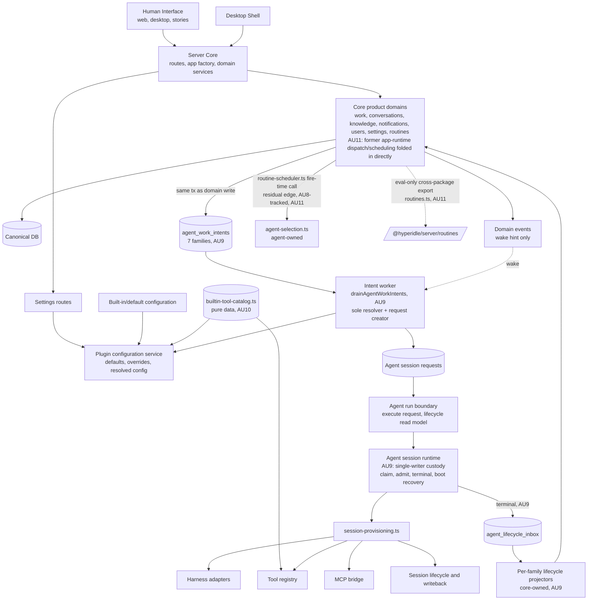
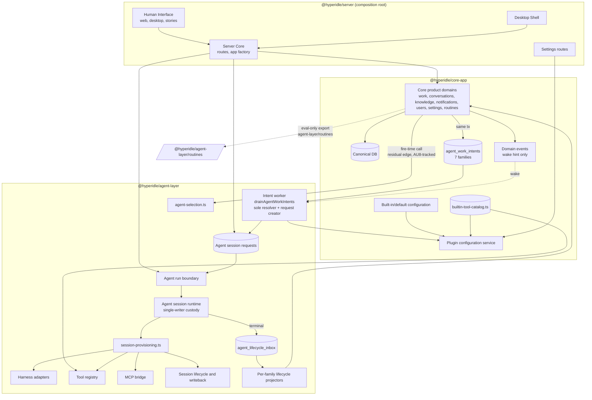
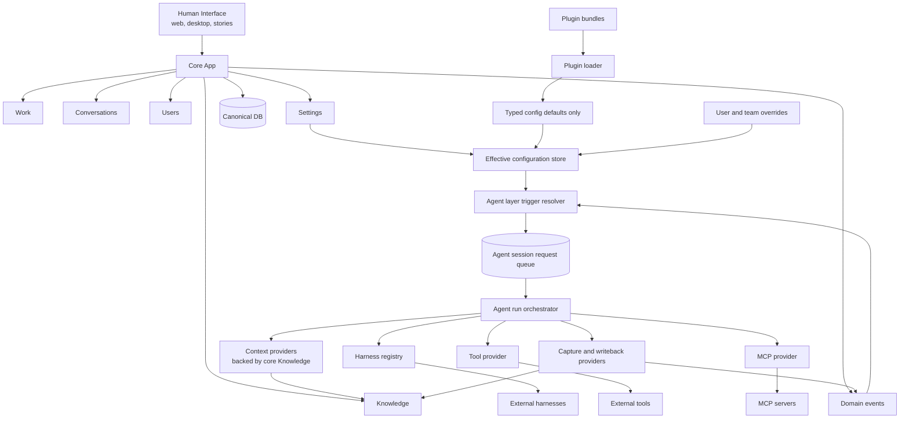
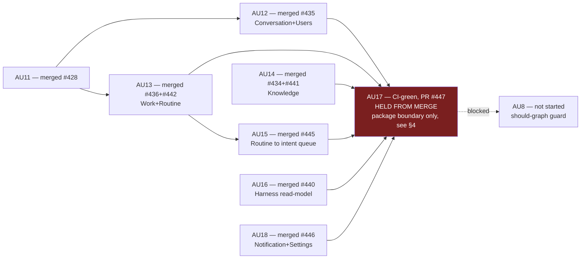
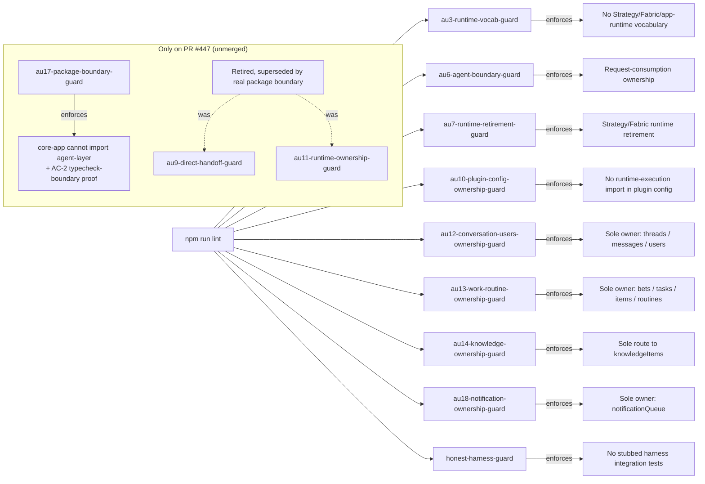
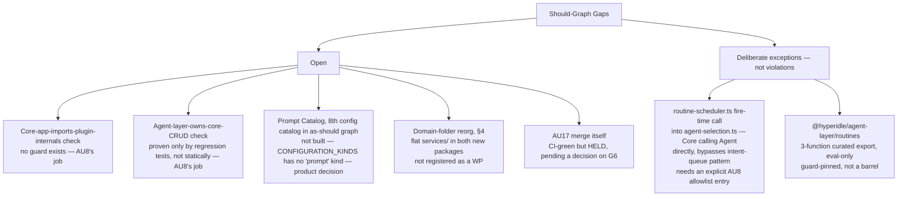

# Runtime Simplification: Dependency Graph (As-Is vs As-Should)

Tracks Core App / Agent Layer / Plugin ownership boundaries for Track AU. Graphs and trees only, no
tables. Companion target doc (untouched by this file): `plans/strategy-kernel-plugin-split/as-should-dependency-graph.md`.

**Live state as of 2026-07-13:** every domain-ownership WP (AU12–AU16, AU18) is merged to
`origin/main`. AU17 (the package split) is CI-green on **PR #447**, held from merge — see §5.
AU8 (should-graph guard) has not started.

---

## 1. As-Is Graph — merged `origin/main` (current live state, unaltered from prior revision)



This is `origin/main` right now — AU17 has not merged, so this graph (single `packages/server`,
`@hyperidle/server/routines` export) is still exactly accurate.

---

## 2. As-Is Graph — PR #447 branch (unmerged), same runtime flow, package boundaries added

Identical nodes and edges to §1, redrawn with the three new package boundaries as subgraphs so you
can see which package each runtime component would move into if #447 merges.



Note the one topology change visible here versus §1: the curated cross-package export moves from
`@hyperidle/server/routines` to `@hyperidle/agent-layer/routines` (`packages/eval` now imports the
two new packages directly, no longer routes through `packages/server`).

---

## 3. As-Should Graph (target — byte-identical to the version before this doc's edits, unaltered)



---

## 4. Folder Trees — Core App / Agent Layer (PR #447 branch)

### 4a. As-is — package boundary real, internal shape NOT domain-split

```
packages/core-app/src/
├── config/                 3 files   (git-export-config, builtin-routines, builtin-tool-catalog)
├── knowledge/               15 files  ✅ pre-existing subfolder, carried over unchanged
├── notifications/           15 files  ✅ pre-existing subfolder, carried over unchanged
├── schemas/                 3 files   (pure zod: artifact-preview, bet, common)
└── services/                43 files  ⚠️ FLAT — no domain grouping
    ├── work-service.ts              ← Work
    ├── routine-service.ts           ← Routine
    ├── conversation-store.ts        ← Conversations
    ├── user-store.ts                ← Users
    ├── server-config.ts             ← Settings
    ├── plugin-configuration.ts      ← Settings
    ├── agent-behavior-config.ts     ← Settings
    └── ...36 more with no domain grouping
        (invite-code.ts, item-router.ts, like-escape.ts, org-edges.ts,
         schedule-label.ts, ws-broadcaster.ts, credential-encryption.ts,
         model-gateway.ts, task-state-machine.ts, bet-kill-cascade.ts, ...)

packages/agent-layer/src/
├── harness/                 20 files  ✅ pre-existing subfolder, carried over unchanged
├── mcp/                     2 files   ✅ pre-existing subfolder, carried over unchanged
├── tools/                   28 files  ✅ pre-existing subfolder, carried over unchanged
├── services/agent-context/  1 file
├── services/agent-defaults/ 1 file
└── services/                31 files  ⚠️ FLAT — no domain grouping
    ├── trigger-resolution.ts        ← Trigger resolution
    ├── agent-run-boundary.ts        ← Run orchestration
    ├── agent-session-runtime.ts     ← Run orchestration
    ├── agent-session-requests.ts    ← Run orchestration
    ├── context-assembly.ts          ← Context providers
    ├── cost-cap.ts, cost-sentinel.ts ← Cost
    ├── session-lifecycle.ts         ← Lifecycle
    ├── session-provisioning.ts      ← Lifecycle
    └── ...23 more with no domain grouping
        (agent-selection.ts, select-agent.ts, routine-scheduler.ts,
         builtin-routine-handlers.ts, task-dispatcher.ts,
         assistant-dispatcher.ts, writeback.ts, file-watcher.ts, ...)

packages/server/src/                (composition root — routes + wiring only, 68 files)
├── routes/          38 files (HTTP surface)
├── middleware/       8 files
├── auth/             3 files
├── filesystem/       8 files
├── services/         2 prod files (mcp-route.ts, worker-ws.ts — inbound transport only)
└── app.ts, index.ts, server-factory.ts, session.ts
```

**Root cause:** AU17's plan moved the old monolith's flat `services/` bucket as-is into two smaller
flat buckets and declared further reorganization out of scope ("one boundary at a time"). The
package *boundary* is real and compiler-enforced; the internal *shape* does not match the
as-should graph's domain separation.

### 4b. As-should (target — illustrative grouping, not yet built, no WP registered)

```
packages/core-app/src/
├── work/            work-service.ts, bet-state-machine.ts, bet-kill-cascade.ts, task-*, item-router.ts
├── conversation/    conversation-store.ts
├── users/           user-store.ts, login-session.ts, invite-code.ts
├── knowledge/       (unchanged)
├── notifications/   (unchanged)
├── settings/        server-config.ts, plugin-configuration.ts, agent-behavior-config.ts, config/
├── routine/         routine-service.ts
└── shared/          files with no single clear domain owner — needs its own audit
                      (ws-broadcaster.ts, org-edges.ts, credential-encryption.ts, model-gateway.ts, ...)

packages/agent-layer/src/
├── harness/         (unchanged)
├── mcp/             (unchanged)
├── tools/           (unchanged)
├── execution/       agent-run-boundary.ts, agent-session-runtime.ts, agent-session-requests.ts,
                      trigger-resolution.ts, agent-selection.ts, select-agent.ts
├── dispatch/        task-dispatcher.ts, assistant-dispatcher.ts, routine-scheduler.ts,
                      builtin-routine-handlers.ts, bet-decomposition*.ts
├── context/         context-assembly.ts, context-assembly-prompt.ts, session-context.ts, agent-context/
├── lifecycle/       session-lifecycle.ts, session-provisioning.ts, routine-session-reaper.ts, sandbox-reaper.ts
└── cost/            cost-cap.ts, cost-sentinel.ts
```

Illustrative only — grouped from the as-is flat file list under the as-should graph's named domains,
not yet critiqued or built. A follow-up WP is the concrete path from §4a to §4b.

---

## 5. Work Package Status Graph



All six of AU17's dependencies (AU12/13/14/15/16/18) are merged. AU17 itself is CI-green but is
being deliberately **held from merge** pending a decision on the folder-reorg gap in §4. AU8 stays
blocked until AU17 lands.

---

## 6. Guard Coverage Graph (`npm run lint`)



---

## 7. Gap Register Tree


