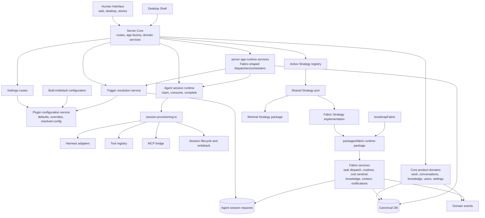
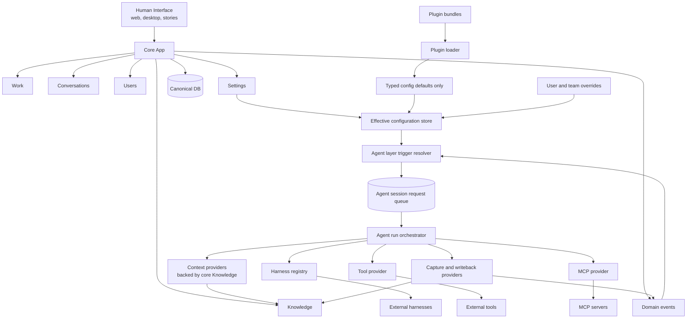

# Runtime Simplification Dependency Graph: As-Is vs As-Should

Baseline: `origin/main` at `1300b56f` (`Implement AU4 trigger resolution path (#416)`).

Companion target document: `plans/strategy-kernel-plugin-split/as-should-dependency-graph.md`.

This file compares the current runtime dependency graph against the target dependency graph. It is intentionally dependency-focused: it tracks ownership and call direction, not every API route or DB table.

## Executive Summary

The target graph has not been reached yet.

Important target pieces are already present:

- `AgentSessionRequest` is now a real runtime primitive.
- Trigger-backed request creation exists in `packages/server/src/services/trigger-resolution.ts`.
- Server bootstrap wires request creation and consumption into runtime hooks.
- Plugin/default configuration resolution exists in `packages/server/src/services/plugin-configuration.ts`.
- Settings has a current story entry at `packages/web/src/pages/SettingsPage.stories.tsx`.

The remaining structural gaps are large:

- The Strategy port still exists in `packages/shared/src/strategy-port.ts`.
- The active Strategy singleton still exists in `packages/server/src/services/strategy-registry.ts`.
- `packages/fabric` is still a runtime/service package, not only retired history.
- `packages/strategy-minimal` still provides a Strategy implementation.
- Fabric-style runtime services still exist in both `packages/fabric/src/services/*` and copied server app-runtime services.
- Core app, Agent layer, and plugin/default configuration are not yet mechanically enforced as separate dependency boundaries.

## Side-by-Side Shape

| Area | As-is graph | As-should graph |
| --- | --- | --- |
| Runtime center | Server owns routes plus provisioning, request runtime, trigger resolution, plugin config, and app-runtime services. Fabric remains as a runtime package. | Core app owns product records/events/settings. Agent layer owns every LLM-capable run. Plugins only seed defaults. |
| Strategy | Shared Strategy port plus server active Strategy registry plus Fabric/minimal Strategy implementations. | No Strategy port, no active Strategy singleton, no Strategy implementations. |
| Fabric | `packages/fabric` still contains bootstrap, adapter strategy, task/routine dispatch, knowledge/context, scoring, notifications, cost sentinel. | No Fabric runtime package. Former Fabric responsibilities redistributed to Core app, Agent layer, or plugin defaults. |
| Agent runs | Trigger-backed `AgentSessionRequest` exists, but provisioning/runtime hooks and route/service consumers remain inside server/app-runtime/Fabric-shaped code. | All LLM runs enter via trigger resolver -> session request queue -> agent run orchestrator. |
| Configuration | Plugin configuration resolver exists with defaults, overrides, and resolved views. Built-in/default projection is partial. | Plugins seed typed config defaults. User/team overrides win. Config resolver produces the effective runtime view. |
| Knowledge | Knowledge routes and projections exist in server; Fabric knowledge/context services remain. | Knowledge CRUD, scoring, search, and projections are core app Knowledge. Agent context/writeback are Agent layer providers backed by core Knowledge. |
| Boundary enforcement | Mostly convention and tests around new paths. No global static dependency guard for target graph. | Mechanical lint/type/package boundaries prevent forbidden imports and ownership leaks. |

## As-Is Graph

## As-Should Graph

## Current Evidence

| Current edge | Evidence |
| --- | --- |
| Strategy port still exported | `packages/shared/src/strategy-port.ts`, exported from `packages/shared/src/index.ts` |
| Active Strategy singleton still present | `packages/server/src/services/strategy-registry.ts` |
| Fabric Strategy implementation still present | `packages/fabric/src/fabric-strategy.ts` |
| Minimal Strategy implementation still present | `packages/strategy-minimal/src/minimal-strategy.ts` |
| Fabric bootstrap still present | `packages/fabric/src/bootstrap.ts` |
| Server bootstrap still registers provisioning/request runtime hooks | `packages/server/src/server-factory.ts` |
| Trigger-backed request creation exists | `packages/server/src/services/trigger-resolution.ts` |
| Agent request queue/runtime exists | `packages/server/src/services/agent-session-requests.ts`, `packages/server/src/services/agent-session-runtime.ts` |
| Provisioning remains central | `packages/server/src/services/session-provisioning.ts` |
| Plugin configuration resolution exists | `packages/server/src/services/plugin-configuration.ts` |
| Fabric-shaped dispatch still exists | `packages/fabric/src/services/task-dispatcher.ts`, `packages/server/src/app-runtime/services/task-dispatcher.ts` |
| Fabric-shaped routine scheduling still exists | `packages/fabric/src/services/routine-scheduler.ts`, `packages/server/src/app-runtime/services/routine-scheduler.ts` |
| Fabric knowledge/context remains | `packages/fabric/src/knowledge-repository.ts`, `packages/fabric/src/context-assembly.ts`, `packages/fabric/src/session-context.ts` |
| Core/server knowledge exists | `packages/server/src/routes/knowledge.ts`, `packages/server/src/services/knowledge/projections.ts` |
| Settings story exists | `packages/web/src/pages/SettingsPage.stories.tsx` |

## Detailed Comparison

### Core App

| Responsibility | As-is | As-should |
| --- | --- | --- |
| Work records | Core server routes/services own much of this, but Fabric/app-runtime dispatchers still create and consume agent work. | Core owns records and emits events only. |
| Conversations | Server routes/services own records and assistant turn entry points. Assistant turn can create and consume trigger-backed requests. | Conversation domain records user intent and emits events; Agent layer owns the LLM run. |
| Knowledge | Core routes/projections exist, but Fabric still owns repository/context/scoring-like concerns. | Core Knowledge owns CRUD, search, scoring, projections, and visibility. |
| Settings | Settings routes plus plugin configuration service exist. Surface completeness depends on the AU5 branch/merge state. | Settings edits user/team overrides; resolver merges overrides with plugin defaults. |
| Domain events | Present, but not yet the only handoff into agent execution. | Sole handoff from core domains into Agent layer triggers. |

### Agent Layer

| Responsibility | As-is | As-should |
| --- | --- | --- |
| Trigger resolution | Exists in server service and reads resolved configuration. | Lives inside Agent layer and is the only event-to-run decision point. |
| Request queue | `AgentSessionRequest` create/claim/consume exists. | Queue is the stable boundary between core events and execution. |
| Run orchestration | `consumeAgentSessionRequest` wraps `provisionSession`; provisioning remains a large server service. | Agent run orchestrator owns lifecycle, harness, context, tools, MCP, capture, and writeback. |
| Context | Split across server `agent-context` and Fabric context modules. | Context providers are Agent layer adapters backed by Core Knowledge. |
| Tools/MCP | Server provisioning builds tool registry and MCP wiring. | Agent layer exposes tool/MCP providers; core does not import execution adapters. |
| Capture/writeback | Split across session lifecycle, provisioning, Fabric/context services, and domain-specific code. | Agent layer writes captured artifacts back through core-owned stores/events. |

### Plugin And Configuration

| Responsibility | As-is | As-should |
| --- | --- | --- |
| Defaults | Default/configuration records exist, but plugin bundle ownership is partial. | Plugins seed typed defaults only. |
| Overrides | Plugin configuration service supports user/team overrides and resolved config. | Same concept, but enforced as the only editable runtime configuration path. |
| Runtime behavior | Runtime still has Strategy/Fabric concepts alongside configuration resolution. | Effective config feeds Agent layer trigger/orchestration decisions directly. |
| Plugin isolation | Not mechanically enforced as target architecture. | Plugins cannot subscribe to the event bus, invoke harnesses, or mutate core records directly. |

## Gap Register

These gaps should be registered as follow-up work if not already represented by later AU work packages.

1. Remove the Strategy port and active Strategy registry.
   - Delete or retire `packages/shared/src/strategy-port.ts`.
   - Delete or retire `packages/server/src/services/strategy-registry.ts`.
   - Remove Fabric/minimal Strategy implementations.

2. Retire `packages/fabric` as a runtime dependency.
   - Move Knowledge CRUD/scoring/search/projections into Core App Knowledge.
   - Move context/writeback into Agent layer providers backed by Core Knowledge.
   - Move routine/task dispatch into trigger-backed Agent layer requests.
   - Convert built-in routines/tools/MCP/harness descriptors into plugin/default configuration.

3. Define and enforce the Agent layer boundary.
   - Place trigger resolution, request consumption, provisioning/orchestration, harness registry, tools, MCP, context, and capture/writeback under one owned layer.
   - Prevent core routes/domains from importing harness/tool/MCP execution adapters directly.

4. Make domain events the only LLM execution handoff.
   - Audit remaining route/service paths that directly create and consume session requests.
   - Replace direct provisioning semantics with event -> trigger resolution -> request queue -> orchestrator.

5. Finish plugin bundle/default projection.
   - Make built-in behavior seed typed defaults through plugin manifests/bundles.
   - Keep user/team overrides above defaults.
   - Add boundary checks so plugins cannot become runtime actors.

6. Add mechanical dependency checks.
   - Forbid runtime imports of `@hyperidle/fabric` and `@hyperidle/strategy-minimal`.
   - Forbid new imports of `strategy-port`.
   - Forbid Core App imports from harness/tool/MCP execution internals.

7. Reconcile AU5 status into mainline.
   - If AU5 is not merged into the baseline branch, merge or rebase the Settings Agent behavior surface before claiming the configuration surface is complete.
   - Keep the story/viewer entry current so the settings surface can be visually inspected.

## Bottom Line

The current graph is transitional. It has the new trigger-backed request spine, but still carries the old Strategy/Fabric runtime graph. The target dependency tree is reached only after Strategy/Fabric are removed as runtime concepts and Agent layer becomes the sole owner of LLM-capable execution.
