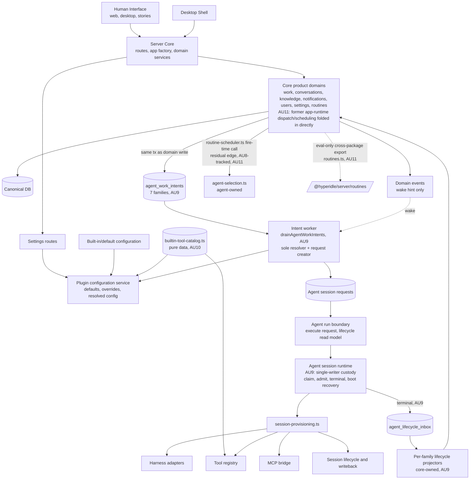
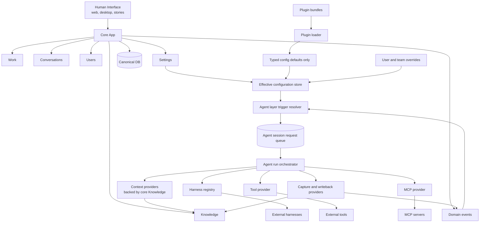
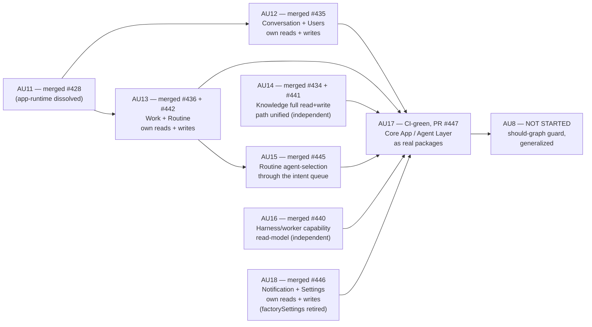

# Runtime Simplification Dependency Graph: As-Is vs As-Should

Baseline: `origin/main` at `6dd27dfd` (`docs: update AU dependency graph for AU9-merged and
AU10-shipped status (#427)`). This baseline already includes AU10 merged (`3d9b2226`).

Update: AU6 rework checked against `feat/AU6-agent-execution-boundary` at `4a11aa45`
(`chore: attest AU6 boundary closure`, PR #419). AU6-owned agent execution boundary gaps
are marked separately below from the remaining Strategy/Fabric retirement gaps.

Update: AU7 was sent back through the pipeline after review found the cleanup requirement gap.
The corrected AU7 scope now deletes the live Strategy/Fabric source packages and seam files:
`packages/fabric`, `packages/strategy-minimal`, `packages/shared/src/strategy-port.ts`, and
`packages/server/src/services/strategy-registry.ts`. Server/eval runtime code uses server
app-runtime contracts, and lint now blocks runtime imports/registration of Fabric, minimal
Strategy, Strategy port, active Strategy APIs, and the deleted live paths returning. Durable
historical `strategy`/`fabric` names remain only where old records need to be readable.

Update: AU9 ("Hard agent handoff boundary") merged. PR #425
(`feat(AU9): hard agent handoff boundary — remediation-2 rebuild`) merged to `origin/main`. AU9
replaced the ad-hoc, direct request-creation paths still present at the AU7 baseline with a single
durable handoff: every core route/domain command persists one `agent_work_intents` row (kind,
source, idempotency key — no execution detail) in the same transaction as its own domain write; the
agent layer alone drains, resolves, admits, executes, and projects lifecycle back. This took five
build/review cycles inside AU9 itself before a founder-directed architecture-level re-diagnosis
closed the pattern for good (see `plans/AU9/architecture.md` §Remediation-2, rules R1/R2/R3).

**Update: AU10 ("Plugin surface ownership correction") merged.** PR #426 merged to `origin/main`
at `3d9b2226` (2026-07-11T15:14:57Z) — `npm run verify` and `release-guard` both green on the merge
commit. This document's baseline now includes AU10; all prior "(AU10, pending merge)" markers below
are now just "(AU10)". AU10's audit of the plugin/default configuration surface
(`plugin-configuration.ts`, `agent-behavior-config.ts` — the entire production config-seeder
surface) found exactly one forbidden upward edge: `plugin-configuration.ts:26` imported
`ALL_TOOL_DEFINITIONS` from the runtime `tools/tool-registry.ts` to seed built-in tool config
defaults, pulling in ~20 tool handlers plus `ToolContext` and `app-runtime/contracts` transitively
for what was only ever a name/description/roles/reversibility read. The fix extracted a pure-data
`packages/server/src/config/builtin-tool-catalog.ts` (zero runtime imports — only `import type` from
`@hyperidle/shared`); `tool-registry.ts` now depends on that same catalog too, so both sides depend
downward onto one data source instead of config reaching up into execution. A new static guard,
`scripts/au10-plugin-config-ownership-guard.ts` (AST module-import reachability, not a runtime test,
wired into `npm run lint`), makes the boundary durable — real-tree run finds 0 forbidden imports
post-fix, and its `--fixtures` mode proves it catches both a direct and a transitive leak.
`agent-defaults/resolvers.ts` (which imported `app-runtime/roster` + `app-runtime/services/agent-selection`)
was confirmed out of AU10's scope at the time — that was the AU11 transitional-shell edge, and AU11
(below) has now repointed it.

**Update: AU11 ("Runtime ownership hard cut") is implementation-complete but not yet merged.**
Checked against branch `framework/AU11-runtime-ownership-hard-cut` at commit `c6358a30`
(`chore(AU11): commit fresh verify attestation`), PR #428 — `npm run verify` (2m34s) and
`release-guard` (11s) both green in CI, PR open and mergeable, awaiting human merge. AU11 dissolved
the transitional `packages/server/src/app-runtime/` shell — 67 files, the third runtime owner that
AU9's own review had named but explicitly deferred. Every file was reclassified against the
should-graph and either moved to its owner or deleted:

- 32 files → **Core app** (Knowledge 18, Notifications 14).
- 14 files → **Core app services** (policy, approval-rate, review routing, lifecycle-propagation,
  retention, practice-meeting, git-export — these were already core-shaped, just app-runtime-housed).
- 14 files → **Agent layer** (context-assembly, capture/writeback, roster, agent-selection, task and
  assistant dispatchers, cost, session/sandbox reapers — joined AU9's agent-owned `services/` set).
- 2 files → **Editable config** (`builtin-routines` split into a config-defaults file and an
  agent-owned handler file; `git-export-config.ts`).
- 5+ artifacts **deleted outright**: the barrel `index.ts`, `bootstrapAppRuntime`, the
  `./app-runtime` package export, `runtime-contracts.test.ts` (its premise — a shared app-runtime
  grouping — is what AU11 dissolves), and dead `AdapterPool`/`SandboxAdapter`/`McpBridgeRegistry`
  import-type threading in 3 core routes. Two routes doing genuine execution rather than descriptor
  reads (`mcp-route.ts`, `worker-ws.ts`) were relocated from `routes/` to agent-owned `services/`.
  A round-1 code review additionally caught 5 pre-existing dead files (`knowledge/conflict-resolution.ts`,
  `knowledge/layers.ts`, `services/polling-watcher.ts`, `services/founder-router.ts`,
  `services/provision-registry.ts`) plus ~18 dead exports that the barrel's re-exports had been
  masking from `knip` — the build had initially preserved them via new `knip.json` ignore entries,
  which review rejected as a violation of AC-4 and this repo's "dead code must be deleted, never
  masked" rule; round 2 deleted all of it instead.

A new static guard, `scripts/au11-runtime-ownership-guard.ts` (module-import reachability, same
technique as AU10's guard, wired into `npm run lint`), enforces two properties: AC-1, the
transitional shell can never reappear (no `app-runtime` path segment, no `bootstrapAppRuntime`
symbol, no `./app-runtime` package export); and AC-2, core routes/domain services cannot import
harness adapters, MCP bridge registries, provisioning internals, context assembly, tool execution,
or agent lifecycle internals — walked from every core-classified file, stopping at the agent-owned
boundary. Real-tree run is 0 findings; `--fixtures` mode proves it catches the shell-reappearance
and forbidden-import cases. A curated new package export, `@hyperidle/server/routines` →
`packages/server/src/routines.ts`, re-exports exactly three functions
(`checkAndFireRoutine`, `provisionTeamRoutines`, `runBuiltinRoutine`) for the one legitimate
cross-package consumer, `packages/eval`, that cannot deep-import server `src/`; the guard enforces
its export list stays exactly those three, so it cannot regrow into a second barrel.

One deliberate, named residual edge survived AU11 by design, not oversight: `routine-scheduler.ts`
stays Core (cron/due-eval is a core concern) but its fire-time agent-selection call
(`isAgentAtWipLimit` / `selectAgentByAppDefaults`) still reaches directly into the agent-owned
`agent-selection.ts`. AU11's planning round (critique round 1) explicitly rejected folding this into
the agent layer's intent-worker drain-time resolver, because the intent worker does not select an
agent for routines today (it uses `routine.ownerAgentId` directly) — moving selection there would
relocate a fire-time decision to drain-time, a real behavior change AU11's import-path-only
invariant forbids. This is tracked as an AU8 should-graph-guard boundary item below (gap 6), not a
defect in AU11.

Companion target document: `plans/strategy-kernel-plugin-split/as-should-dependency-graph.md`.

This file compares the current runtime dependency graph against the target dependency graph. It is intentionally dependency-focused: it tracks ownership and call direction, not every API route or DB table.

## Executive Summary

The AU7 runtime-retirement, AU9 hard-handoff, AU10 plugin-ownership, and AU11 runtime-ownership
targets are all now reached at the work-package level (AU7, AU9, AU10 merged; AU11
implementation-complete, PR #428 pending merge). Strategy/Fabric are gone from production runtime
and live source; core app routes/services no longer construct, consume, or execute agent requests
directly — they record durable intent, the agent layer does everything downstream of that; the
plugin/default configuration surface no longer imports a runtime execution registry to seed its
defaults; and the transitional `app-runtime/` shell — the third runtime owner AU9's review first
named — no longer exists. Core app and Agent layer are, for the first time, the *only* two runtime
owners in the source tree, matching the as-should graph's shape exactly. The full target graph is
still not mechanically proven end-to-end as a single, unified guard: AU8 has not yet consolidated
the four separate boundary scripts (`au7-runtime-retirement-guard.ts`, `au9-direct-handoff-guard.ts`,
`au10-plugin-config-ownership-guard.ts`, `au11-runtime-ownership-guard.ts`) into the should-graph's
full closure signal, and two of the as-should graph's eight boundary checks
(Core-app-imports-plugin-internals, Agent-layer-owns-core-CRUD) have no guard at all yet — see the
Gap Register. AU9 was a *precondition* for both AU10 and AU11 (both formally depend on it in the
manifest); AU11 was itself a precondition for AU8 (the manifest's last node) — with AU7/AU9/AU10
merged and AU11 implementation-complete, **AU8 is now the only remaining, not-yet-started work
package in the entire AU track**, unblocked as soon as AU11 merges.

Important target pieces are already present:

- `AgentSessionRequest` is now a real runtime primitive.
- Trigger-backed request creation exists in `packages/server/src/services/trigger-resolution.ts`.
- `packages/server/src/services/agent-run-boundary.ts` is the named execution boundary:
  request execution flows through `executeAgentRunRequest`, while lifecycle reads use
  `getAgentRunLifecycle` / `listAgentRunLifecycleBySource`.
- Server core, routine, decomposition, and session route callers no longer resolve a production
  request consumer from the legacy registry.
- Plugin/default configuration resolution exists in `packages/server/src/services/plugin-configuration.ts`.
- `scripts/au6-agent-boundary-guard.ts` is wired into `npm run lint` and fails when
  production server code imports `agent-session-runtime`, resolves request consumers
  from the registry, uses the legacy `provisionSession` registry hook, or reintroduces local
  `consumeAgentSessionRequest` naming outside the boundary.
- Settings has a current story entry at `packages/web/src/pages/SettingsPage.stories.tsx`.
- `@hyperidle/server/routines` is exported for the one legitimate cross-package (eval) caller;
  no other package deep-imports server internals. **(AU11, pending merge)**
- Eval scenarios that used to import Fabric runtime types now import server core/config types.
- `scripts/au7-runtime-retirement-guard.ts` is wired into `npm run lint` and blocks production
  runtime use of `@hyperidle/fabric`, `@hyperidle/strategy-minimal`, Strategy registry, Strategy
  port, Fabric bootstrap, minimal Strategy fallback, and the retired source paths returning.
- **(AU9)** Every one of the seven work families (assistant, explicit session, knowledge, routine,
  decomposition, task, re-engagement) persists a durable `agent_work_intents` row in the same
  transaction as its own domain write; no family callback creates or resolves a request itself.
- **(AU9)** `scripts/au9-direct-handoff-guard.ts` is wired into `npm run lint` and statically
  forbids core-side files from importing `trigger-resolution`, `agent-session-requests`,
  `agent-session-runtime`, or `agent-run-boundary`, or from referencing request-construction/
  consumption symbols (`createTriggeredAgentSessionRequest`, `claimNextAgentSessionRequest`,
  `consumeAgentSessionRequest`, `executeAgentRunRequest`, `provisionSession`, etc.) outside the
  agent-owned file set.
- **(AU9)** Request custody (claim, admission, terminal transition, boot recovery) is each a
  single CAS-guarded writer function, and terminal state is projected through a durable
  `agent_lifecycle_inbox` and per-family projector registry rather than a direct execution
  callback — closing Gap Register items 1 and 2 from the AU7-era version of this document.
- **(AU10)** `packages/server/src/config/builtin-tool-catalog.ts` is a pure-data
  catalog (zero runtime imports) that both `plugin-configuration.ts` and `tools/tool-registry.ts`
  depend on downward, replacing the prior edge where `plugin-configuration.ts` imported
  `ALL_TOOL_DEFINITIONS` from the runtime tool registry directly.
- **(AU10)** `scripts/au10-plugin-config-ownership-guard.ts` is wired into
  `npm run lint` and statically forbids the plugin/default configuration surface
  (`plugin-configuration.ts`, `agent-behavior-config.ts`) from importing runtime tool registries,
  harness adapters, MCP bridge registries, provisioning services, or agent execution internals
  (module-import reachability, not symbol-call reachability); real-tree run is 0 findings
  post-fix, `--fixtures` mode proves it catches a direct and a transitive leak.
- **(AU11, pending merge)** `packages/server/src/app-runtime/` no longer exists — no barrel, no
  boot shell, no package export. Boot is split into `registerCoreDomainServices` and
  `registerAgentLayerServices` in `server-factory.ts`.
- **(AU11, pending merge)** `scripts/au11-runtime-ownership-guard.ts` is wired into `npm run lint`
  and statically forbids (a) any reintroduction of an `app-runtime`-shaped grouping and (b) core
  routes/domain services from importing harness adapters, MCP bridge registries, provisioning
  internals, context assembly, tool execution, or agent lifecycle internals — real-tree run is 0
  findings, `--fixtures` mode proves it catches both violation classes.
- **(AU11, pending merge)** Dead `AdapterPool`/`SandboxAdapter`/`McpBridgeRegistry` import-type
  threading through core routes that had no real execution behind it is deleted; the two routes
  that did real execution (`mcp-route.ts`, `worker-ws.ts`) moved to agent-owned `services/`.

The remaining structural gap is no longer deletion of Strategy/Fabric source, nor direct
core-to-execution handoff, nor plugin config importing a runtime registry, nor a third
`app-runtime`-shaped runtime owner. The remaining AU work is: (a) merge AU11
(implementation-complete), then (b) mechanically enforce the complete should-graph guard as one
unified closure signal (AU8) — the only work package left in Track AU once AU11 lands.

## Side-by-Side Shape

| Area | As-is graph | As-should graph |
| --- | --- | --- |
| Runtime center | Server owns routes plus provisioning, request runtime, trigger resolution, plugin config, and core domain services. Legacy Fabric package dependency is gone. **(AU9)** Every route/domain command's only cross-boundary act is a durable intent write. **(AU11, pending merge)** The former app-runtime intermediate layer is gone — its responsibilities landed in Core app or Agent layer directly; only two runtime owners remain, matching the as-should shape. One named residual edge remains (`routine-scheduler.ts`'s fire-time call into agent-owned `agent-selection.ts`), tracked for AU8. | Core app owns product records/events/settings. Agent layer owns every LLM-capable run. Plugins only seed defaults. |
| Strategy | Strategy port/registry files and Fabric/minimal implementations are deleted from the live source graph. Production runtime no longer imports/registers/selects active Strategy. | No Strategy port, no active Strategy singleton, no Strategy implementations. |
| Fabric | `packages/fabric` is deleted from the live source graph. Former Fabric behavior lives in server core/agent services, with durable historical names preserved only for old records. **(AU11, pending merge)** The last intermediate hop (app-runtime) those responsibilities transited through after AU7 is now also gone — they sit directly in their should-graph owner. | No Fabric runtime package. Former Fabric responsibilities redistributed to Core app, Agent layer, or plugin defaults. |
| Agent runs | **(AU9)** All seven work families enter through one durable-intent → drain → single-request → custody → lifecycle-inbox pipeline. `agent-work-intent-worker.ts` is the sole intent resolver/request-creator; `agent-session-runtime.ts` is the sole request custody writer (claim, admission, terminal transition, boot recovery each a single CAS-guarded function). Provisioning (`session-provisioning.ts`) remains the internal orchestrator the agent layer calls once custody is held. | All LLM runs enter via trigger resolver -> session request queue -> agent run orchestrator. |
| Configuration | Plugin configuration resolver exists with defaults, overrides, and resolved views. **(AU10)** Built-in tool defaults now project from a pure-data `builtin-tool-catalog.ts`; the config surface no longer imports the runtime tool registry, and a lint guard enforces it. Prompt Catalog still has no real equivalent (see Detailed Comparison, unaffected by AU9/AU10/AU11). | Plugins seed typed config defaults. User/team overrides win. Config resolver produces the effective runtime view. |
| Knowledge | Knowledge routes and projections exist in server. **(AU9)** Knowledge actions persist a durable intent row alongside their domain write. **(AU11, pending merge)** Former Fabric-era knowledge/context behavior that had been housed in app-runtime (18 files) is now core-owned Knowledge directly, no intermediate layer. | Knowledge CRUD, scoring, search, and projections are core app Knowledge. Agent context/writeback are Agent layer providers backed by core Knowledge. |
| Boundary enforcement | AU6 guard enforces request-consumption ownership. AU7 guard enforces Strategy/Fabric runtime retirement. **(AU9)** `au9-direct-handoff-guard.ts` forbids core-side construction/consumption of requests; two of the target's eight boundary checks ("every LLM-capable event has a trigger surface or default-attach path", "every agent run has a recorded trigger resolution including fallback runs") are already structurally guaranteed by AU9's `agent_work_intents_kind_source_compat_ck` DB constraint + exhaustive `eventTypeFor` switch + mandatory `triggerResolutionHistory` insert on every request. **(AU10)** `au10-plugin-config-ownership-guard.ts` forbids the plugin/default config surface from importing runtime tool registries/harness adapters/MCP bridges/provisioning services. **(AU11, pending merge)** `au11-runtime-ownership-guard.ts` forbids the app-runtime shell from reappearing and forbids core routes/domain services from importing harness/MCP/provisioning/context/tool/lifecycle internals — this closes the as-should graph's "Core app modules must not import harness adapters directly" check. Two of the remaining boundary checks (Core-app-imports-plugin-internals, Agent-layer-owns-core-CRUD) have no guard yet and genuinely await AU8's consolidated should-graph guard. | Mechanical lint/type/package boundaries prevent forbidden imports and ownership leaks. |

## As-Is Graph

## As-Should Graph

## Current Evidence

| Current edge | Evidence |
| --- | --- |
| Legacy Strategy port deleted | `packages/shared/src/strategy-port.ts` removed from live source graph |
| Legacy Strategy registry deleted | `packages/server/src/services/strategy-registry.ts` removed from live source graph |
| Legacy Fabric package deleted | `packages/fabric` removed from live source graph |
| Legacy minimal Strategy package deleted | `packages/strategy-minimal` removed from live source graph |
| Agent run boundary exists | `packages/server/src/services/agent-run-boundary.ts` |
| AU6 request-consumption guard exists | `scripts/au6-agent-boundary-guard.ts`, `package.json` `lint` script |
| AU7 runtime-retirement guard exists | `scripts/au7-runtime-retirement-guard.ts`, `package.json` `lint` script |
| **(AU9)** Direct-handoff guard exists | `scripts/au9-direct-handoff-guard.ts`, `package.json` `lint` script — forbids core imports of `trigger-resolution`/`agent-session-requests`/`agent-session-runtime`/`agent-run-boundary` and forbidden request-construction/consumption symbols outside the agent-owned file set |
| **(AU9)** Durable intent boundary exists | `packages/db/src/schema.ts` (`agent_work_intents`, seven kinds/sources, unique idempotency key), `packages/server/src/services/agent-work-intent-worker.ts` |
| **(AU9)** Single-writer request custody exists | `packages/server/src/services/agent-session-runtime.ts` (`terminalizeAgentSessionRequest` — sole terminal writer, both running+session_id and claimed+claim_token preconditions; `recoverRunningAgentSessionRequests` — real boot recovery) |
| **(AU9)** Durable lifecycle projection exists | `packages/db/src/schema.ts` (`agent_lifecycle_inbox`), `packages/server/src/services/agent-lifecycle-projectors.ts` (per-family projector registry, core-owned, no agent-runtime import — moved out of `app-runtime/` by AU11) |
| **(AU9)** Task dispatch has a durable, replay-safe source | `packages/db/src/schema.ts` (`task_dispatch_attempts`), `packages/server/src/services/task-state-machine.ts` |
| **(AU9)** `createTriggeredAgentSessionRequest` has exactly one production caller | the intent drain (`agent-work-intent-worker.ts`); assistant/handoff direct-create paths collapsed into it |
| **(AU10)** Built-in tool catalog is pure data | `packages/server/src/config/builtin-tool-catalog.ts` — no import of `tools/`, `harness/`, `mcp/`, or provisioning; only `import type` from `@hyperidle/shared` |
| **(AU10)** Plugin config no longer imports the runtime tool registry | `packages/server/src/services/plugin-configuration.ts:26` imports `BUILTIN_TOOL_CATALOG` from `../config/builtin-tool-catalog.js` (was `ALL_TOOL_DEFINITIONS` from `../tools/tool-registry.js`) |
| **(AU10)** Catalog↔registry drift guard exists | `packages/server/src/tools/__tests__/builtin-tool-catalog-consistency.test.ts` — name-set equality, `return_status_tool` exclusion, per-tool metadata deep-equal, real-path validation via `loadBuiltInConfigurationDefaults` |
| **(AU10)** Plugin-config-ownership guard exists | `scripts/au10-plugin-config-ownership-guard.ts`, `package.json` `lint` script — module-import-reachability check over the plugin/default config surface; 0 findings on the real tree post-fix, `--fixtures` mode proves it catches a direct and a transitive leak |
| **(AU11, pending merge)** The transitional shell no longer exists | `packages/server/src/app-runtime/` — directory, barrel `index.ts`, `bootstrapAppRuntime`, and the `./app-runtime` package export are all deleted; `rg app-runtime` across production source finds only historical `@lore` comments |
| **(AU11, pending merge)** Boot no longer routes through one runtime-shaped bootstrapper | `packages/server/src/server-factory.ts` — split into `registerCoreDomainServices` and `registerAgentLayerServices` |
| **(AU11, pending merge)** Runtime-ownership guard exists | `scripts/au11-runtime-ownership-guard.ts`, `package.json` `lint` script — forbids app-runtime-shell reappearance (AC-1) and core routes/domain services importing harness/MCP/provisioning/context/tool/lifecycle internals (AC-2); 0 findings on the real tree, `--fixtures` proves both checks |
| **(AU11, pending merge)** Curated cross-package export exists | `packages/server/src/routines.ts` → `@hyperidle/server/routines`, re-exports exactly `checkAndFireRoutine`/`provisionTeamRoutines`/`runBuiltinRoutine`; consumed by 4 files in `packages/eval` (the guard pins the export list to exactly these three names) |
| **(AU11, pending merge)** Dead descriptor-threading removed from core routes | `packages/server/src/routes/sessions-routes.ts`, `routes/routines-routes.ts`, `services/bet-decomposition.ts` — `AdapterPool`/`SandboxAdapter`/`RoutineProvisionDeps` import-type threading deleted; no real execution was behind it |
| **(AU11, pending merge)** Real-execution routes relocated to agent-owned `services/` | `packages/server/src/services/mcp-route.ts` (was `routes/mcp-route.ts` — executes `bridgeRegistry.handleRequest`), `packages/server/src/services/worker-ws.ts` (was `routes/worker-ws.ts`) |
| Server bootstrap no longer registers production request/provision consumer hooks | `packages/server/src/server-factory.ts` |
| Trigger-backed request creation exists | `packages/server/src/services/trigger-resolution.ts` |
| Agent request queue/runtime exists | `packages/server/src/services/agent-session-requests.ts`, `packages/server/src/services/agent-session-runtime.ts` |
| Provisioning remains central | `packages/server/src/services/session-provisioning.ts` |
| Plugin configuration resolution exists | `packages/server/src/services/plugin-configuration.ts` |
| Core/server knowledge exists | `packages/server/src/routes/knowledge.ts`, `packages/server/src/services/knowledge/projections.ts` |
| Eval runtime imports use core/config types, not app-runtime | `packages/eval/src/scenarios/builtin-routines.ts`, `packages/eval/src/scenarios/delegation.ts`, `packages/eval/src/scenarios/routine-sessions.ts`, `packages/eval/src/scenarios/skill-autonomy.ts` — all repointed off the deleted `app-runtime` export by AU11 |
| Settings story exists | `packages/web/src/pages/SettingsPage.stories.tsx` |

## Detailed Comparison

### Core App

| Responsibility | As-is | As-should |
| --- | --- | --- |
| Work records | Core server routes/services own this. AU6 moved request execution through the agent-run boundary, AU7 removed Strategy/Fabric ownership, **(AU9)** task acceptance/retry/owner-handoff persist a `task_dispatch_attempts` row + intent in the same transaction as the domain write, and **(AU11, pending merge)** the app-runtime intermediate dispatch layer that used to sit between core routes and this write is gone — the dispatcher lives directly in core `services/` now. | Core owns records and emits events only. |
| Conversations | Server routes/services own records. **(AU9)** the assistant message-insert transaction persists the intent directly. | Conversation domain records user intent and emits events; Agent layer owns the LLM run. |
| Knowledge | Core routes/projections exist. **(AU9)** knowledge actions persist their intent in the same transaction as the action/flag mutation. **(AU11, pending merge)** Former Fabric-era knowledge/context behavior that had been housed in `app-runtime/knowledge/` (18 files) is now directly under core `knowledge/`, no intermediate layer. | Core Knowledge owns CRUD, search, scoring, projections, and visibility. |
| Settings | Settings routes plus plugin configuration service exist. **(AU10)** the config surface no longer imports a runtime execution registry to seed built-in tool defaults. | Settings edits user/team overrides; resolver merges overrides with plugin defaults. |
| Domain events | Present, and **(AU9) substantially closed**: direct route/service creation of agent requests is gone — replaced by a durable intent row per family, persisted in the same transaction as the domain write, with the EventBus emission demoted to a wake-hint only (not the recovery contract). One nuance versus the as-should diagram: the as-should graph draws `DomainEvents -> TriggerResolver` as the sole handoff primitive, while AU9 built a dedicated `agent_work_intents` table as the durable contract and kept EventBus purely as a latency optimization. This is arguably the stronger design (a table survives replay; an in-memory-published event does not) but it is a deliberate divergence from the literal diagram worth flagging, not a defect. | Sole handoff from core domains into Agent layer triggers. |

### Agent Layer

| Responsibility | As-is | As-should |
| --- | --- | --- |
| Trigger resolution | Exists in server service and reads resolved configuration. | Lives inside Agent layer and is the only event-to-run decision point. |
| Request queue | `AgentSessionRequest` create/claim/consume exists. AU6 puts production consumption behind `executeAgentRunRequest`. **(AU9)** `createTriggeredAgentSessionRequest` now has exactly one production caller (the intent drain). | Queue is the stable boundary between core events and execution. |
| Run orchestration | `executeAgentRunRequest` is the domain-facing boundary; `consumeAgentSessionRequest` and `provisionSession` remain internal implementation details. **(AU9)** custody (claim/reclaim, admission, terminal transition, boot recovery) is each a single CAS-guarded writer. | Agent run orchestrator owns lifecycle, harness, context, tools, MCP, capture, and writeback. |
| Context | **(AU11, pending merge)** `context-assembly.ts`, `context-assembly-prompt.ts`, and `session-context.ts` are now directly agent-owned `services/` files (moved out of `app-runtime/`, no intermediate layer). | Context providers are Agent layer adapters backed by Core Knowledge. |
| Tools/MCP | Server provisioning builds tool registry and MCP wiring. **(AU11, pending merge)** `mcp-route.ts` (real MCP protocol execution — `bridgeRegistry.handleRequest`) moved from `routes/` into agent-owned `services/`, closing the one core-route file that did real execution rather than a descriptor read. | Agent layer exposes tool/MCP providers; core does not import execution adapters. |
| Capture/writeback | **(AU11, pending merge)** `writeback.ts` and `file-watcher.ts` are now agent-owned `services/` files, moved directly out of `app-runtime/` with no intermediate layer. | Agent layer writes captured artifacts back through core-owned stores/events. |
| Lifecycle projection | **(AU9)** terminal request state is written by the single custody writer, which inserts one `agent_lifecycle_inbox` row in the same transaction; **(AU11, pending merge)** the core-owned, per-family projector registry (`agent-lifecycle-projectors.ts`) is now a direct core `services/` file (moved out of `app-runtime/services/`), drains that inbox and mutates each family's own read model. | Domains observe completion/failure/cancellation only through durable lifecycle projection, never an execution callback. |
| Agent selection / roster | **(AU11, pending merge)** `agent-selection.ts` and `roster.ts` are now agent-owned `services/` files. `agent-defaults/resolvers.ts` (the edge AU10 confirmed out of its scope) is repointed to these new locations. One residual edge remains by design: `routine-scheduler.ts` (Core) still calls `agent-selection.ts` (Agent) directly at fire-time — see the preamble note above and gap 6 below. | Agent layer owns agent selection; core never calls it directly except through the trigger/intent boundary. |

### Plugin And Configuration

| Responsibility | As-is | As-should |
| --- | --- | --- |
| Defaults | Default/configuration records exist; typed-default projection (AU2/AU5) predates AU10. **(AU10)** built-in tool defaults now project from the pure-data `builtin-tool-catalog.ts` instead of the runtime tool registry. **(AU11, pending merge)** `builtin-routines` split into a config-defaults file (`config/builtin-routines.ts`) and an agent-owned handler file (`services/builtin-routine-handlers.ts`) — the config side now imports nothing execution-shaped. | Plugins seed typed defaults only. |
| Overrides | Plugin configuration service supports user/team overrides and resolved config. AU10 preserved this byte-for-byte (`defaultVersionHash` unchanged; VS2 override-survives-reseed regression stayed green). AU11 did not touch this surface. | Same concept, but enforced as the only editable runtime configuration path. |
| Runtime behavior | Production runtime no longer registers Strategy or imports Fabric/minimal Strategy; legacy packages/files are deleted from the live source graph. | Effective config feeds Agent layer trigger/orchestration decisions directly. |
| Plugin isolation | **(AU10)** Partially enforced: `au10-plugin-config-ownership-guard.ts` statically forbids the plugin/default config surface from importing runtime tool registries, harness adapters, MCP bridge registries, or provisioning services (0 findings on the real tree). **(AU11, pending merge)** `au11-runtime-ownership-guard.ts` closes the adjacent "core app imports harness directly" check, but neither guard forbids Agent-layer-owns-core-CRUD or Core-app-imports-plugin-internals — the full should-graph enforcement is still AU8. | Plugins cannot subscribe to the event bus, invoke harnesses, or mutate core records directly. |
| Prompt catalog | **Still open, unaffected by AU9/AU10/AU11.** The target's 8th configuration catalog (Prompt Catalog) has no real equivalent. `packages/shared/src/configuration.ts` `CONFIGURATION_KINDS` still defines exactly 7 kinds (agent, skill, routine, trigger, tool, mcp_server, harness_descriptor) — no `prompt` kind, confirmed unchanged on the AU11 branch. Prompt templates/overrides are not editable configuration; they live folded into trigger/agent prompt-mode bindings (`PROMPT_MODE_BY_SOURCE`, `trigger-resolution.ts`). This is the AU2/AU5-era shape. | Prompt Catalog is a first-class configuration catalog alongside the other 7 (Agent, Skill, Routine, Trigger, Tool, MCP, Harness). |

## Gap Register

These gaps should be registered as follow-up work if not already represented by later AU work packages. Status reflects PR #425 (AU9), PR #426 (AU10) as merged, and PR #428 (AU11) as if merged.

1. ~~Finish defining and enforcing the Agent layer boundary beyond AU6 request consumption.~~ **Closed by AU9 + AU11.**
   - AU6 closed the production request-consumption gap: non-boundary imports of
     `agent-session-runtime`, registry consumer resolution, legacy `provisionSession` registry
     hooks, and local `consumeAgentSessionRequest` variables are guarded by lint.
   - **AU9** closed request *construction*: `au9-direct-handoff-guard.ts` forbids core files from
     importing the agent-owned modules at all, and `createTriggeredAgentSessionRequest` has
     exactly one production caller.
   - **AU11** closed the remaining piece this gap's "Remaining AU8/AU11 work" line called out: the
     agent-owned trigger resolution, provisioning/orchestration, harness registry, tools, MCP,
     context, and capture/writeback set is no longer routed through an intermediate `app-runtime`
     hop — every one of those 14 files now sits directly under agent-owned `services/`, and
     `au11-runtime-ownership-guard.ts` mechanically forbids core routes/domains from importing
     execution adapters directly (module-import reachability, not just a symbol/module denylist).
     What's left — a true structural *package* boundary (a separate `@hyperidle/agent-layer`
     package rather than a directory convention within `packages/server`) — was never an AU7-era
     ask and is not in any AU work package's acceptance criteria; if wanted, it would need a new
     work package, not a reopening of this gap.

2. ~~Decide and enforce the final event-only handoff rule.~~ **Closed by AU9, with a noted design divergence.**
   - AU9 made the durable `agent_work_intents` row — not the EventBus — the recovery contract;
     every family persists it in the same transaction as its domain write, and EventBus emission
     is now explicitly a wake-hint, never load-bearing. All direct-request-creation call sites
     found in the AU7-era audit are gone.
   - Noted divergence (not a defect): the as-should diagram draws `DomainEvents -> TriggerResolver`
     as the literal mechanism; AU9 implements the same guarantee through a durable table instead of
     the event bus, which is more crash-safe than a literal event-only design would be. Worth a
     one-line note if `as-should-dependency-graph.md` is ever revised, otherwise leave as informative
     context.

3. ~~Finish plugin bundle/default projection.~~ **Boundary-check portion closed by AU10; typed-default projection was already in place from AU2/AU5.**
   - Built-in behavior already seeds typed defaults through the plugin/default configuration path
     (AU2/AU5, pre-AU10) — that part of this gap was stale by the time AU10 started.
   - User/team overrides already win and remained unchanged by AU10 (byte-stable
     `defaultVersionHash`, VS2 regression green).
   - **AU10** added the boundary check this gap actually called for: plugin/default config can no
     longer import a runtime execution registry (`au10-plugin-config-ownership-guard.ts`, 0
     findings on the real tree, catches direct + transitive leaks via `--fixtures`). Scoped to the
     plugin/default config surface specifically — it does not forbid plugins from subscribing to
     the event bus or invoking harnesses directly, which was already true pre-AU10 and remains a
     should-graph-guard (AU8) concern to make mechanical and general rather than a newly-found gap.

4. Add mechanical dependency checks. **Substantially closed by AU9, AU10, and AU11; full unified guard is still AU8.**
   - AU7 already forbids runtime imports of `@hyperidle/fabric` and `@hyperidle/strategy-minimal`.
   - AU7 already forbids production runtime imports of `strategy-port` and Strategy registry.
   - **AU9** added a targeted guard for core-side request construction/consumption
     (`au9-direct-handoff-guard.ts`), scoped to that one edge.
   - **AU10** added a targeted guard for plugin/default config importing runtime tool
     registries/harness adapters/MCP bridges/provisioning services (`au10-plugin-config-ownership-guard.ts`),
     scoped to the plugin/default config surface.
   - **AU11** added a targeted guard (`au11-runtime-ownership-guard.ts`) that forbids the
     app-runtime shell from reappearing and forbids core routes/domain services from importing
     harness/MCP/provisioning/context/tool/lifecycle internals — this closes the as-should graph's
     "Core app modules must not import harness adapters directly" boundary check, which the prior
     revision of this gap had listed as genuinely open.
   - Still open, and now the entirety of what's left: forbid **Core-app-imports-plugin-internals**
     and forbid **Agent-layer-owns-core-CRUD**. Neither has any static guard today — AU11's AC-3
     ("agent-layer code doesn't own core CRUD except via contracts") was proven only by
     behavior-preservation regression tests staying green on an import-path-only move, which would
     not catch a *newly introduced* agent-layer CRUD write. This is AU8's full should-graph guard,
     and AU8 depends on AU11 (implementation-complete, pending merge) in the manifest — once AU11
     merges, AU8 is unblocked and is the only remaining AU work.
   - A related, smaller AU8 task: today the should-graph boundary is enforced by **four separate
     scripts** (`au7-runtime-retirement-guard.ts`, `au9-direct-handoff-guard.ts`,
     `au10-plugin-config-ownership-guard.ts`, `au11-runtime-ownership-guard.ts`) with overlapping
     but not unified scope, naming, or failure-message vocabulary. AU8's own acceptance criteria
     ask for one closure signal "in target-graph vocabulary" — consolidating these four (plus the
     two new checks above) into a single should-graph guard is itself in scope, not just adding the
     two missing checks standalone.

7. **New gap surfaced by the AU9/AU10 cycle's should-graph audit — the target's Prompt Catalog has no real
   equivalent.**
   - The as-should graph's Configuration And Plugin Graph lists 8 catalogs (Agent, Skill, Routine,
     Trigger, Tool, MCP, Harness, Prompt). Source (`packages/shared/src/configuration.ts`
     `CONFIGURATION_KINDS`) has only 7 — no `prompt` kind, confirmed still true on the AU11 branch.
     Prompt templates/overrides are not editable configuration; they're folded into trigger/agent
     prompt-mode bindings (`PROMPT_MODE_BY_SOURCE`, `trigger-resolution.ts`).
   - Not created or touched by AU9/AU10/AU11 (this is the AU2/AU5-era shape, unchanged) — but it
     was never named in this document before the AU9/AU10 audit cycle. A real, if minor,
     should-graph deviation, still on record and still unresolved.
   - Whether this should become a real 8th editable catalog (giving users an editable
     prompt-override surface) or the target doc should be revised to drop it is a product
     decision, not an engineering gap. Not assigned to a specific AU package here — AU8 is the
     should-graph guard, not a place to add new configuration surface, so this most likely needs
     its own future work package (or a documented decision to drop it from the target) rather than
     folding into AU8.

5. Reconcile AU5 status into mainline. **Resolved — no longer a gap.**
   - AU5 (Settings agent behavior configuration surface) is merged into `origin/main` as of
     `09eb9b41` (`feat(AU5): add agent behavior configuration surface`), which is an ancestor of
     the current baseline. No further reconciliation needed; this line item can be dropped in a
     future revision of this document.

6. ~~The app-runtime layer is still a third runtime owner.~~ **Closed by AU11, with one deliberate residual edge tracked for AU8.**
   - AU9 first verified that `packages/server/src/app-runtime/services/{task-dispatcher,routine-scheduler}.ts`
     still existed as an intermediate dispatch/scheduling layer between core routes and the agent
     layer's intent drain. AU10 confirmed the same layer (via `agent-defaults/resolvers.ts`) as
     out of its own scope, deliberately deferred to AU11.
   - **AU11 dissolved it.** All 67 files under `app-runtime/` were reclassified against the
     should-graph and either moved to Core app, Agent layer, editable config, or deleted; the
     directory, barrel, boot shell, and package export no longer exist. Core app and Agent layer
     are now the only two runtime owners in the source tree — matching the as-should graph exactly.
   - **One deliberate residual edge remains**, named explicitly rather than silently accepted:
     `routine-scheduler.ts` (Core, cron/due-eval) still calls `agent-selection.ts` (Agent-owned)
     directly at fire-time. AU11's own critique round rejected relocating this into the agent
     layer's drain-time intent resolver, because doing so would move a fire-time decision to
     drain-time — a real behavior change, not an import-path-only move. This is a genuine,
     documented cross-boundary call (Core calling into Agent-owned code directly, bypassing the
     intent-queue pattern every other family uses) that the as-should graph's literal shape does
     not allow. It should be an explicit AU8 boundary-check exception (an allowlisted edge with a
     comment pointing to this document) rather than something a future guard silently flags as a
     regression or silently ignores as noise.
   - A second, much smaller residual: the new `@hyperidle/server/routines` cross-package export
     (three functions, for `packages/eval` only) is a narrow, guard-pinned exception to "no
     app-runtime-shaped grouping" — it is not a barrel and cannot regrow into one, but AU8 should
     be aware it exists when defining "no runtime-shaped package export" as a boundary check, so it
     doesn't get flagged as a false positive.

## AU7 Completion Check

| AU7 requirement | Status | Notes |
| --- | --- | --- |
| Production server boot succeeds without registering/selecting a Strategy | Complete | Production runtime no longer imports/registers/selects active Strategy; AU7 guard blocks reintroduction. |
| Runtime package dependencies no longer include `@hyperidle/fabric` or `@hyperidle/strategy-minimal` | Complete | Runtime roots and workspace package graph no longer depend on either package. |
| Former Fabric service behavior reachable through server core/agent services | Complete for AU7 surface | Server/eval callers use core service types instead of Fabric runtime types; the intermediate `app-runtime/contracts.ts` hop this originally routed through is itself now gone (AU11). |
| Agent-capable behavior continues through AU6 request/runtime boundary | Complete | AU6 boundary remains the execution handoff; AU7 updated the AU6 guard to stop treating Fabric as production runtime. |
| Durable rows with historical `strategy`/`fabric` names remain readable | Complete | AU7 does not rename historical schema/table vocabulary. This is intentional compatibility, not active runtime architecture. |
| Docs describe Fabric and Strategy only as legacy compatibility | Complete | Runtime simplification and system overview docs were updated in AU7, and again in AU11 to describe the two-owner (not three-owner) end state. |
| Full as-should dependency tree mechanically enforced | Not an AU7 requirement | AU8 needs the full graph guard after AU9/AU10/AU11 land. |

## AU9 Completion Check

| AU9 requirement | Status | Notes |
| --- | --- | --- |
| Core app routes and domain services never directly create, consume, or execute agent run requests | Complete, merged | `au9-direct-handoff-guard.ts` lint-enforced; manual `rg` audit against the agent-owned file allowlist confirmed by two independent review rounds. |
| Every existing LLM-capable entry point hands off by recording domain intent or publishing a domain event the agent layer consumes | Complete, merged | All seven families (assistant, explicit session, knowledge, routine, decomposition, task, re-engagement) persist an `agent_work_intents` row in the same transaction as their domain write. |
| The agent layer is the only owner of request construction, trigger resolution outcome binding, execution admission, and lifecycle publication | Complete, merged | `createTriggeredAgentSessionRequest` has exactly one production caller (the drain); custody operations are each a single CAS-guarded writer; lifecycle publication goes through the durable inbox + projector registry. |
| Assistant turns, session-start paths, knowledge actions, routines, decomposition, task acceptance, and re-engagement preserve current observable behavior after the handoff cut | Complete, merged | Protected suites amended to drive the real route/drain/boot entrypoints (not helper imports) still pass; a real builtin-harness LLM call independently re-verified the assistant reply path end-to-end. |
| Failure, cancellation, and completion are observed by domains only through lifecycle state/events, not direct execution callbacks | Complete, merged | Terminal transition writes the lifecycle inbox row in the same transaction as the CAS; seven core-owned projectors consume it; no family imports agent-runtime execution types. |
| Review includes a should-graph audit proving no core-to-agent direct handoff edge remains | Complete, merged | Phase-4 review (`plans/AU9/code-review-remediation2.md`) independently re-verified the guard and the caller-count claims against source; verdict DONE, 0 CRITICAL. |
| Full as-should dependency tree mechanically enforced | Not an AU9 requirement | AU9 scoped to the core↔agent handoff edge only; AU10 (plugin ownership) and AU11 (app-runtime shell removal) are explicitly out of AU9's scope, and AU8 needs the full graph guard after both land. |

## AU10 Completion Check

| AU10 requirement | Status | Notes |
| --- | --- | --- |
| Plugin/default configuration code does not import runtime tool registries, harness adapters, MCP bridge registries, provisioning services, or agent execution internals | Complete, merged | `au10-plugin-config-ownership-guard.ts` (module-import reachability) — 0 findings on the real tree; independently re-run by the Phase-4 reviewer, not just builder-reported. |
| Built-in defaults are represented through the same editable configuration/provenance model as plugin defaults | Complete, merged | Confirmed already true pre-AU10 by independent source review; `configuration-projection-boot.integration.test.ts` pins `tool.submit_review` resolving `origin.type==="builtin"` post-swap. |
| Runtime execution consumes active configuration through agent-layer contracts instead of plugin code pushing behavior into runtime registries | Complete, merged | Confirmed already true pre-AU10 (`trigger-resolution.ts` already read `listResolvedConfiguration`); guard now makes the correct direction durable, and existing consumption tests stayed green. |
| User overrides, disabled plugin origins, and built-in defaults preserve AU2/AU5 observable behavior | Complete, merged | `defaultVersionHash` byte-stable; full `plugin-configuration.test.ts` suite including the VS2 override-survives-reseed case green, unchanged. |
| Capability validation is explicit and inspectable without making plugin configuration own runtime discovery | Complete, merged | `builtin-tool-catalog-consistency.test.ts` exercises the real `validateConfigurationValue` path over all 21 catalog entries. |
| Review includes a should-graph audit proving plugins are configuration sources only | Complete, merged | Phase-4 reviewer's explicit audit: the config surface reaches zero execution internals; the only real tool-registry importers left are execution modules, all in the correct downward direction. |
| Full as-should dependency tree mechanically enforced | Not an AU10 requirement | AU10 scoped to the plugin/default-config-surface-owns-no-runtime-import edge only, deliberately narrower than AU8's eventual full guard. |

## AU11 Completion Check

| AU11 requirement | Status | Notes |
| --- | --- | --- |
| No transitional app-runtime/Fabric-shaped ownership boundary remains in boot, service wiring, or runtime imports | Complete (pending merge) | `packages/server/src/app-runtime/` directory, barrel, `bootstrapAppRuntime`, and package export all deleted; boot split into `registerCoreDomainServices`/`registerAgentLayerServices`; `au11-runtime-ownership-guard.ts` AC-1 check is 0 findings on the real tree, independently re-run by the Phase-4 reviewer twice (round 1 and round 2). |
| Core routes and core domain services do not import harness adapters, MCP bridge registries, provisioning internals, context assembly, tool execution, or agent lifecycle implementation details | Complete (pending merge) | `au11-runtime-ownership-guard.ts` AC-2 check is 0 findings; reviewer independently verified the two "still-direct execution" reclassifications (`mcp-route.ts`, `worker-ws.ts`) and the descriptor-read allowlist (`agent-profile.ts`/`agents.ts`/`workers.ts`/`harnesses.ts`/`connections.ts`) file-by-file, confirming each only reads capability/registration metadata with zero execution calls. |
| Agent-layer code does not own Work, Conversation, Knowledge, Users, Settings, Routine, or notification CRUD except through explicit core app contracts | Complete (pending merge), proven by regression not by a static guard | All 14 agent-layer-destined files call core-owned modules through explicit functions; ~64 file moves verified import-path-only via spot-checked diffs; no new static check exists for this — see Gap Register item 4, this is exactly AU8's remaining scope. |
| Former transitional services are either moved to their should-graph owner or deleted as dead behavior; none remain as pass-through wrappers | Complete (pending merge), after one review round of rework | Owner table exhaustive over all 67 `app-runtime/` files (32 core, 14 core-services, 14 agent, 2 config, 5+ deleted). Round-1 review found 5 dead files + ~18 dead exports preserved via new `knip.json` ignore entries instead of being deleted — a real AC-4 violation; round-2 deleted all of it, and `knip.json` is now byte-identical to pre-AU11 except the `app-runtime/**` glob removal. |
| Existing Work, Conversation, Knowledge, Settings, Routine, notification, session, tool, MCP, and harness behavior remains observable | Complete (pending merge) | Full `npm run verify` green (3388 unit/component + 2501+ integration tests); the two harness-facing integration test files touched by the `mcp-route.ts` relocation were independently re-run by the reviewer against real binaries (builtin/claude/opencode all passed; the only 3 failures were a pre-existing, unrelated codex account usage-cap issue). |
| Review includes a should-graph audit proving every moved/deleted responsibility lands in the target owner | Complete (pending merge) | Reviewer independently re-derived a sample of the owner table against the actual moved files and ran an `rg app-runtime` production sweep (only comment/`@lore` hits remained) in both review rounds. |
| Full as-should dependency tree mechanically enforced | Not an AU11 requirement | AU11 scoped to dissolving the third runtime owner and the two edges its own guard covers; AU8 needs the full graph guard (Core-app-imports-plugin-internals, Agent-layer-owns-core-CRUD, and consolidating all four existing guards into one closure signal). |

## Requirement Resolution

Track AU says AU7 owns Strategy/Fabric runtime retirement and AU8 explicitly excludes removing
remaining Strategy/Fabric code. Review clarified that "retirement" means a completely clean live
source graph, not only production-runtime removal. AU7 requirements were corrected to match that
definition.

Under the corrected definition, AU7 deletes `packages/fabric`, `packages/strategy-minimal`,
`packages/shared/src/strategy-port.ts`, and `packages/server/src/services/strategy-registry.ts`
from the live source graph. AU7 also hardens lint so those paths and runtime imports cannot return.
Durable historical table/field names remain readable as compatibility data, not active runtime
architecture.

AU9 took the review-driven correction pattern further than any prior AU package: the acceptance
criteria ("core never creates/consumes/executes agent requests") were architecturally right from
the first pass, but the *implementation* twice reintroduced a weaker parallel path beside a correct
one. The fix that finally held was not another code patch — it was three explicit, reviewer-
mechanical rules written directly into the architecture (single custody writer per operation;
production-entrypoint-only tests; no manufactured rows/dead scaffolds), each with a named
canonical symbol and a `rg`-based verification recipe.

AU10, by contrast, stayed a single-pass correction: the acceptance criteria were architecturally
right from the first pass, the audit found exactly one concrete violation, and the fix (extract a
pure-data catalog, invert the import, add a narrowly-scoped guard) held through refine-critique,
architecture-critique, and code review without a single CRITICAL finding at any gate.

AU11 landed between the two: architecturally right from the first pass (the owner table was
exhaustive and internally consistent from round 1), but the planning critique loop needed one
revision round to close two WARNING-level open decisions (the routine-scheduler resolution had
initially picked the option that would have changed fire-time-vs-drain-time behavior; the
cross-package export decision was initially attributed to the wrong package with an unworkable
fix) — both closed cleanly once corrected, scores rising from 7.5/7.5 to 9.0/9.0. The *build* then
needed one review round of rework, but of a different character than AU9's: not a correct-symbol-
beside-a-weak-symbol defect, but a **dead-code-masking** defect — the mechanical move surfaced 5
files and ~18 exports the app-runtime barrel had been keeping falsely "alive" in `knip`'s eyes, and
the first build pass suppressed that discovery with new `knip.json` ignore entries instead of
deleting the dead code, which is exactly the failure mode this repo's own rules forbid ("dead code
must be deleted, never masked"). This is worth naming as a distinct pattern from AU9's: large
mechanical deletion passes that remove a barrel/re-export layer should expect to *increase* the
amount of dead code `knip` can see, and the correct response is always deletion, never a new
ignore — a useful heuristic for AU8, which will also touch every one of these guard scripts and
could face the same temptation if consolidating them surfaces more previously-hidden dead code.

## Bottom Line

**On track — AU8 is now the only remaining work package in Track AU.** The dependency-ordered
chain the manifest encodes (AU7 → AU9 → {AU10, AU11} → AU8) is proceeding in the correct order with
no work skipped or reordered: AU7, AU9, and AU10 are merged, and AU11 is implementation-complete
(PR #428, CI green — `npm run verify` 2m34s, `release-guard` 11s — awaiting human merge). Once AU11
merges, AU8 (the should-graph guard) is unblocked and is the only AU work left. No scope has
silently dropped — AU9's own review named the app-runtime transitional layer as still standing
(gap 6), AU10 confirmed the same edge and deliberately left it untouched, and AU11 has now closed
it, naming its one deliberate residual (the routine-scheduler fire-time call) explicitly rather than
silently absorbing it.

**New observations from this cycle, in order of how surprising they were:**

- **A real, recurring process gap, confirmed again:** AU11's Phase-4 review round 1 caught the
  builder preserving 5 dead files + ~18 dead exports via new `knip.json` ignore entries instead of
  deleting them — directly the failure mode this repo's own memory/feedback already documents
  ("dead code must be deleted, never masked; knip:production is the guardrail, don't weaken it").
  The pattern held even under the pressure of a large (67-file) mechanical deletion pass, and it was
  only caught because the reviewer independently re-derived the claim against source rather than
  trusting the builder's green `npm run verify`. Worth flagging for `/compound`: this is at least
  the second AU-track instance of "verify passes green while a guardrail is quietly weakened
  underneath it" (the first being AU9's remediation-cycle pattern of a correct symbol coexisting
  with an unused weak one) — different mechanism, same shape (a passing test suite is not proof the
  right thing happened; independent re-derivation is what actually catches it).
- **A smaller, also-recurring process gap:** the builder's sandboxed session could not provision the
  worktree's `.env` for the harness-facing integration lane (no `OPENROUTER_API_KEY`, and direct
  `cat`/`cp` of the primary checkout's `.env` were denied by the sandbox) — the orchestrator had to
  `cp` it in from outside the builder's session, and even then the harness vitest project doesn't
  auto-load `.env`, requiring `node --env-file=.env` to actually run it. This is the same standing
  friction already noted for AU9/AU10-era work and AR1/AV4 in project memory — still unresolved as
  of AU11.
- **Confirmed, not new:** the app-runtime dispatcher/scheduler layer (former gap 6) is now gone, not
  merely "narrowed" — AU11 was the first AU package to actually delete the transitional shell rather
  than defer it further, closing a gap that AU9 first named and AU10 explicitly declined to touch.

**Independent should-graph audit (2026-07-11, this cycle):** verified directly against source on
both the merged-main baseline (`6dd27dfd`, includes AU10) and the AU11 branch (`c6358a30`) rather
than trusting AU11's own artifacts: confirmed `packages/server/src/app-runtime/` does not exist on
the AU11 branch and does exist on `origin/main` (three-owner state is genuinely still live on `main`
until AU11 merges); confirmed AU10 is merged into `origin/main` and is the AU11 branch's merge-base
(no drift); confirmed `CONFIGURATION_KINDS` in `packages/shared/src/configuration.ts` still has no
`prompt` kind on the AU11 branch (Prompt Catalog gap genuinely untouched); confirmed no core route
imports `SessionProvisioning`/harness adapters/`mcp-bridge` in production source (only a test file
references them by name); read `au11-runtime-ownership-guard.ts`'s actual allowlist logic rather
than trusting its docstring, confirming its scope really is AC-1 (shell reappearance) + AC-2 (core
execution-import ban) and nothing broader — AC-3 (agent-layer-owns-core-CRUD) has no static
enforcement mechanism anywhere in the repo today, matching this document's Gap Register claim.

No new work package is needed. The next actions in dependency order are: merge PR #428 (AU11), then
start AU8 (now the only unblocked, not-yet-started AU work, and the last work package in the
track).

---

## Service-Scoped Architecture (AU12–AU17): As-Is vs Should (2026-07-12, final-state)

AU8's own review found the should-graph's two-layer split (Core App / Agent Layer) is real but too
coarse to build a zero-allowlist guard against: it names *no* real services, so a Routine handler
writing into `messages` is invisible to a check that only knows "core" from "agent." This section
goes one level down — real services, per layer, with their internal modules, and the exact mechanism
each crossing should use. It registers AU12–AU17 (`.pipeline/work-packages/TRACK-AU.md`) and gives
AU8 something concrete to check once they land.

> **Consolidation note.** This section supersedes two earlier mid-cycle doc updates — PR #438
> ("AU12/AU13 shipped status") and PR #439 ("AU14 merged, AU12/AU13 open, flag Settings/Notification
> gap"), both now **closed**. Both were snapshots of an in-flight, partially-complete state (before
> AU13 was reopened for reads, before AU14 round 2, before AU16, before AU12's final read+write
> completion). Everything below is re-verified directly against merged code on this branch
> (`git log` ancestry through `e1b87c50`, guard `--check` runs, live function reads), not carried
> forward from those stale drafts.

> **Update (2026-07-13).** AU15 and AU18 have since merged (`#445`, `#446`), closing the
> Settings/Notification gap §4 originally flagged as unregistered. AU17 (Core App / Agent Layer as
> real packages) is implementation-complete and CI-green (**PR #447**), open for human merge — all
> six of its dependencies (AU12, AU13, AU14, AU15, AU16, AU18) are merged into `origin/main`. Once
> AU17 merges, **AU8 is the only remaining work package in Track AU.** §0, §4, and §5 below are
> updated in place to reflect this; the rest of this section's AU12–AU16 analysis is unchanged and
> still verified against merged code.

### 0. Merged status — AU12/AU13/AU14/AU15/AU16/AU18 landed, AU17 CI-green pending merge

Six of the seven service-ownership work packages have merged to main; the seventh (AU17) is
CI-green and open for merge. Each domain package owns **both reads and writes** of its tables — the
earlier "write-only" framing was superseded by a founder correction (see §5).

| WP | Domain | Merged as | Owning module(s) | State |
|---|---|---|---|---|
| **AU12** | Conversation + Users | **#435** (`e1b87c50`) — final commit includes reads; the write-only #435 head was rebased/extended to reads before merge | `services/conversation-store.ts` (~29 fns), `services/user-store.ts` (~20 fns) | **Merged, full read+write** |
| **AU13** | Work + Routine | **#436** (`ac691bda`, writes) + **#442** (`1566babb`, reopened for reads) | `work-service.ts` (~28 fns), `routine-service.ts` (~17 fns) | **Merged, full read+write** |
| **AU14** | Knowledge | **#434** (`f22990a7`, round 1 writes) + **#441** (`29c07ec3`, round 2 full read+write) | `knowledge/knowledge-repository.ts` (~16 fns, +7 reads in round 2) | **Merged, full read+write** |
| **AU15** | Routine agent-selection → intent queue | **#445** (`8bdab9df`) | routine-scheduler fire-time edge now goes through the durable intent queue like every other event family | **Merged** |
| **AU16** | Harness/worker capability read-model | **#440** (`ff4de24e`) | `services/harness-capability-read-model.ts` (6 typed forwarders) | **Merged** |
| **AU18** | Notification + Settings (`factorySettings` retirement) | **#446** (`2a1761fb`) | one Notification module owns `notificationQueue` reads+writes; `factorySettings` dropped, real settings moved onto `server_config` | **Merged, full read+write; closes §4's gap** |
| **AU17** | Core App / Agent Layer as real packages | **PR #447**, CI green, 15 commits — depends on all six rows above | `@hyperidle/core-app` (86 files), `@hyperidle/agent-layer` (84 files), slimmed `packages/server` composition root (68 files); new `au17-package-boundary-guard.ts` replaces au9/au11 file allowlists | **Implementation-complete, CI-green, awaiting human merge** |

Upstream: **AU11** (#428, `7d4791a2`) and **AU9/AU10** (#425/#426) are merged; this branch is cut from
`origin/main` at `2a1761fb`, which is AU18's merge — the tip of the whole AU12–AU18 wave.

**AU17 — Core App and Agent Layer as real packages.** Splits `packages/server`'s ~238 production
files into three tiers rather than the two the WP title implies: `@hyperidle/core-app` (Work,
Conversation, Knowledge, Notifications, config, Routine records, credentials — imports only db/shared),
`@hyperidle/agent-layer` (harness/mcp/tools/execution, provisioning, dispatch, context assembly, cost,
session lifecycle — imports core-app), and a slimmed `packages/server` composition root (all routes +
middleware/auth/filesystem + wiring — imports both). The three-tier split avoids a core↔agent import
cycle that a strict two-package split would force at the HTTP-route layer, since routes read from both
Core domains and Agent-run read-models. A cross-package import to an unexported file fails `tsc`
module resolution (verified via a negative-case fixture, not asserted structurally). Nine surviving
ownership/vocab/harness lint guards (au3, au6, au7, au10, au12, au13, au14, au18-notification,
honest-harness-guard) were re-rooted to the new package source roots with live sanity-break proofs
(inject a raw owned-table write in the wrong package → guard goes RED → revert); au9/au11's file
allowlists were retired in favor of the new package-boundary guard. Pure structural migration — zero
behavior change, confirmed via the full existing test suite passing unchanged plus a live two-topology
boot proof (laptop-solo + simulated shared-backend).

**AU12 — Conversation + Users.** `conversation-store.ts` owns `threads`+`messages`, `user-store.ts`
owns `users`; both are the sole read *and* write path within `packages/server/src`. Roughly 6 write
functions + 23 read functions in conversation-store (`insertThread`/`updateThread`/`insertMessage`/
`updateMessage`/`resolveMessageIfUnresolved`/`findOrCreateDirectThread` plus `getThreadById`,
`listThreadsByHost`, `searchConversations`, … reads), and ~5 write + ~15 read in user-store.
`services/direct-thread.ts` was deleted (its `findOrCreateDirectThread` relocated into
conversation-store). Every write takes the executor as its first arg so tx atomicity is preserved.

**AU13 — Work + Routine.** `work-service.ts` owns `bets`/`tasks`/`items` (~11 writes incl.
`createBet`/`transitionBetStatus`/CAS transitions/`claimBetDecomposition`, ~17 reads),
`routine-service.ts` owns `routines`/`routine_runs`. Every core route, agent tool, and agent-layer
service now routes through the owning function for both reads and writes.

**AU14 — Knowledge.** `routes/knowledge.ts` no longer performs *any* direct `knowledgeItems` access
of any kind (read or write) — round 2 moved all 4 GET handlers' raw selects plus the POST/PATCH
re-selects into 7 new repository read functions (`findById`, `searchByText`, `listVisibleWithSignals`,
`countTriageVisible`, `findDetailById`, `countAccessesSince`, `findRelatedByTopic`). Round 1's dead
`getKnowledgeEvents()` singleton and its file `knowledge/events.ts` were deleted; the shared
`EventBus` is the one surviving event mechanism.

**AU16 — Harness/worker capability read-model.** `harness-capability-read-model.ts` exposes six typed
forwarders backed by a `Pick`-narrowed `HarnessCapabilityReader` over `AdapterPool`. The 8 routes
that previously reached into `AdapterPool` directly (agent-profile, agents, assistant, connections,
harnesses, teams-routes, users, workers) now call the read-model. The former hand-verified
`DESCRIPTOR_READ_ALLOWLIST` in `au11-runtime-ownership-guard.ts` was **deleted**: the boundary is now
structural — a route holding `HarnessCapabilityReader` categorically cannot reach an execution call —
instead of a per-file carve-out.

### 1. Guards — four scoped ownership checks, all green, and their scope asymmetry

| Guard | Owned tables | Scan scope | Exempt/owner set | `--check` |
|---|---|---|---|---|
| `au12-conversation-users-ownership-guard.ts` | `threads`, `messages`, `users` | all of `packages/server/src` | `EXEMPT_FILES` = the 2 owning modules only | **PASS** |
| `au13-work-routine-ownership-guard.ts` | `bets`, `tasks`, `items`, `routines`, `routine_runs` | all of `packages/server/src` | `OWNING_MODULE_ALLOWLIST` = the 2 services only | **PASS** |
| `au14-knowledge-ownership-guard.ts` | `knowledgeItems` | **only `routes/knowledge.ts`** (`GUARDED_FILE`) | structural (single-file guard) | **PASS** |
| `au11-runtime-ownership-guard.ts` | (execution-import ban + shell) | `packages/server/src` | AU16 deleted its `DESCRIPTOR_READ_ALLOWLIST` | (unchanged from AU11; **retired by AU17**, superseded below) |
| `au18-notification-ownership-guard.ts` | `notificationQueue` | all of `packages/server/src` (pre-AU17); re-rooted to `core-app`/`agent-layer` by AU17 | one owning Notification module | **PASS** |
| `au17-package-boundary-guard.ts` (new, PR #447) | cross-package imports between `core-app`/`agent-layer`/`server` | all three new package trees | replaces au9's and au11's hand-typed file allowlists with a real AST-level DAG-direction check (any core-app file importing `@hyperidle/agent-layer`, bare or subpath, is flagged) plus an `--ac2-fixture` negative-case `tsc` proof | **PASS** (pending merge with rest of PR #447) |

All three new ownership guards run clean with **zero findings** — verified live this session, not
assumed. One honest asymmetry worth naming: **AU12 and AU13 guards scan the whole
`packages/server/src` tree** (any file other than the owner writing/reading the owned tables is a
finding), whereas **AU14's guard is narrower — it only guards the single file `routes/knowledge.ts`**
against `knowledgeItems`. So "the repository is the sole read+write path" is *guard-enforced* for the
HTTP route specifically; the other repository callers (`write-memory.ts`, `writeback.ts`,
`context-assembly.ts`) already went through the repository (per the round-2 reopen commit, the route
was the *last* remaining bypass), but that repo-wide property is not mechanically enforced the way
AU12/AU13's is. This is a real difference in guard strength, not a claim of equivalence.

### 2. The founder's zero-exceptions ACL ruling (2026-07-12)

The founder ruled: **no "foreign-import ceiling" exceptions for cross-owned-table access are
permitted.** A query that needs two owned tables must **decompose into one call per owning service**,
never be allowlisted. This is recorded as a `@lore` in `work-service.ts`.

**Concrete precedent (resolved):** the `findPostBetRetroItem` `items ⋈ threads` join (AU13 addendum
§A2 "FOREIGN-IMPORT CEILING") was **removed** — decomposed into `findRetroItemByThreadIds`
(items-only, in work-service) plus a caller-side `getThreadIdsByHost` lookup in conversation-store,
since Conversation owns `threads`. `searchBetsByText` follows the same discipline (owned-primary
`bets` query + caller-side `teams` lookup rather than a join).

**Is the principle now uniformly true across all four guards?** From direct code + guard reading:
**yes, for cross-*owned*-table access.** Because the AU12 and AU13 guards scan the whole tree and flag
reads too, a residual cross-owned join in any non-owner file — or in an owner file joining *another
owner's* table — would fail `--check`; both pass. The two `@lore`-labeled "foreign-import ceiling"
reads that survive inside work-service — `listBetTasksWithLatestSessionOutcome` (correlated `sessions`
subquery) and `searchBetsByText`'s `teams` lookup — touch **unowned** tables (`sessions`, `teams`
have no AU12/13/14 owner guard), so they are **not** exceptions to the cross-owned-table ruling; the
`sessions` read explicitly predates and is unaffected by it. **Residual gap to name honestly:** the
ruling is enforced structurally only over the *currently owned* tables. `sessions`/`teams` reads
being permitted is not a violation of the ruling as stated, but it does mean the "one call per owning
service" discipline is only as complete as the set of tables that have owners — which today excludes
Settings/Notification (§4), sessions, and teams.

### 3. AU12's four out-of-`packages/server` exceptions (still the only named ones)

The AU12 guard only scans `packages/server/src`; four files **outside** that tree write owned tables
directly and are the named §5a exceptions (all non-production bootstrap/fixture/seed/dev code):

- `packages/db/src/factory-bootstrap.ts`
- `packages/db/src/demo-fixture.ts`
- `packages/eval/src/seeding.ts`
- `packages/web/scripts/ah6-test-server.ts`

These remain the only named out-of-server exceptions. **AU13, AU14, and AU16 surfaced no *new*
comparable ones:** the AU13-owned tables (`bets`/`tasks`/`items`/`routines`/`routine_runs`) are also
written from the *same* four locations (bootstrap/fixture/seed/dev-server), not from additional
places; AU14 and AU16 touch no out-of-server writers at all. Because every one of these ownership
guards is scoped to `packages/server/src`, these four stay **non-blocking for AU8** *provided AU8's
own guard keeps that same `packages/server/src` scope*. (Test files under `__tests__` also write these
tables directly; they are test fixtures, not production, and out of every guard's production scope.)

### 4. Settings/Notification write-ownership gap — CLOSED by AU18 (2026-07-13)

**Originally:** `factorySettings` and `notificationQueue` were written with raw Drizzle
`insert`/`update`/`delete` across many production files with no owning service — e.g.
`config/git-export-config.ts`, `routes/notifications-routes.ts`, `routes/status.ts`,
`notifications/{mute,digest,config,dispatcher}.ts`,
`services/{cost-cap,cost-sentinel,lifecycle-propagation,retention-reaper}.ts`,
`services/observability/config.ts`. This was exactly the raw-write pattern AU12/AU13 removed for
their domains, and the AU12/AU13 "audit Settings/Notification first" task flagged it but scoped it
*out*, leaving no work package registered to close it.

**Now closed.** AU18 was registered (PR #444) and shipped (**PR #446**, `2a1761fb`, CI green): one
Notification module owns every `notificationQueue` read and write; every real setting formerly on
`factorySettings` (notification delivery config, mute state, observability config, git-export
config, the generic `routes/status.ts` endpoint) moved onto the existing `server_config` structured
pattern; `cost-cap.ts` is the sole reader/writer of its own cost-accumulation state, with
`cost-sentinel.ts` calling an exported function instead of touching a table; `factorySettings` has
zero remaining callers and is dropped as a table. A zero-allowlist `au18-notification-ownership-guard.ts`
enforces this going forward (see §1). AU8's `TABLE_OWNER` map can now include Settings/Notification
without an allowlist exception — the last real precondition for a genuinely complete, zero-exception
table-ownership guard is satisfied.

### 5. Dependency tree and status (final-state)

| WP | Status | Depends | Notes |
|---|---|---|---|
| AU12 | **Merged** (#435) | AU11 | Full read+write |
| AU13 | **Merged** (#436 + #442) | AU11 | Full read+write |
| AU14 | **Merged** (#434 + #441) | — | Full read+write; single-file guard (§1) |
| AU16 | **Merged** (#440) | — | Deleted `DESCRIPTOR_READ_ALLOWLIST` |
| AU15 | **Merged** (#445) | AU13 | Routine agent-selection now goes through the durable intent queue |
| AU18 | **Merged** (#446) | AU11 | Notification + Settings ownership; `factorySettings` dropped; closes §4's gap |
| **AU17** | **Implementation-complete, CI-green** | AU12, AU13, AU14, AU15, AU16, AU18 (all merged) | **PR #447** open for human merge; no rebase needed, based on current `origin/main` tip |
| **AU8** | **Not started** | AU17 | Should-graph guard; unblocked once AU17 merges; no branch/PR exists yet |

All six of AU17's dependencies are merged; AU17 itself is CI-green and awaiting merge (PR #447), not
"not started" as an earlier snapshot of this doc had it. AU8 depends only on AU17 and remains the
sole not-started work package in the track — confirmed against `git branch -a` and `gh pr list`.

### 6. What this section is, and isn't

This is a should-graph *refinement*, not a new should-graph — the two-layer contract in
§"Layer Interaction Graph" above (Core App owns records/events, Agent Layer owns execution, Plugins
are configuration-only) is unchanged. What's new — and now **realized in merged code, plus a real
package boundary,** rather than merely diagrammed — is naming the real services inside each layer
(conversation-store, user-store, work-service, routine-service, knowledge-repository,
harness-capability-read-model, the Notification module) and the exact mechanism each crossing uses.
AU8's own audit found the two-layer split alone cannot support a zero-allowlist guard because it has
no vocabulary for "a Routine handler wrote into a Conversation table." With AU12/AU13/AU14/AU15/
AU16/AU18 all merged and their guards green, and AU17 CI-green pending merge, that vocabulary now
exists as enforced code for seven domains, and AU17 upgrades the enforcement mechanism itself from a
hand-typed file allowlist to a build-time package boundary. **The only remaining work before AU8 is
merging PR #447 (AU17)** — the Settings/Notification gap (§4) and the AU15 routine-scheduler edge
that previously blocked AU17 are both closed.
