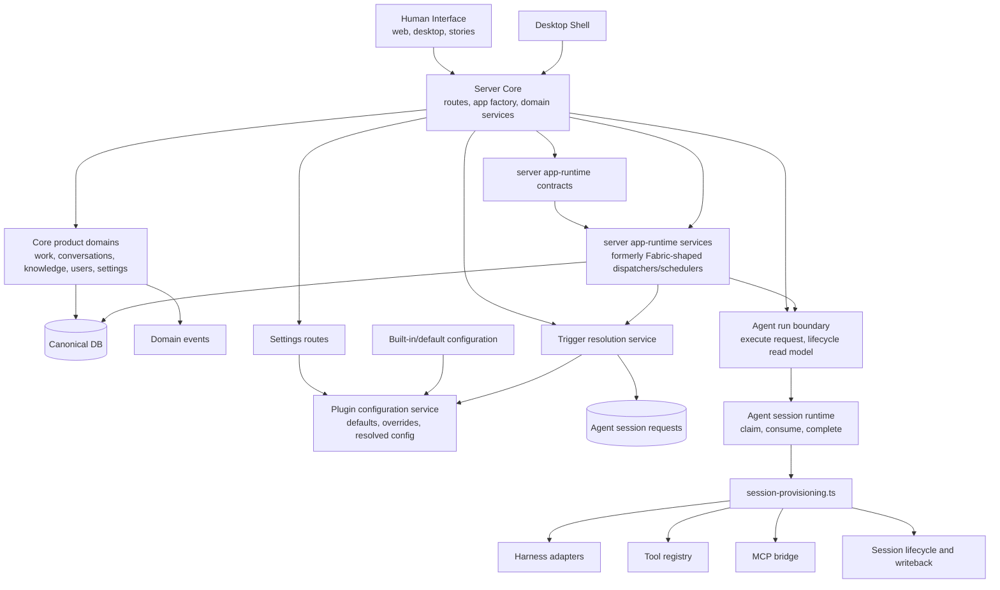
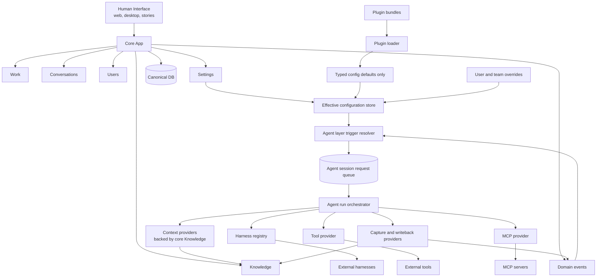

# Runtime Simplification Dependency Graph: As-Is vs As-Should

Baseline: `origin/main` at `1300b56f` (`Implement AU4 trigger resolution path (#416)`).

Update: AU6 rework checked against `feat/AU6-agent-execution-boundary` at `4a11aa45`
(`chore: attest AU6 boundary closure`, PR #419). AU6-owned agent execution boundary gaps
are marked separately below from the remaining Strategy/Fabric retirement gaps.

Update: AU7 was sent back through the pipeline after review found the cleanup requirement gap.
The corrected AU7 scope now deletes the live Strategy/Fabric source packages and seam files:
`packages/fabric`, `packages/strategy-minimal`, `packages/shared/src/strategy-port.ts`, and
`packages/server/src/services/strategy-registry.ts`. Server/eval runtime code uses server
app-runtime contracts, and lint now blocks runtime imports/registration of Fabric, minimal
Strategy, Strategy port, active Strategy APIs, and the deleted live paths returning. Durable
historical `strategy`/`fabric` names remain only where old records need to be readable.

Companion target document: `plans/strategy-kernel-plugin-split/as-should-dependency-graph.md`.

This file compares the current runtime dependency graph against the target dependency graph. It is intentionally dependency-focused: it tracks ownership and call direction, not every API route or DB table.

## Executive Summary

The AU7 runtime-retirement target is now reached for the workpackage: Strategy/Fabric are gone
from production runtime and from live workspace source/test fixtures. The full target graph is
not yet proven because AU8 still needs to enforce the complete dependency boundary, but AU8 is
now a guard/boundary-hardening workpackage, not the place where Strategy/Fabric source deletion
is deferred.

Important target pieces are already present:

- `AgentSessionRequest` is now a real runtime primitive.
- Trigger-backed request creation exists in `packages/server/src/services/trigger-resolution.ts`.
- `packages/server/src/services/agent-run-boundary.ts` is the named execution boundary:
  request execution flows through `executeAgentRunRequest`, while lifecycle reads use
  `getAgentRunLifecycle` / `listAgentRunLifecycleBySource`.
- Server/app-runtime, routine, decomposition, and session route callers no
  longer resolve a production request consumer from the legacy registry.
- Plugin/default configuration resolution exists in `packages/server/src/services/plugin-configuration.ts`.
- `scripts/au6-agent-boundary-guard.ts` is wired into `npm run lint` and fails when
  production server/Fabric code imports `agent-session-runtime`, resolves request consumers
  from the registry, uses the legacy `provisionSession` registry hook, or reintroduces local
  `consumeAgentSessionRequest` naming outside the boundary.
- Settings has a current story entry at `packages/web/src/pages/SettingsPage.stories.tsx`.
- `packages/server/src/app-runtime/contracts.ts` owns the runtime contracts production server
  code uses instead of the legacy Strategy port.
- `@hyperidle/server/app-runtime` is exported for runtime/eval callers.
- Eval scenarios that used to import Fabric runtime types now import server app-runtime.
- `scripts/au7-runtime-retirement-guard.ts` is wired into `npm run lint` and blocks production
  runtime use of `@hyperidle/fabric`, `@hyperidle/strategy-minimal`, Strategy registry, Strategy
  port, Fabric bootstrap, minimal Strategy fallback, and the retired source paths returning.

The remaining structural gap is no longer deletion of Strategy/Fabric source. The remaining AU
work is enforcement: Core app, Agent layer, and plugin/default configuration are not yet fully
mechanically enforced as separate dependency boundaries. AU6 and AU7 added targeted guards; AU8
still needs the full should-graph guard.
- Core app, Agent layer, and plugin/default configuration are not yet fully mechanically enforced
  as separate dependency boundaries. AU6 and AU7 added targeted guards; AU8 still needs the full
  should-graph guard. AU8 does not delete remaining legacy Strategy/Fabric source.

## Side-by-Side Shape

| Area | As-is graph | As-should graph |
| --- | --- | --- |
| Runtime center | Server owns routes plus provisioning, request runtime, trigger resolution, plugin config, app-runtime contracts, and app-runtime services. Legacy Fabric package dependency is gone. | Core app owns product records/events/settings. Agent layer owns every LLM-capable run. Plugins only seed defaults. |
| Strategy | Strategy port/registry files and Fabric/minimal implementations are deleted from the live source graph. Production runtime no longer imports/registers/selects active Strategy. | No Strategy port, no active Strategy singleton, no Strategy implementations. |
| Fabric | `packages/fabric` is deleted from the live source graph. Former Fabric behavior lives in server app-runtime/core/agent services, with durable historical names preserved only for old records. | No Fabric runtime package. Former Fabric responsibilities redistributed to Core app, Agent layer, or plugin defaults. |
| Agent runs | Trigger-backed `AgentSessionRequest` exists and AU6 introduced a named agent-run boundary. Production request consumption is guarded behind `agent-run-boundary.ts`; provisioning remains the central internal orchestrator. | All LLM runs enter via trigger resolver -> session request queue -> agent run orchestrator. |
| Configuration | Plugin configuration resolver exists with defaults, overrides, and resolved views. Built-in/default projection is partial. | Plugins seed typed config defaults. User/team overrides win. Config resolver produces the effective runtime view. |
| Knowledge | Knowledge routes and projections exist in server; Fabric knowledge/context services remain. | Knowledge CRUD, scoring, search, and projections are core app Knowledge. Agent context/writeback are Agent layer providers backed by core Knowledge. |
| Boundary enforcement | AU6 guard enforces request-consumption ownership. AU7 guard enforces Strategy/Fabric runtime retirement. No global static dependency guard yet for all core/plugin/agent-layer target rules. | Mechanical lint/type/package boundaries prevent forbidden imports and ownership leaks. |

## As-Is Graph

## As-Should Graph

## Current Evidence

| Current edge | Evidence |
| --- | --- |
| Legacy Strategy port deleted | `packages/shared/src/strategy-port.ts` removed from live source graph |
| Legacy Strategy registry deleted | `packages/server/src/services/strategy-registry.ts` removed from live source graph |
| Legacy Fabric package deleted | `packages/fabric` removed from live source graph |
| Legacy minimal Strategy package deleted | `packages/strategy-minimal` removed from live source graph |
| Server app-runtime contracts exist | `packages/server/src/app-runtime/contracts.ts` |
| Server app-runtime export exists | `packages/server/package.json` exports `./app-runtime` |
| Agent run boundary exists | `packages/server/src/services/agent-run-boundary.ts` |
| AU6 request-consumption guard exists | `scripts/au6-agent-boundary-guard.ts`, `package.json` `lint` script |
| AU7 runtime-retirement guard exists | `scripts/au7-runtime-retirement-guard.ts`, `package.json` `lint` script |
| Server bootstrap no longer registers production request/provision consumer hooks | `packages/server/src/server-factory.ts` |
| Trigger-backed request creation exists | `packages/server/src/services/trigger-resolution.ts` |
| Agent request queue/runtime exists | `packages/server/src/services/agent-session-requests.ts`, `packages/server/src/services/agent-session-runtime.ts` |
| Provisioning remains central | `packages/server/src/services/session-provisioning.ts` |
| Plugin configuration resolution exists | `packages/server/src/services/plugin-configuration.ts` |
| App-runtime dispatch uses boundary handoff | `packages/server/src/app-runtime/services/task-dispatcher.ts` |
| App-runtime routine scheduling uses boundary handoff | `packages/server/src/app-runtime/services/routine-scheduler.ts` |
| Core/server knowledge exists | `packages/server/src/routes/knowledge.ts`, `packages/server/src/services/knowledge/projections.ts` |
| Eval runtime imports use app-runtime contracts | `packages/eval/src/scenarios/builtin-routines.ts`, `packages/eval/src/scenarios/delegation.ts`, `packages/eval/src/scenarios/routine-sessions.ts`, `packages/eval/src/scenarios/skill-autonomy.ts` |
| Settings story exists | `packages/web/src/pages/SettingsPage.stories.tsx` |

## Detailed Comparison

### Core App

| Responsibility | As-is | As-should |
| --- | --- | --- |
| Work records | Core server routes/services own much of this. App-runtime dispatchers still exist, but AU6 moved request execution through the agent-run boundary and AU7 removed Strategy/Fabric ownership. | Core owns records and emits events only. |
| Conversations | Server routes/services own records and assistant turn entry points. Assistant turn creates trigger-backed requests and executes them through the agent-run boundary. | Conversation domain records user intent and emits events; Agent layer owns the LLM run. |
| Knowledge | Core routes/projections exist. Former Fabric knowledge/context behavior is reachable through server app-runtime/core/agent services. | Core Knowledge owns CRUD, search, scoring, projections, and visibility. |
| Settings | Settings routes plus plugin configuration service exist. Surface completeness depends on the AU5 branch/merge state. | Settings edits user/team overrides; resolver merges overrides with plugin defaults. |
| Domain events | Present. Several direct route/service entry points still create requests for current behavior, but request execution is behind the AU6 boundary. AU8/follow-up work must decide whether remaining direct request creation is acceptable or should become event-only. | Sole handoff from core domains into Agent layer triggers. |

### Agent Layer

| Responsibility | As-is | As-should |
| --- | --- | --- |
| Trigger resolution | Exists in server service and reads resolved configuration. | Lives inside Agent layer and is the only event-to-run decision point. |
| Request queue | `AgentSessionRequest` create/claim/consume exists. AU6 puts production consumption behind `executeAgentRunRequest`. | Queue is the stable boundary between core events and execution. |
| Run orchestration | `executeAgentRunRequest` is the domain-facing boundary; `consumeAgentSessionRequest` and `provisionSession` remain internal implementation details. | Agent run orchestrator owns lifecycle, harness, context, tools, MCP, capture, and writeback. |
| Context | Split across server `agent-context` and app-runtime/core services. | Context providers are Agent layer adapters backed by Core Knowledge. |
| Tools/MCP | Server provisioning builds tool registry and MCP wiring. | Agent layer exposes tool/MCP providers; core does not import execution adapters. |
| Capture/writeback | Split across session lifecycle, provisioning, Fabric/context services, and domain-specific code. | Agent layer writes captured artifacts back through core-owned stores/events. |

### Plugin And Configuration

| Responsibility | As-is | As-should |
| --- | --- | --- |
| Defaults | Default/configuration records exist, but plugin bundle ownership is partial. | Plugins seed typed defaults only. |
| Overrides | Plugin configuration service supports user/team overrides and resolved config. | Same concept, but enforced as the only editable runtime configuration path. |
| Runtime behavior | Production runtime no longer registers Strategy or imports Fabric/minimal Strategy; legacy packages/files are deleted from the live source graph. | Effective config feeds Agent layer trigger/orchestration decisions directly. |
| Plugin isolation | Not mechanically enforced as target architecture. | Plugins cannot subscribe to the event bus, invoke harnesses, or mutate core records directly. |

## Gap Register

These gaps should be registered as follow-up work if not already represented by later AU work packages.

1. Finish defining and enforcing the Agent layer boundary beyond AU6 request consumption.
   - AU6 closed the production request-consumption gap: non-boundary imports of
     `agent-session-runtime`, registry consumer resolution, legacy `provisionSession` registry
     hooks, and local `consumeAgentSessionRequest` variables are guarded by lint.
   - Remaining AU8/follow-up work: place trigger resolution, provisioning/orchestration, harness
     registry, tools, MCP, context, and capture/writeback under one owned layer and prevent
     core routes/domains from importing those execution adapters directly.

2. Decide and enforce the final event-only handoff rule.
   - AU6 ensures direct request execution goes through the agent-run boundary.
   - Remaining gap: some current route/service flows still create requests directly for
     behavior such as manual session/routine/decomposition paths. If the final should graph
     requires domain events as the only request creation handoff, AU7/AU8 must encode that
     explicitly; AU6 was responsible for execution ownership, and AU7 was responsible for
     Strategy/Fabric runtime retirement.

3. Finish plugin bundle/default projection.
   - Make built-in behavior seed typed defaults through plugin manifests/bundles.
   - Keep user/team overrides above defaults.
   - Add boundary checks so plugins cannot become runtime actors.

4. Add mechanical dependency checks.
   - AU7 already forbids runtime imports of `@hyperidle/fabric` and `@hyperidle/strategy-minimal`.
   - AU7 already forbids production runtime imports of `strategy-port` and Strategy registry.
   - Forbid Core App imports from harness/tool/MCP execution internals.

5. Reconcile AU5 status into mainline.
   - If AU5 is not merged into the baseline branch, merge or rebase the Settings Agent behavior surface before claiming the configuration surface is complete.
   - Keep the story/viewer entry current so the settings surface can be visually inspected.

## AU7 Completion Check

| AU7 requirement | Status | Notes |
| --- | --- | --- |
| Production server boot succeeds without registering/selecting a Strategy | Complete | Production runtime no longer imports/registers/selects active Strategy; AU7 guard blocks reintroduction. |
| Runtime package dependencies no longer include `@hyperidle/fabric` or `@hyperidle/strategy-minimal` | Complete | Runtime roots and workspace package graph no longer depend on either package. |
| Former Fabric service behavior reachable through server app-runtime and core/agent services | Complete for AU7 surface | Runtime contracts live in `packages/server/src/app-runtime/contracts.ts`; server/eval callers use app-runtime instead of Fabric runtime types. |
| Agent-capable behavior continues through AU6 request/runtime boundary | Complete | AU6 boundary remains the execution handoff; AU7 updated the AU6 guard to stop treating Fabric as production runtime. |
| Durable rows with historical `strategy`/`fabric` names remain readable | Complete | AU7 does not rename historical schema/table vocabulary. This is intentional compatibility, not active runtime architecture. |
| Docs describe Fabric and Strategy only as legacy compatibility | Complete | Runtime simplification and system overview docs were updated in AU7. |
| Full as-should dependency tree mechanically enforced | Not an AU7 requirement | AU8 needs the full graph guard after AU7 deletion is complete. |

## Requirement Resolution

Track AU says AU7 owns Strategy/Fabric runtime retirement and AU8 explicitly excludes removing
remaining Strategy/Fabric code. Review clarified that "retirement" means a completely clean live
source graph, not only production-runtime removal. AU7 requirements were corrected to match that
definition.

Under the corrected definition, AU7 deletes `packages/fabric`, `packages/strategy-minimal`,
`packages/shared/src/strategy-port.ts`, and `packages/server/src/services/strategy-registry.ts`
from the live source graph. AU7 also hardens lint so those paths and runtime imports cannot return.
Durable historical table/field names remain readable as compatibility data, not active runtime
architecture.

## Bottom Line

The current graph is still transitional, but AU6 and AU7 closed their scoped gaps:
production request consumption is behind `agent-run-boundary.ts`, and production runtime no
longer needs Strategy/Fabric to boot or run. AU7 also removes the legacy Strategy/Fabric source
packages and seam files from the live workspace graph.

Remaining gaps are no longer AU7 blockers. They split into AU8 enforcement and later graph-policy
decisions:

- AU8: enforce the full should graph, including Strategy/Fabric bans, core-to-agent-layer import
  bans, plugin-as-runtime bans, and agent-layer-owning-core-CRUD bans;
- follow-up: decide whether the final graph requires all request creation to be domain-event-only, then
  add the corresponding guard if so.

AU7 is complete under the corrected "completely clean repo" requirement for this workpackage.
The target dependency tree is fully proved only after AU8 adds the broader mechanical graph guard.
