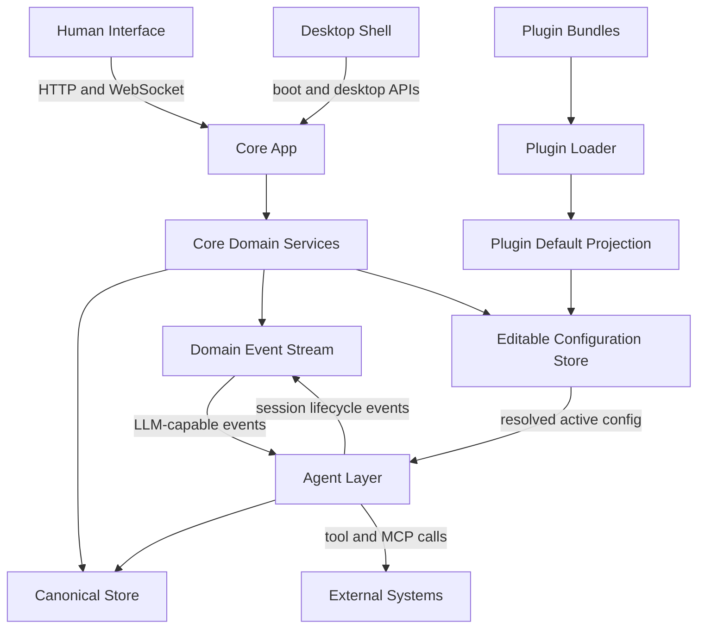
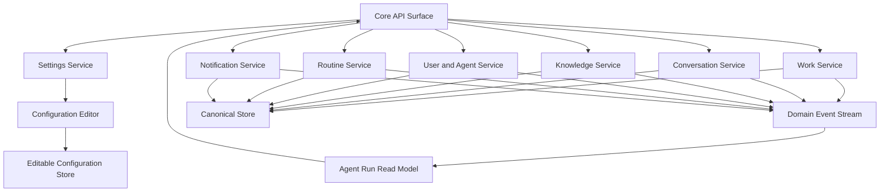
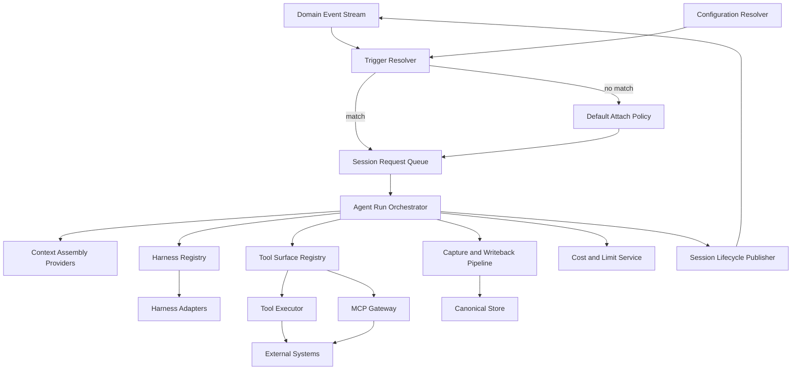
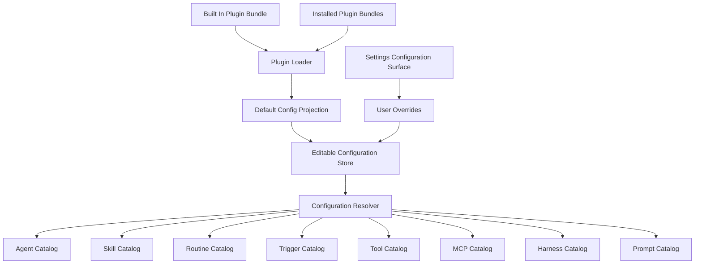
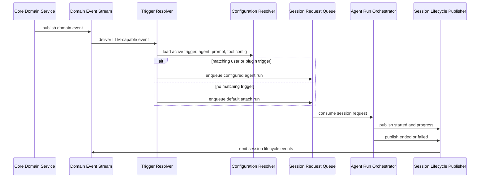

# Runtime Simplification: As-Should Dependency Graph

> **SUPERSEDED (2026-08-02) — this target has been reached AND surpassed.** This document
> hypothesizes a two-owner model ("Core App" / "Agent Layer" as folders inside one
> `packages/server`). AU19 replaced that target with a package-per-Layer model (`core-ui`,
> `core-api`, `agent-orchestration`, `agent-execution` as real npm workspaces), and AU20/AU21 built
> the concrete seam/guard/baked-request mechanisms this document only gestures at as "mechanical
> lint/type/package boundaries." See `docs/architecture/runtime-simplification.md` and
> `plans/AU19/architecture.md` for the current target; `.pipeline/work/AU21/architecture.md` for the
> `core-api ↔ agent-orchestration` boundary's actual, shipped design. Preserved below as historical
> record of the AU2-AU11 target, not current.

Purpose: hypothesize the target dependency graph after AU2-AU5. This is not current code. It is the intended component shape after removing Strategy and Fabric as runtime concepts.

## Target Rules

- Core app owns Work, Conversation, Knowledge, Users, Settings, durable records, domain events, and editable configuration.
- Agent layer owns every LLM-capable run: trigger resolution, session requests, provisioning, harness execution, tools, MCP, context, capture, decomposition, and lifecycle events.
- Plugins are configuration sources. They seed agents, skills, routines, triggers, tools, MCP servers, harness descriptors, and prompts into editable app configuration.
- User-owned configuration wins over plugin defaults.
- No Strategy port, Active Strategy singleton, Fabric bootstrap, Fabric runtime package, or Fabric service layer remains.
- Former Fabric behavior is redistributed:
  - Knowledge CRUD, scoring, search, projections: core app Knowledge services.
  - Context assembly and writeback: agent layer context/capture providers backed by core Knowledge.
  - Task dispatch, routine scheduling, assistant turns, decomposition: trigger-driven agent-layer requests.
  - Built-in routines, tools, MCP defaults, harness descriptors: built-in plugin defaults.

## Layer Interaction Graph

Layer contract:

- Human Interface and Desktop talk only to Core App APIs.
- Core App owns records and emits domain events; it does not provision sessions.
- Agent Layer consumes events plus active configuration; it does not own Work, Conversation, Knowledge, Users, or Settings.
- Plugins only flow into configuration. They do not subscribe directly to domain events or call harnesses outside the Agent Layer.

## Core App Graph

Core app components that should exist:

| Component | Responsibility | Must not own |
|---|---|---|
| Work Service | Bets, tasks, task state, artifacts, work events | Harness calls, agent prompt choice |
| Conversation Service | Threads, messages, assistant-visible events | Assistant provisioning |
| Knowledge Service | Knowledge CRUD, search, curation, scoring, projections | Separate Fabric runtime |
| User and Agent Service | Humans and agents as users, agent identity/config records | Hidden strategy roster logic |
| Settings Service | Surfaces editable configuration | Plugin execution |
| Routine Service | Routine records, schedules, run history, due events | Direct LLM calls |
| Notification Service | Notification queue, delivery state, preferences | Agent selection |
| Configuration Editor | Applies user edits to plugin-seeded/default config | Runtime execution |
| Agent Run Read Model | Projects session lifecycle for UI/API reads | Session orchestration |

## Agent Layer Graph

Agent layer components that should exist:

| Component | Responsibility | Inputs |
|---|---|---|
| Configuration Resolver | Combines built-in defaults, plugin defaults, and user overrides into active config | Editable config store |
| Trigger Resolver | Maps domain events to agent run requests | Domain event, active triggers |
| Default Attach Policy | Fallback when no trigger matches | Event scope, eligible agents |
| Session Request Queue | Durable request boundary for all agent runs | Trigger resolution |
| Agent Run Orchestrator | Owns admission, provisioning, run supervision, teardown | Session request |
| Context Assembly Providers | Build run context from core app records | Knowledge, Work, Conversation, plugin defaults |
| Harness Registry | Resolves available harness descriptors and adapters | Built-in and plugin config |
| Tool Surface Registry | Resolves which tools and MCP servers the run may use | Trigger, agent, skill, plugin config |
| Tool Executor | Invokes registered app tools with audit and policy | Tool calls |
| MCP Gateway | Bridges harness MCP calls to approved servers/tools | MCP descriptors |
| Capture and Writeback Pipeline | Captures run output into Knowledge, Work, Conversation, artifacts | Session output |
| Cost and Limit Service | Meters and blocks runs by configured caps | Session request, usage |
| Session Lifecycle Publisher | Emits started, streamed, ended, failed, captured events | Orchestrator state |

## Configuration And Plugin Graph

Configuration catalogs that should exist:

| Catalog | Contains | Used by |
|---|---|---|
| Agent Catalog | Agent templates, active agent records, default eligibility rules | Trigger Resolver, Default Attach Policy, User Service |
| Skill Catalog | Skill definitions and agent-skill grants | Tool Surface Registry, Settings |
| Routine Catalog | Routine templates, routine records, handler bindings | Routine Service, Trigger Resolver |
| Trigger Catalog | Event matchers, agent bindings, prompt bindings, action bindings | Trigger Resolver |
| Tool Catalog | Core and plugin tool definitions | Tool Surface Registry, Tool Executor |
| MCP Catalog | MCP server descriptors and connection requirements | MCP Gateway, Settings |
| Harness Catalog | Harness descriptors, adapter capabilities, model defaults | Agent Run Orchestrator |
| Prompt Catalog | Prompt templates and prompt overrides | Trigger Resolver, Context Assembly Providers |

Resolution rule:

1. Built-in defaults load first.
2. Plugin defaults layer on top by plugin order.
3. User overrides win over every default.
4. Disabled plugin origins become explicit inactive origins, not silent deletes.
5. Active config is queryable before a run starts and after a run completes.

## Trigger Flow Graph

Triggerable event families that should exist:

| Event family | Default attach behavior | Override can supply |
|---|---|---|
| Conversation message appended | Default assistant agent, no event-specific prompt | Assistant agent, prompt, tool surface |
| Task accepted or ready | Task owner or default eligible team agent, no event-specific prompt | Agent, task prompt, context providers, tool surface |
| Bet ready for decomposition | Default eligible decomposer, no event-specific prompt | Decomposer agent, decomposition prompt, decomposition handler |
| Routine due or fired | Routine owner or default eligible agent | Routine handler, agent, prompt, tools |
| Knowledge action requested | Default eligible knowledge-capable agent | Agent, knowledge prompt, context providers |
| Proposed call granted | Same agent/run lineage by default | Re-engagement agent, grant prompt, constrained tool surface |

## Removed Components

These components should not exist after the migration:

- Active Strategy Registry
- Strategy Contract
- Fabric Strategy Adapter
- Fabric Bootstrapper
- Fabric Export Surface as a runtime dependency
- Minimal Strategy package as a product concept
- Direct domain-to-provisionSession call sites
- Direct domain-to-harness call sites
- Hard-coded LLM event subscribers that choose agents/prompts outside Trigger Resolver
- Fabric-named user-facing concepts

## Boundary Checks

These mechanical checks should fail if the target graph regresses:

- Core app modules must not import harness adapters directly.
- Core app modules must not import plugin implementation internals.
- Agent layer modules must not own Work, Conversation, Knowledge, Users, or Settings CRUD.
- Plugins must not subscribe directly to the domain event stream.
- Plugins must not call harness adapters directly.
- No runtime code imports a Fabric package or Strategy package.
- Every LLM-capable domain event has a registered trigger surface or documented default attach path.
- Every agent run has a recorded trigger resolution, including fallback runs.
