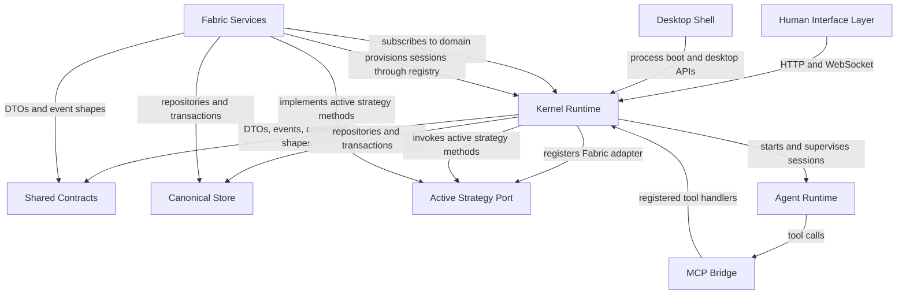
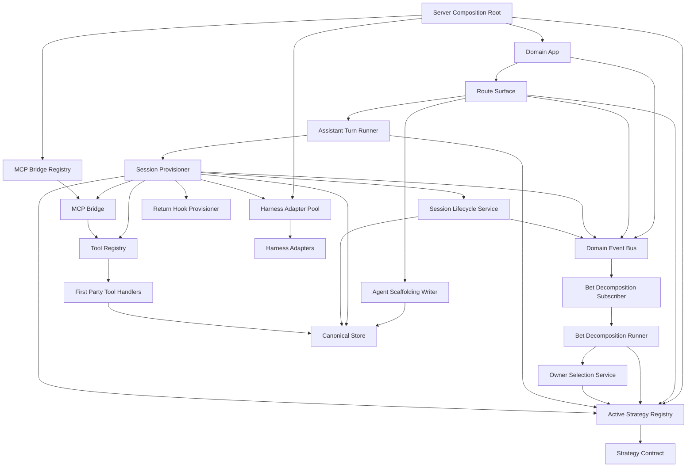

# Strategy Kernel Removal: Code-Traced Dependency Graph

Purpose: map the live code dependencies around the current Strategy/Kernel/Fabric split so the Strategy concept can be removed and replaced by editable plugins + triggers. This file treats docs as historical only; citations point to code.

## Live Shape

The current system has three overlapping extension shapes:

- Strategy port: one active process-wide object selected by `setActiveStrategy(...)`.
- Fabric bootstrap: a bundle of event subscribers, schedulers, and services registered through `strategyBootstrap`.
- Runtime extension points: harness adapters, tool registry, MCP bridge, routines, and service connections.

The desired plugin model should absorb the first two shapes without weakening the third.

## Layer Interaction Graph

Current state only. This graph shows live layer dependencies in code; it does not include the proposed plugin or trigger model.

This graph is the high-level layer picture. The current problem is that Fabric is both a service bundle and the active Strategy implementation.

## Kernel Internal Graph

Kernel owns the execution machinery: routes, session admission/teardown, events, tool invocation, MCP transport, harness selection, and persistence writes. The current Strategy singleton is embedded in the kernel graph at every agent-choice or context-choice point.

## Fabric Internal Graph

```mermaid
flowchart TD
  FabricExportSurface["Fabric Export Surface"]
  FabricStrategyAdapter["Fabric Strategy Adapter"]
  FabricBootstrapper["Fabric Bootstrapper"]
  ContextAssembler["Context Assembly Service"]
  LearningWatcher["Learning Ingestion Watcher"]
  AgentRosterComposer["Agent Roster Composer"]
  AgentSelectionService["Agent Selection Service"]
  TaskDispatcher["Task Dispatcher"]
  ProvisionRegistry["Provision Session Registry"]
  RoutineScheduler["Routine Scheduler"]
  BuiltInRoutineHandlers["Built In Routine Handlers"]
  NotificationServices["Notification Services"]
  KnowledgeServices["Knowledge Services"]
  LifecyclePropagator["Lifecycle Propagation Service"]
  SessionReviewCreator["Session Review Creator"]
  PolicyEngine["Policy Engine"]
  GitExportService["Git Export Service"]
  CanonicalStore["Canonical Store"]
  DomainEvents["Domain Event Bus"]
  KernelProvisioner["Kernel Session Provisioner"]

  FabricExportSurface --> FabricStrategyAdapter
  FabricExportSurface --> FabricBootstrapper
  FabricExportSurface --> TaskDispatcher
  FabricExportSurface --> RoutineScheduler
  FabricExportSurface --> NotificationServices
  FabricExportSurface --> KnowledgeServices
  FabricExportSurface --> GitExportService
  FabricExportSurface --> PolicyEngine
  FabricStrategyAdapter --> ContextAssembler
  FabricStrategyAdapter --> LearningWatcher
  FabricStrategyAdapter --> AgentRosterComposer
  FabricStrategyAdapter --> AgentSelectionService
  FabricBootstrapper --> LifecyclePropagator
  FabricBootstrapper --> SessionReviewCreator
  FabricBootstrapper --> TaskDispatcher
  FabricBootstrapper --> RoutineScheduler
  FabricBootstrapper --> NotificationServices
  FabricBootstrapper --> DomainEvents
  TaskDispatcher --> ProvisionRegistry
  ProvisionRegistry --> KernelProvisioner
  TaskDispatcher --> CanonicalStore
  TaskDispatcher --> DomainEvents
  RoutineScheduler --> BuiltInRoutineHandlers
  RoutineScheduler --> AgentSelectionService
  RoutineScheduler --> CanonicalStore
  BuiltInRoutineHandlers --> CanonicalStore
  NotificationServices --> CanonicalStore
  NotificationServices --> DomainEvents
  ContextAssembler --> CanonicalStore
  LearningWatcher --> CanonicalStore
  AgentRosterComposer --> CanonicalStore
  AgentSelectionService --> CanonicalStore
  LifecyclePropagator --> CanonicalStore
  SessionReviewCreator --> CanonicalStore
  KnowledgeServices --> CanonicalStore
  GitExportService --> CanonicalStore
  PolicyEngine --> CanonicalStore
```

Fabric currently owns two different kinds of things:

- Strategy-like behavior: context assembly, ingestion, roster, selection, assistant/decomposition choices.
- Service-bundle behavior: schedulers, subscribers, notifications, scoring, propagation, git export, task dispatch.

Those should not stay under one Strategy concept. Candidate ownership is covered in the companion inventory.

## Current LLM-Capable Surfaces

Current code has no trigger abstraction. These are the places where an LLM-capable session or Strategy delegation can start today.

| Current component | Current strategy involvement | Current event or user action |
|---|---|---|
| Agent Scaffolding Writer | `scaffoldAgents` | Team, persona, role, or project creation |
| Assistant Turn Runner | `formAssistant` then `provisionSession` | User posts thread message |
| Bet Decomposition Runner | `decomposeBet` | `work_decompose_requested` or bet created |
| Owner Selection Service | `selectAgent` | `work_selection_requested` |
| Session Provisioner | `assembleContext` | Any harness session start |
| Session Provisioner | `beginLearningIngestion` | Any harness session start |
| Task Dispatcher | indirect `provisionSession` | `task.created` or `task.updated` |
| Routine Scheduler | no Strategy port | due routine tick |
| Session Review Creator | no Strategy port | session lifecycle event |
| Lifecycle Propagation Service | no Strategy port | domain lifecycle event |

## Target Trigger Semantics Note

Design input for later split, not represented in the as-is diagrams above:

- Every event that can cause an LLM call should become a trigger surface.
- Without a user/plugin trigger, runtime should attach the default eligible agent with no event-specific prompt.
- A user/plugin trigger should override that default by binding a specific agent and prompt to the event.

## Direct Fabric Imports From Server

These are live package dependencies that remain even if the Strategy port is removed. They must be classified before the plugin split:

| Server file | Fabric import role | Split implication |
|---|---|---|
| `server-factory.ts` | `bootstrapFabric`, `fabricStrategy`, `createGitRunner`, `setProvisionSessionFn` | Composition root currently wires Fabric as default Strategy and service bundle. |
| `app.ts` | notification adapter factory, assistant dispatcher | Fabric still owns some app event subscribers and route helpers. |
| `session-provisioning.ts` | cost/session-context/prompt helpers from Fabric | Runtime still depends on Fabric utilities outside Strategy. |
| `session-lifecycle.ts` | cost dedup release | Runtime teardown depends on Fabric cost module. |
| `bet-decomposition.ts` | cost cap check | Core execution path imports Fabric cost service. |
| `routes/knowledge.ts` | `scopeToLayer` and fabric table writes | Knowledge route writes Fabric projection inline. |
| `routes/routines-routes.ts`, `tools/create-routine.ts` | cron parser/next match | Routine editing uses Fabric scheduler helpers. |
| `tools/query-practice.ts`, `tools/write-memory.ts`, `tools/promote-knowledge.ts`, `tools/score-attention.ts`, `tools/route-item.ts`, `tools/create-item.ts` | knowledge/fabric tools | First-party tools are coupled to Fabric services. |
| `routes/notifications-routes.ts`, `routes/status.ts`, `routes/git-export-routes.ts`, `routes/dispatch-queue-routes.ts` | Fabric service route APIs | App surfaces expose Fabric service internals. |
| filesystem services | git runner/types | Git export/mount logic depends on Fabric helpers. |

Conclusion: "remove Strategy" requires a package/API cleanup, not just renaming `Strategy` to `Plugin`.

## Code Anchors

- Strategy interface: `packages/shared/src/strategy-port.ts`
- Strategy registry: `packages/server/src/services/strategy-registry.ts`
- Production registration: `packages/server/src/server-factory.ts`
- App bootstrap hook: `packages/server/src/app.ts`
- Fabric Strategy adapter: `packages/fabric/src/fabric-strategy.ts`
- Fabric service bootstrap: `packages/fabric/src/bootstrap.ts`
- Minimal Strategy: `packages/strategy-minimal/src/minimal-strategy.ts`
- Session runtime: `packages/server/src/services/session-provisioning.ts`
- Tool registry: `packages/server/src/tools/tool-registry.ts`
- MCP bridge: `packages/server/src/mcp/mcp-bridge.ts`
- Routine scheduler: `packages/fabric/src/services/routine-scheduler.ts`
- Task dispatcher: `packages/fabric/src/services/task-dispatcher.ts`
- Core schema tables: `packages/db/src/schema.ts`
